# 约翰霍普金斯大学《道德黑客入门｜Introduction to Ethical Hacking》中英字幕 p08 7_渗透测试方法论.zh_en -BV1xgu1z1Eau_p8-

This lecture discusses many of the important components of penetration testing and then reviews the expected content of the penetration testing report。

You will focus on the penetration testing execution standard approach。

 but I will also review a couple of similar methodologies that one might use。

 P T E S provides a penetration testing methodology that has many more components to it than just the final report。

 The methodology includes one pre engagement interactions with the sponsor during which you lay out the contract and rules of engagement 2 intelligence gathering on the organization to include corporate and personnel intelligence。

3 threat modeling in which you determine the potential threats to business assets and business processes。

4 vulnerability analysis in which you are actually scanning computing assets。

5 exploitation of any vulnerabilities found，6 post exploitation activities and finally 7。

 the reporting。An important idea is that the report is closely coupled to the rest of the methodology。

 and you need to engage the other elements of the methodology before you can write a meaningful and useful pen testing report。

One of the class objectives is to bring all of these pieces together。

The real goal for you is to assemble all the material you collect in various labs into a final report。

 We will be able to do some of the phases of the PT E S methodology， but not all of them。

 because our scenario does not provide a robust corporate environment for social engineering or open source intelligence gathering on the organization。

 In fact， there is no organization。 So in the end， you will need to do a little creative writing and tailor the PT E S report recommendations to those that make sense。

 So the discussion will sometimes focus on our specific ethical hacking lab scenario and sometimes be generic discussing important content that will not be part of your report。

The first sentence on this slide is how Anbretson describes a penetration test。

 It is a reasonable but rather terse definition， as a pen test may have many other attributes。

 as shown in the subbus。 But what we want to focus on for this lecture is the report that is to be provided at the end of the pen test。

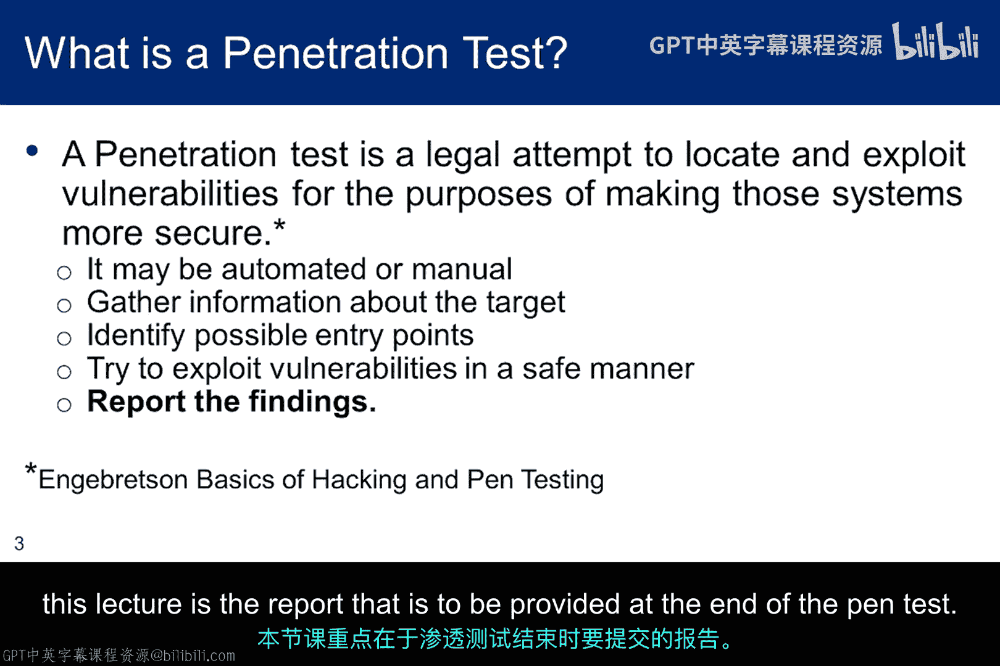

Of course， pen testers would like to find high risk and hard to find problems。

 but the real key in reporting back to the client is to identify risk associated with the current infrastructure and configuration and potential impact to the business。

 If there is no risk， no investment by the client is required。

 But if there is risk that will affect his mission， how can it be mitigated。

 The sponsor needs to understand both the potential mission impact and mitigation recommendations in order to make investment trade off decisions。

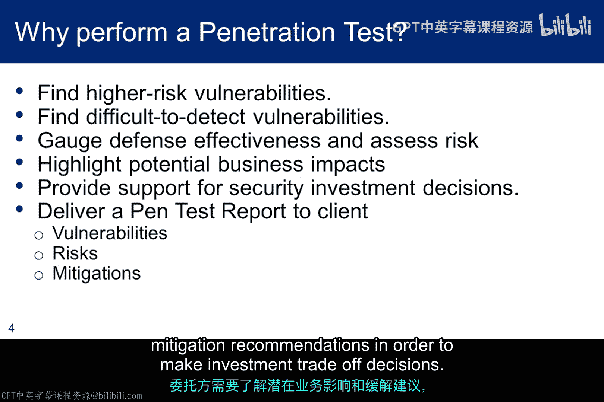

To proceed， you need a clearly defined methodology that can be managed and is repeatable。

 and you definitely need to define boundaries。 Gos， as well as non goalsals。 For example。

 explicitly identify any components that are off limits。 The target attack of 2014。

 started with the attacker stealing the credentials of targets。

 Eachvac vendor is testing vendor interfaces to the enterprise in or out of scope。

 One key is a penetration test should be based on a repeatable methodology。

 A pen test is a security snapshot， and the value of an individual report rapidly decreases over time。

 The words should， in the second bullet tries to address this idea。 Pen tests need to be reported。

 but the words should is used here because there is also a related cost to consider。

 and the client has many other business goals that need investment dollars。 The customers。

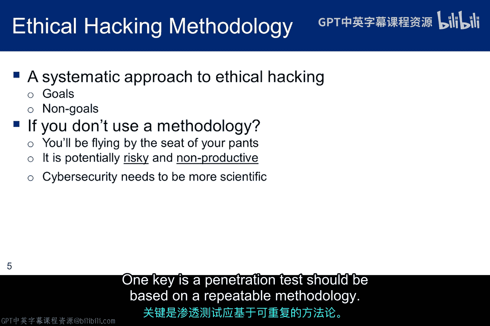

Often think in terms of doing a single scan and then being done with it from a security perspective。

 that is a risky approach。 But for sure， it is cheaper。 However， as soon as a pan test is finished。

 a new vulnerability， Even a zero day may be discovered。 threats evolve and systems evolve。

 So the security mechanisms have to be tested and retested periodically to have any chance of really protecting the enterprise。

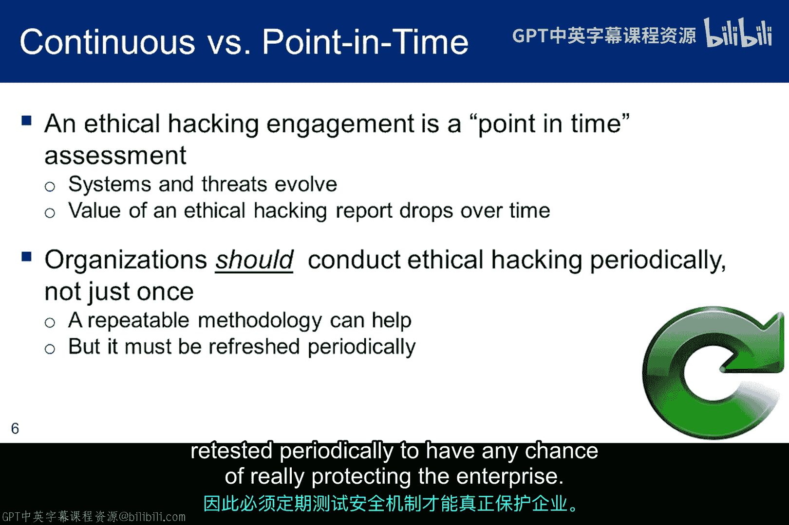

The questions shown here frame the first step in a pen test。

 You need to meet with a client and begin to define the boundaries。

 These are some of the questions that you need to ask in the first meetings to get guidance。

 for the artificial scenario used in class。 We don't have a client to interact with。

 but in your report， you will still want to bound the problem by describing typical answers to these questions。

 There is no right or wrong choice for the report， but it is important that at a minimum。

 you address each of the items identified here， but these are only provided to get you thinking about the problem。

 Try to come up with other items that are important， but may not be on this list。

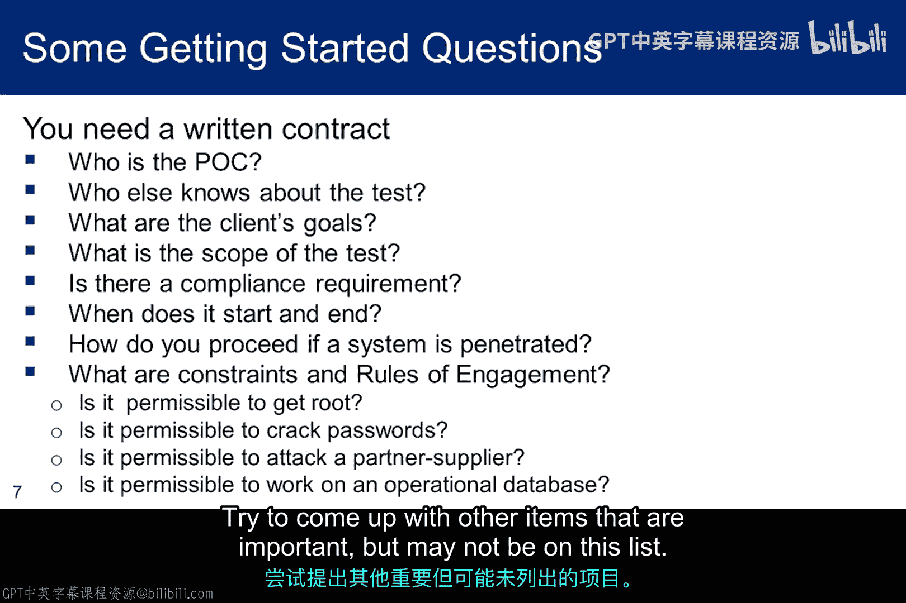

Before you can check compliance， you need to know not only what the organization's policies and procedures are。

 but also what the associated laws and regulations are。

 You need to compare policies and procedures to compliance rules to look for possible issues。

 There may be direct violations of the compliance requirements。

 or there may be gaps for requirements that just aren't addressed at all。

 and checking in compliance requires you to find both。

 The colored boxes here show three elements of the OPM hack in 2015。

 that affected virtually every one with a government clearance。

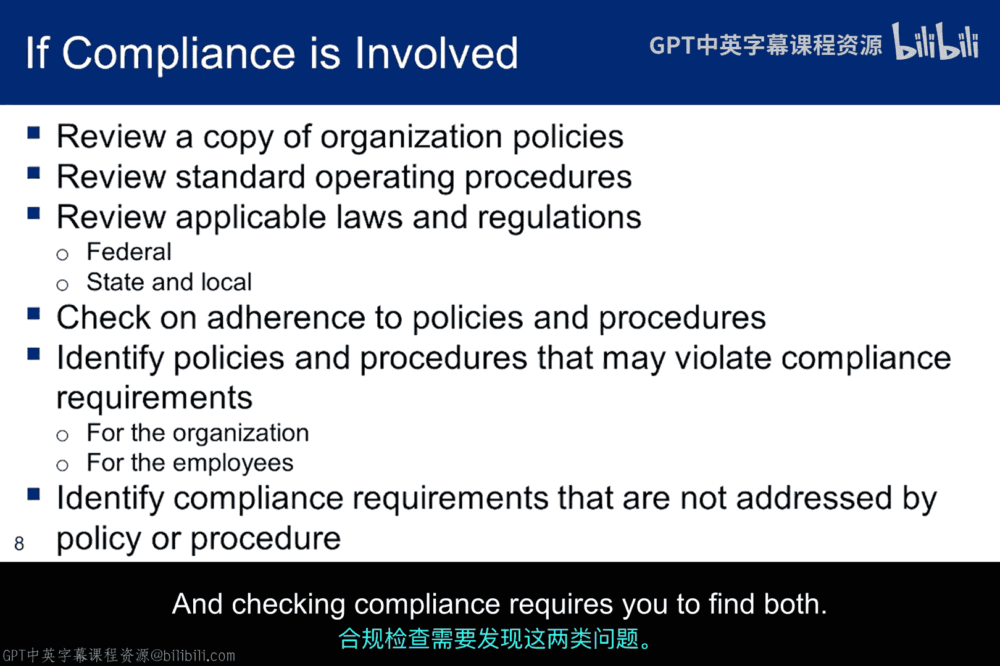

In light gray， you see the first breach in November 2013。 We don't know the attack vector。

 but we do know that it was detected three months later。

 And OPM determined network information had been exfiltrated。 This kind of information is， of course。

 a precursor of future attacks。 OpPM did not disclose their findings for another three months。

 while they worked to determine if P I I had been stolen。 Fortunately， at that time， it had not。

 but unfortunately， OpPM did not increase their defences。In light blue。

 you see attacks on OP contractors。4 breaches were detected， but apparently。

 the significance of these breaches was not reported and or not realized。

 even though the critical breach took place3 to  four months before detection and notification of the contractors having been hacked。

 The main breach was not detected for another 8 to 9 months。

Light green is the main breach that resulted in the Exville of the OPM S F 86 information。

 It was accomplished through disclosure of key point credentials。

 And the really shocking point is that even though both OPM and their contractors had been hacked over the preceding year and a half。

 no significant additional effort was made to look for intruders or protect the OPM infrastructure。

 It was 12 months before it was detected。

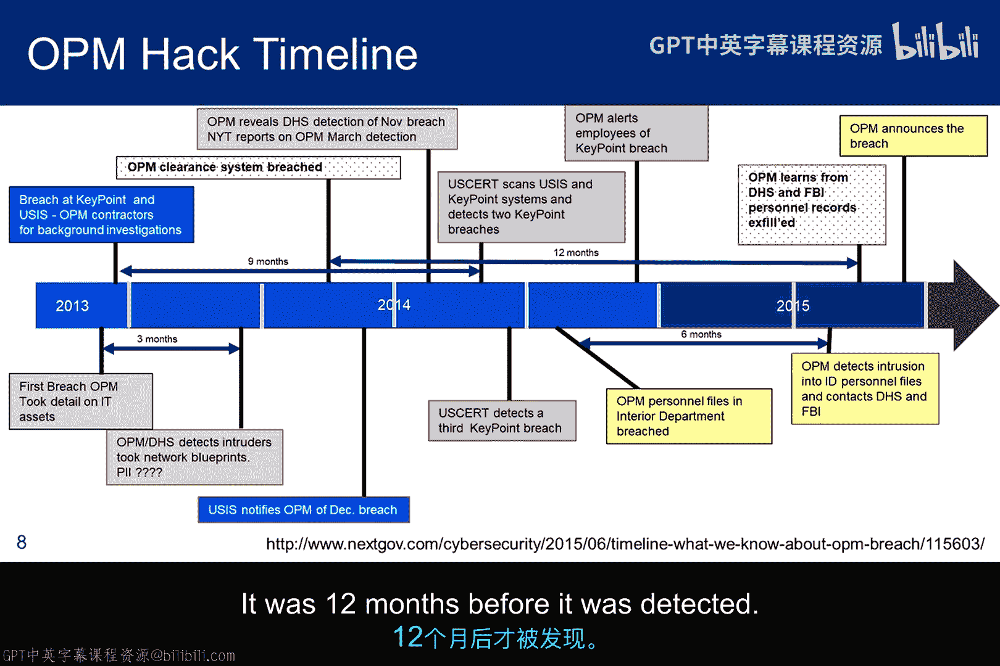

I discussed the OPM incident as a case study for pen testing used to examine compliance。

 How could pen testing have helped with policies， procedures， laws and regulations at OPM。

DHS used an I D S named Einstein to detect some of the breaches。

 They determined the attackers entered with valid credential from key point government solutions。

 A Colorado based contractor that conducts background investigations。

 They also noted that this credential was possibly gained through social engineering using a malicious website。

 OPM tech learning dot org。It was a decoy site set up to trick OPium employees into entering their credentials。

 Compliance testing might have informed OPM that there was an inadequate training on the risks associated with social engineering or clicking on links in unsigned email。

 It would also have found that contractors were using I D password for authentication and twofactor authentication had not been implemented。

 even though the use of a Piv was mandatory as of 2011。

Deefficiencies in contractor or password policy could easily have been detected with a pen test addressing compliance with policy。

Nothing was encrypted。 Did it matter。 How could testing have helped with that For one thing。

 an assessment may have identified the fact that user credentials provide authorized access to the whole database encryptryed or not。

 instead of just the elements rows and tables， the users' need to do their jobs upon log on。

 the whole database would be decrypted。Testing would also have identified the need to protect PI through encryption。

A March 2015 IG report to Congress made OPM deficiencies public information。

Did this report help the attackers， A few quotes from the report。

Persistent deficiencies in OPM's information system security program。

Incomplete security authorization packages， weaknesses in tested of information security controls and inaccurate plans of action and milestones。

None of the agency's 47 major applications require PIV authentication。

Reconnaissance might have LED the pen testers to this same report and made OPM aware of the fact that important information about weaknesses in the security approach was publicly available。

 testing for a compliance should also have revealed that systems were operating without authorities to operate。

 These are documents that approve operation of a system， because security testing has been performed。

 and no deficiencies found。 or any that were found were corrected。

 Getting root is fun for hackers and red team members as well。

 But pen testers really need to focus on the client's mission。

 Which systems are used for what and how critical are they to the organization's mission。

 Maybe they have a website for advertising。 but the mission is a brick and mortar。 for example。

 a car repair business。 That means the website isn't mission critical。 Another example， of course。

 is the CIA， other than recruiting。 the website has very little to do with their。

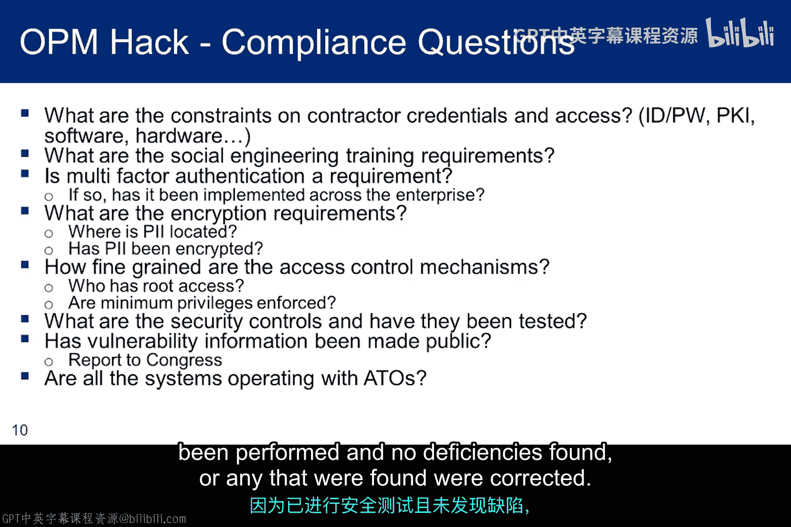

sSo weaknesses in these websites will have minimum impact on the mission。

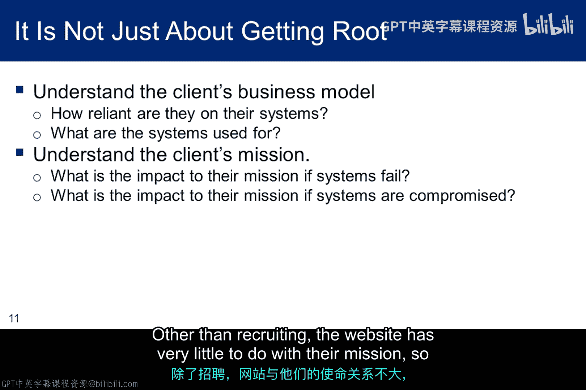

Misp calls all the spoils you collect loot。 It is really a pen tester's treasure。

 You need to collect everything you can and save it so you can refer to it when you write the report。

You will find out that by the end of this course， you will have forgotten the specifics of the first lab and you will leave material out of the report that should be in there。

 The way to avoid that is to capture whatever you can， Or it and arching。 In fact。

 the best approach used by many red teams is to write the pen test report as the test proceeds。

 In other words， you are actually archiving the loot in the report itself。

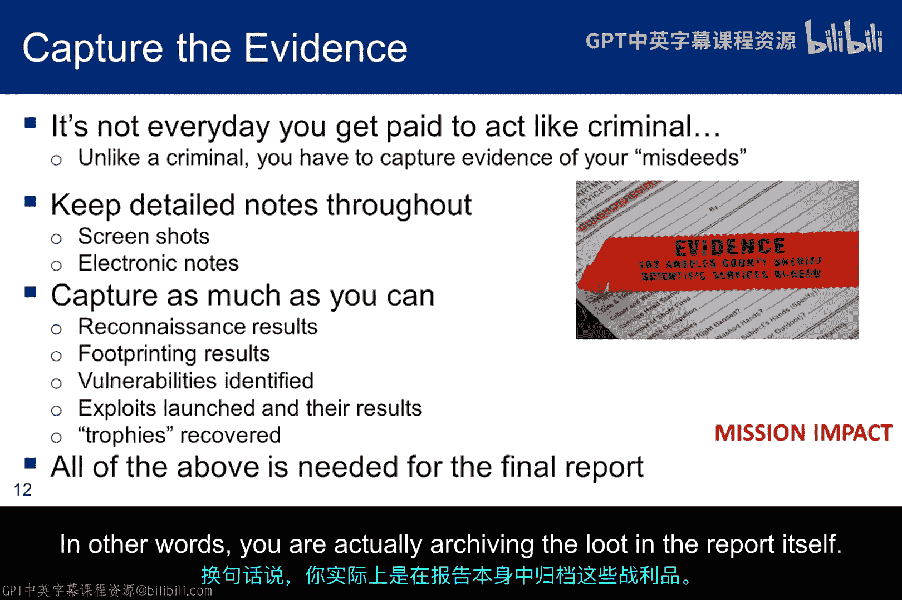

But remember， it's not about getting root。 It's about the mission。

We have finished discussing the concept of a penetration test。

 and we'll talk about ethical hacking methodologies next。

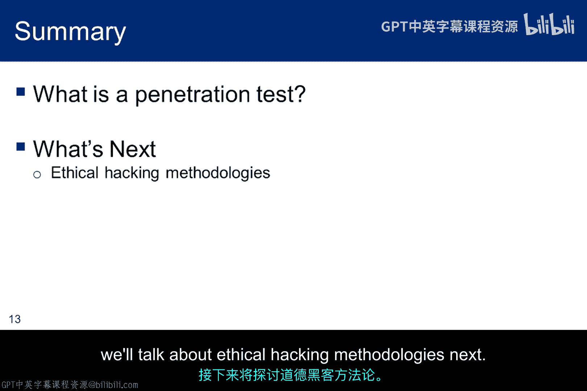