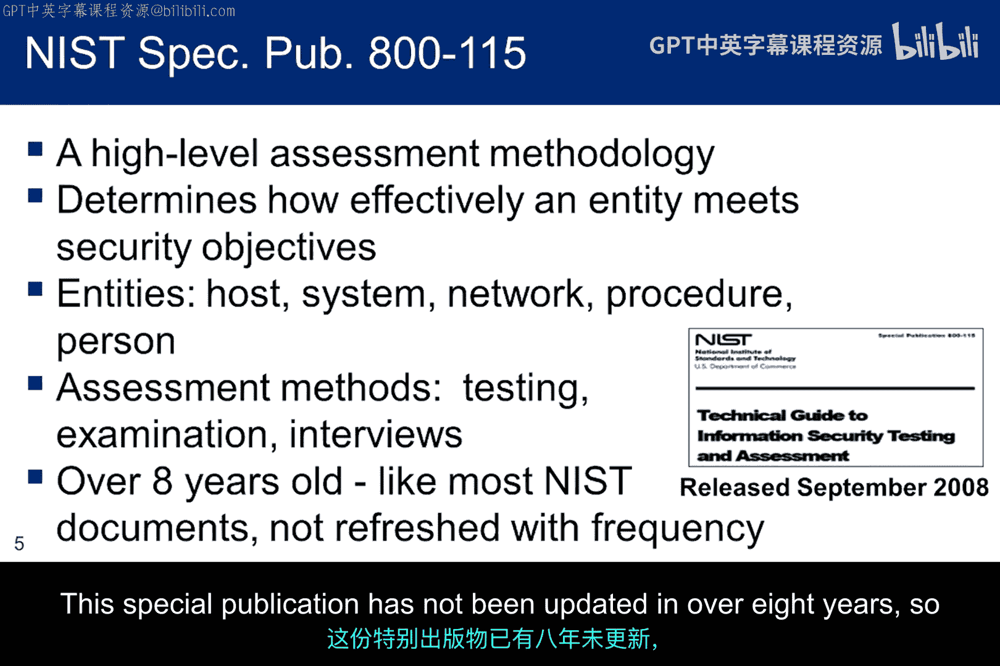
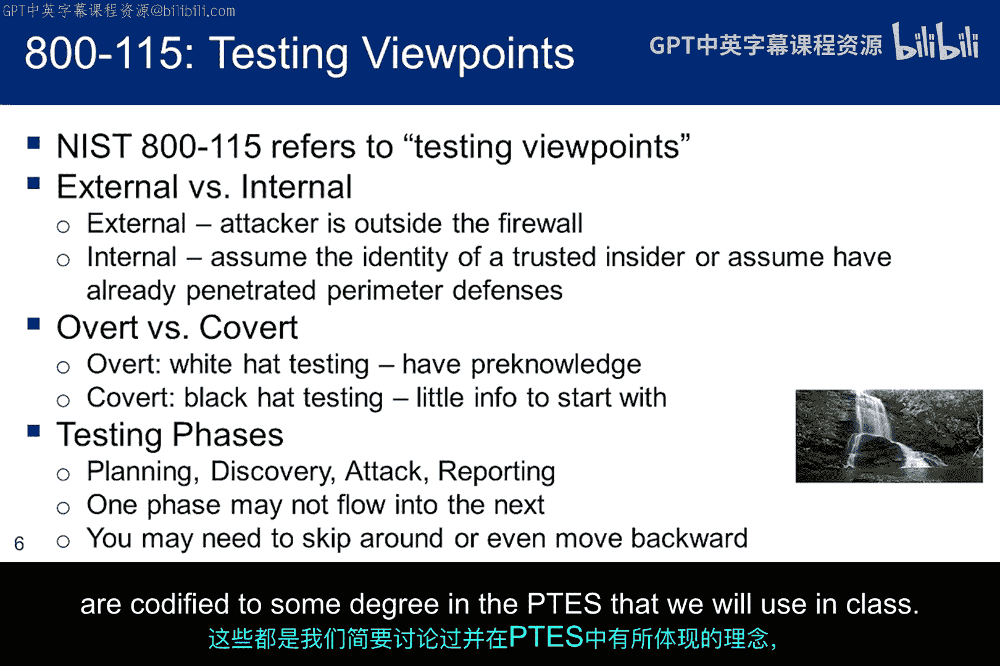
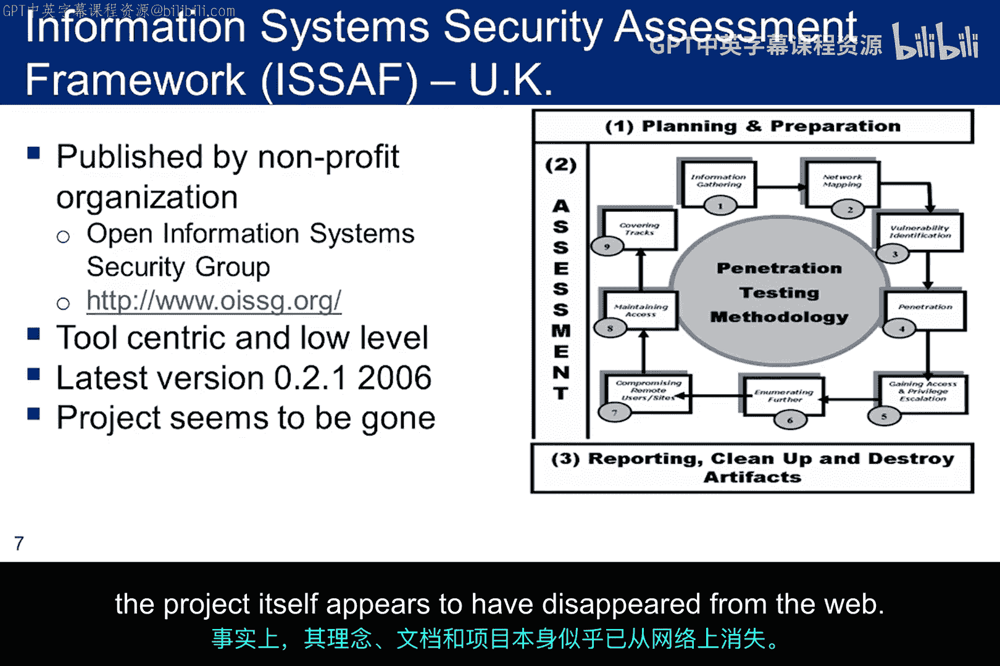
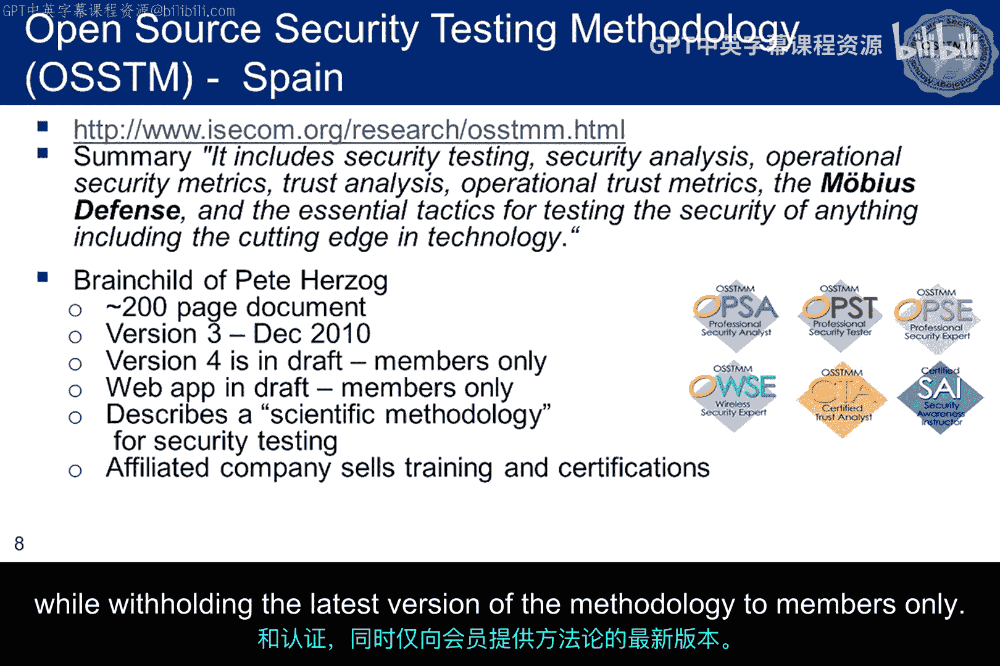
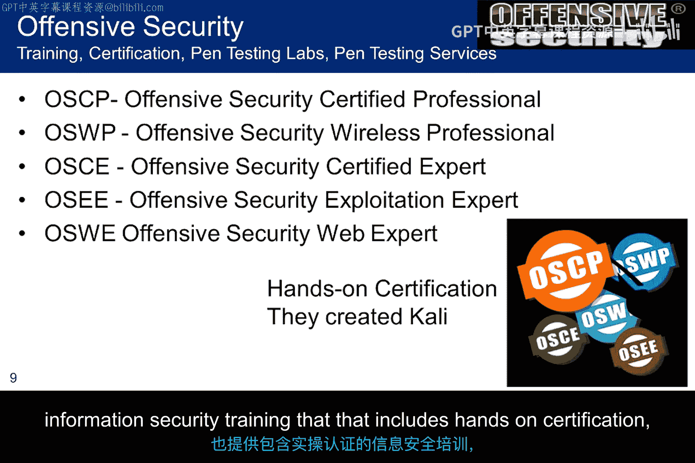
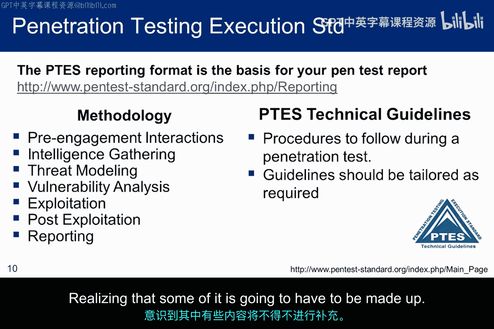
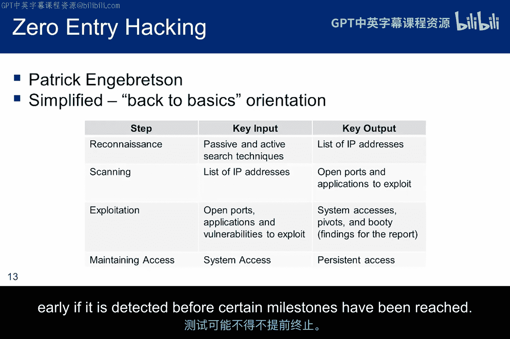
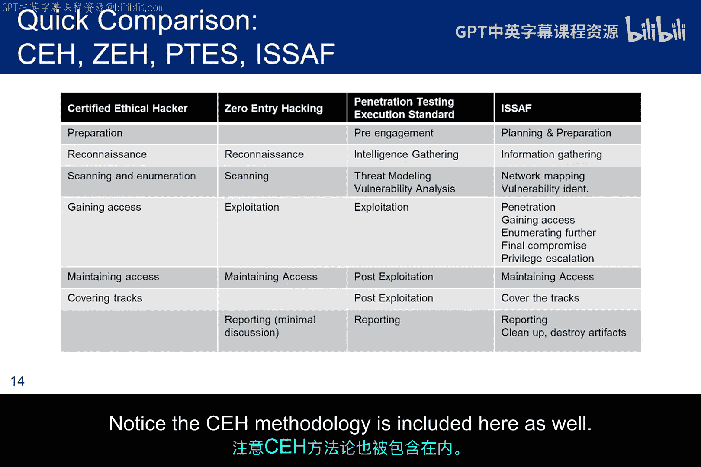
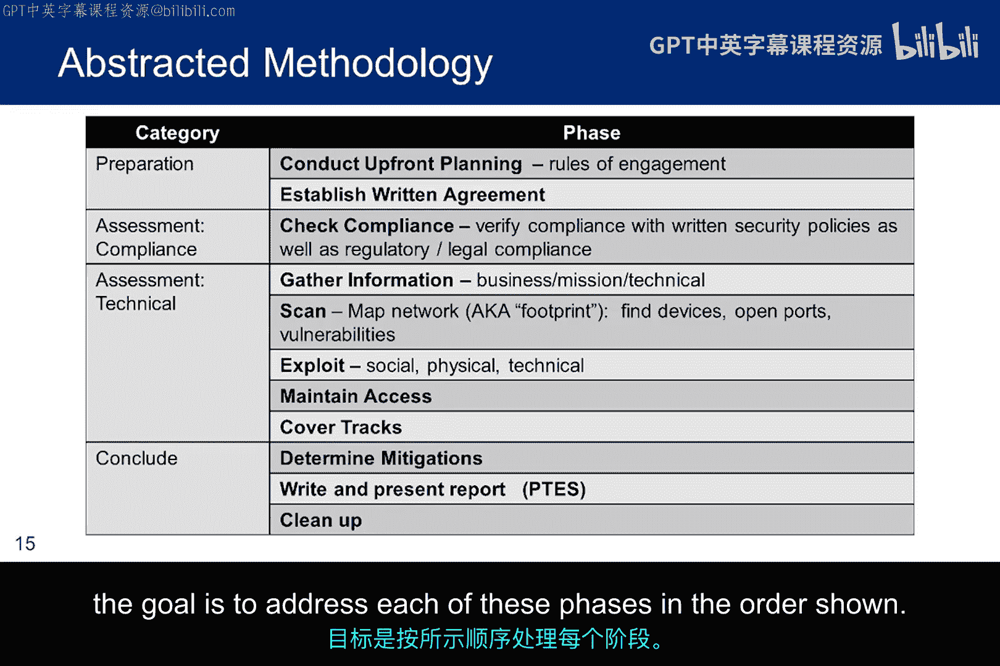
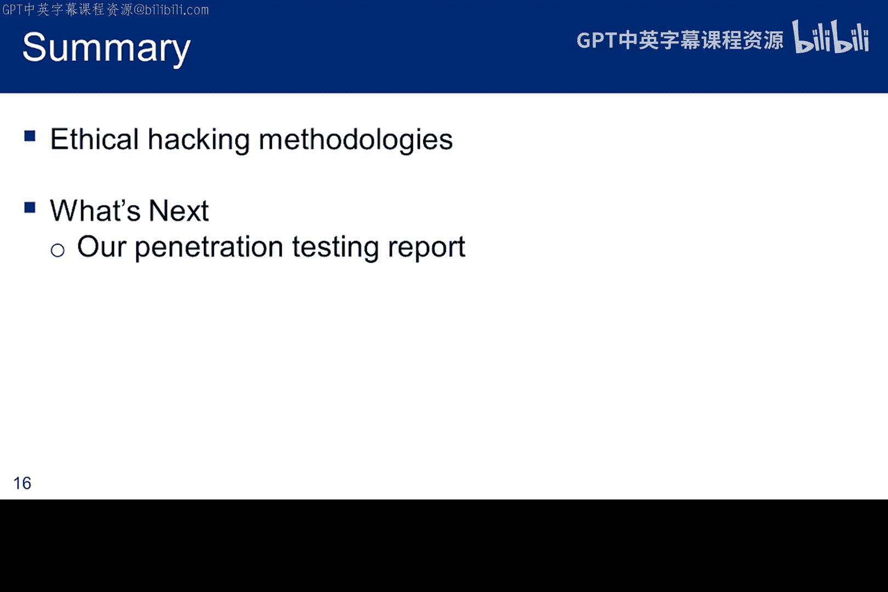

# 约翰霍普金斯大学《道德黑客入门｜Introduction to Ethical Hacking》中英字幕 p09 8_道德黑客技术体系.zh_en -BV1xgu1z1Eau_p9-

This portion of the lecture will examine a few ethical hacking methodologies that were examined in abstracting the methodology for the class。

Before we get into the serious methodology， it will take a quick look at Hollywood In the flow chart on the left。

 you will see John Travolta's name in the middle， pointing to the password is swordfish。

 The movie swordfish has a pretty convoluted plot that has a hacker siphoning money from government slush funds。

 What is interesting is the movie's title is taken from a Marx Brothers clip from the 30s。

More on that in a minute。On the right， you see a comic that tries to capture what you might see in a movie on the top and how social engineering really works on the bottom。

In both cases， we give Hollywood artistic license， and their methodology is sometimes quite far from reality。

If you are interested in the Marx Brothers Comic clip that LED to the movie's name。

 you will find it at this link on YouTube。

The first methodology of interest is found in the NISist publication。

 providing guidance for security assessments for entities using three methods， testing。

 examination and interviews。 Testing is the process of exercising one or more entities under specified conditions to compare actual and expected behaviors。

Examination is the process of checking， inspecting， reviewing， observing。

 studying or analyzing one or more entities to facilitate understanding。

 achieve clarification or obtain evidence， Intering as the process of conducting discussions with individuals or groups within an organization to facilitate understanding。

 achieve clarification or identify the location of evidence。

 This special publication has not been updated in over eight years。

 So it clearly has limitations in terms of an effective approach。

Although the guidance is dated， one of the interesting aspects of the publication is the testing viewpoints examined。

 It distinguishes methodologies for external versus internal and overt versus covert testing。

 It also discusses four testing phases。 planning discovery attack and reporting that don't necessarily occur linearly。

And the procedures may require a tester to revisit earlier phases。

These are all ideas that we have discussed briefly and are codified to some degree in the PT E S that we will use in class。

The I SAAF is a relatively detailed low level framework developed in the UK。

 which had some interesting ideas 10 years ago， but has not been updated。 In fact， the ideas。

 the documentation and the project itself appears to have disappeared from the web。

The O SSTM， a nonprofit organization， is also of European origin and developed as a framework that is alive and well。

 But in some sense， it is a one man show LED by Peter Herzo。There is only a single US contributor。

 a company called KCT data。The approach is a higher level methodology when compared to I SSAF。

 It does not prescribe tools to use and assumes the practitioner is knowledgeable about pen testing。

 So it has a steeper learning curve at the beginning。Mr。

 Hertzog argues that the idea of defence in depth is antiquated。

 His proposed defence model is called the Mobius defense。

 The idea is that each model should be protected as if it stood alone。

 independent of any lines of defense for the enterprise。

 So the model disregards network boundaries and security enclaves and promotes each man for himself as a better way to guarantee protection in the version of the standard available to the public。

 Several stages of penetration testing are described and proponents argue that the approach is very scientific。

However， the current business model of the organization appears to be more focused on training than enhancing and extending the standard。

 As you can see， OSSTM promotes training and certification in several areas of interest to the security community。

 while withholding the latest version of the methodology to members only。

And while we're thinking about training and certification， we should look at offensive security。

 the creators of Cali。The company provides both pen testing services and information security training that includes hands on certification。

 which is well respected in the security community。

Penetration testing execution standard provides another methodology that influenced the methodology abstracted for this course。

 It also provides guidance that we will use for the final pen test report。

 The methodology was described earlier， so I won't repeat it here。

 But I do want to remind you that the report comes last in the list and is closely coupled to the rest of the methodology。

 It is necessary to engage in the other elements of the methodology。

 before one can write a usable pen testing report。And again。

 the goal for this class is to assemble all the material you will collect in the weekly labs into a final report and cover as many of the components of the P T E S methodology as possible。

 realizing that some of it is going to have to be made up。

To model the threat， we begin with the two main categories for attackers， insiders and outsiders。

 and we need to complete this table with the oversight of the sponsor。

The slide breaks down the insider threat category by identifying various internal threat agents。

 Once the agents are identified， the pen tester works with a sponsor to identify the business assets and business processes the various agents may attack。

One factor in making this determination might be access rights already granted to an insider。

 Once this information is assembled， the pen tester can use it。

 along with the sponsor's prioritization of the assets。

To develop a testing plan that is based on techniques， those agents might attempt in an attack。

 Of course， members of this list of agents have different skill levels and different access authorizations。

 So the test has to account for that。 For example， some professional testing tools are probably not going to be available to insiders。

 So that may reduce their capability。 On the other hand。

 they have privileges and knowledge that an external threat won't have。

 The plan needs to be fineted to account for this。 And， of course， there are certain assets。

 The sponsor may not be worried about， which means they can be eliminated from the plan。

And there may be some threat agents that the sponsor's feels pose such a low threat that he doesn't want to pay for the associated penetration testing。

 So the goal is to determine which assets and processes are the most important for the viability of the business and which agents have the ability and an opportunity to attack those assets。

 This is all vital to planning the penetration test you have specific goals and targets that you want to compromise。

Once you have a risk structure for the internal threat agents。

 you must extend the effort to external threat agents。 Again。

 these agents have different skill levels， different connectivity and access authorizations。

 So the threats are different。And as with internal agents。

 you have to overlay the sponsor's requirements。For example， if the business is small。

 service oriented and doesn't have any valuable intellectual property an attack by a nation state is probably unlikely。

 and the sponsor may not want to pay for that level of pen testing。

The table on this slide describes the methodology from our text book。

 One of the omissions here is Engelbreten does not discuss covering your tracks as a pen tester。

 In many situations， This is a critical aspect of the exercise。

 because not everyone in the organization is aware of the pen test。

And testing might have to end early if it is detected before certain milestones have been reached。

This table compares four methodologies。 Notice there are similarities， and in some phases。

 it is really only the semantics of the phase' name that is different。

 But notice that there are also some gaps。Phas that are included in some methodologies and not in others。

 It is these differences that LED to an abstracted methodology for the class that looked for intersections and tried to find a consistent naming convention。

 Notice the C， E H methodologies is included here， as well。

This is the final combined methodology that we will use for the class。

 and it drives the syllabus in terms of the material we will cover。

You will see that the PT E S guidance documents provide some additional detail on the preparation phase。

 which is called pre engagement interactions。 This is an important difference。

 The interactions are included in our methodology in the upfront planning。

 but the PT E S team felt it important to separate planning on the red team's part from client engagements and discussions as the class progresses。

 The goal is to address each of these phases in the orders shown。

Now that we have completed an overview of ethical hacking methodologies。

 we will drill down into the content of the penetration testing report。

 and you will use these ideas in completing your report for this class。

