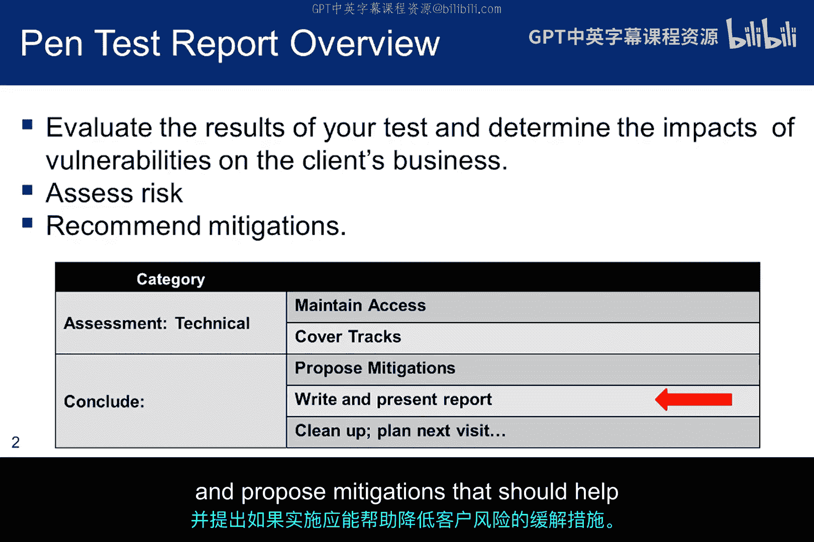
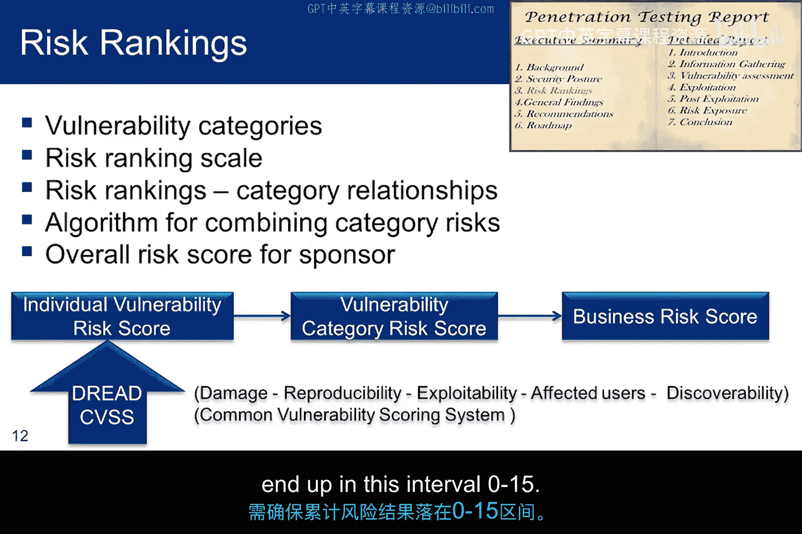
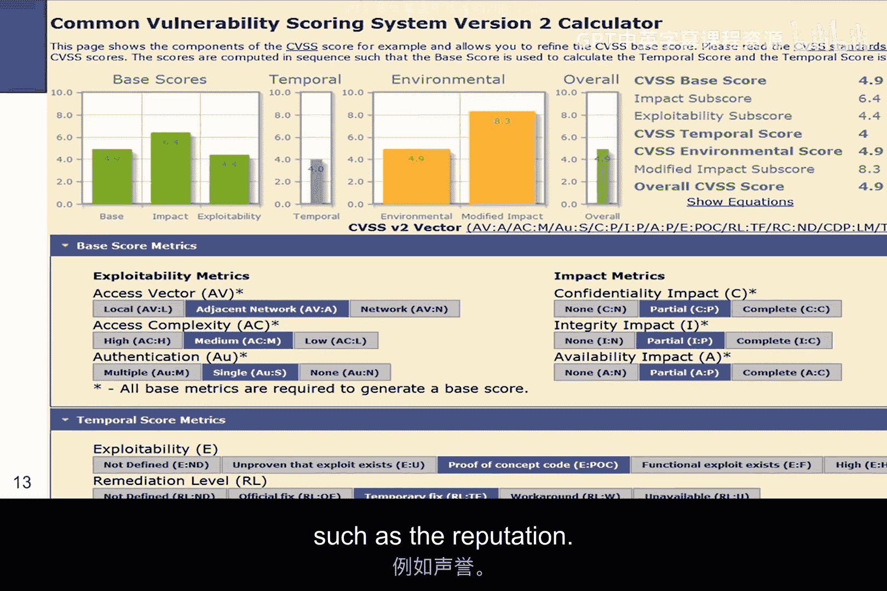
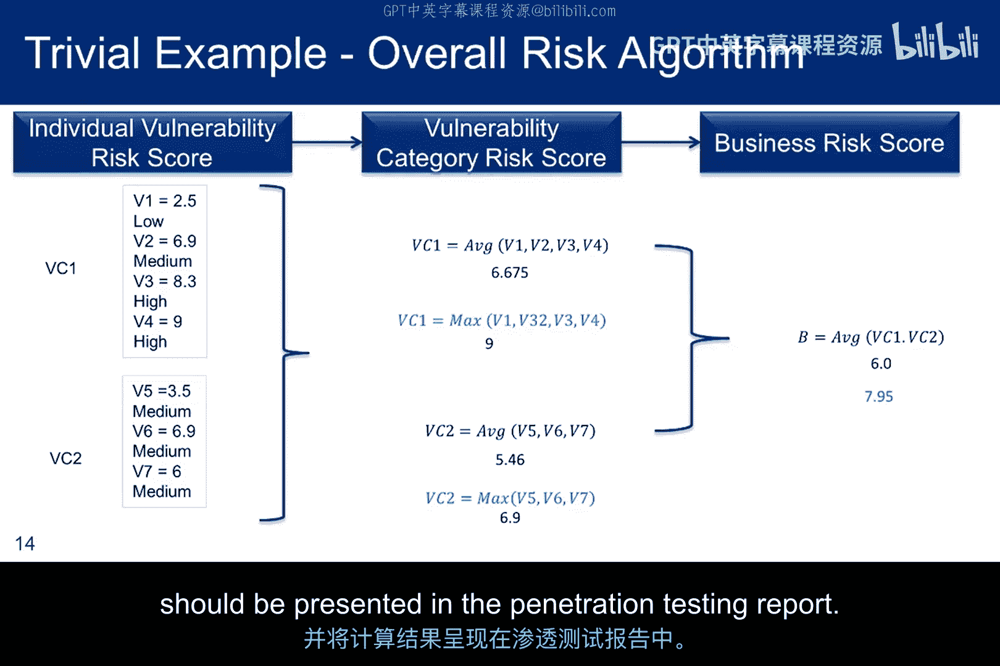
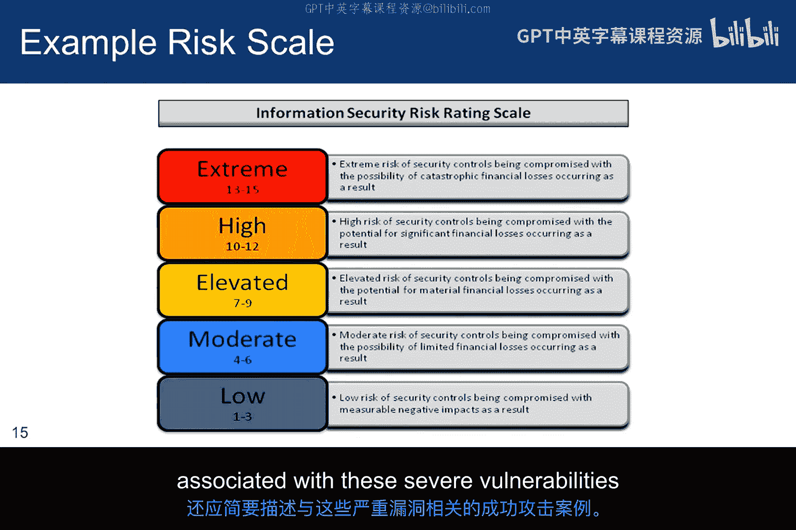
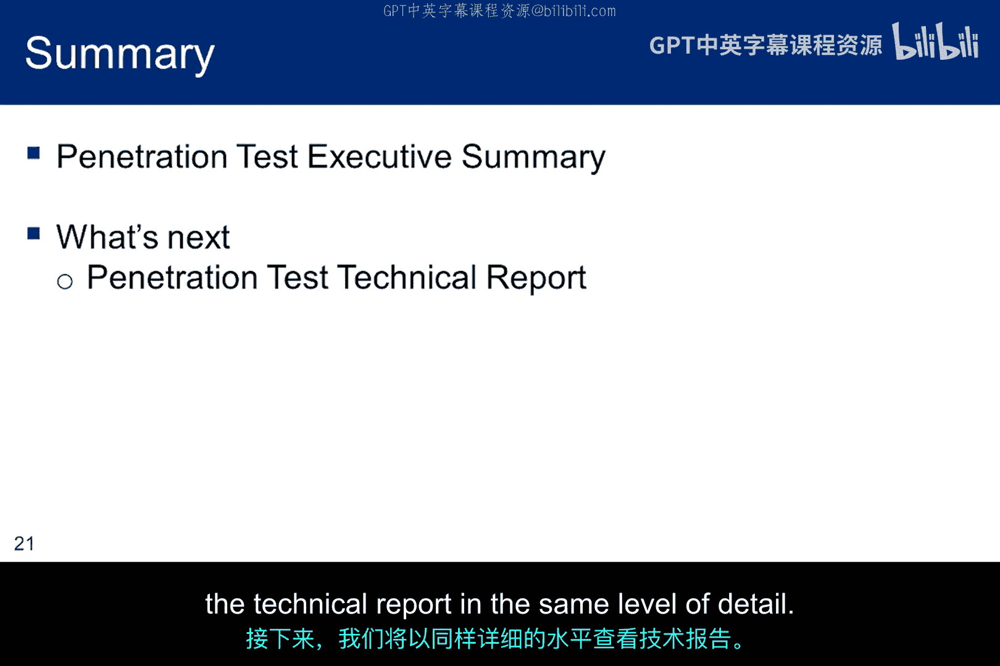

# 约翰霍普金斯大学《道德黑客入门｜Introduction to Ethical Hacking》中英字幕 p10 9_渗透测试报告执行摘要.zh_en -BV1xgu1z1Eau_p10-

In the remainder of this lecture， I will discuss the content of a penetration testing report。

 I will focus on the P T E S approach， But as you learned earlier。

 there are other similar methodologies that one might use。 In fact。

 most of the penetration testing teams have their own customized format that has evolved over the course of numerous tests and suits the team's needs in a manner that strict adherence to a standard does not。

 But in the end， even the PT E S report guidelines need to be tailored to meet the requirements of the test at hand。

Looking at the bottom of the abstracted methodology。

 we see that the goal is to propose mitigations and document them in a report in a manner that can help executives in the client organization make smart investment decisions for their security mechanisms。

 They may implement your proposed mitigations。 They may not。

 What is important is that you assess the risk to their business put a metric on that risk and propose mitigations that should help reduce the client's exposure if implemented。

We've seen this methodology slide before。 I presented again as a reminder that pre engagement interactions and threat modelling cannot really take place。

 as there is no client to interact with。For pre engagement interactions。

 you should develop ideas that would make sense in any penetration test。

 The scenario in the lab notes is that the client wants a black box test from an external location performed with a firewall up。

But you need to make decisions as if you were the client about any constraints on attacking an operational database。

 installing back doors， and cracking passwords。The threat will also be discussed as part of the lab guidance。

 For example， one of the external threats identified would be script kitties。

 and another is that the client is only concerned with external threats， not internal threats。

Continuing from the preceding slide， these two bullets represent the part of the methodology that is assumed to have been completed。

 The pen testing team should have a written contract with the sponsor that specifies the scope and dates of the test。

 The contract should include the domains that are within scope， and those that aren't。

 and the rules of engagement for third parties and third party systems。

 It should also clearly lay out any constraints on the pen tester's use of physical attacks。

 social engineering， back doors and password crackers。For threat modeling。

 the standard focuses on two key elements， As and attacker As are further broken down into business assets and business processes。

 and attackers are broken down into threat communities and their capabilities and skill levels。

These are some of the items that need to be summarized in your final report that represent the pre engagement agreement。

 Most of these items are included in the outline provided in the lab notes。

 but some of them may be represented differently or may require some additional detail to fit into the report。

 So as you begin to develop the outline， you should review this list to make sure your report includes everything。

The final report is what the sponsor will remember。 Smping on the report is at your own risk。

 You may never be asked back。And that is a reminder that the penetration test is done at one point in time。

 and you need to make sure the sponsor understands that as the threat， assets and tools evolve。

 the sponsor should request additional tests。 You may want to make sure that your report is of high quality。

 So you will be asked back。And the term executive summary is not what one normally means when writing a summary of a White paper。

 It is not a two page summary。 It is a complex assessment of risk and proposed mitigations that the decision makers can use to make security investment decisions。

Typically， you will be asked to provide a written report of the results and also summarize the results in a presentation at the sponsor's facility。

 make sure the writing and the presentation material are provided at a level equal to your penetration testing technical skills。

The report itself will have three sections。 The executive summary must be written at a level senior managers and executives can understand and act on。

 In most cases， that is all the executives will read so it must be crystal clear， precise。

 and the recommendation must be actionable。 The detailed report is for the technical staff who will question your results and want to understand the details。

 The raw data consists of all the material saved in the repository。

 All screenshot and anything else that may be needed to justify the conclusions and inferences in both a detailed technical report and the executives summary。

As noted a moment ago， the executive summary is intended for a non technical executive level audience。

 It is for decision makers who may act on your recommendation。

 so it needs to clearly show the business impact。It should include phrases like here is how your business can be hurt。

And remember， it is a summary with references to more detail。

 So don't get bogged down in this part with technical information。 On the other hand。

 don't sell the executive summary short。 Talk about business risks and mitigation recommendations and note that there may be some overlap of the executive summary and the technical report。

 For example， a risk discussion。 This is because there are typically two audiences for each report。

 And they have different but intersecting goals。 Both audiences want to understand risk。

 but at a different level of detail。 On the left， the slide shows the recommended sections of the executive summary。

 and we will discuss each in a little more detail。The background section connects the reader with the goals。

 objectives and scope of the test。 There may be many readers who are not involved with the pre engagement discussions。

 So this section gives them the background on what is agreed to and what to expect as they read the report。

It must also include a discussion of the threat modeling so the reader knows which agents and which assets were tested。

This would include an explanation of the fact that it was not a comprehensive test against every asset and every agent in terms of physical enterprise。

 identify the specific systems attacked in their logical and physical location。

 As you talk about each asset， identify the business criticality as specified by the client in pre engagement discussions。

As you continue with the background section， provide a summary of the methodology。 But remember。

 executives aren't interested in what tools you used。

 Such a discussion would not be meaningful to them。

 Some topics to be summarized as part of the methodology are these。

 Describe the threat agents emulated in the test。 Inter external or both Describe the asset risk rankings agreed to by the sponsors that were used in developing the penetration testing plan。

Describe any constraints on the use of physical access or social engineering。

Describe the protection mechanisms tested， the key security mechanisms in our scenario are authentication and a stateless firewall。

 But if others occur to you， include them as well。 Describe the scanning techniques used。

 but at a high level。 For example， we scan for available services that haven't been patch or upgraded。

Described exploitation techniques at a high level that confirmed vulnerabilities identified during scanning。

 For example， we leveraged vulnerable services and performed both client side attacks and browser side attacks。

Describe the rationale for any modifications to test objectives during the course of testing。

A documented agreement amending the test should be included in the appendix to the report and referred to in this background section。

The security posture section will discuss the overall effectiveness of the test and whether or not the pen testers were able to achieve the agreed two goals。

Systemic issues should be summarized， for example， The sponsor's security team does not have an effective process for patching software in a timely fashion。

 Prorovide one or two specific examples of vulnerabilities that are known， documented。

 addressed by the vendor， but the patch has not been installed by the client。

Describe the pen tester's ability to gain access to the client's information or assets and identify the potential impact to the business qualitatively。

 Since you don't have a good way to assess the potential dollar loss length the confirmed vulnerabilities and the security controls put in place by the client to secure business critical information that will be lost。

 While this section does not provide recommended mitigations。

 you want the sponsor to begin thinking about strengthening the organization's security posture。

The first thing to describe in the risk section are the vulnerabilities， which should be identified。

 categorized and explained as a function of the threat model。

 An example of a vulnerabability might be unpatched colonel drivers。

 While an example of an associated vulnerability category would be missing patch or failure to harden the O S。

 The idea here is 25 vulnerabilities are difficult for the executive to grasp。

 Three categories is much easier to explain。Second。

 the overall risk rankings need to be identified and explained in this section of the report。

In the pre engagement discussion， the pen tester and sponsor should have identified the scoring mechanism for tracking risk。

 For example， Microsoft developed the dread system， which assigned high medium and low numbers to D。

 damage， How bad would an attack be， R reproducibility， How easy is it to reproduce the attack。

 E exploitability， How much work is it to launch the attack。A affected users。

 How many people will be impacted And D discoverability。 How easily is it to discover the threat。

sum of these individual scores provides a measurement for the risk associated with the vulnerability within a vulnerability category。

The common vulnerability scoring system， CS S is another approach to developing a risk metric。

 It is a quantitative model that enables users to see the underlying vulnerability characteristics that were used to generate the scores。

 CS S starts with a base score used to calculate a temporal score used to calculate an environmental score used to calculate an overall score。

 Of course， there are other threat risk systems。 But before meeting with your client You should have an approach in mind。

 You can read a little more about them at Oos org under threat risk modeling。

 After explaining these two elements that the report should discuss the approach selected to measure risk to the business as opposed to identify the existence of vulnerabilities。

 the discussion begins with an examination of categories of vulnerabilities such as failure to patch software and。

A risk model will assign a risk number to this category that will allow a comparison to other categories。

An algorithm， possibly something as simple as addition。

 provides a way to turn an individual vulnerabilities into a vulnerability category rankings into an enterprise metric。

 The resulting score may fall into a ranking scheme something like extreme high elevated。

 moderate and low。 This is defined as part of the P T E S guidelines。 But if you use the scale。

 make sure your cumulative risk results end up in this interval 0 to 15。

The vulnerability ranking system should provide a method to prioritize the actionable items produced from the penetration testing report。

 CSS can be used to measure the risk associated with individual vulnerabilities that can be traced back to CVE numbers。

 The overall scoring system that CVSS uses will map to high medium， low groupings。

 but these qualitative rankings are simply map from the numeric CVSS scores。

Vulnerabilities are labeled low severity if they have a CVSS base score of 0 to 3。9。

 vulnerabilities will be labeled medium severity if they have a base CVSS score，4。0 to 6。9。

 and vulnerabilities will be labeled high severity if they have a CVSS base score of 7。0 to 10。0。

Another approach to a qualitative scale could be this High refers to any method that can achieve remote code execution or exfiltrate specific high value customer data。

Medium might be used for a potentially exploitable vulnerability or exfil of a data item that can affect the business assets。

 such as the reputation。 Lo might be designated for exfil information that could benefit one of the identified threats but is not valuable corporate information。

And note that this C VS S scale only goes up to 10。

 So if you decide to use the PT T E S risk scale that goes from 0 to 15。

 some kind of adjustment needs to be made。Here is an example of a simple enterprise risk algorithm。

 You don't have to use this approach， but you need something similar to define a risk metric for the enterprise。

 In this example， equations in black show one simple approach for combining individual risks into risk associated with a vulnerability category。

 which， in turn is used to determine an overall business risk。

This is just a simple example to show that some method has to be developed for rolling up the individual vulnerability risks。

 Another approach shown in blue might be to take the maximum score within a vulnerability category to capture the weakest link within that category。

 The key is to develop a methodology that makes sense to the sponsor makes sense to you and provides a metric for risk。

 The algorithm should be agreed to as part of the pre engagement discussions and the results of those calculations should be presented in the penetration testing report。

These example rankings from the P， T E S measure the risk of the client's security controls being compromised and the associated potential for material financial losses。

 If used in a report， it would need to discuss how the overall risk score for their enterprise is calculated。

 For example， it might be based on a small group of high risk categories。

 possibly just one multiple medium risk vulnerability categories and several low risk categories。

The security assessment should be discussed in terms of successful direct attacks。

 This is important if it looks like a vulnerability， but you weren't able to exploit it。

 itss impact on the score should be minimal or 0。 Finally。

 the report should summarize the most severe vulnerabilities that drove the metric to the current level。

 A brief description of successful attacks associated with these severe vulnerabilities should be included as well。

The general findings section will provide a synopsis of the issues found during the penetration test。

 It should include both analytical content， simple quantitative detail and graphics showing some statistics。

 You want to include a high level graphic of the architecture and the targets。

 The attack scenarios and success rates。 The source of the vulnerabilities leveraged using statistics and metrics and a quantitative summary of the significant results。

 system by system。 Use as many graphics as you can here to explain the results from a quantitative perspective。

 You should also try to depict the effectiveness of the countermeasures and a quantitative manner。

 For example， a graph of how many penetration attempts were tried versus how many times it was defeated by the firewall or detected and blocked by the intrusion prevention system。

 The idea is to present the sponsor's design for secure。Contros and discuss their effectiveness。

Here is a graphic that you can include if you keep track of the vulnerabilities tested as the test progresses。

 In this case， on box 5， there were0 successful exploits in 15 attempts。On box 3。

 there were 13 successful exploits in 15 attempts。Here is another example of a quantitative graphic。

 It shows the percentage of vulnerabilities detected by category。 Of course。

 there are many other potential categories as you discover the set of vulnerabilities in the system being tested。

 You want to do the analytical assessment necessary to put them into well defined categories which will provide a framework to explain risk。

Finally， and possibly the most important of all are the recommendations。

 This section of the report should provide the reader with a high level understanding of the tasks necessary to resolve the risks identified。

 It should also discuss the level of effort required to implement them。

 The idea is to give the reader enough information to compare the cost of mitigation against the risk of successful attack。

 This section should also identify any weighting mechanisms that may have been introduced to prioritize the order of implementation。

 For example， improving password entropy may be 1。5 times as important as expediting the patching process。

 or they may be weighted the same， whatever the choice it should be explained here。

 One challenge in making recommendations is to find a viable middle ground。 as noted on the slide。

 if you consider all possible combinations of S P 853 controls。The number of options is unmanageable。

 However， the recommended changes are probably more complex than just considering the sand's top 20 security controls。

To recommend the Sans top 20 doesn't require a penetration test at all。 And more importantly。

 those top 20 won't have any connection to the sponsor's business model。

 the business processes or the business data。Once you have made and prioritized the recommendations。

 you need to describe a road map that includes a plan for a remediation of the insecure items found。

The plan should provide an overlay of the threat modeling for those threats that were deemed to be a significant part of the test。

 There may be a high priority vulnerability that will take more than 12 months to fix and there may be a low priority vulnerability that can be mediated with an immediate hardware appliance purchase。

 Even though the sponsor may only choose to partially implement the recommendations。

 You need to help them put a plan in place in developing a plan。

 you should also consider the business objectives and the potential business impact。

 The idea is to break up your recommendations that will align with predeeffined goals and provide a path for the way ahead。

 And remember， the sponsor may have capital or expense constraints that spread a one to threemon goal across six months or more。

 That completes the discussion of the executive summary。 which is far more than a summary。 Next。

 we will take a look at the。report in the same level of detail。

