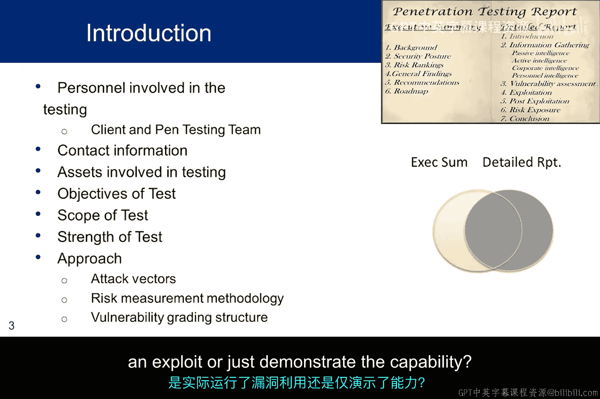
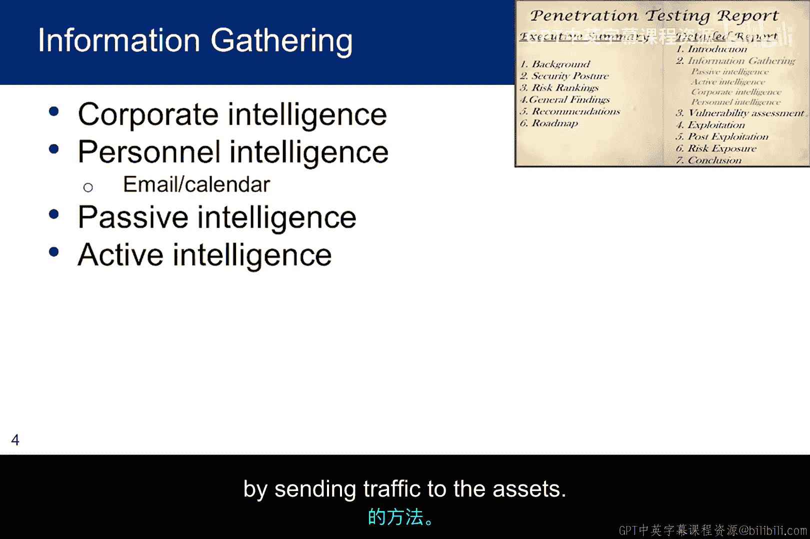
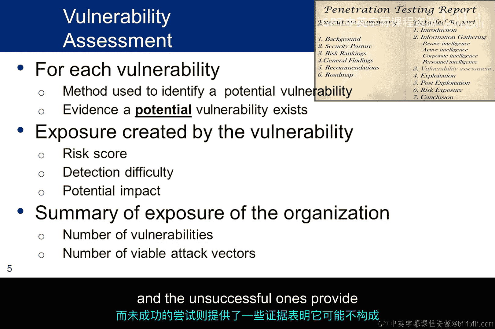
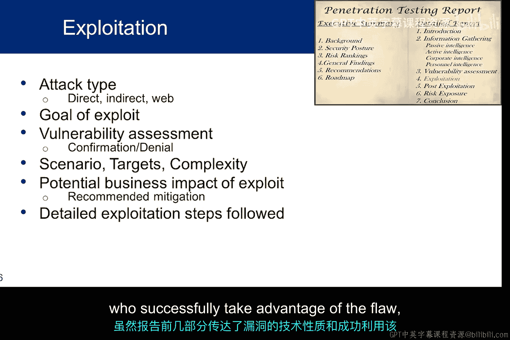
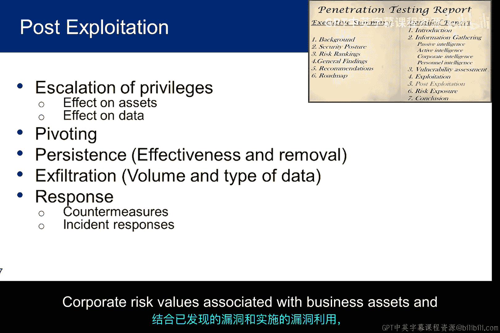
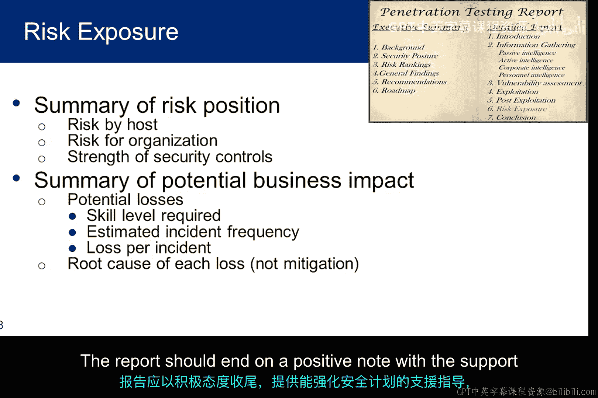
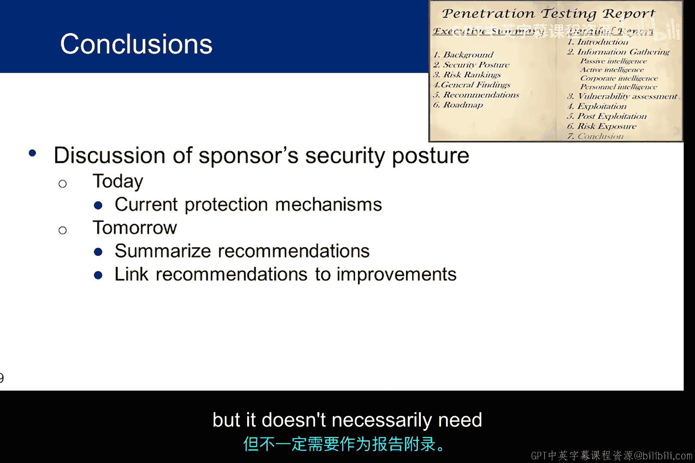
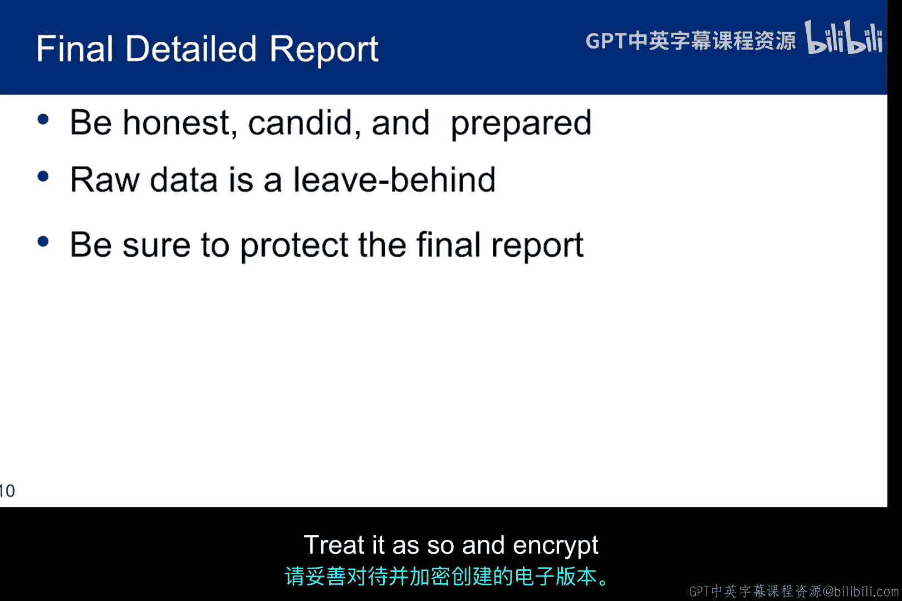
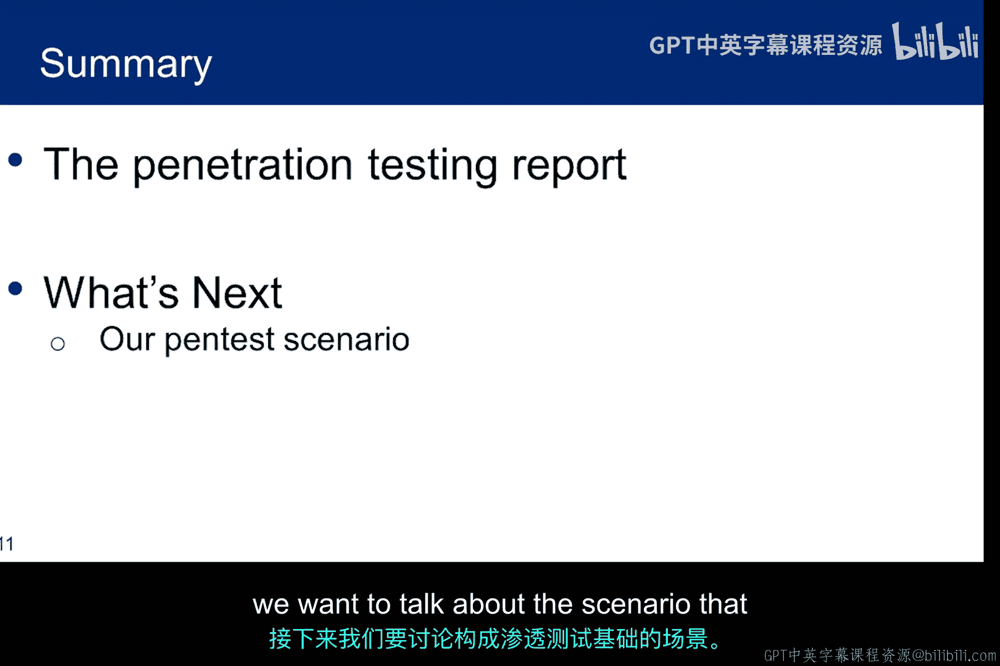

# 约翰霍普金斯大学《道德黑客入门｜Introduction to Ethical Hacking》中英字幕 p11 10_渗透测试技术报告.zh_en -BV1xgu1z1Eau_p11-

PTES also provides guidance on the detailed penetrationration testing report。

This part of the report will describe detailed technical content。

 The detail is intended for use by the security staff or the network operations staff whose job is to protect the infrastructure。

 the business processes and the corporate data。They will want to understand exactly what attacks were executed。

 how they worked and why their protection mechanisms failed。As discussed earlier。

 the executive summary is intended for non technicalchnical executive level audience。

 It is for decision makers who are positioned to act on the recommendation。

 So it needs to clearly show the business impact。 Now。

 we want to explain the details to the security staff。

 People well trained and attack methodologies and controls that have been put in place to protect the business processes and data。

 They need to understand which of their security assumptions were off target and resulted in their protection mechanisms failing。

 On this slide， you see a list of the recommended sections of the detailed report。

 and we will discuss each in a little more detail。The introduction of the technical report may duplicate some of the background discussion in the executive summary。

 However， in switching the focus to readers who may include security engineers。

 you need to provide far more technical content。 For example。

 instead of providing a high level architectural drawing。 You could include firewalls， routers。

 switches， VPN servers， Web servers， DMmzs， database servers and even ports and services running on individual boxes。

Basically， you need to drill down in this section to provide as much engineering content as possible without getting into the raw data itself。

 The raw data will go in the appendix。 These sections in the introduction are selfexplanatory。

 They describe the penetration testing organization。

 scope and objectives of the test as agreed to during preengage。

 The methodologyologies followed the attack vectors used based on threat models and the details of the risk measurement approach and the methodology behind the vulnerability categories。

 Any content in the executive summary that is pertinent to the technical discussion and necessary for understanding the penetration testing methods should be reintroduced here。

 but don't just cut and past from the executive summary。

 The two discussion should be tailored to the different audiences。

 Str of test is a somewhat vague idea。 One aspect is you are coupling the report to the。Threadags。

 for example， a state sponsored thread agent requires a stronger test than a script kitty。

Specifically， did you use custom scripts or standard scripts。

 A second idea associated with strength of test captures the technique used。

 Did you actually run an exploit or just demonstrate the capability。

The class includes one lecture on reconnaissance In that lecture。

 you will see that intelligence gathering and information assessment are foundational elements of any penetration test。

The more informed the tester is about the environment， the better the results of the test will be。

 This section should include a discussion of all the public and private information available through the intelligence gathering phases of P。

 T E。 S。 At a minimum， the results identified should be presented in the four basic categories shown on this slide。

Corporate intelligence includes information about the structure of the organization， business units。

 market share， vertical horizontal integration and other corporate functions。

 The information should be mapped to both business processes and physical business assets being tested。

 personnel intelligence is any information， which maps users to the target organization。

 This section should show the techniques used to harvest intelligence from public or private databases。

 mail repositories， social networking formss， Word charts and other items with sources of employee detail。

If social engineering or ph were within the scope of the penetration test。

 any personnel intelligence collected， such as executive contact information should be presented。

 A good example was provided by an incident in which a small company was losing millions of dollars because hackers got into the owner's email and calendar saw how he completed banking transactions。

 duplicateupd the process while he was in a meeting to have funds sent to their account and deleted emails before he returned。

Passive intelligence is intelligence gathered from indirect approaches。

 such as DN S and Google Hacking for I P infrastructure related information。

 This section will focus on the techniques used to profile the technology and the target environment without sending any traffic directly to the assets。

The active intelligence section will show the methods and results of tasks。

 such as infrastructure mapping， port scanning， architecture assessment and other footprinting activities。

 This will focus on the techniques used to provide the technology and the target environment by sending traffic to the assets。

The vulnerability section of the report starts off with a separate look at each vulnerability identified。

 The threats tested or identified in the pre engagement threat modeling。

 and a vulnerability assessment is based on emating those threats in looking for vulnerabilities。

 It includes the act of identifying the potential vulnerabilities in doing the associated risk scoring based on the risk model selected。

This section should link to the risk model with an explanation of the methods used to identify vulnerabilities。

 as well as the classification of the vulnerability。

You should provide evidence that shows the potential vulnerability is exploitable based on your results。

 includeclude some information about difficulty of detection and potential impact。 if exploited。

 each vulnerabability should be kangarized in terms of both a detection mechanism and similarity to other vulnerabilities。

Detection mechanisms might include manually identified， scanner found， well known protocol。

 service weakness or CV VE entry。The vulnerability categories have been discussed earlier。

 so I won't repeat those here。 A final summary in this section should present the exposure of the organization based on the number of vulnerabilities found。

 the number of vulnerability categories， which translate into the number of attack vectors and how easily the vulnerabilities were found。

The exploitation section should discuss the exploits actually attempted。

 which were successful and which were not。 The successful exploits confirm the vulnerability exists。

 and the unsuccessful ones provide some evidence that it may not present at risk。

Exploitation is the act of triggering the vulnerabilities identified in the previous section to gain a specified level of access to the target asset。

This section should review the type of attack， the goal of the attack and all the steps taken to confirm the vulnerability to include the exploitation timeline targets selected for exploitation。

 the attack scenario， successful and failed exploit attempts and detailed exploitation activities。

Exploitation activities should discuss the results of direct attacks on ports and services and the results of indirect attacks。

 using social engineering， phish， clientient site attacks to reach into the network and browser site attacks to gain access to the server infrastructure。

 Each of the successful attacks should be presented with the level of access achieved and recommended mitigation mechanisms or security controls to eliminate the vulnerability。

 summarize this section with some statistics on the number of successful exploits for exploits attempted。

 First， categorize them based on attack type， direct indirect and web。

Indirect could be broken down separately by social engineering， phishing。

 client side attacks and browser attacks。 This kind of quantitative detail will help the security engineering team recommend to management where the expenditures should be made first。

 For example， if fishing has a significant success rate。

 the organization may want to immediately invest in a strong mandatory training class for all employees。

 Of course， the results of this analysis are what drove the recommendations and road map in the executive summary。

 Post exploitation is a critical element in the pen testers' assessment of the impact of successful exploits on the business。

 While the earlier sections in the report relay the technical nature of the vulnerability。

 and the ability to successfully take advantage of the flaw。

 the post exploitation will tie the ability to exploit of vulnerability to the actual risk to the business in terms of escalation of privileges。

Moving around the network， maintaining long term access and stealing intellectual property。

 competitive data or sensitive information like P I。

If you were able to escalate privileges which provided access to more data or control over more business processes。

 that needs to be discussed。Clients may understand many of the issues of initial access。

 but they may not think about vertical and horizontal escalation as an additional threat。

 This section should clearly explain the additional negative effect on the business that was achieved by escalation。

 If you were able to exfiltrate data identified by the client as critical to their business you should provide a detailed discussion of the attacks to include the volume of data collected the type of data collected and screenshot demonstrating the techniques。

If you were able to gain access to a core business system， such as a database。

 to perform either a confidentiality or integrity attack。

 you should provide both screenshots and a detailed discussion of your ability to control that business system。

 If you are able to pivot to other systems， you should describe the associated exploits against those systems in any business assets or business data access are collected from the secondary targets。

 If back doors are within the scope of the penetration test。

 you should discuss both their effectiveness and the removal process to ensure the client that they are no longer installed to any computers or other devices。

Finally， the effectiveness of the client's proactive controls and the reactive countermeasure should be discussed。

 if any incident responses were triggered， the details and effects on the penetration testing should be discussed。

An assessment should be provided describing the response and effectiveness of the firewalls。

 including Webamp firewalls， ISs， Iss， NaOs， monitoring tunes。

 data loss prevention mechanisms and logging。Now that the direct impact to the business has been explained。

 the risk quantification for the technical team can be completed。

 It should expand upon the risk discussion from the executive summary。

 corporate risk values associated with business assets and business data need to be discussed as they relate to vulnerabilities found and exploits run。

 summarize the analytical and statistical details of the risk algorithm that turns the individual vulnerability category rankings into a corporate metric。

 The resulting risk levels for corporate exposure should be explained in terms of the algorithms selected。

 The strength of the security control should be summarized as well。

 This will give the client the ability to identify。

 visualize and monetize the vulnerabilities found throughout the testing and effectively weigh the cost of mitigation against the organization's business objectives。

 discuss the risk system selected， for example， CSS and provide details for quantifying。

The business risk by vulnerability category in terms of estimated incident frequency。

 estimated loss per incident and the fundamental cause of that loss。

 estimated threat capability used in the assessment based on threat modeling。

 skill level required by the attacker and access level required by the attacker。In the conclusion。

 provide a summary of the fundamental drivers for the recommendations and how implementing the recommendations will increase the client's security posture。

 The report should end on a positive note with the support and guidance that will enable a strengthened security program and provide an approach for future activity necessary to maintain awareness of the organization's security posture。

 Here are a few final thoughts on a pen test report。

 Be honest and be prepared and be ready to support all of your assertions using captured evidence to substantiate findings。

 Make all the raw data available， but it doesn't necessarily need to be an appendix to the report。

 You may just want to leave behind something like a dus archive or whatever repository you use to capture the data。

 And remember， the report will be very sensitive to the organization。

 T it as so and encrypt the electronic version that you create。

Now that we have covered the basics of a penetration testing report。

 we want to talk about the scenario that will form the basis for our penetration test。

