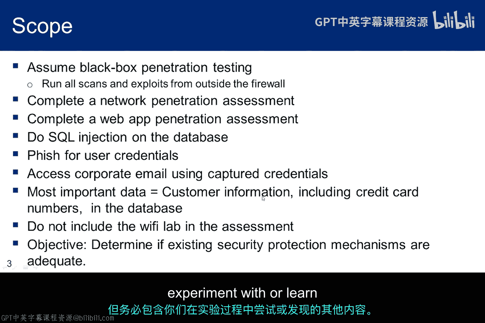
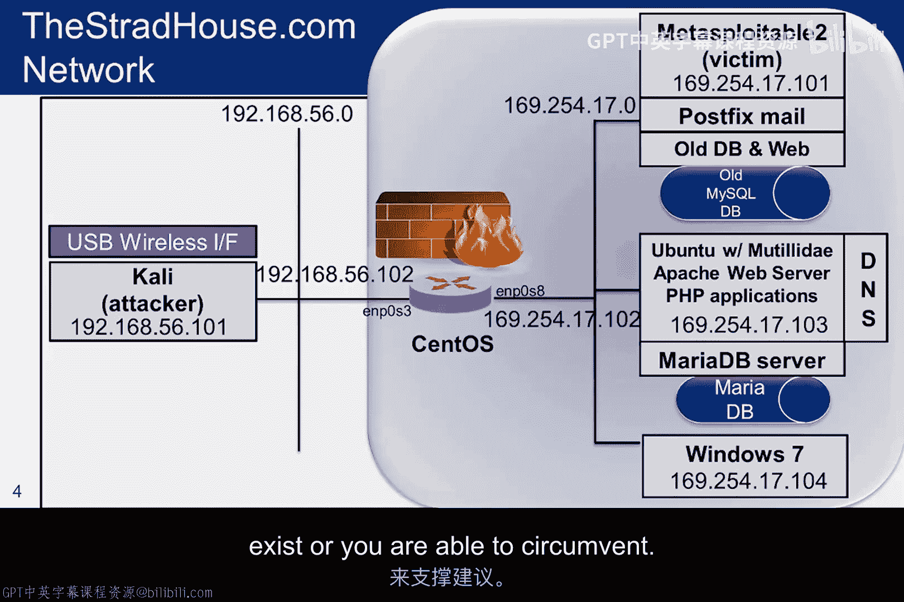
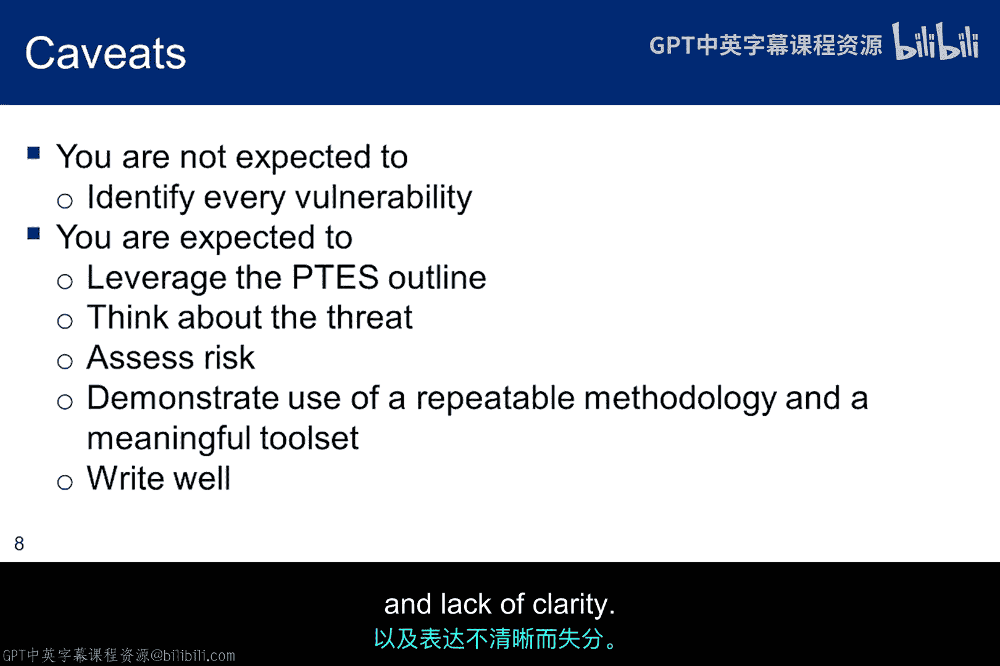

# 约翰霍普金斯大学《道德黑客入门｜Introduction to Ethical Hacking》中英字幕 p12 11_渗透测试实战场景.zh_en -BV1xgu1z1Eau_p12-

Since our ethical hacking lab doesn't provide a total environment for an organization。

 Some of the elements of the PT E S standard are not going to be applicable to this assignment。

 I will try to fill in a few of the gaps and point out some of the sections that probably aren't going to apply。

 but your job will involve tailoring the report to provide a meaningful review of the security posture of this notional organization。

Since we don't have an actual robust organization to run a pen test on this slide provides the context for your report。

 Don't misinterpret this slide。 It may appear to be focused on the web apps and the database。

 but many of your vulnerabilities are also going to come from the services running on the metaplable server and password deficiencies。

There will only be three components to the penetration test， a network pen test， a Web app pen test。

 and some elements of a database pen test。As you explore the Web app vulnerabilities。

 you should also learn a little about the access control mechanisms for the Mysql database。

 so include what you learned in your report。 and in terms of threat modeling。

 assume the database contains valuable data critical to successfully operating the business。

 in addition to customer P I。The Web app lab only asks you to explore three of the OS top 10 vulnerabilities。

 but make sure to include anything else that you experiment with or learn as you work your way through the lab。

This is one view of the target somewhere in the middle between what the executives were going to see and what the security engineers were going to see。

The architecture has some weaknesses。 Think about better designs。 But remember。

 your recommendations should be driven by vulnerabilities and risk， not system design principles。

 In other words， your recommendations should be supportable for security reasons based on the results of your pen testing。

 For example， we know that a multi tiered architecture running in different internal segments with firewalls between them is better than the design shown here。

 but you need to support your recommendations based on weak control mechanisms that don't exist。

 or you are able to circumvent。

This is a reminder that the PT T E S guidance will need to be tailored。 For example。

 since no violin part supplier actually exists， many of the information gathering tools we will discuss are not going to apply。

 And since you only examine three of the Owass top 10 Web app vulnerabilities。

 that discussion and associated recommendations are going to be an incomplete assessment。

 and the report should note that shortcoming of the test。

Here is a summary of the information you will collect over the term that will provide content for the pen testing report。

 But remember， the report is not about a bunch of unassociated screen shots。

 The graphics are part of it， and they should be carefully annotated。

 but the critical thinking is what is important。 Think about the enterprise you are assessing。

We won't do any threat modeling as part of the planning cycle。

 so you should review the pre engagement threat modeling content from the PT E S website。

 I have identified three threats that you should include in your test report。

 If you have taken a different approach to threat modeling and want to include other actors。

 that's fine。If you haven't thought about your testing from the perspective of the thread。

 you should revisit the PT E S guidelines because the threat should drive the pen test。

 This may lead to additional scans， additional exploits and additional post exploit activity。

These are just some of the caveats associated with your report。 First of all。

 you aren't expected to identify every vulnerability。

 You will find much discussion of metaplainable on the Internet。

 including a  hundred and 60 page vulnerability audit。 But that kind of report is not the goal。

 The goal of this homework assignment is to take what you learned throughout the term and assemble it into a structured document that follows the P T E S guidance。

 You would like the pen test to be driven by the threat modeling。

 or at a minimum from the perspective of the threat actors from the previous slide。

Make sure all the approaches documented in the report are based on critical thinking and a repeatable methodology。

 That is not to say that creative thought doesn't play a role。 In fact。

 it is critical to your success。 It just means there needs to be a repeatable process that you will be able to bring back to the client 12 months later in order to generate a second meaningful result that makes sense in the context of the first penetration test。

For a vulnerable system， think about running a penetration test on different Os versions at different times。

 You want the results to be repeatable and comparable。And finally， make sure your writing is concise。

 clear with clean transitions。 Engineers are often great at explaining technical details to other engineers。

 but are not so great at explaining something like business risk to executives。

 You need to be able to do both。 In fact， I recommend you have someone who is not technical。

 Read the executive summary to see if they can follow the flow。

 Even if some of the content is money to them。 technical expertise should not be required to read the executive summary。

 And you will lose points for spelling errors， grammar errors， weak transitions and lack of clarity。

