# 约翰霍普金斯大学《道德黑客入门｜Introduction to Ethical Hacking》中英字幕 p13 12_对称加密技术.zh_en -BV1xgu1z1Eau_p13-

So again classes it' is going to be for module three， PI and cryptography。

The first thing I want to talk about is going to be cphers， data encryption standard。

 advanced encryption standard algorithms， encryption pads。

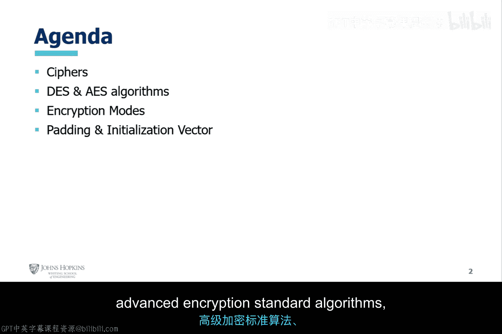

Moodes， excuse me， padty initialization initialization vectors。

So the two types of cpher is transposition and substitution。

 Transposition is basically letters are rearranged， but the d letters are not changed。

So column transposition sphers， plain text hello world， for example。

 the apply columnar trans transposition technique， you will have what comes up there as your vertical format where hello world becomes HOL E WDLOLR。

Substitution is letters are changed， but the position do not change。 So if you have a Cypher text。

 for example， Caesar or cipher。You add a4， basically if the cpher is shifted by four letters。

 then you have a plain tax， which you see therere an output what you have。So basically。

 A becomes an E and you see from plain text to output what you get there。

Cyphers now are not used nowadays， but both of them approaches are wile used by modern ciphers in chapterer 21 of Dr。

 Dewes and the police that talks about the amygma machine。

Which applies a poly alphabetic substitution cipher。

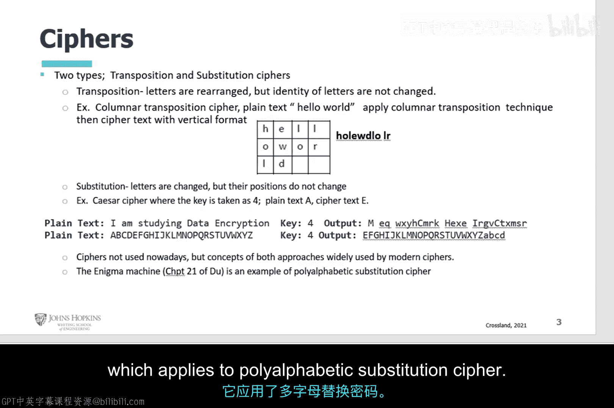

The next is data encryption standard。 So data encryption standardner is a very big encryption standard but base on Luciffer cipher。

 And they submit made two controversial changes。 The main thing is that cut the key size by more than half。

So the original 128 bits was reduced to 64 bits total with size of the key was 56 with a parity check that was8。

In 1997， RSIDs security sponsored a series of death challenges， tried to break the encryption method。

 first challenge be in 1997 saw the 96 days by the Dis shellll project。

 which used idle cycles of thousands of computers across Ar。So this challenge，2。

Tag1 saw by distributed per net in 39 days。In 1998 and in 1999。

 a Joan effort between distributednet and Deep crackracks solved the death challenge too and led over 22 hours so that key basically of the singled 64 bits was basically cracked volatile or sus suible to brute force attacks。

 so now you have the triple deaths， which is 56 times 3 168 bits。However， being in that case。

 computational power and a high competition cost of triple D resulted in does be replaced。

 which you got your advanced encryption standard。

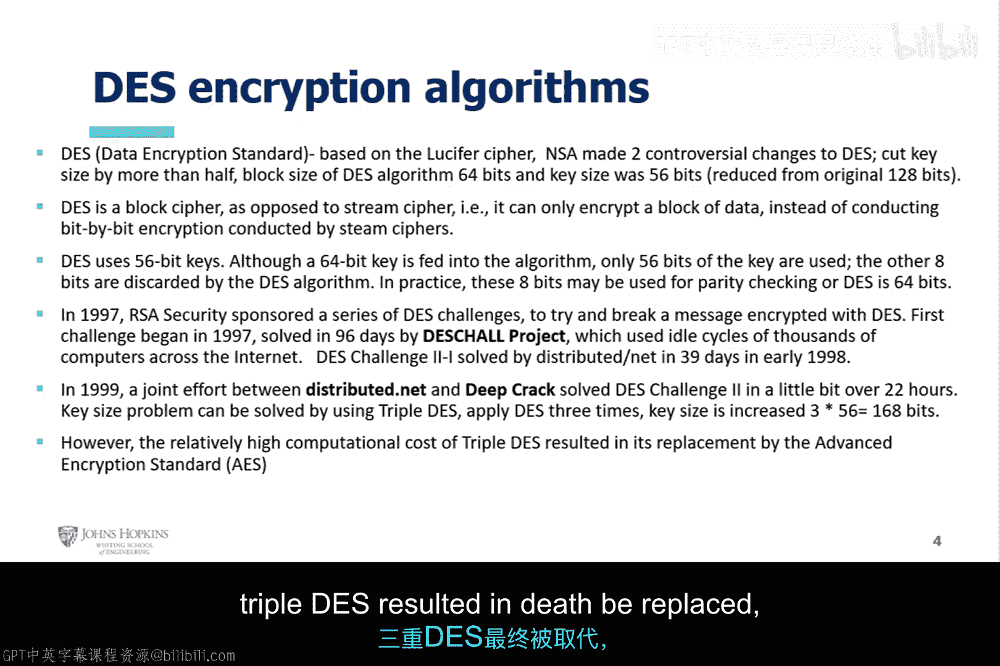

From that AES though， it was open market with no involvement before NSA where DAS was involved in NSA and AES was not。

 so they had a basically selection criteria mandated about algorithm。

Where they wanted to make sure that when algorithm was used for A yes。

 it was publicly defined one symmetric， black cipher 2， freely available， scuttable horror software。

 andled to multiple key linkss。Substitution judge， according to the cryptographic strength。

 the ease of implementation， performance of software hardware and royal fees。

Toil and cphers were submitted， and of those five finalists were there。

 the winner was Rel blocklock Cyrus for AES Fscription standard was 128，182 and 256。

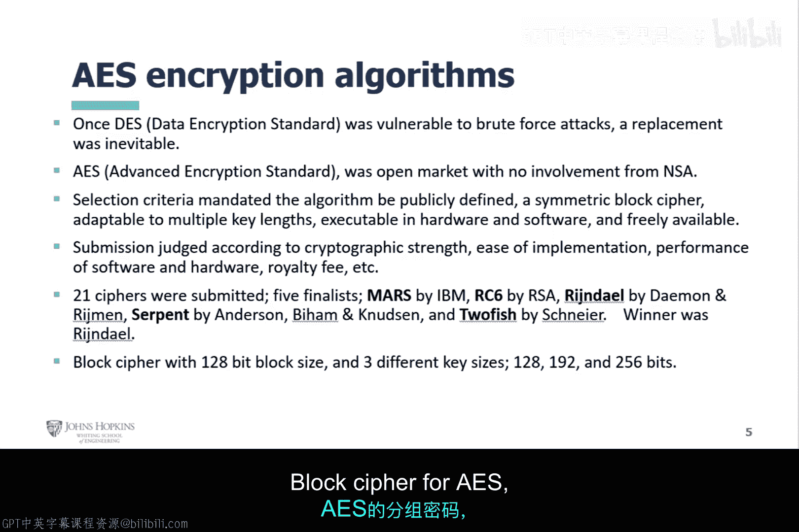

So the next thing I want to talk about description modes here。

 the main thing I want to say here is that you have electronic code code book。First one。

 it is a block cipher， 64 bits， easy， it's fast to use， mostly if you use for small chunks of data。

But it has its dangers。 and that it be in substitution permutation that is using this。

 but the two security concerns。Is really because one each block encrypted with the same key and the code book。

 hence the attacker can cover the key and decrypt all the blocks of the data。

 And the second is a attacker could gather the Cypher implant tax of each block and build a code book that was used without needing the key。

So the problem is that is not enough randomness to process in middle blocks。

 a large amounts of data can be cracked。 So if you have a pattern saying boldulder patterns will show themselves。

 if you have the same plain text。You always use the same platet and you apply the same key。

 you always get the same cphert as a result。But if youre using pins， challenge response。

 value for authentication processes， encryption keys。

 usually ECB is used because it is fast it is easy and it is efficient for small amounts of data。

So basically best use for databases。

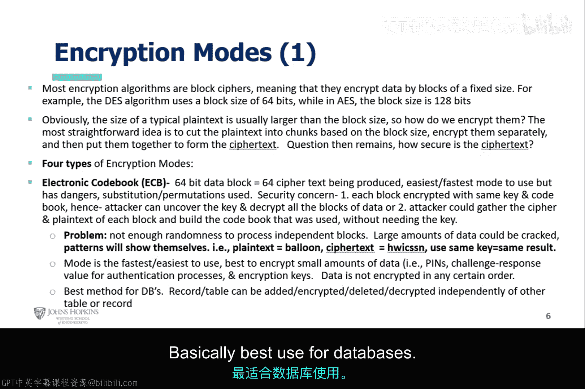

The second one is excuse me， the second one after ECB。

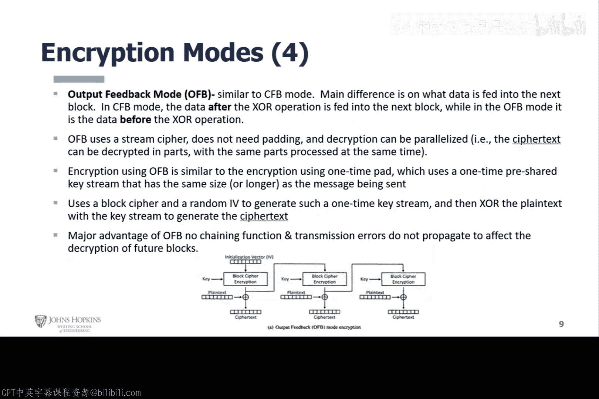

After ECB， excuse me， is the second one， which is suffer blockchain。So you see the diagram there。

 the difference here that does not reveal patterns E codebook does when we just talked about software blockchain is not。

 so that's a benefit。Sinceent block of tax， the key value based on the previous block to the previous process in the。

 the process and algorithm applied to the next block text。This one。

 the big difference here uses initialization vector。Where AC be does not。

 so this here's initialization vector。This is a huge deal because basically the IV ensure that if the two plain texts are identical。

 their Cyphert are still different。And we'll also use an exclusive order。

For the first block of the plain text then is encrypted。

 Brazil the sa is sclusborn with a second block to the plain text then encryptryed as well。

And the about this， too is that uses chainney。 So chainney as a sequence of bands are encrypted as a single unit a block。

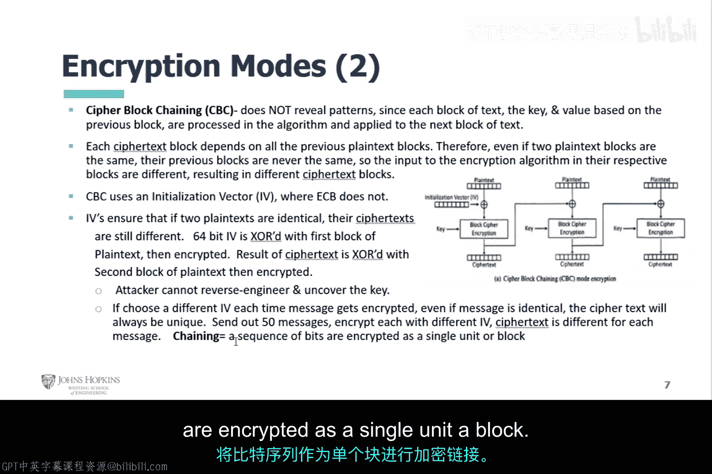

The third one was cipher feedback mode， accommodation combination of the block and the stream。

 so basically this also used block cipher is encryptpted exactly the same as done in CBC。

Had a initialization vector， but also had a stream cipher。

 So a key and IV are used by algorithm to create this key stream， which is random set of bits。

So it a diagram， I see here mouses。Basically operates against data produced in real time and uses initialization vectors and chaining。

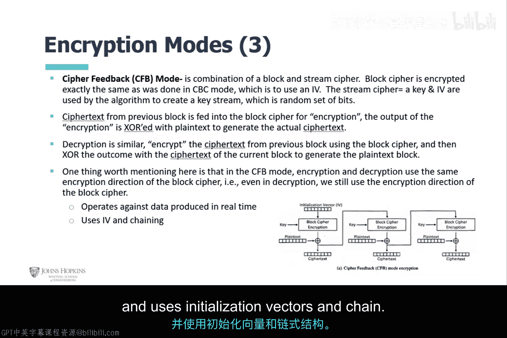

The next one is going to be the output feedback mode similar to cyber feedback mode made differences on what data is fed into the next block。

 the CFB mode， the data after the exclusivevo fed is fed into the next block and what I be mode。

It is the data before the PX to order operation So again。

 the difference is is that the cyber feedback we just talked about the data after this consumer operation is fed in the next block。

Or I'll put feedback on the data before this system operation is found。

Another big thing about this is in our major advantage of Oipes。

 no chaining function and no transmission errors So is they do not propagate the transmission errors。

And since with no chain functional transmission errors。

 do not propagate to effect the decryption of the future blocks。

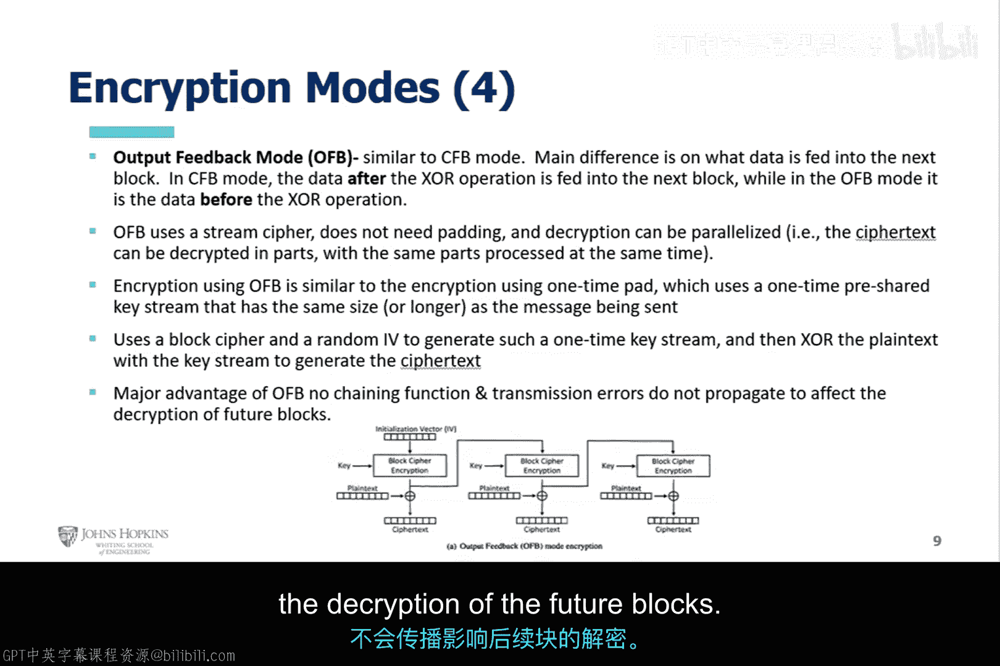

And then the last one is or next thing Im to talk about is the padding initialization in vectorors。

 So the main thing about this is when encrypt modes were used data divide a block on the size of your block should match the cypherrus block size。

But there's usually no guarantee of that。 So the size of the last block matches a suffer block size。

 you always can't determine that。 So what they did is they basically had padding put into place。

So for for the V CBC this is not a problem。Usually anything that is not an issue for mode that use stream ciphers。

But for our blockchain， this is a problem， so last block needs to be pad。So namely。

 before encryption， each data needs to be added to last block complaint tax。

 so its size equals to Cy' block size。And the last thing about initialization vectors。

 I'll say is that if IVs are not used then the two identical plant values that are crypted in the same key。

 would you create the same sph text。

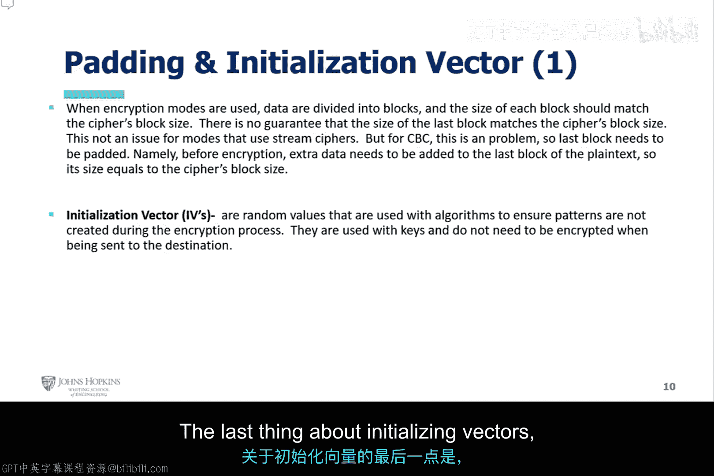

So IVs and keys are both used bygon to provide more randomness to encryption to the encryption process。

One thing to know about this， though， there is a couple tax， which are， you know， mistakes。

Withth initialation factors is built， you know， first one is space requirement for IV to be unique。

And that if you have them being unique you use just say mys。

 you can be susceptible it's known plain text attacks。

And the second part is after use Is use predictable Is。I mean。

 initially some vectors cannot repeat themselves。So if you do repeat them。

 and then so the developer may change everyV over time as is encrypted。And you don't。

 you fall into the predictive byV stand standpoint， you can have chosen plain tech attacks。

So that's the first video and then during office hours。

 I'm going to go through and talk about this a little more in depth。

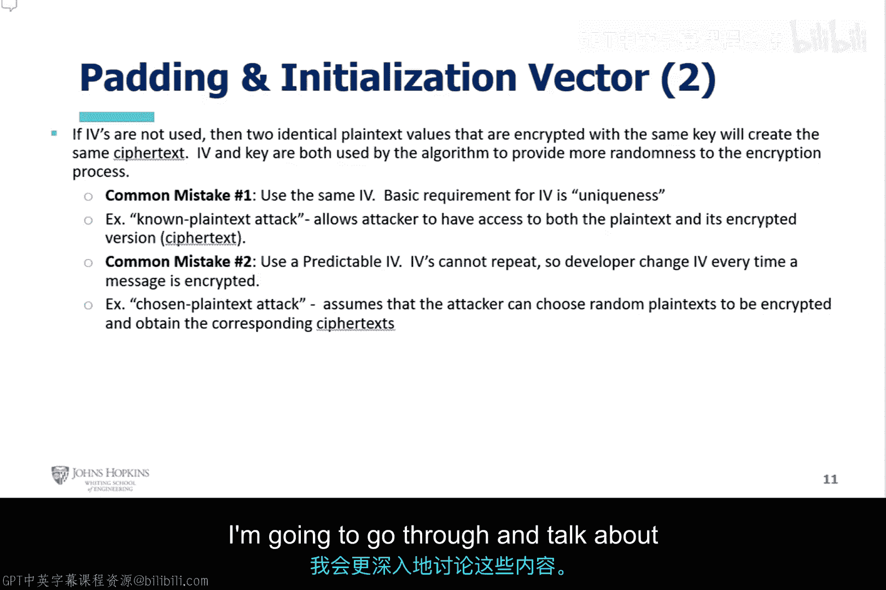