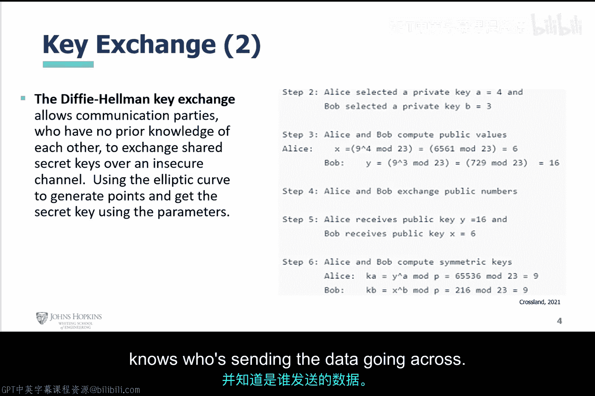
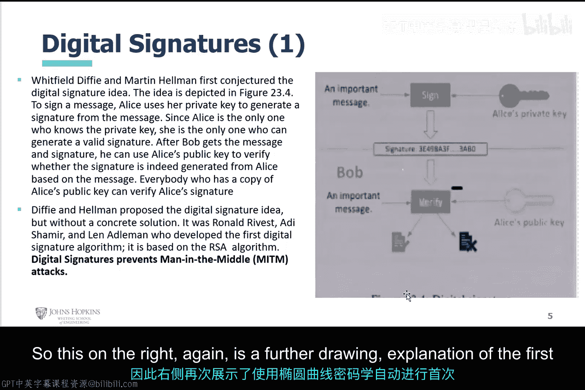
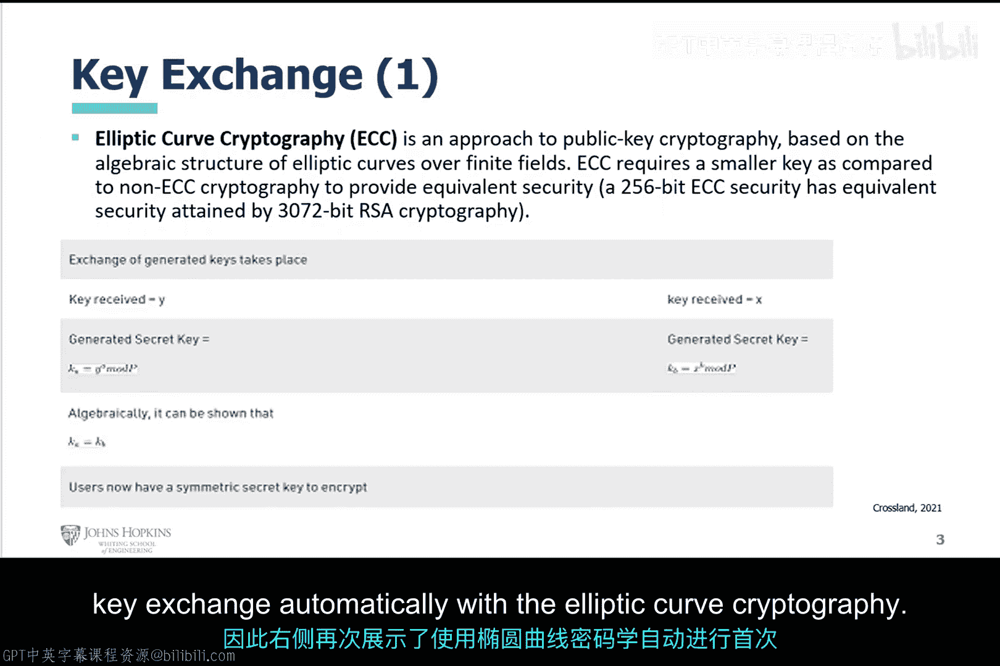
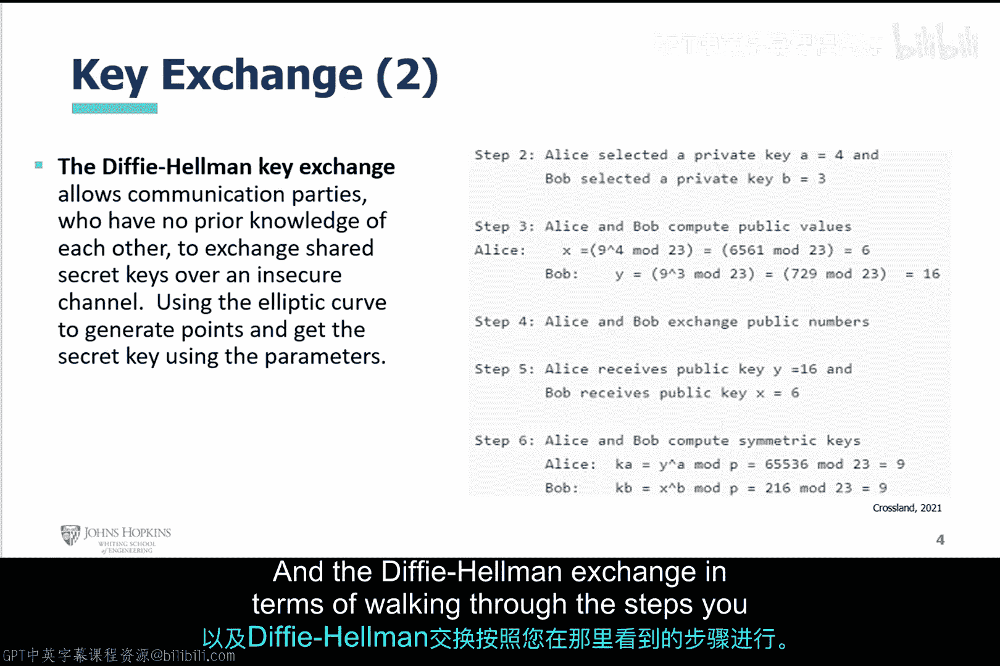
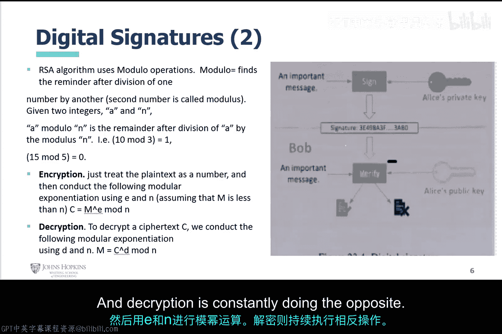
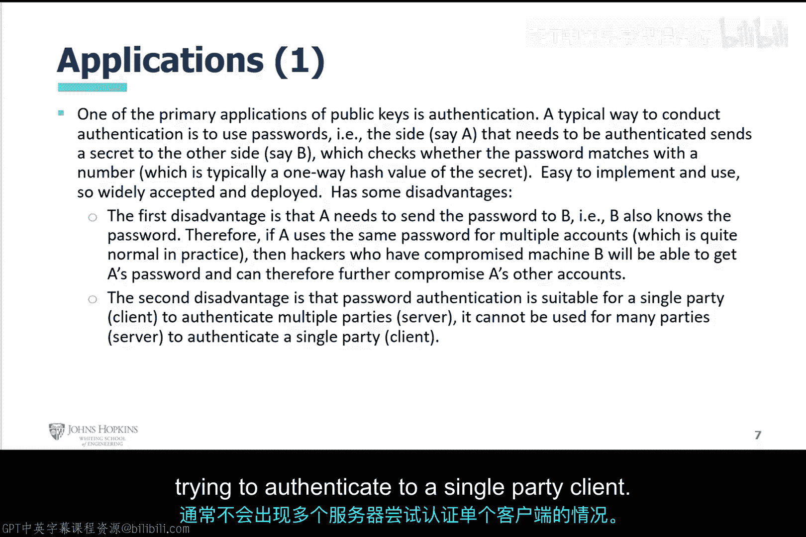
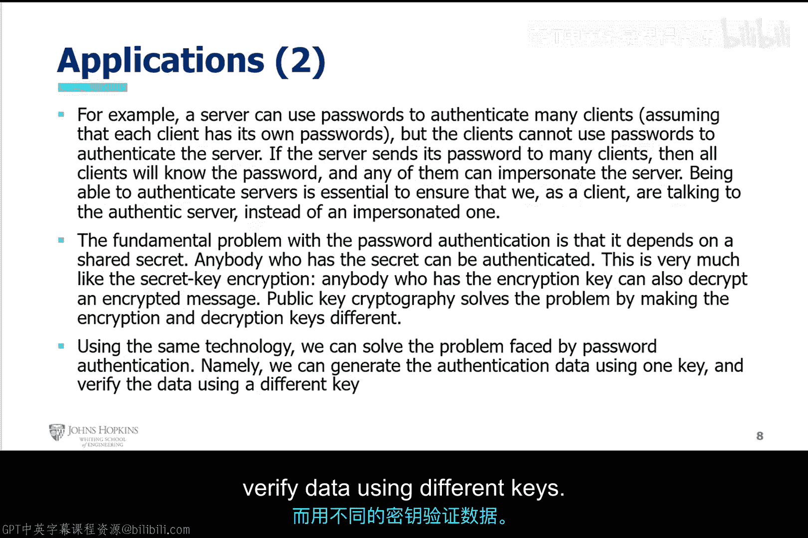

# 约翰霍普金斯大学《道德黑客入门｜Introduction to Ethical Hacking》中英字幕 p14 13_公钥密码学原理.zh_en -BV1xgu1z1Eau_p14-

So the next one I'm going to talk about is public key cryptography。

so in this one you have three fundamentals we're going to talk about key exchange digital signatures and applications。

So the first part is that key exchange， the elliptic curve cryptography ECC is the main one used in the key exchange。

Which ECC is an approach to public key cryography。Based on the algebraic structure electric curve。

Have over finite fields， so UCCC required a small key as compared to N electric elliplltic curve carography。

To provide equivalent security， which equivalent being the 256 bit。

 ECC security has equivalent security obtaineded by the 3072 bit or sacredt。And below is basically。

A breakout of when you log through the acute exchange。Mathematically， between the keys。

 the keys chain and receive key Y to receive key acts between two parties。

 how it breaks down how the actualho form alive of the algebraic piece of it goes from generating secret key between two individuals algebraically as shown and then sharing a secret key across。

So further into the secret key or into the key key exchange is a differenty helmet key exchange。

So allows communication parties who have no prior to be taught to exchange share secret keys over insecure channel。

 using the elliper curve to generate points and get them get the secret keys in the parameters。

 So on the right side， you have steps。And traditional bugs says Ben for Ab But' see。

 you'll talk about Alice and Bob wanting to change keys between each other。

So if you look at the Alice selected the private key and Bob， you walk through those steps。

 basically you keep going through that， you take the mod of those。

 you can find out what Dallas public key exchange and public keys。

 they would get the key between each other， then they can share those keys securely。

Trusting that the party known that other party received it actually sign and knows who's sending the data going across。

The other part the digital signatures going further is that White field Duffy and Martin Heman the Vihelman key exchange first conjected that digital signature idea that was starting point of that。

 So this on the right again is a further dyinging explanation of the first key exchange aftermet with the ellipric curve cryptography。

And that if you exchange terms of walking through the steps， you see there。

When you go through the Q exchange， basically depict it on that screen on the right， 23。

4 is a picture on the right。To sign the message， Alice uses a private key to generate a signature from the message。

 which you see on top of this appear。She after she signs the Mr， she is only， you know。

 since Alice is only one who knows a private key， which is her key。

She will generate that sent an across。 And after Bob gets a message of the signature。

 he can use the public key from Alice to verify the signature here that the message is authentic in this from Bob and then everybody who has a copy of Alice's public key can then verify Alice's signature。

Diffy Hillman proposed a digital Senator idea but without a concrete solution。Basically moved to RSA。

 Rond R， Ris， Audi Shamir， and Lyn Otterman， RSA， who developed the first stage signature algorithm based on RFA algorithm。

So。Dital center as though basically helps prevent the man attacks。

 which I'll talk about later in his videos。So our say， really， again， based on these gentlemen here。

 the Roder revisedd Addy Shamir Lynn Alttoman。Basically， RSA uses modular operations。

 Moular basically flats are mainly after division of1。Numb by another， sub sleeve。

 if you have second numbers called a modulus， and you have two integers A and N。 So， for example。

 if you have a and a module N。The a could be， like I said，10 or 3 or 15 and 5。

 And the remainder of after the division of those a by the modulus of n get your remainderer。

 So 10 divided by 3 turn mod 3 or remainder is 1，150 modd 5 or a module n remainder of 0。

So encryptption decryption， this encryptption takes the plank text as a number。

 and then conduct a following modular explanation using E&M and decryption is going to still in the opposite。

Now on the form area you see how they break up carpet and the two those。

And the last thing or two things， I'm sorry， is an application。

 so one of the primary applications about the keys is authentication。

So a typical way to conduct authentication is use passwords。

So if you have side A to say client A wants it needs them to be authenticated to send a circuit message to other side to say client B。

Which checks one of the passenger matches with a number。

 which typically when we hash value of the secret， iss easy to implement and use so while acceptable and developed。

 But there is some disadvantages in this。 Okay。 So first of an disadvantage。

Is that aim needs to be set。Send the password to B so B also knows the password because it sends it So therefore a if a uses the same password for multiple accounts。

 which is quite normal and basically right， then the hackers who have a compromise machine B will also be able to get the A's password and therefore can further compromise other A's accounts of these in the same password。

The second disadvantage is that the password authentication is sitting for a single party。

So client to authentic Molten part is server， but it's not necessarily good the other way around。

So I usually do not have multiple parties， the servers try to authenticate to a single party a client。

And then other part of applications， for example， is a server can use password and authenticate many clients。

 which talked about assuming that each client has a own password， right。

But decline clientss cannot use Pa tour authentic to server。

So the server sends this password to many clients and all the clients would know the password， right？

Add any of them to can then impersonate the server。

 That's why usually you have a signal to many a server to a client to a server not the way around。

So being able to authenticate servers is essential to show that we as a client。

 meaning as a person right talking to authentic servers。

So it can be the authenticational trust can be violated。

Fal problem with the password litigationation， though， is that depends honestly shared secret。

Sysymmetric concerns asymmetric public private。 Any who has a secret can be authenticated so is very much like a key encryption。

 Any who has encryption key also decryptive message。

So that's why public key or asymmetric cryptography solves a problem。

 Basically you don't have a shared secret or a same key as symmetric key。嗯。

And the public key basically solves as you see in digital signatures or the digital TV human in or ECC exchange。

Because you're making， but you know， you're not probably making encryption encryption keys different by using public key or asymmetric encryption。

And using the same technology， we can solve the problem phased by password authentication。

 and we can generate authentication data using one key and verify data using different keys。

