# 约翰霍普金斯大学《道德黑客入门｜Introduction to Ethical Hacking》中英字幕 p15 14_公钥基础设施(PKI).zh_en -BV1xgu1z1Eau_p15-

And the last video we're going to talk about is public key infrastructure。So with this one。

 there's a couple of things we're going to go through public key cryretography hashing。

 attacks on public key cryreptography， the public key certificates， mainly the X。 509。

 which is the main one certificate authorities how they work， attacks on public key infrastructures。

 cast case， studies and types of digital signature certificates。

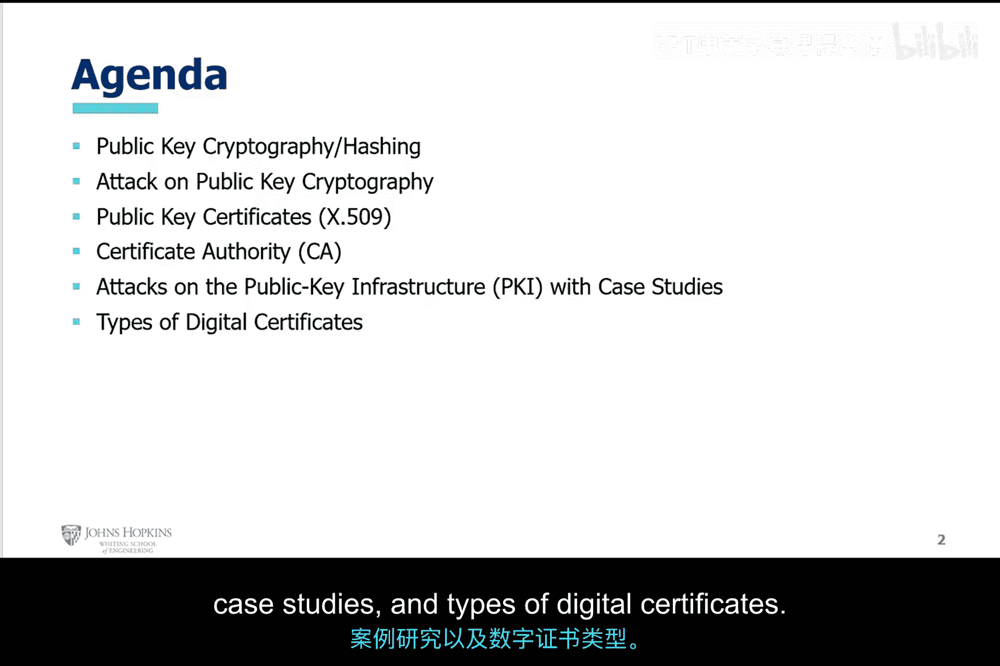

So public key cartography your hashing we just talked about digital signatures like ify hill and ECC and we're going to get a little more discussion on that so public key cryography your PK you know private infrastructure PKI。

We talked about Diffy Hillman，1976， so that was invented by them。 The cryryion re odd secret keys。

And we talked how public key， private public keys was used to help with that authentication piece using the same key。

So the challenge then we talked about with secret key encryption is a key exchange because using the same key。

 so key exchange， saying the secret key to other party before a encryption channel is established。

Any eavdpers？Can see that if the Cf secret key is unprotected。这。

So public key cryptgraphies solve this problem as we talked about because you have the public and private keys that we just talked about with the digital signature and Alice and Bob of exchange。

By allowing encryption keys， have be made public so they can be sent to other parties in plain text。

 so you're not giving your private key away。So unfortunately， though。

 why the fes drop in attack as you're not using the same keys。

 the public used cryography is still vulnerable to certain kinds of attacks。

Which is the man of the middle， which we mentioned in the last video。

 which we're going to talk a little more now in this this video。

So that man in the middle or MIT and attacked， attacks happens when someone else is under something to travel between two devices or two individuals。

So when a computer send the data to another computer。

 the data travels through various devices of routers， switches， hubs， demand controllers， etc。

 prefer reaching the other computer。These devices or compromise can be used to launch MITM attacks。

So the National Student of Technology NIS specifies a digital Center algorithm be acceptable for federal government is using the federal information processing standard FPS。

186 tech 4 also known as the digital signature standard DSss。

So DoA specifies on a federally approved inter signature algorithms must use a Shaw to hashing function。

So hash functions take a potentially long message， generates a unique output value derived from the content of the message。

So does wide variety of synonyms used for hashes， hash， hash value， hash total。

 cyclic redundancy checks， fingerprints， checks some， and digital IDs？

So public use to talk for your hashing a little more about that is that RSA。

 which talked about that algorithm， five basic requirements for cryptographic hash functions。

One input be input can be of any length can be whatever you want， output must be fixed。

 the hash function is relatively easy to compute for any input， hash functions when weigh。

 meaning that extremely hard to determine the input when provided the output and lastly。

 a hash function is a collection free。Excuse me， collision free。

 extremely hard to find where basically is extremely。

Hard to find two messages that produce the same hash value。

So the last one is hash function is collision for you and I'll change that。

Buts extremely hard to find two messages that produce the same hash value。

 So common hashing algorithms， Shaw 256， Shaw5 12， MD D message Ija 2。

4 and 5 and then message hash message authentication code。So data signature standards。

 DSS also specifies encrypt algorithms can be used to support data signatures， infrastructures。

Those are the three basically ones that are allowed to support digital signature infrastructures。

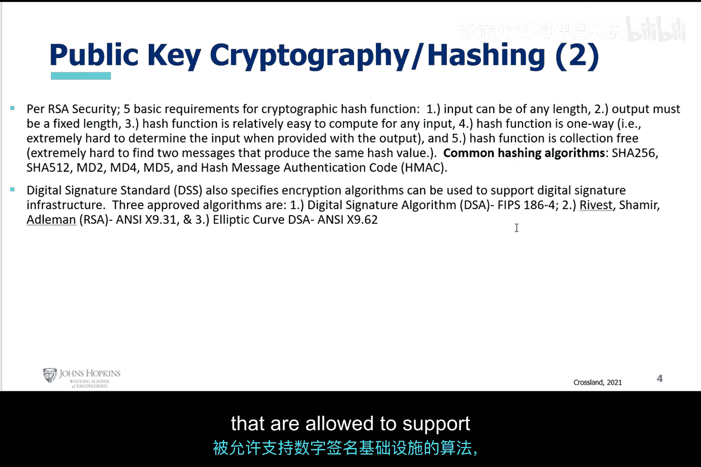

And then we go into here。 So we talked about manment text。

 And here is basically the Alice Bob again with the key with a secret in the public。

 And you have it mail at Mallory， which is the person in the middle， Be being the malicious party。

Saz and Bob wants to communicate over the Internet want to ensure a God exchange is cryed between them。

 So Alice have sent her public key to Bob。Bob can generate a secret key， See here。

Ecrypt the cigar keys and bought Alice's public key because it's public so she can get it。

end and send the message to Alice， Alice you decrypt a message。With her private key。

And then basically， adversaries with eavesrop on the and the communication will not be able to get the secret key because of the fact that she's using her private public key not the secret key。

 So that solves in eavesdrops because using two different keys and not using the same key。

But intercepting the message is another part of this。So Mallory intercepts into to the middle。

 the public key stuff from malice here。Instead of affording the os key to Bob。

 Mallory fors her own public key to Bob。Bob basically can't tell the difference。

 So because the message seems to be from Alice。He uses the C public key。

 which he thinks is for Alice was really for Mallory。And crptps the secret key generated by him here。

M enter subsetat。since a message is encrypt crypted use in the her public key， which is Alice's。

Then basically can get to correct the message， get the secret key the Bob used。

 send the key then to Alice who's Alice's public key because she basically intercepted it。

And then gives that to Alice。 So that Alice can dec the message。 Get the key。

And then basically from now， alpha Bob can use a secret key。K trip the message the communications。

 So the result is that since Mallory noticed the secret key。

 because she intercepted that here in the man middle attack。Ba。

 she knows that she can use a secret between Alice and Bob。

 she can decrypt entire communication between them both。

Because she has a public and she has a secret key。And more。

 she also changed her data since security between Alice and Bob， but basically compromised。

Because again， gal and decrypts a message。Here， Gi it send it across。 The publicies are shared。

 but the syny key is also gone between。When he decryptps it。Bob decrypts it from the See key。

 Basically， this is a message erypted uses her public key， she can decrypt the message。

And get the secret key going between。

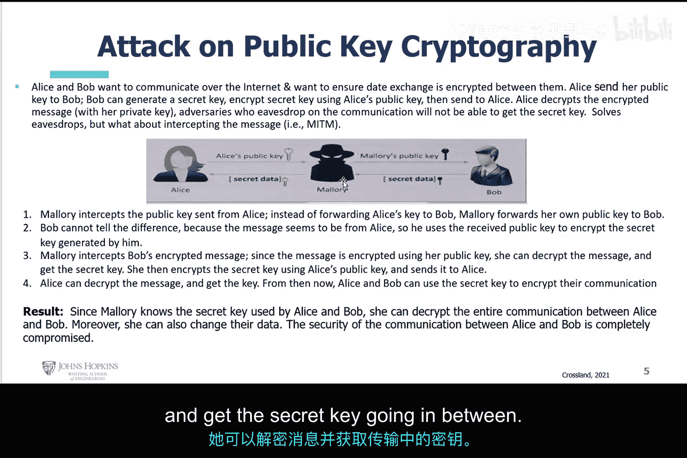

So on the next part of this basically， is kind of a recap， which is for four things on that。

 So the way to solve the digital signature or the， you know， the man， the middle attack。

Is they use digital signatures or use basically the public key cryography。

Basically in public private keys not using the same key。

 So Alice sends a public key and a entire certificate to Bob。

And reason why this du private public and private key is why you're not using the same key symmetric using asymmetric encryption。

 public and private。 Secondly， because of digital signatures。

 you're having a trusted third party and certificate authority。

I basically can validateity and that trust that issue until that certificate being sent to Bob and Bob to Alice So that Bob knows it's coming from Alice and Alice knows's coming from Bob because it's trusted by a third party certificate of authority。

So so Bob， basically， publicly he comes with a name that's already been certified。

 So basically Bob gets it。 He knows from Alice because he can view the certificate showing us from Alice and not from Mallory。

 So even if Maory can still intercept his certificate。

She cannot replace Alice's public key with her own public key。

Why keep in Alice's name because that will invalidate the digital such signature on that public key。

 the digital signature thats part of that， you， trusted certificate authority。

 So if Mallory sends her own to Bob， Bob will know that the public key does not belong Alice。

I will not continue with the protocol。So' no way for Mallory to get a certificate choosing consisting of a public key or office's name。

Because again， the certificate authority would never sign that or validate for it or issue a certificate without validating who that person is。

 actually vouching for the background and vouching for an national authentication of the person is。

So that's how digital signatures and Sal authorities。Fix。

 basically the man middle attack and the ability for public private keys to be compromised。

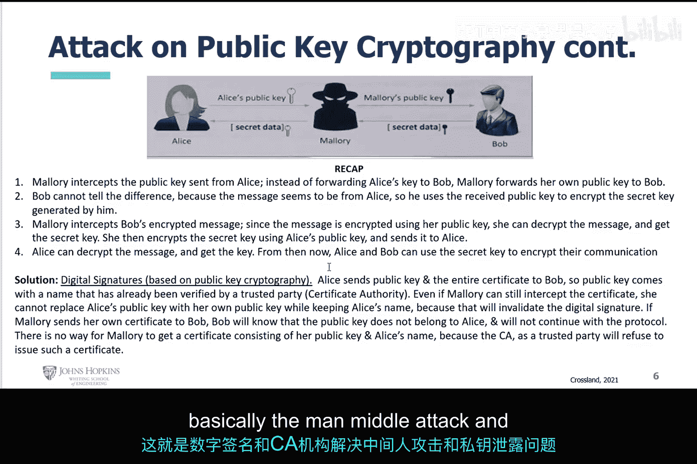

So go to the next one we're going to talk about public key certificate next 509。

 so basically you have the format on the left hand side and then the right side it it talks about this is taken from a Paypal again out of Dr。

 De after the readings for this week， each of those are the names。

 issue or subject public keys and ensure validityity etc and the definitions of each。

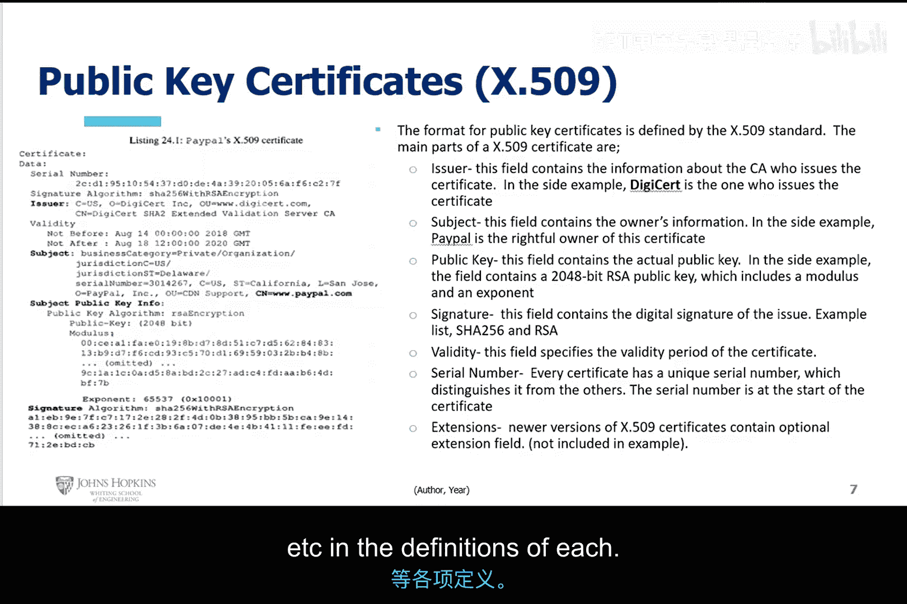

So as you go through specific authorities basically， there's three steps of this。

 One is an enrollment。 So enrollment obtain a digital certificate。

 he must prove or den to the C A and has physical appearing before agent to certificate authority of the appropriate identification and welcome to those steps。

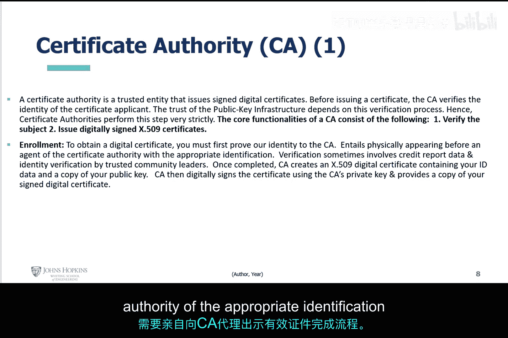

The next part is verification and revocation。So a verification verification。

 basically a verification involves a verifying certificate of someone you wish to communicate with but checking the state digital signage signatures by those meanss you see there。

And the revocation， usually there's only four reasons you're going to have something revocationated or pull from you。

 and those listed on this slide as well。

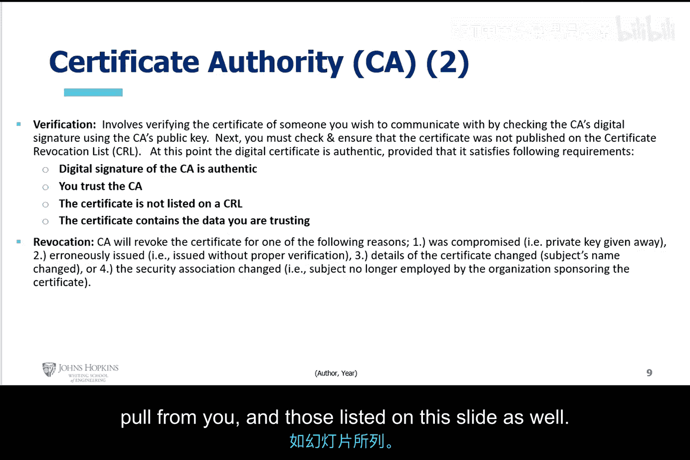

So tax on say is a verification process。You basically have two different ways and these are two case studies we're going to talk about and the last piece that we're going to talk about is again。

 tag a little bit some more and then also all on the algorithm itself and then the types of digital certificates。

So there's two key studies that were done on tax of CA's verification process one was the verification process。

 another attack was on the CA's signing process。So the first one was basically。

 you know of the verification we talked to about's role see is to verify the public key belonging to the particular subject。

And there's two parts of them。 So on the key study， what they did as they found is done in 2011。

 where basically the most popular route Cis look in New Jersey。

 and they had basically Kamano filled an incident report where they saw due one of this compromised registration authorities。

9 certificates ratio to 77 domains。But no attacks using a sifics for ever seen wild。

But they does show this and what kind of happens again is that they did detect due to the compromised attack attackers could provide false assessestation。

 which attests to the CAs attacker owns a targeted domain， so upon receiving such astation。

 the issue that CA will issue a certificate。So effective several domains missilla dot org。

 for example， in Adon So basically at that point， one of the key domains in the Firefox browser was Missoilla do org Adon sub missoilla do org。

 So that was fixed and basically。All basically Firebox updates browsers to recognize the four certificates and block them automatically。

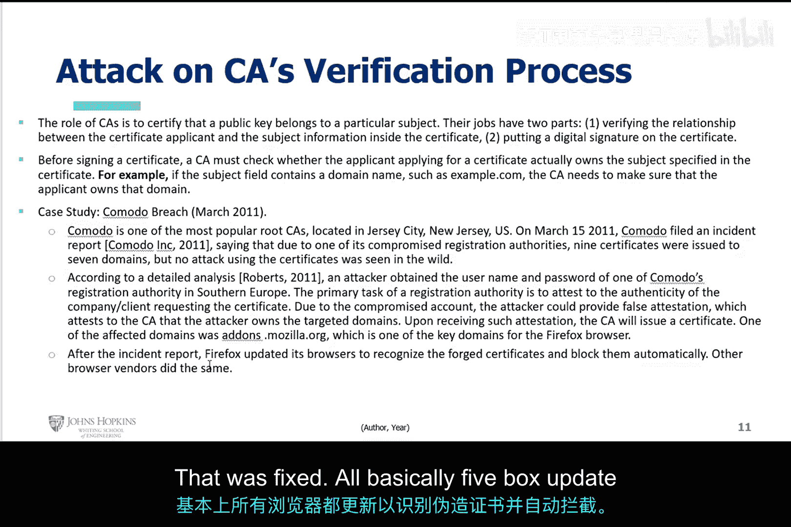

The other one was gets signing process and that was at Bagdoor Natter breach。

The kind of the main thing about this was that the traffic was intended for Google's subdomains likely basically have been intercepted and redirected during the man attack。

But this basically attacked approximately 300，000 users and exclusively was located in Islamic Republic and Iran。

But then again， this was potentially exposed contents under interceptive traffic as Google credentials。

 it was identified and then it was taken care of。

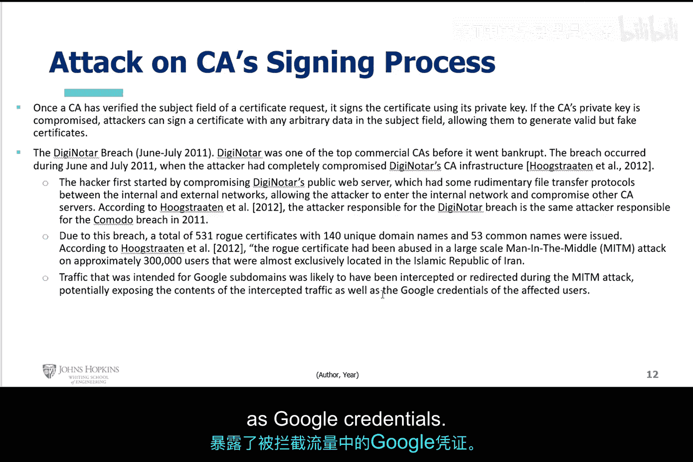

And it add to tax on algorithms。These are two main things collision resist the property of oneway Hah was one case study。

Basically what this is what digital signatures are conducted and when we hash。

 we talked about the five properties when we hash。So basically of the certificates is why you always。

 in one way， hasher algorithms are used。A good one hash algorithm should have two properties。

 one way and collision resistance。A collision free。

 so collision resistance property ensures that it's difficult to find two measurement messages that produce the same hash value。

Severally widely used one hash functions have trouble， maintains properties。

 so this is one where saw。In February 2017， CI， Amsterdam and Google Research analysis Shatter attack would break the collision resistance property。

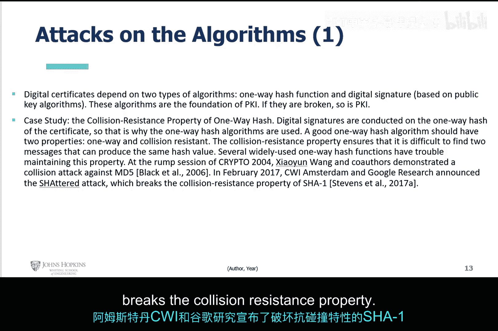

Go on from the Sha attack， basically in 2017， they demonstrated further they could create two different PDF files with the same Shaw hash。

As you go through this， you would find that both， you know。

 if you had both certificatevics can generate the same Sha has attackers to say you had example。

org exampled their3232。com。If you owner the same between those two and you own both of those。

 then basically attacker versions A to the CA and CA would not sign it so the attacker descends version B and CA will also sign that。

So since both certificates have the same one way hash value。

 sign the hash and the second certificate is equivalent to sign the hash of the first one。

So essentially that attacker gets a valid to get with example。com in the subject field。

 a attacker can now launch to manmental attack。

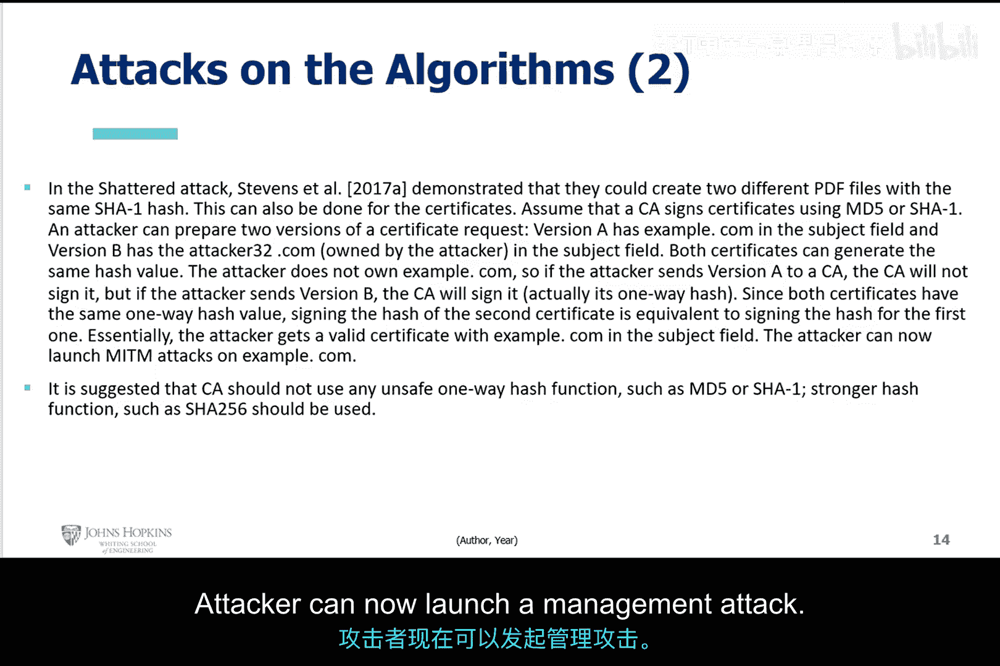

And the two types of certificates and there's three we're going to talk about is the validate certificate。

 the organization validated certificate， and the last one is the extended validated certificate。

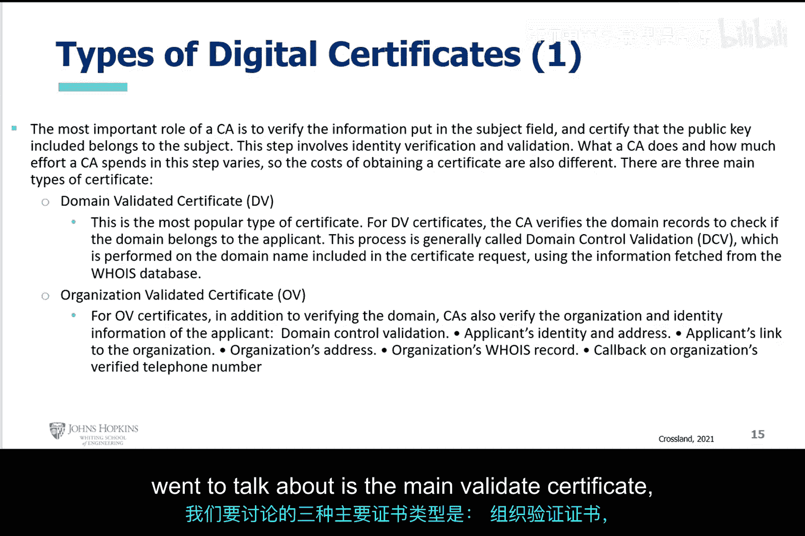

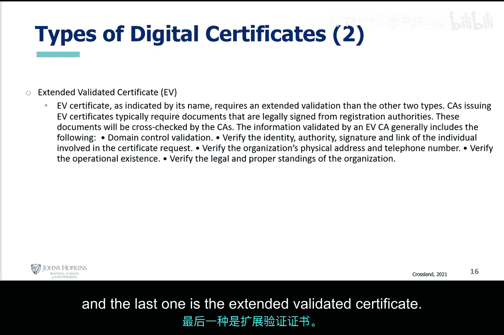

So in these are types of digital certificates， you have domain which is the most popular type of certificate。

 basically it's the CA verifies the domain records a check if the domain belongs to the applicant。

The next one is OV all organization validated， and this is to verify the domain C is also verified the organization and the identity of the information and of the applicant。

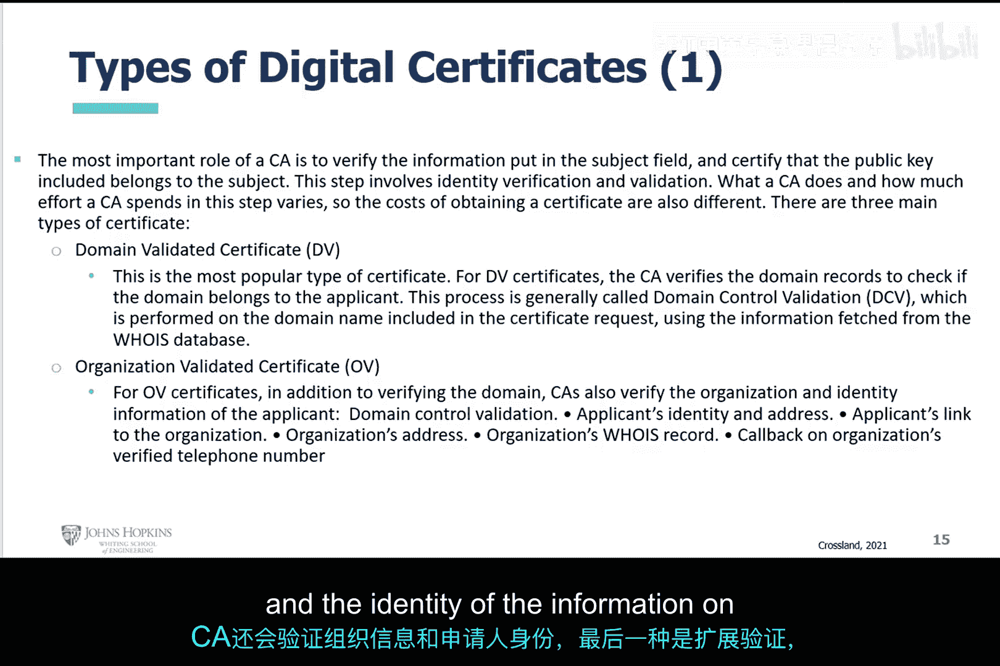

And the last one is the extended validated， which is dedicated by its name。

So it requires extended validation of the other two types。

 other two types being the domain and the organization validate sort of like。

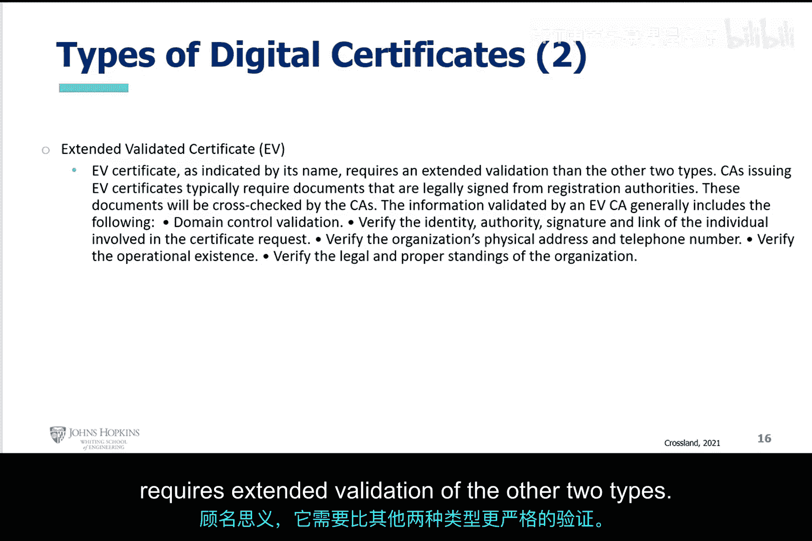

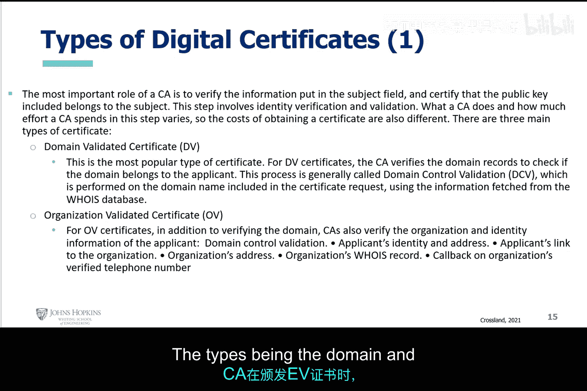

So see these issues EV certificates typically requires the mains documents that are legally signed from registration authorities these dos will be cross-checked by CAs and then have multiple steps to go through there So on office hours I'm going to go through these videos again I kind of went through them real quick but I'm going to talk to them during office hours kind of touch that main highlights of these each time we do office hours These are some of the videos I'm going to go through I'll pull some of the aspects out of these all three let just went through and we'll talk about these more during office hours but these are the three kind of video sets for module3 for ethical hacking and again I'll go through these videos highlighting some more aspects of them as we do office hours in the course。

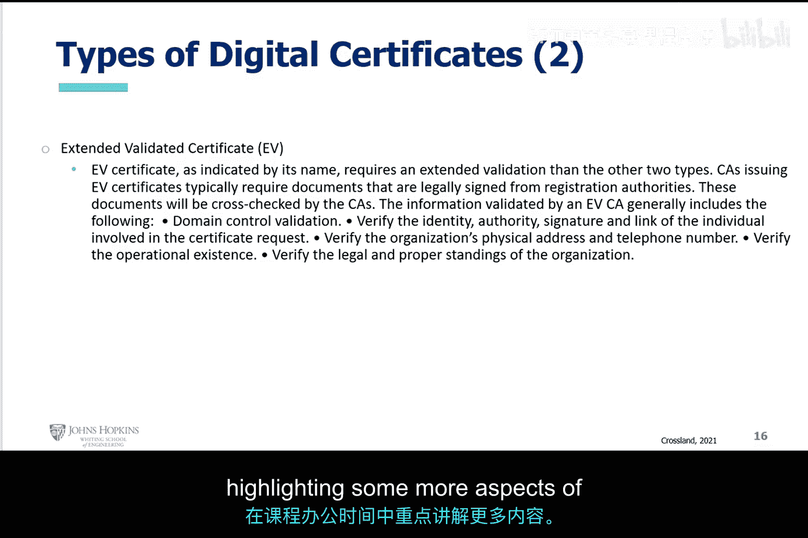