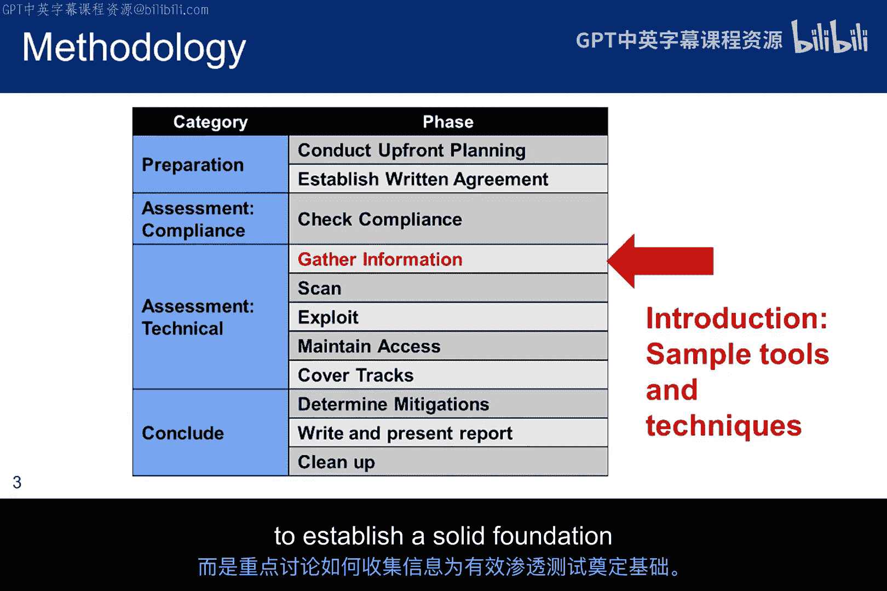
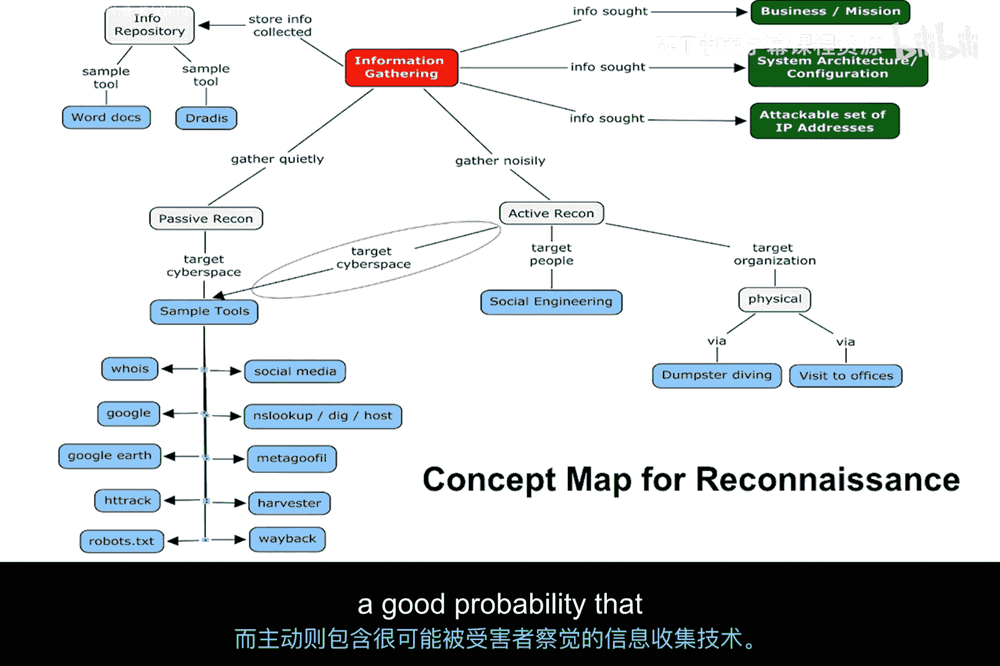
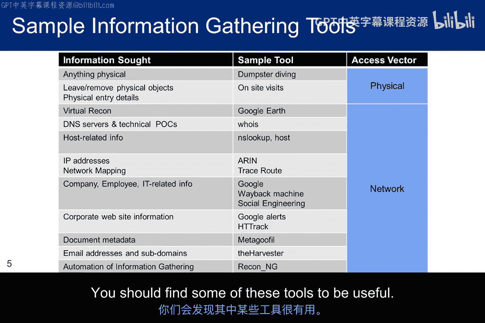
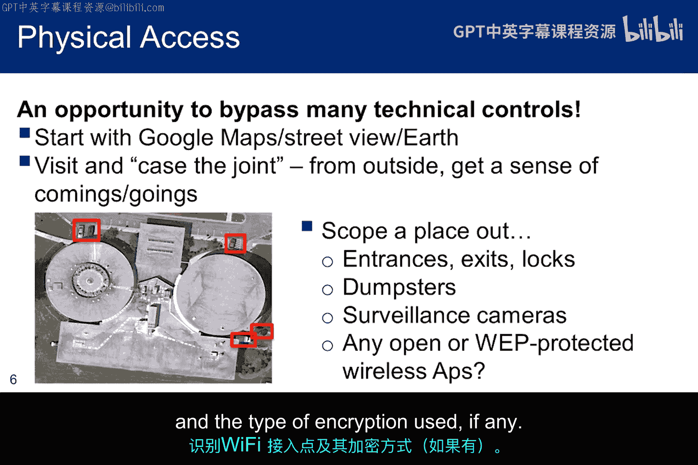
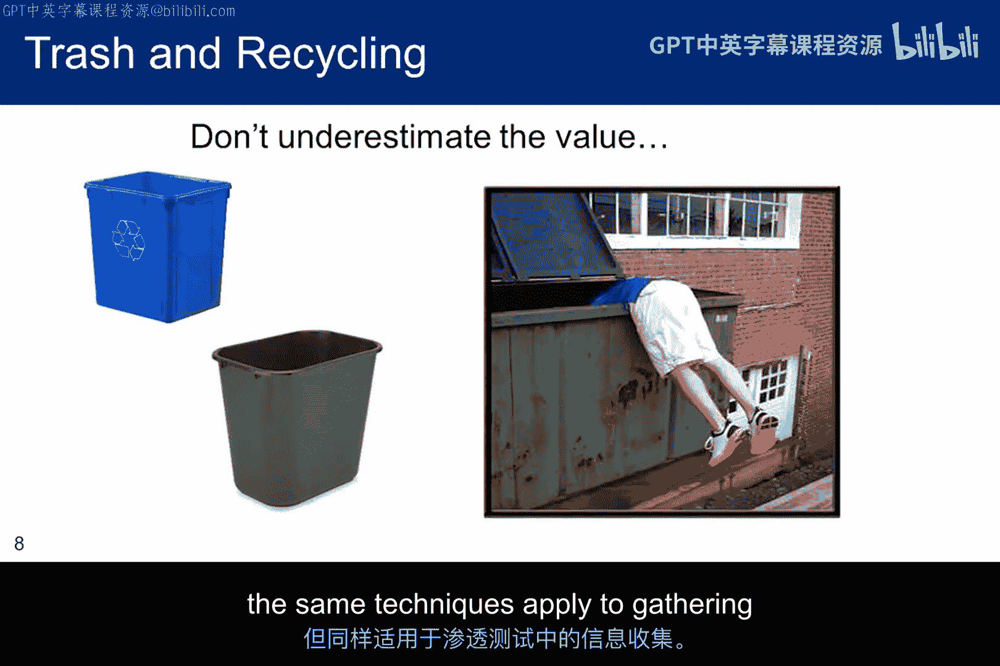
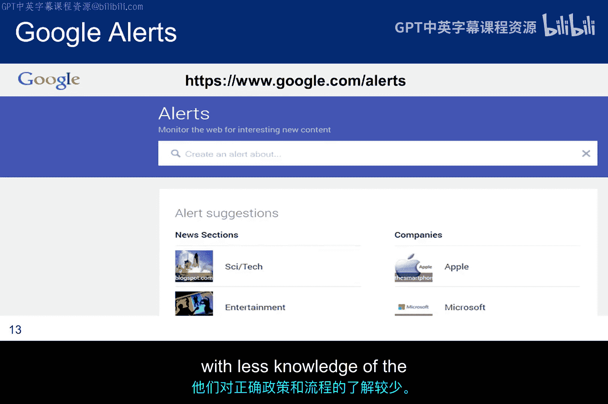
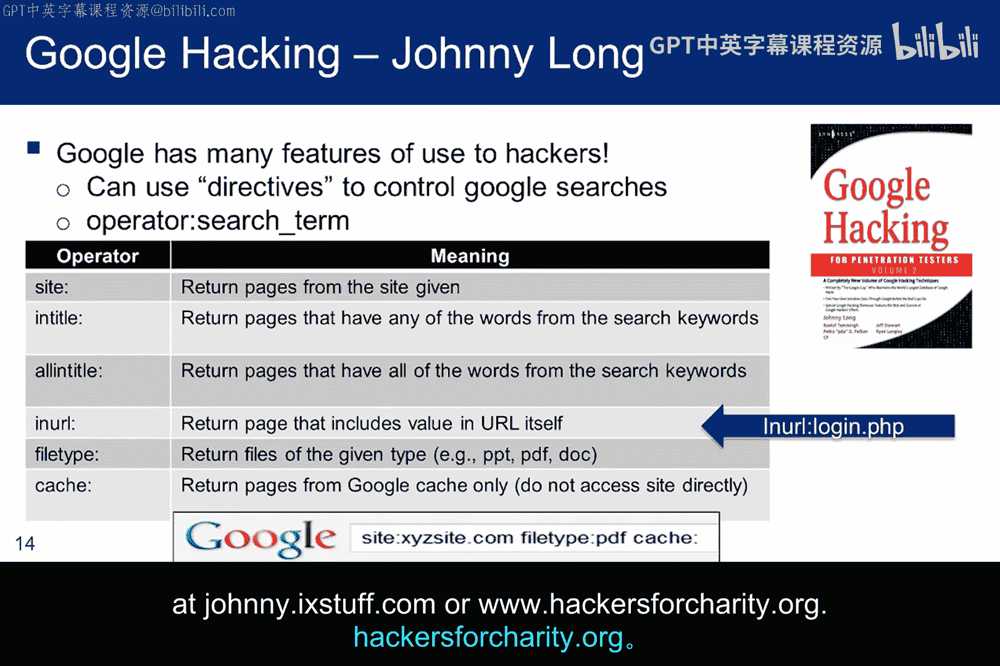
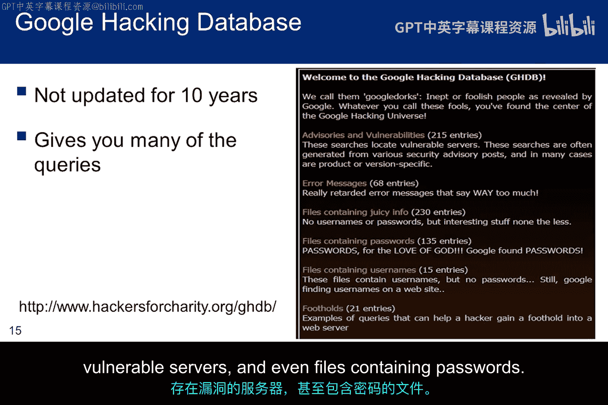
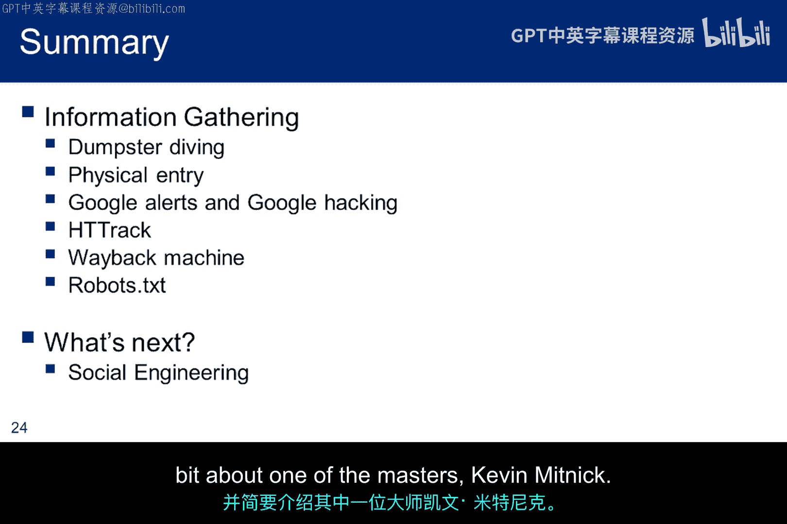

# 约翰霍普金斯大学《道德黑客入门｜Introduction to Ethical Hacking》中英字幕 p16 15_情报收集技术.zh_en -BV1xgu1z1Eau_p16-

This module covers the reconnaissance component of the ethical hacking methodology。

Sometimes called information gathering， intelligence gathering or open source intelligence。

 Reconnaissance is about passive observation to gather information about a target without the target's knowledge。

Of course， it is possible to do active reconnaissance as well， but if the target is perceptive。

 he may take some action to make the penetration tester's job more difficult。

Information gathering is the first technical element of penetration testing Once all the preparation has been completed and the scope of the effort has been well defined in writing。

While one role for an ethical hacker might be compliance checking。

 this module will not address that aspect。 Rather， we will move on to the collection of information necessary to establish a solid foundation for an effective penetration test。

This concept map puts some structure on the idea of reconnaissance In the center， in red。

 you see information gathering。As noted earlier， this phase could be named reconnaissance。

 and I will use the terms interchangeably throughout this module。

 The top right shows the kind of information we are seeking to prepare for the penetration test。

 mission information， network toppology and I P addresses。

The top left shows the repository for storing the information we have collected。

 There are several ways to archive information from maintaining simple text files to using complex multius collaborative tools like Dras。

 What is important is to make sure everything is recorded in case it is needed as the penetration test proceeds。

On the bottom， the diagram splits reconnaissance into active and passive categories。

 Passive means the target is unable to determine they are being observed。

 and that data has been collected， Act， on the other hand。

 includes techniques for which there is a good probability that the information collection can be detected by the victim。

This slide provides a list of information types that we can collect and some tools that may help in the collection process。

 A reminder， however， this class does not try to provide a comprehensive list of tools。Rather。

 the goal is to introduce the concepts of information gathering and to provide a short discussion of a few tools that may help to understand and explore the concepts。

 Each of the tools listed here will be discussed in some detail in the lecture。

 So I won't run through them at this point。The homework assignment for this module asks you to do some information gathering。

 So you should find some of these tools to be useful。

Physical access requires some knowledge of the location。

 One way to gather that kind of information is to use some of the Google map tools。

 They let you look at the target location without actually visiting and risk being observed。

 The satellite view may show dumpsters。And possible entrances near where there are autos or parking spaces。

 If we zoom in， we might even be able to spot surveillance cameras。

 This image is a Google Earth view of the Cosakco Center at J H A PL。

 where we hold many of our face to face classes in the E P program。

 We can't zoom in far enough here to identify any surveillance cameras。

 but the building is open to students for instruction。

 so we could visit the E P website to determine typical hours of instruction and then walk around the building during that time period to identify cameras。

 maybe with a backpack so that we appear to be a student。

 We could also sit in the lobby or a classroom with a computer or smart and identify Wifi access points and the type of encryption used。

 if any。

And the bird's eye view， which provides some 3D context， may give you additional physical insight。

We all hear stories about dumpster diving， but the New York Times wrote an article some time ago。

 providing a real life example of the effectiveness of the technique。 According to the article。

 a man named Stephen Masey， a meth addict in Oregon directed one of the most extensive and notorious identity theft rings ever prosecuted by federal authorities。

 The team ruined hundreds of people's credit Although the leaders only spent about a year in prison。

 The scheme started when Masey found a shed where recycling was stored。

 that included discarded tax forms from an accounting firm。The data included the person's name。

 date of birth and Social Security number。 He used that information to apply for a line of credit in the victim's name。

 making him an additional card holder。 The identity theft ring had numerous tactics。

 But one of the main tricks was to through garbage from hospitals， accounting firms， banks。

 law firms and other organizations known to be careless with personal information While this dumpster diving is an identity theft example。

 The same techniques applied to gathering information about an organization being pen tested。

Here you see a list of techniques for entering a building and what you might do to gather information after you get in。

 there may be a guard， but if he is not controlling access。

 it is easy to just walk up to the elevator with a group and pick any floor at random。

 In most buildings once you are in， you can move from floor to floor via the stairwell。

 If the guard is checking I D， it would be possible to counterfeit your own I D based on casual observations from a previous visit。

 For example， you might claim you need to deliver an envelope with a resume or transcript to HR。

 and then just carefully observe the format of the badges。 Of course。

 if the I D card has a magnetic strip， a chip or an RF Id to control access entry is more complicated。

 In those cases， tailgating may work。 unless every employee is vigilant about enforcing individual authentication。

 which would be unusual， you might。Be able to follow someone one else in。 If you were to try that。

 you would want to prepare an explanation in the event you are challenged。 again。

 counterfeiting an I D visiting a public smoking area and careful observation should identify those Just being polite and willing to allow tailgating Once you are in the facility。

 How do you collect information。 If you can find a vacant desk to sit at or even a phone on the wall The Voip database is usually accessible。

 This may make it possible for you to quickly collect names and phone numbers to use in social engineering of individuals at a later date。

 Some databases may even show you employees titles。

 So if you have time you can scroll through looking for system administrators。 While。

 this is pretty easy， you should have an explanation prepared in case someone questionsed you。

 For example， you might try。I'm a new employee starting work to day。

 I'm sort of lost and trying to get in touch with someone in HR。 but I forget that person's name。

 The pen tester also needs to be observant and take notes of facility weaknesses like propped open doorways。

 drop down ceilings and door sensors that can be exploited on follow up visits。

This slide focuses on the fact that you need to be prepared in the event you are stocked。

 You need a story that will explain your presence。 You also need a story that will let you escape in the event the questioner wants to be too helpful。

 For example， if you say you are trying to find HR， the questioner might agree to escort you。

 which could be disastrous。 But if you say you are visiting a friend named Mike Jones who works for acme products actually located in the building next door。

 It should be much easier to just walk out。 Of course， if you are entering a high security facility。

 Neither of these is going to be very plausible and you will need to do much more research to create a viable alibi for being there。

Once inside a facility， there are many items you could walk out with that might help your information gather and exercise。

 If that is one of your techniques， you do need to make sure you have permission in writing。

 because walking out with hardware would be a prosecutable felony。

 While line printers are a thing of the past。 some organizations with laser printers still print out a cover page providing some user information。

 This could be invaluable in trying to determine a username for subsequent use in pen testing the organization's network。

And after entering the facility， you can leave things behind as well。

 Tech is that any device you leave would be compromised in some way。 Typically。

 such devices would contain malicious software that establishes an outbound connection to a malicious server outside the firewall as soon as it is connected or accessed。

 There are so many USB ports on hardware today day that it should be easy to find one that isn't very visible but even if it is visible。

 you may not need to leave it there for long。 If the computer has ought to run activated。

 the malicious hardware should be able to drop and start the payload in a few seconds and you can just remove it and put it back in your pocket。

 Once started， the external server would assume control of the connection。

When you are doing reconnaissance on an organization， Google Alerts is another useful tool。

 it will monitor websites for interesting new content and send you an email when it finds something。

Whenever Google Crwlers find a new result on a topic you're interested in。

 alerts can be set to contact you。 For example， you could set it to provide updates about a product an organizational change hiring or just keep up with the corporate news stories。

 monitoring these kinds of events might tell you when an organization is looking for or has a new system administrator。

 and that may identify a target consisting of a less experienced employee。

With less knowledge of the correct policies and procedures。

 Google hacking is a very useful technique that lets you add specificity to Google searches and find material that otherwise might be lost in a sea of information as originally designed。

 specially crafted search queries made it possible to locate servers on the Internet running vulnerable software。

 or with no security at all protecting personal identifiable information。

 This slide shows a few of the Google directives that are helpful in adding specificity regarding information collection。

 The simple example at the bottom shows a search for P Df files。

 and it is further constrained to just search the cache for a specific domain。

 Johnnylong was a pioneer in the field of Google hacking。

 And he updated the ideas in his first book with Google hacking for pen tester's volume to in 2007。

Johnny has also written several papers that describe hacking techniques to include other ways to leverage Google。

 They are worth reading。 Why not do a little Google hacking on your own using the directives listed here to locate Johnny's papers。

 He now spends much of his time supporting and promoting hackers for charity a nonprofit that collects computer and office equipment to donate to underdeveloped countries。

 You can visit his website at Johnny dot Ihackstuff dot com or。Www。hackersfor charityity。org。

The Google hacking database originally created by Johnny Long can be found at www。hasforcharity。

org/ GHDb。It is the authoritative source for leveraging the ever widening reach of the Google search engine。

In the GHDB， you will find search terms and results of hundreds of Google searches that return files with username。

 vulnerable servers， and even files containing passwords。

H T track is a website copier that does not come with Cali， but is easy to install。

 It allows you to download a website from the internet to a local directory。

 buildinging all the directories and copying H M images in other files from the server to your computer。

H T track also rewrites the original site's relative link structure so you can simply open a page on the mirrored website in your browser and browser site from link to link as if you were viewing it online。

 Once you have duplicated the website， you can use the H T M L to create a version that has embedded scripts or applets。

 These might be useful on a pen testing server which leverages social engineering techniques to trick a user into navigating to it。

 with the default settings， H T track opens multiple connections and downloads using all those connections at full speed。

 This is a fast approach but the Web server may detect that it is being crawled and log the I。

 It may also block your I before you finish。 And at that point。

 it may try to block you from even navigating the website。To address this possibility。

 H T track has built in options to put transfer constraints on the connections。

 So the interaction looks like a person navigating and copying rather than a computer。

 This approach takes longer， but may help avoid detection。 However。

 copying all the web pages at any speed is going to create detectable outgoing traffic。

 So the approach will certainly be noisier than just visiting and navigating。

Portions of the website that have access controlled with something like HD access will not be copied。

 and obviously， data computed and served up by back end services can be copied。

Everything else should be mirrored。But a reminder that this is a pretty noisy approach that is easily detectable by the web server。

 if you want to learn more about HT track， here are some links to the user's guide and a video demonstrating its use。

The next tool is a very useful one because the Internet never forgets Fies and websites get cached。

 while some of the cached links will end up broken over time。

 the content for the cached site itself will remain available。

 Suppose a target has posted organizational information or phone numbers for employees。

 but at a later date decides such information as a privacy or security risk and removes it。

 This deletes it from the website， but is it gone from the cache。

 Another example might be the inadvertent posting of social security numbers。

 While the SSNs will most certainly be removed as soon as the error is discovered。

Have they already been cacheed or not。And if they have been cashed。

 what has the organization done about it， Probably nothing if they don't know about the way back machine。

As the news report shown on this slide notes， some organizations use Internet search tools to investigate potential employees。

 These tools may examine Internet sources， especially social websites， including caches。

 Young people have matured and realized mistakes in some of their postings。

 The question remains are they really gone after they've been deleted in all of these cases。

 The answer is that the availability of information on old websites。

 probably depends on how long the information was viewable on the website before it was removed。

This is the website where you can find the way back machine， Www dot archive dot org。

To see how it works， this is an Apple screen from 1997。 When Mac O S 8 was new。

 C D Roms were expensive and DVD technology didn't really exist。 Much information has been cached。

And a pen tester may find an invaluable tidbit。 As mentioned in the previous slide。

 it is possible that at one time， names of executives in the organization were available online。

 But now they are not for security reasons。 The way back machine could provide you a target for spearfish and email。

 This screen shot shows you the way the information is presented。

You can see how many times a site has been saved a year by year visual of the activity and a month by month day by day indication of sayss。

 You can click on one of the blue dots to visit a snapshot of the web page there。

 you can explore the links to see which of those were cached as well。

 If you went to the RSA site before the 2011 hack。 Would there be more information about employees that was removed after the hack。

 if your own organization has tried to increase privacy on your website。

 Go back a few years and see what you can find that shouldn't be there。😊。

And Facebook appears to get cacheed daily， while user accounts should not be cashable because of the credential。

 you should pay attention to what you post that is made available to the public and linked to your name。

A robot dot text file on a website asks the robots to ignore specified files or directories when crawling a site when a site owner wishes to have instructions to web crawlers regarding which directories should be skipped。

 They place the text file called robot dot text in the root of the website。

 This text file contains the instructions in a standard format identifying directories and files to be dropped。

Bots that choose to follow the instructions， access this sl and read the instructions before fetching any other files from the website。

 If robot dot text doesn't exist， the crawler crawls the entire site。

 Both Google and Bing read and respect robot dot text files。

 Rob dot text files are often used when websites are being updated。 However。

 it might also define a preference for privacy from a search engine。

 It could be created because the content of the selected directories may be misleading or irrelevant when parsed by the Web crawlwler。

For a penetration tester， robot stock text could provide a directory path to be explored to see if there is any information to be collected。

This has been an introduction to information gathering。

 We discussed a couple of physical techniques and introduced some high level tools for studying a targetss domain。

 We are starting to collect details that may help us later， So we should file those away。

 It is important to record and archive every tidbit of information you come across as it may help later in your penetration work。

 Try to get into the habit of taking screenshot and storing host names and I P addresses everywhere you go。

 but don't forget to also archive any amplifying information you come across。

 You definitely want to avoid having to repeat the information gathering process because you fail to record something when it was fresh in your mind In the next lecture。

 we will talk about social engineering。 In the final analysis。

 Social engineering is about instilling trust and manipulating the truth to achieve specific goals。

 We will discuss this subject and also talk a little bit about one of the masters。 Kevin Mitnick。

