# 约翰霍普金斯大学《道德黑客入门｜Introduction to Ethical Hacking》中英字幕 p17 16_社会工程学攻击.zh_en -BV1xgu1z1Eau_p17-

In this submule， I will talk about social engineering。

Before you start social engineering for some particular goal。

 the key tactic is to complete your reconnaissance。 gather information about the company。

You would want to find out information such as the following。

 how a specific department in the organization operates。 the department's responsibilities。

 What types of information an employee can access， who can make requests for which types of information。

 What is the standard procedure for making requests。

 Does the organization have any information release constraints， and perhaps more importantly。

 What is the terminology， What are the acronyms。And what are the shorthand lingo used by the company？

It is all about creating trust。Social engineering techniques work simply because the people are very trusting of someone who establishes credibility。

 That is what the reconnaissance in the research buy you。

 The above chart shows an abstracted ethical hacking methodology drawn from several other methodologies to include enres in zeroent hacking approach。

 In fact， all pen testing methodologies will contain some or all of these phases。

 The labels are not what is important。 Rather， it is the steps an ethical hacker must go through to be successful。

 As shown， social engineering is simply one approach to collecting information on a target that will let you drill down to gather more detail and move into the scanning phase。

 From a penetration tester's perspective。 We begin by gathering information on an organization and individuals within the organization。

 We may gather enough information to be able to scan for a vulnerability。 However。

 if the information is sparse or the network seems to be well protected。

 we may need to do some social engineering。This would involve trying to trick a victim into putting himself or his system into a vulnerable state。

 in the first case we are strictly in an information gathering phase， in the second case。

 we are using limited information we have collected about an individual to formulate an attack vector that will create an entry point。

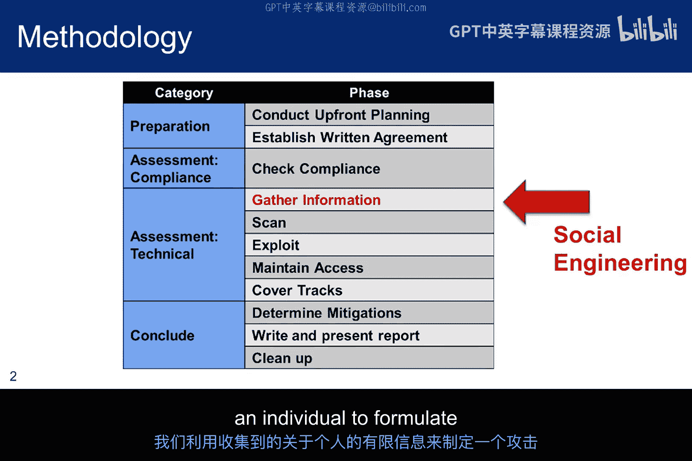

This slide just summarizes the discussion from the introductory slide。

 I won't repeat that discussion here， but just note that it lists the type of information you would want to capture about an organization in order to create a trust relationship in support of your social engineering exploits。

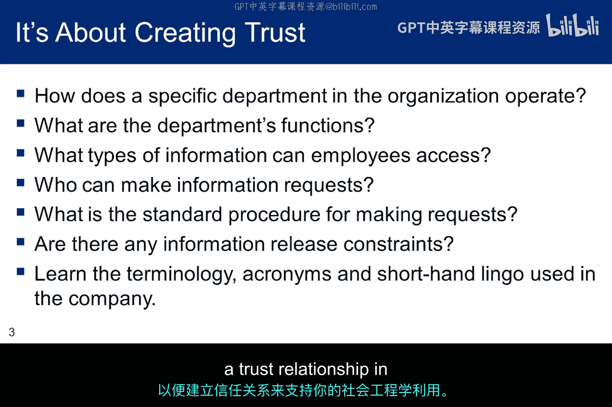

Kevin Mitnick started out using his social engineering skills to gain access to telephone offices。

 networks and computer systems。 He ended up stealing source code。

 cloning cell phones and stealing identities。 He spent five years in a federal prison。

 One of those years in solitary confinement due to an uninformed but overzealous US attorney。

 After being released， he started a legitimate penetration testing firm。

 And also capitalized on his fame as a notorious hacker。 In fact。

 I succumb to his marketing and bought ghost in the wires。

 This autobiography gives a lot of insight into his world of social engineering。

 Here is an example of a social engineering exploit。 as I run through the steps。

 decide if you think this was one of Mitnick's illegal activities。

 Or if he did this as part of a legal penetration test。 Here is a scenario。

Drop off a letter for an employee。 That's a pretext。 During the visit。

 Sty the I D cards used by the employees。 Go home， make a reasonable facsimile。

 return to the site and tailgate in with a group。 For example。

 smokers at a back door or a group returning from lunch。

 Since the previous reconnaissance on LinkedIn has provided the name of a network engineer。

 You wander about and find his office。 It's locked。 So you enter via the drop down ceiling。

 Once in the office behind a locked door， use a USB stick to boot from Linux with a hackers's toolki。

 Change the local admin password。 reboot and install a rat or remote access Trojan。

Go to the registry of this computer and set last logged in user to the engineer's username in the morning when the engineer logs in。

 his computer will establish a connection via the rat and the tester has full admin access to the network。

 So you navigate to the domain controller and dumped the password hash。

 which can be attacked offline to capture other credentials。

 even though some of these techniques might not be allowed in a normal penetration test。

 It turns out this was an authorized， paid for penetration test described in ghost in the wires。

 And it brings up another important reminder。 The boundaries and constraints associated with any penetration test should be well defined in writing。

 Here is another physical attack described by Kevin， as one used by his pent in company。

 Penteer looked up the facility in Google Maps and determined that the company had just leased an office suite。

 Next， he contacted the same realtor under the pretext of one office space for Pinkerton investigations。

The realtor had worked with Pinkerton in another city， So they began to develop a trust relationship。

 This， of course， is the magic。 They tried to identify common friends。 Did you know so and so， No。

 did you know， and so on。 Then the penteer told the realtor that as a representative of a security company。

 he would like to understand the physical security controls of the building before Lee in the space。

 And the realtor explained how everything worked。Once he understood that。

 the tester found the janitorial service provider for the building and called to try to get cleaning details。

 He focused the discussion on the security mechanisms。

 He told the janitorial supervisor the security system had crashed and needed to be restored so their key cards would not work on Monday。

 He asked if he would be able to exchange key cards on Friday。

 The tester met with the janitorial supervisor and provided a new fake card。

 supposedly for a restored system。 and he requested the old one。 during this exchange。

 the janitorial supervisor also told the tester that use lock box with master keys。

 The only alarm is at the outside perimeter。So over the weekend。

 the tester used a key card to circumvent the alarm system。

 and the secondary locks on the office doors were picked。

 They found and entered the server room and discovered admin password on postit note。

 and they were in。 They also rebooted boxes using a USB tool and captured the password file。

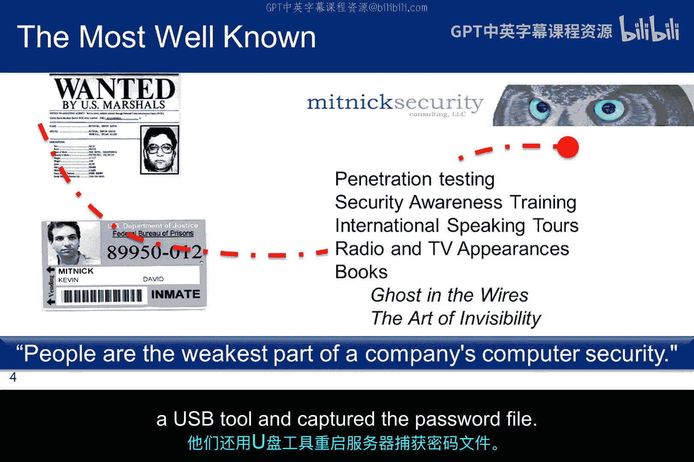

John Markoff of the New York Times was a technology reporter who earned a lot of money。

 a million dollars according to Kevin， by single handedly creating what Kevin labeled the myth of Kevin Mitnick。

The attacks you see listed on this slide are Kevin's version of the hack in history。

 Markov thinks otherwise。 at age 15， he bypassed the punch card system used in the Los Angeles bus system。

 after a friendly bus driver told him where he could buy his own ticket punch。

 He was able to ride any bus in the greater L A area using unused transfer slips he found in the trash where the buses were washed。

 At 16， he called the debt computer room， claiming his test account had been deleted。

 He told the essay A he was Anton Chernnoff， one of the lead developers and had it restored。

 Actually， the account was newly created since it had never existed before。

 But Kevin knew enough about the system to identify a privileged account。

He claimed he couldn't log into one of his accounts。

 and he was convincing enough to talk the guy into giving him access and allowing him to select a password of his choice。

As an extra level of protection， whenever anyone dialed into the development system。

 the user also had to provide a dial password。 The system administrator。

 happy to have a friendly chat with one of the lead developers， told him the password was buffoon。😊。

At 17， he got access to a cosmos facility。 Cosmos or computer system for mainframe operations was a database used by many of the nation's phone companies for controlling the phone systems's。

 basic record keeping functions。 a small group， including Kevin to their way past a security guard and found the room where the cosmos system was located。

 Once inside， they took lists of computer passwords。

 including the combinations to the door locks at 9 Pacific Bell Central offices。

 They also took a series of operating manuals for the cosmos system。Kevin was caught。

 but was only sentenced to spend three months in the Los Angeles Juvenile detention Center。

 followed by a year's probation。 At 17 years old， Kevin believes he was able to talk most Telco employees into almost anything。

 whether he was speaking with them in person or by telephone。

 He had learned the lingo methods and techniques of the telephone company。At 18。

 he gained entry to a Hugh Vx computer that had access to the arpanet。

 Lincoln a collection of universities research labs and government contractors。

 It was a computer system called Dockmaster， which was owned by the National Comp security Center。

 a public arm of NSA At 21， he attacked a Pacific Bell control system On his first call。

 he had planned to say he was from the electronic systems assistance center。

 which provided support for all the SCC S software deployed throughout the company。

 He did his research coming up with the name of a legitimate E S worker。 when he called。

 he said he wanted to get into the Oakland SCC S。 but some of his local equipment was down for maintenance。

 So he needed to get access through the dialup。 The man he had reached on the call gave him the dial up number。

 a series of passwords and stayed on the line talking him through each step。 At 23。

 he was convicted stealing software from the Santa Cruz operation。 a。ia So Company。

 and in December 1997， he was sentenced to 36 months probation at 24。

 he would call an essay at deck and claim to be from deck support。

 He would continue saying we've discovered a catastrophic bug in your version of R S T S s E。

 an operating system that may result in some data loss。 if you would like。

 a comp your system without interfering with your operations。 Typically。

 the essay would immediately give him the dial at phone number and access to the system manager account。

 After many successes。 he began to feel like getting code from deck was the easy part。

 The big challenge was figuring out where to stash copies of it。

 So he began to use computers with arpant connections。 After making the FBI's most wanted list。

 Kevin was on the run in Seattle and Colorado。 He was finally apprehended in North Carolina with cloned cellular phones and multiple pieces of false identification。

 He was subsequently sentenced to five years。federal prison and spent one year in solitary confinement。

 Solitary confinement resulted from the fact that the US attorney convinced a judge Kevin could whistle the launch codes to the US nuclear Arrsenal。

 even though the Norrid computers were not accessible from any outside point。

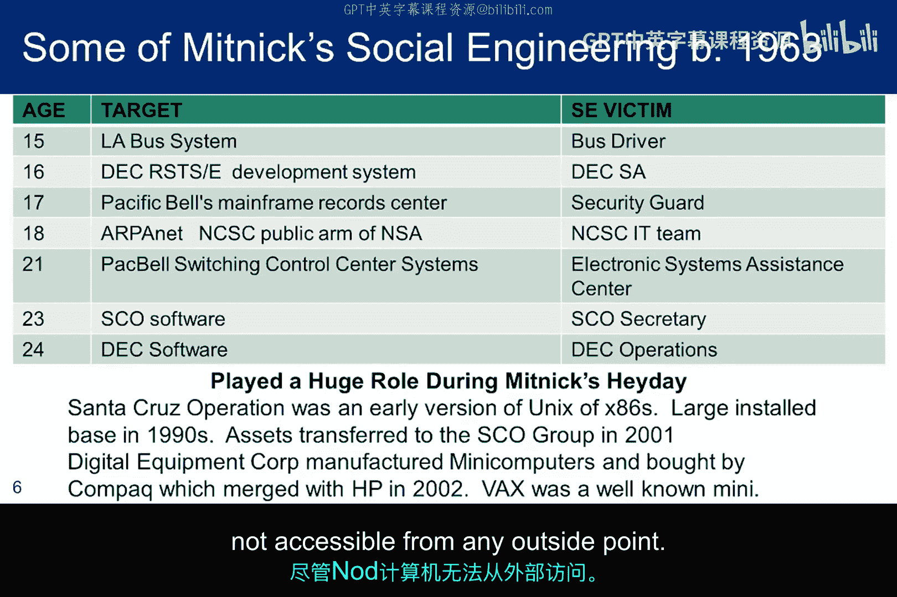

In the broadest sense， social engineering is truly universal。

 and it always involves the manipulation of trust。 This list shows a few examples。

 The item on the list that you may find least obvious is taxation。

 The idea is that the government knows taxation is burdensome。

 but they want to appease the public and get us to pay the bill voluntarily。

 Government creates deductions that reduce the burden。

 Some examples are the interest deduction on mortgages or for charitable giving。

The manipulation of trust comes in because the taxpayer focuses on the deduction。

 rather than the overall tax burden， which is 10 to 15 times the value of the deduction。

The fundamental approach is to make the tax bill seem a little more acceptable。 In this regard。

 the thought is the IRS should be simplifying the tax code and eliminating loopholes rather than manipulating the trust of the taxpayer。

 Here are a couple of examples of trust manipulation from a penetration testing perspective。

 The first is a pen tester pretending to be a software vendor's representative。

 He calls an unsuspecting person in the company being pen tested and asks which software versions they are using。

 At the same time， he will ask for an email address。

 telling the victim he will receive a summary of the conversation in order to verify the version numbers provided by phone to ensure there is no misinterpre。

 After he hangs up the hacker sends an email with malicious code attached。

 A second example involves an attempt to identify the antivirus product used by a company prior to starting pen testing。

 Some inexperienced pen testers might try to find。Find out from someone in the company。

 which could easily reveal the fact that a pen test is under。

 Another approach would be to call all the A V companies。 Tell them the company you work for。

 In other words， the one you are pen testing and tell them your company wants to buy more licenses。

 The A V salesman will be very helpful in trying to determine the current number of licenses because you would like to sell you more。

 you keep going until you find the right A V company。

 Since there are only 7 or so A V companies on average。

 it takes 3 to4 calls to figure out the A V product you are dealing with。

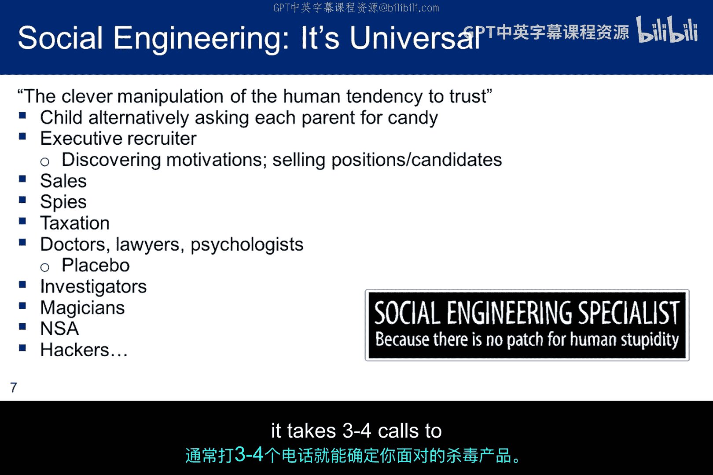

The idea expressed here gets back to the bumper on the first slide。 Social engineering always works。

 People are the weakest link。 Why would a hacker or an ethical hacker spend time scanning for vulnerabilities when a talent and social engineer can get the same results with much less effort。

 He just needs to get a victim to visit a malicious web page or click on an email attachment。

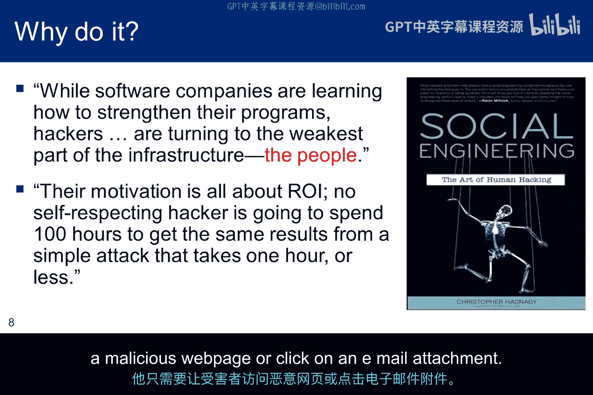

The digitization of our record system has pros and cons。

 This slide shows some of the information we might collect on a total stranger by doing online searches。

 The availability of information varies from location to location。

 but much of it can be found for almost anyone。 In fact， at one time。

 property records in the county I live in near Washington， D。 C contain social security numbers。

 There used to be some pretty interesting images of the Sns of senior federal officials who lived in the same county。

 We have and will continue to discuss several tools that will help you collect this type of information。

 But what do we do with it。 We have discussed a few examples， but it can be used for many purposes。

 Here are a few examples， pretexting and spearfishient emails are our focus in this submodule。

 but in interesting example of data collection not related to social engineering。 Concer。

 drawing inferences from the data。 Research have determined that 87。

Pcent of the population in the United States have reported characteristics that may make them unique based only on a five digit zip。

 their gender and their date of birth。 This may not seem significant。

 but here is an example of why it is。 The medical records of the governor of Massachusetts were in the group insurance commission database。

 The database was provided to researchers and sold the industry。 after the data had been anonymized。

 However， privacy researchers linked this database to the Cambridge voter list。

 which they were able to buy for $20。 After linking the two databases。

 six people in the medical records database had the governor's particular birth date。

 Three of them were men， but only one had its  five digit zip code。 In other words。

 the researchers were able to identify the governor's specific medical records by spending $20 on a voter database。

 Of course， this module is not about database privacy。

 but the key point is that seemingly innocuous information。

Available on the internet may yield information that the social engineer can assemble and leverage to achieve his purpose。

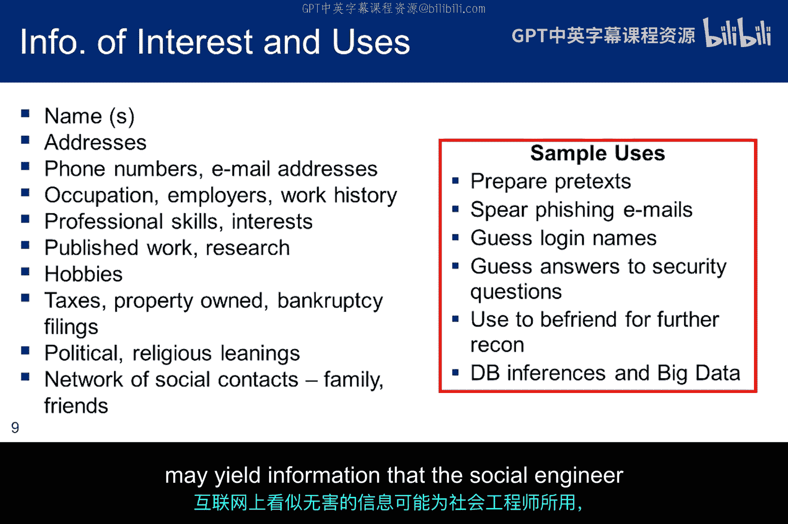

Pretexting amounts to falsifying intent regarding the activity of the attacker or in some cases。

 lying about your identity to achieve a specific goal。

 doing this kind of pretexting may or may not break a law depending on the circumstances。

 in the case of Kevin Mitnick。 He has acted on both sides of the law。

 One key to successful verbal pretexting is to be able to react to an unexpected turn in the conversation。

 You can't prepare for every question or situation that arises。

 and you have to be able to smoothly transition through a change in flow for which you aren't prepared。

 For example， suppose a victim is about to give you some important information。

 but once a callback number。 If you don't actually have one for the pretext you are representing。

 or if you don't even know the area code or N N X for the company。

 What do you do in real time to maintain the ruse。 The wrong kind of reaction could end the call。

 One solution might be to say your boss just walked into your office and you'll call back in a minute。

You quickly do some research on the company phone numbers before calling back。

The table show some examples we have heard about or seen in movies or on television。 These days。

 I think most organizations have trained employees to remain professional。

 but not to react to such events。 However， we know there are still victims。

 Another good example is an investigator quickly flashing false identification before you can read it。

 The hope is you will be too intimidated to ask to see it again。

 Every time I am interviewed about someone applying for a security clearance。

 I always insist that I be allowed to carefully examine the credential。 You should do the same。

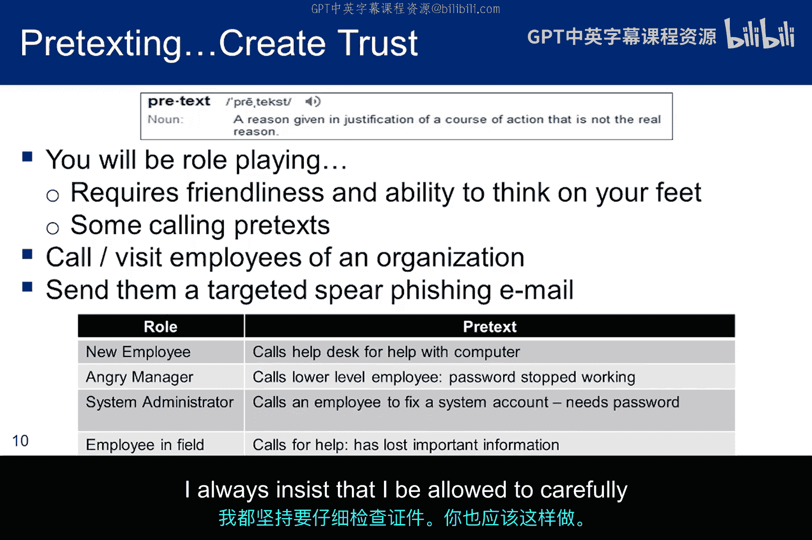

4，1，9 scams are a type of fraud and one of the most common types of confidence tricks。 In fact。

 the phrase confidence trick clearly refers to the manipulation of trust。 The number 4，1。

9 refers to the article of the Nigerian criminal code， dealing with fraud。

The scam has been used with fax， traditional mail。 And now， as we all know。

 it is used with the Internet。 A scam from a couple of years ago。

 preys on the fact that people who have fallen for one con are likely to fall for another。

 The idea is this。 If you send a small fee to a lawyer representing the Nigerian government。

 He will help you recover your original loss。 Incredibly。

 there are victims who have been scammed twice。 The message here is that some people may be far more vulnerable than others to social engineering。

 Some clues to the ph scams shown here are highlighted in red。

 in the top left hovering over the link shows it is not really Microsoft。

 The I P preceding U R L is a malicious website。 Everything else in the link。

 And on the page looks like Microsoft， including the graphics。

 but the hard coated I P is the giveaway。 The bottom left describes a bank transfer that you can cancel but provides no specificity about your bank account。

 while an account。numberer would never be shown at a minimum。

 A legitimate message would provide the name of your bank。

 The bottom right illustrates a common technique to install a sense of urgency in the victim。

 This is a well known sales tactic Act now before it is too late。 It works the same way in fishing。

 trying to get you to click before thinking about it。 The top right is a hybrid approach。

 It lacks specificity about the country and suggests that they are interested in any business type。

 Don't worry about specifics。 But whatever business you are in， respond right away。 Of course。

 absurdly written letters will be self selecting。 But a carefully crafted one will be harder to detect。

 This is where spear fishinging comes in。 and you will be asked to try your hand at it in this module's homework assignment。

 Here is one example of a spearfishing attack。 The intended victim。

 One of my colleagues had just flown on US air two weeks before receiving this email。 Fortunately。

 he is a security professional and。

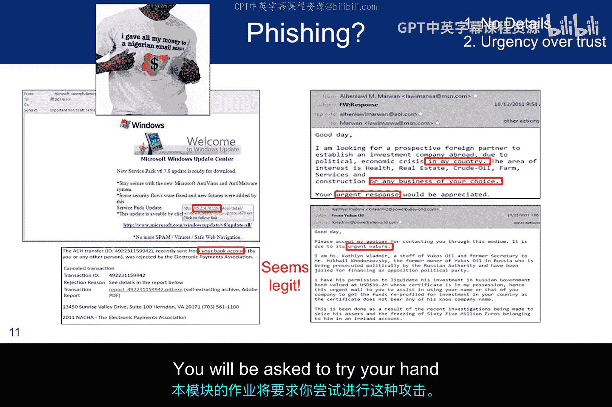

Deected the obfuscated link with the leading IP address point to a malicious web server that does not belong to US Air。

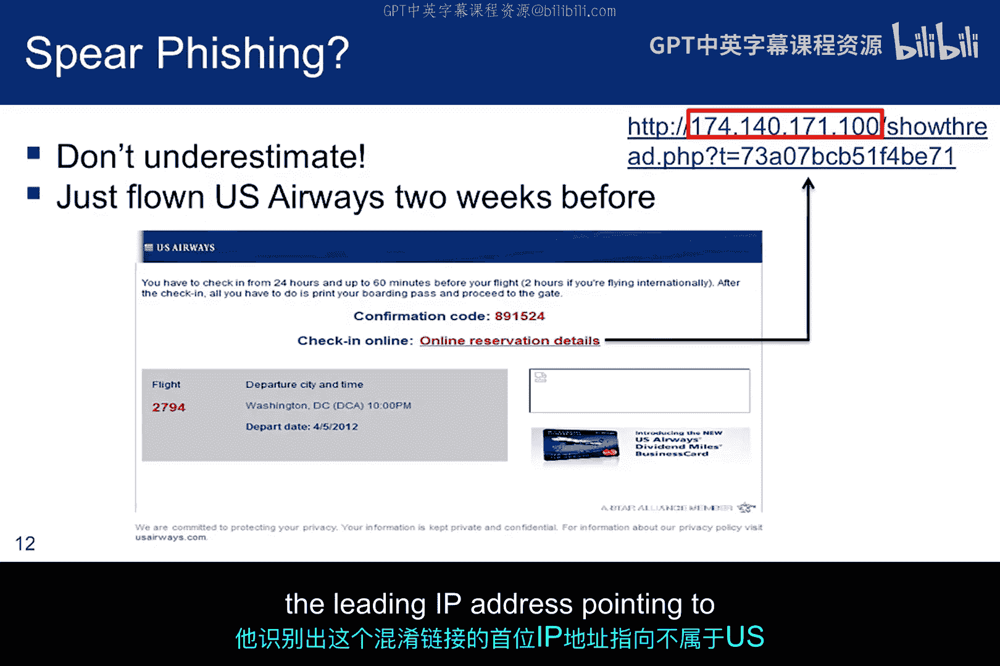

And， of course， the rage of social media has created a gold mine of publicly available information that can be leveraged to collect enough information to develop a very believable spearfishing attack。

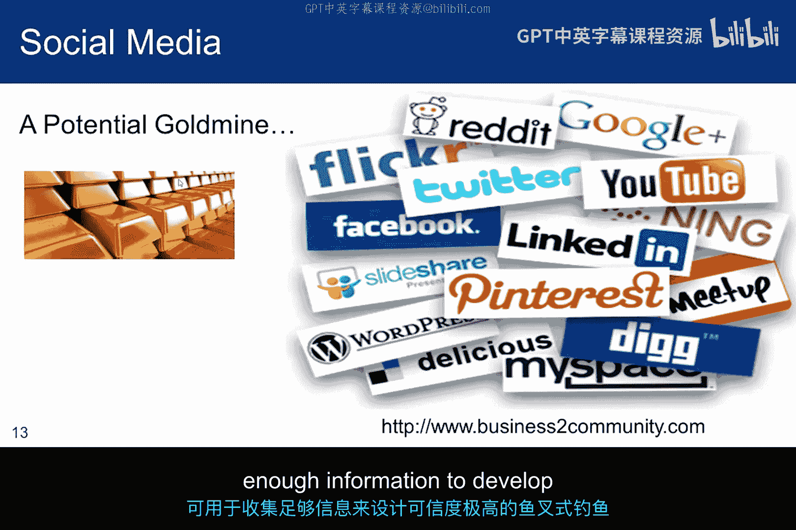

In this spearfishing example， the organization being pen testeded did not have much of a web presence or any viable entry points。

 So Mattdie turned to social engineering。 Corporate reconnaissance LED to the name of a company official。

Additional searches on his name revealed a stamp collecting hobby。 The stage was set。

 Mattty set up a fake and malicious stamp collection website once it was established。

 he called the official leaving a voice mail and also sent an email saying that he had recently received a large 1950 stamp collection due to the death of his grandfather。

 He concluded by asking the target if he was interested in buying any of the stamps。

 The official clicked on the link and the company peri was thus compromised。

This attack took place in the spring of 2011， and it is a great example of how spear fishinging can be effective。

 The attacker created a spreadsheet that was supposed to have information about the recruitment plan。

 R SA had put in place for that year。 It was subsequently sent to several employees in the HR Department。

 Pre significantly reconnaissance had been done to identify HR personnel at all levels of the organization。

 The victim may have been someone who didn't normally receive that kind of information was curious enough to look at it or it may have been someone who knew there was no such thing and looked at it to see what was in it。

 or the attacker may have had enough information to know R S A did this every year。

 and they released the malicious version just before the official version comes out。

 All our viable possibilities， but R SA， when they reported， didn't release that kind of detail。

The point is， targeting with malicious emails will work。

A scam I noticed last Christmas was malicious emails received from shippers of recent on purchases regarding tracking of packages。

 by doing it over the holidays， The goal was to leverage the fact that shoppers make many purchases that time of year。

 and wouldn't remember every purchase they had made。

 The goal is that the victim would click on a link to refresh their memory and see when it would arrive。

 This is pretty creative thinking， and I suspect many on shoppers fell victim to the conhan。😊。

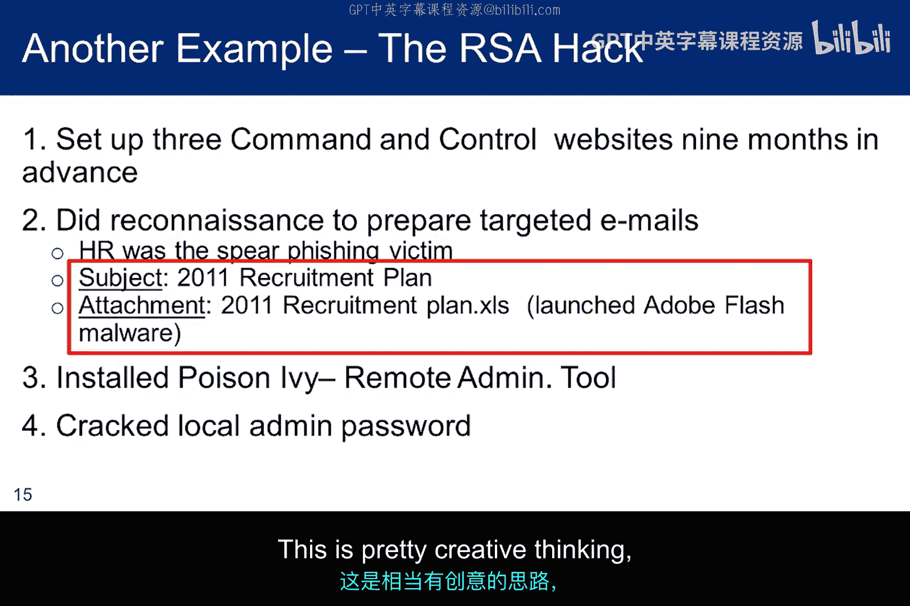

The Federal Information Security Management Act， or Fsma was passed in 2002。

 It recognized the importance of information security to the economic and national security interests of the United States。

 The Act requires each federal agency to develop， document and implement an information security program。

 Fsma requires agency officials to conduct annual reviews of the agency's information Security program and report the results to the Office of Management and Bu。

 O M B， in turn， prepares the annual report for Congress on agency compliance with the Act。

 The graph you see here， comes from that report and shows the importance of social engineering and phishing。

 OM B uses social engineering terminology to include fraudulent websites and other attempts to entice users to provide sensitive information or download malicious code in O M。

These terms， it is really a subcategory of attempted access。 As such。

 it does not include malicious email。 Fishing， On the other hand， is all about malicious email。

 It is reported that social engineering was an important technique used by Edward Snowden in getting access to other system administration accounts at NSA to increase the magnitude of his data collection crime。

 Social engineering may be behind many other incidents in this chart， but as we have noted。

 it is a major component of fishing。How do you get the victim to take some action that may be out of the ordinary。

 or they have been trained not to do。

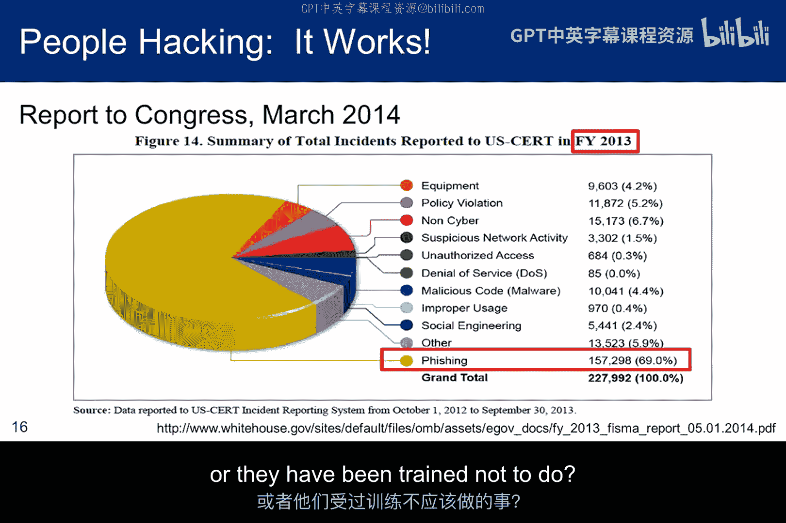

While phishing attempts continue to be a primary method for exploit federal systems and data。

 US Cert's incident categories depicted in figure 3 do not capture the magnitude of this threat。

 In fact， the data for 2013 is completely inconsistent with what is shown in the 2013 report。

 It appears that US Cert has redefined the incident definitions and recategorized the data。

 While Fsma was well intentioned。 This points out at least one problem in trying to collect incident information。

 In this report， you Cert categorgorized these incidents based on the root cause。

 such as malicious code or social engineering， rather than the source。 For this reason。

 figure 3 shows a low number of ph incidents compared to the high number of malicious code and social engineering incidents。

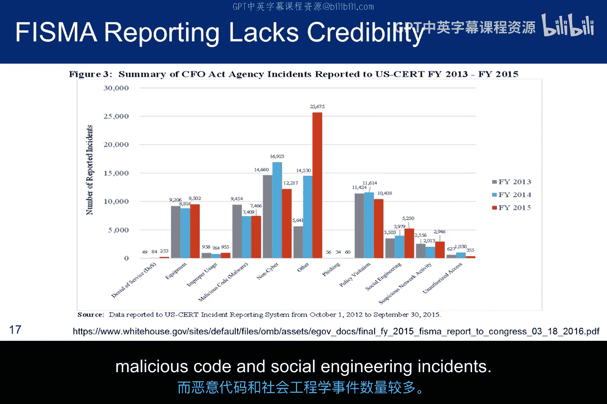

This is the homework assignment for this module。 You will collect information on your partner。

 starting with extremely limited identifying information。

 Your goal is to develop a believable spearfishing email。

 You will send the spearfishing email to yourself， not your partner。

This is the approach because all the payloads in SAT are malicious and typically set up a connection between the victim's computer and the attackers。

 While it would be interesting to see what happens if you send this to your partner。

 if the payload were to set up a connection and then install a persistent back door。

 you would be violating the law。 So please don't send this to your partner for security。

 privacy and legal reasons。

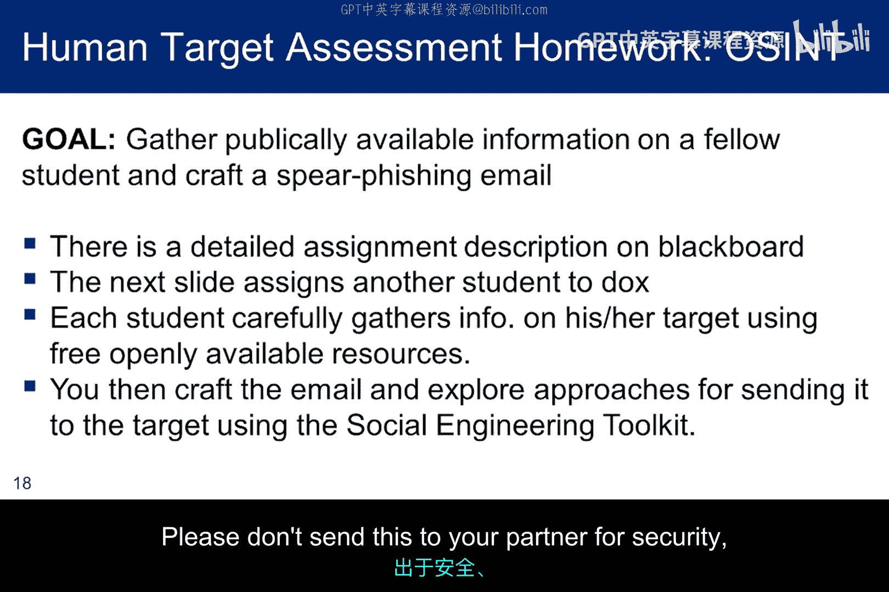

In one last word about information on the Internet， whether you post it or someone else does。

 Getagging of pictures is something everyone should be aware of and make sure there is no invasion of privacy or that you don't create security risks。

 capturing and leveraging geotagging can be thought of as a form of social engineering。

 in the case shown here， Some soldiers posted some harmless pictures of themselves on the Internet。

 But this action did not maintain operational security or ops。 The attackers。

 kinetic terrorists in this case。 Use the geotags to precisely locate the unit and destroy several Apache helicopters on the flight line in Iraq。

 Social engineering involves the use of pretexting to manipulate trust。

 People are truly the weakest link。 and some one will usually let you in。

 if you just ask the right way。 There is little reward in spending days trying to leverage a technical vulnerability while hiding your presence。

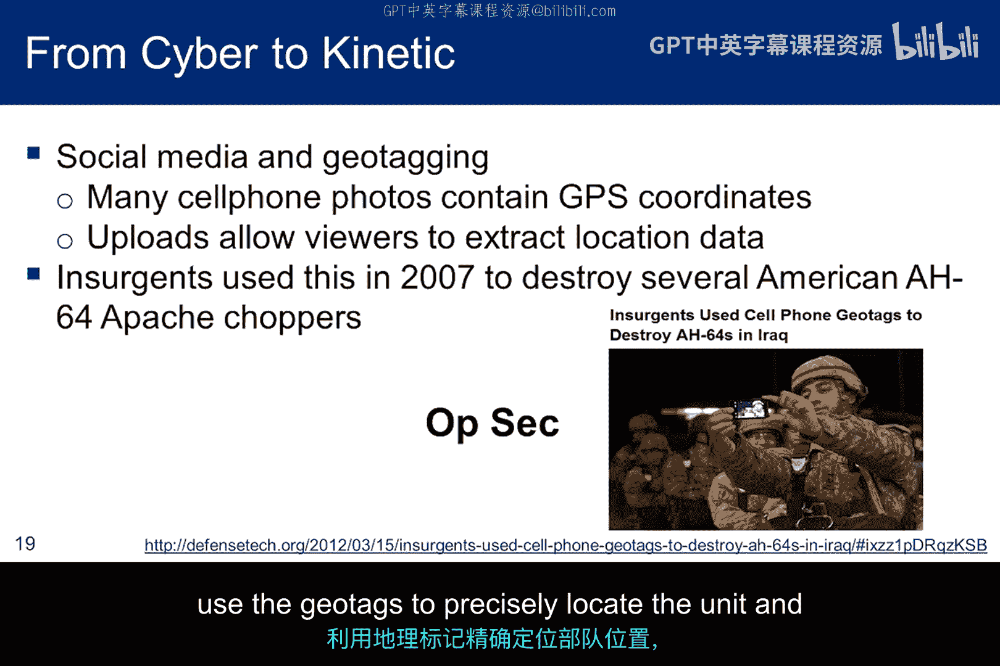

When an employee， even though they are trying to do the right thing， will just open the door。

 They will do this to be polite because they are intimidated or because they trust you。

In the next lecture， I will cover the social engineering toolki。

 You will use this software in the second part of the homework to send email to a victim。

 although it is a little boring。 in this case， the victim will be you。Certainly。

 you can explore other targets on your own。 For example， a family member on a family network。

 But remember to do so is a violation of law and most likely a felony。

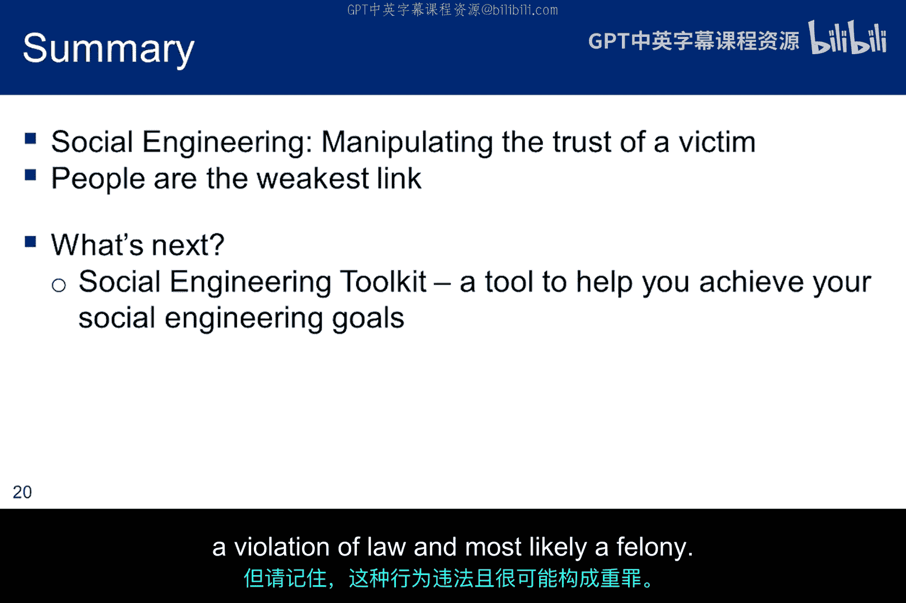