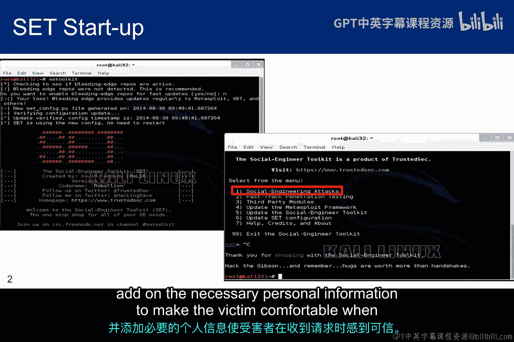
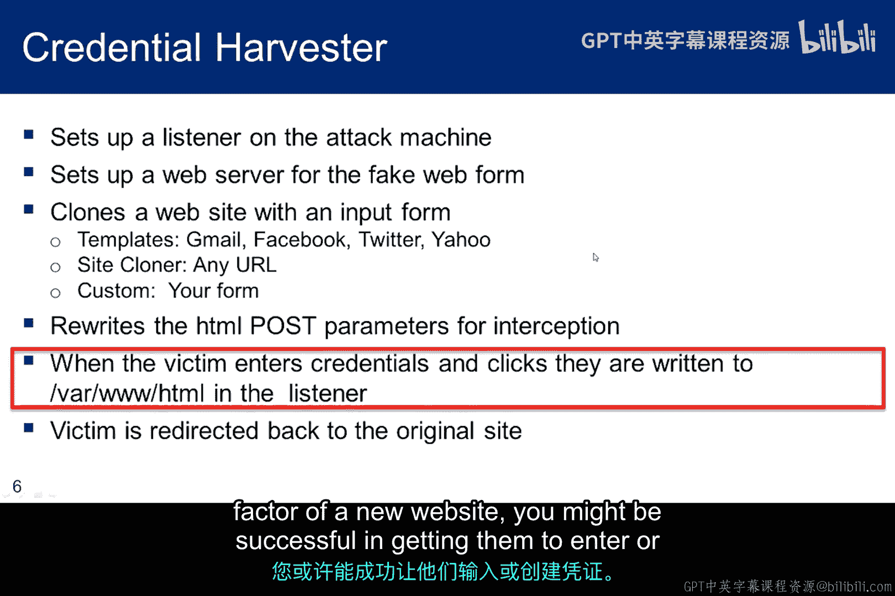
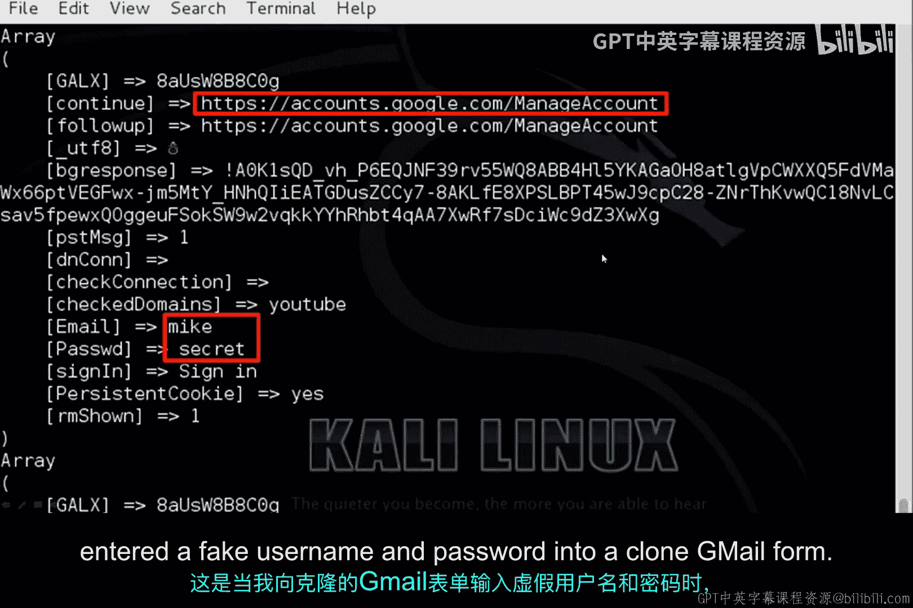
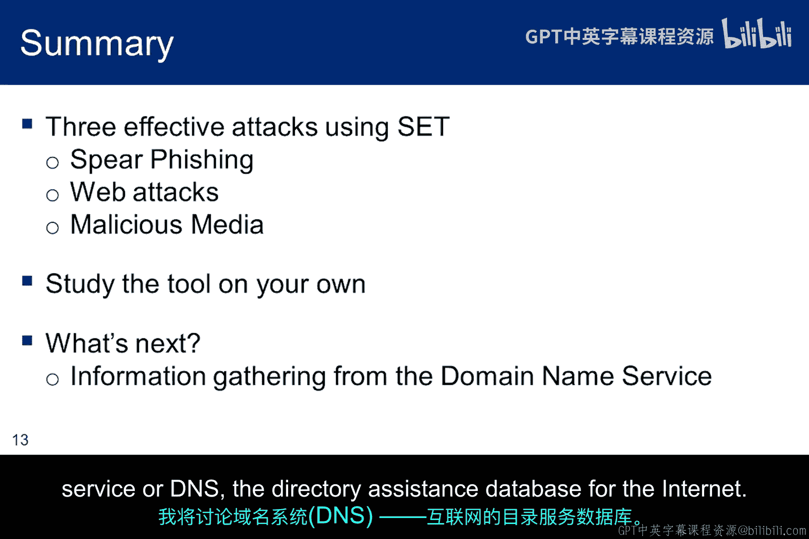

# 约翰霍普金斯大学《道德黑客入门｜Introduction to Ethical Hacking》中英字幕 p18 17_社会工程学工具包.zh_en -BV1xgu1z1Eau_p18-

Social engineering and toolkit was developed by Dave Kennedy， CEO of Trust S。

Dave is also one of the founders of the penetrationet testing execution Standard， P T E S。

 a foundational standard for penetration testing。Since he is also a metaloid developer。

 there are some similarities and links to the meta framework as a result of this coupling。

 much of the functionality of S is exploit oriented in social engineering only provides one step in the execution of an attack。

 Nevertheless， S T has many tools for generating scenarios。

 and getting victims to click on malicious links or visit malicious websites to use S T and our ethical hacking environment。

 Ho only mode isn't going to work very well。 Ho only is the mode we typically use when learning about exploits against other VM。

 But in many attacks， S T needs to clone active websites。

 and it can only accomplish this if it has Internet access。 in host only mode。

 it is possible to clone internal websites like the vulnerable mutilday Web servers set up in metatable。

 But seeing how St clones Gmail and Facebook will add to your understanding of how the tool works。

 A reminder， however， it。iss illegal to use these techniques to establish a connection to a computer outside of your ethical hacking environment。

 If you don't keep Callley in the host only mode， you must stop the tool before an exploit is run against an external victim。

 You should only run the exploit against other Vms in the ethical hacking environment。

 I have experimented with my own computers on my home network using virtual box bridged mode。

 and you may be interested in doing that as well。 But remember that it is a felony to attack any boxes outside of your home network。

To start S and Cali type set toolkit in the command line， S T O O L K I T。 Again。

 S is a framework with many attacks that leverage MF。

 It is easy to mix up S capabilities with those of MF and many wannabe hackers generating YouTube videos on the Internet do this。

 Although you won't learn about metaloit until later。

 it is important to try to separate the two in your mind as you explore S's functionality。

 The key discussion point here is each of the attack vectors in S provides a different approach to get someone to click on a link or visit a website。

 your job as a social engineer is to pick the right approach and add on the necessary personal information to make the victim comfortable when the request is received。

Ft has many more attack vectors than the three shown here。

 but these were identified by the author of the tool kit as some of the most effective。

 So we will spend some time discussing them。The first。

 spearfishing is a highly directed attack that attempts to get a victim to open an attachment to an email。

 Web attacks typically try to get a Java applet to run on a web page you visit。

 And we've all heard stories about malicious USB sticks distributed as part of a conference freebie。

 how you label a USB stick left on a table or any parking lot may make it irresistible to some victims。

 If you know enough about the victim's interests。 Care labeling becomes a very useful social engineering tool。

Sear fishinging is the subject of the homework assignment for this module。

 You will need to gather enough information about your partner。

 the victim that you are able to craft a message that he or she will trust。

 If a victim trusts an emails origin and the content seems realistic and aligns with expectations。

 there is a good chance the victim will open the attachment。

SAT lets you pick some common file formats like P D F for the attachment。

 S allows you to give the attachment a name tailored to match the socially engineered email。

 For example， if your victim is a do it yourself or a carefully crafted email about electrical work in the home and an attachment named something like three way switch instructions do P D F might result in a successful attack。

SAT also allows you to spoof the sender's email address using send mail。 However。

 this will only work if the victim's STP server does not perform reverse look ups on the host name。

 If it does， victim's mail server will most likely take some action other than delivering the mail in order to explore this feature。

 Send mail will need to be installed， although Callli typically comes with send mail in place。

To turn this feature on and leverage it in set， you need to change the set configuration file found at s user/ sharere/ set sconfig in that directory。

 editit the file set underscore Config and change the send mail equals off flag to send mail equals on。

Set will allow you to use send mail， Gmail or your own open mail relay to perform targeted attacks。

 and it supports one victim email address or mass email。 It's your choice。 When you start set。

 the menus guide you through the creation of the email and the malicious attachment。

 but it is only effective if the victim opens the attachment。

 This is where the real social engineering comes in。

 You will need to discover enough about the victim to craft an email so well targeted that the victim will open the attachment。

Here is a screen shot of the SAT T underscore config file showing the send mail feature set to off。

 set it to on if you want to try spoofing the sender's address。

The second effective set capability we will discuss is the Java applet attack。

 The basic idea is to get a victim to browse to a website and agree to run the embedded applet。

 Unfortunately， since early 2014， this has become a less effective tool due to updates in Java。

 Of course， if the user has failed to keep his version of Java current， the attack will still work。

The basic idea of this attack is to cloney website。

 embed the applet in the clone and send a link to the victim with enough social engineering to create a sense of trust so that the victim will run the applet。

 One of the tricks provided by S E T is the Java repeater idea。

 The run window won't stop popping up until the user agrees to run it。

 So if he create a sense of trust and the victim can't do anything in their browser because the run window keeps popping up。

 The idea is he is eventually going to click on run because he wants to continue browsing and doesn't really know what running the pop up does anyway。

 The reason this attack is no longer as effective is the current version of Java does not allow self signed code to run。

For set， the developer， Dave Kennedy， originally bought a code signing certificate for a couple of hundred dollars Attesting to a company in Ohio called Verified publisher。

 Cerific was used to self sign the applet to increase the victim's trust level in the applet。

 increased trust created by good social engineering and a lack of understanding of the code signing process resulted in a viable attack vector。

When the user selects run and the payload on the cloned web page is executed on the victim's machine。

 the browser is immediately redirected back to the authentic website to make the attack less conspicuous。

 The set menus will guide you through the cloning of the web page and the embedding of the applet。

 but it is only effective if the victim runs the applet。 Again。

 this is where the importance of good social engineering comes in。

You need to discover enough about the victim so that you can determine which web page to clone or create and what it will take to get the victim to run the applet。

The credential harvester allows you to clone a website or even create a new website and set automatically rewrites the post parameters to allow you to intercept and harvest the credentials after they are entered into the form。

 After the credentials are harvested。 the victim is redirected back to the authentic site to make the attacks seem less conspicuous This technique can be set up to attempt wide scale harvesting as well。

 for mass collections set provides a mechanism to export the collected information in either H T M L or X M L formats to support report generation。

The social engineering requirement is that the attacker must convince the victim to enter their credentials into a webage when the link has been passed to them。

The challenge with websites like Gmail or Facebook is that users typically navigate there on their own。

 so they may be skeptical of a link received in an email。 That said。

 you could probably develop a believable story for either Gmail or Facebook。

 if you write your own enthusiastic email describing some content the user is interested in。 However。

 it may be more effective to clone a website that is less popular。

 and for which passing a link might not be as unusual。

 If the link is accompanied by an enthusiastic email discussing the coolness factor of a new website。

 you might be successful in getting them to enter or create credentials。

This is a screenshot of the file containing the credentials When I entered a fake username and password into a clone Gmail form。

The malicious DVD tool is used when deploying USBC or DVD social engineering attacks。 It is a simple。

 yet effective tool which will create a folder in the set route that automatically receives and stores the auto run and generates a meta payload for you。

 Two files are stored in the set home directory slash user slash share slash set slash auto run。

 You just copy the contents of the auto run directory onto the media。

And you are ready to launch the attack。 Autotto run is often turned off on a victim。 But if it is on。

 the exploit will run。 And soon as the stick is inserted when it is turned off。

 social engineering will probably be required to get the victim to allow it to run。

 The social engineering involves creative labeling on a USB stick or a DVD to get someone to insert the media and start up。

Another option would be to put a legitimate file on the stick as a means to transfer it to the victim。

 But the USB would also contain the malicious content。

The amount of social engineering required for a QR code scan and a Java update attack is pretty low。

The Q R attack may not need any social engineering at all。

 People usually scan Q R codes without even thinking about the fact that they may be malicious for the Java update message。

 The social engineering has already been done by security engineers and I T departments that encourage everyone to patch patch。

 patch by using the social engineering toolki。 the patch can be made malicious。

 and the social engineering work has already been done for the attacker。

The attacker just has to make sure the Java update looks realistic。

We've looked at several social engineering tools。 And in every case。

 there has been a trust component to the attack。 Trust is a foundational component of social engineering and to be effective。

 you need to create some degree of trust and then leverage it。

 The next two slides will identify one aspect of trust that each of the exploits shown depends upon for you to start the homework。

 a good exercise would be to try to think of other trust components associated with these exploits。

 because if you can't establish that trust relationship。

 Your social engineering exploits won't be successful for spear fishing to work。

 The email has to be well constructed and based on detailed research。

 The victim has to believe that the email is authentic and has come from a source they can trust。

 What makes spearfish so effective， is users typically open many attachments every day with no malicious results。

 In a sense， they train themselves to trust attachments。 So when a well crafted。

 believable spearfish arrives。 They may not even think twice about opening it to get you。

UseTo run a Java applet will typically be harder and require even more trust than spearfishing。

 because people have gotten more skeptical of pop up windows if they don't understand。

 In the early days of home computers， Use could click on Windows。

 and it didn't matter because there wasn't much malware in the wild。 That's changed。

 And the associated publicity now causes many unknowledgeable users to ask someone else for advice before clicking run。

 This situation increases the importance of trust。 The applet has to make a run request that a user understands。

 believes and perhaps is seen before。To be directed to a website where you are asked to enter your credentials probably requires the creation of trust somewhere between that of opening an attachment and running an applet。

 Some users heed the advice to always surf to the website yourself。 Don't trust a link。 Of course。

 some users aren't so careful。 So if the link and message seem realistic。

 they may very well enter credentials that you will then own。

It is a little different to create trust in a USB stick attack。

 One approach is to label it in a way that someone one might trust it。

 perhaps the name of a person they know or a well known organization such as a university。

 You might also label it with a subject that you have learned is of interest to the victim。

 You could also use a name the victim knows。 and add the word financials or taxes。

The fact that Q R codes could be malicious hasn't occurred to most mobile device users yet。

 That said， you might construct the same kind of malicious email that you would use to pass a malicious link。

 The trick would be to pass it via email to a computer email account and get the victim to scan it with their smartphone。

 recognizing that the attack will be executed on the smart， not on the computer。

 Last attack is a malicious software update message that is very carefully crafted to match exactly an update the user frequently encounters。

 For example， Adobe reader or Java updates。 You could do some social engineering to identify other software the victim uses in construct an update message for that。

This slide briefly outlines the last part of the homework assignment for this module。

 requiring the use of social engineering4。More detail is available in the social engineering and homework right up。

This part of the homework requires you to use set to send an email to yourself with a spoofed sender address。

 It would be great if you could send the email crafted earlier in Part 1 to your partner to see how good of a job you have done。

 But you cannot do that because all the payloads are malicious。 If successful。

 you would have access to the victim's computer and have committed a computer crime being in violation of the computer fraud and abuse Act。

 Don't do it。 The idea， therefore， is for you to become the victim of your own attack in order to demonstrate that you understand the technique。

To conclude this module， please start up social engineering toolki in Cali and explore all the attacks we have discussed。

 This will give you a good feel for sets's capabilities。

 hands on experience is the most important component by far in understanding how a tool works。

 And since the creation of a spearfish and email is part of your homework。

 Undering the tools will be important to successfully complete the assignment In the next submodule on information gathering。

 I will discuss domain， name， service or DNS。 The directory assistance database for the Internet。😊。

