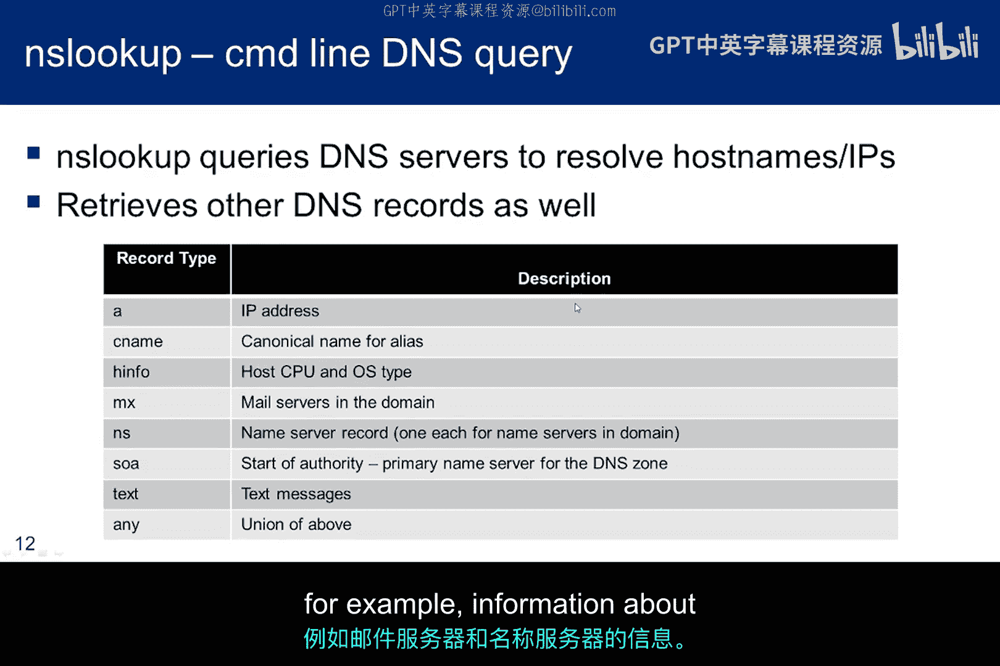
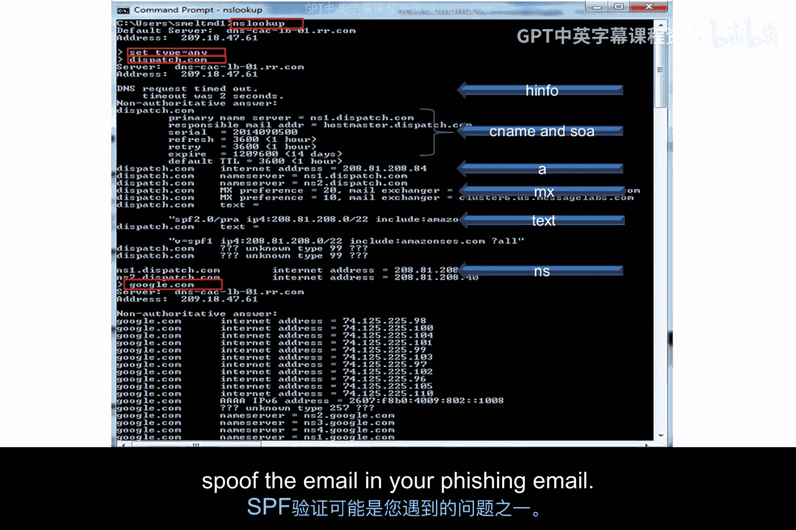
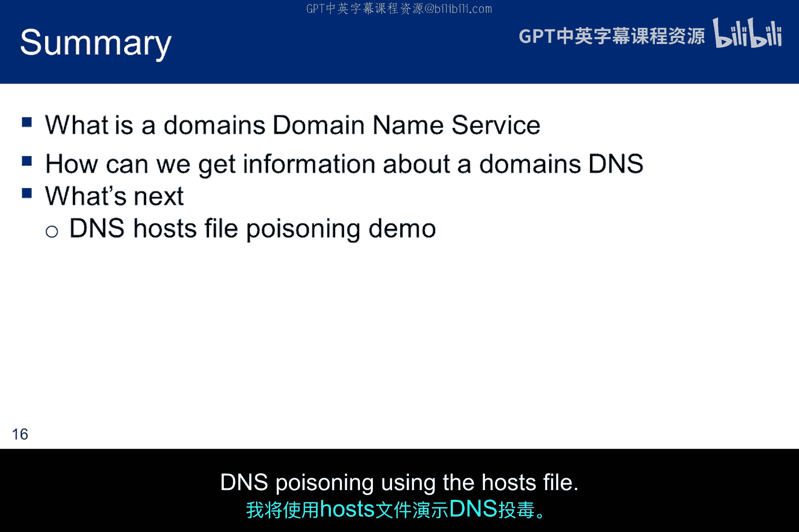

# 约翰霍普金斯大学《道德黑客入门｜Introduction to Ethical Hacking》中英字幕 p19 18_域名服务侦查技术.zh_en -BV1xgu1z1Eau_p19-

This submodle continues with the information gathering phase of our methodology。

 but turns from the whole internet to the domain name service， a more local source of information。

 So what is in the domain name server， What kind of information does it contain。

 And how might we get that information out of it。Collecting data from the DN S is just another piece of the information gathering phase of the ethical hacking methodology。

 and it is a good source of information because DN S is full of I P addresses。

We've talked about capturing all the data we can find on a target。

 but some of it is indeed more important than other data。

 as it helps us progress with the penetration testing。 When we have I addresses。

 we know something about the network we are attacking。

 and we can scan those I addresses and look for vulnerable services to exploit I addresses represent computing devices。

 So acquiring them may help us map the internal networks we want to attack。

 email addresses are useful for social engineering exploits。

 and they also provide information before the at sign that may be useful in determining network user names。

 host names are coupled to Ip addresses， and the host command in Linux may generate additional I Ps that can be scanned URLs help identify both primary domains and secondary domains。

 We can collect data on all those domains and look for new I addresses。 In the end。

 the more I addresses we can find associated with。Target， the more potential entry points。

DN S is an extremely valuable source of information because it is cram full of I P addresses and mappings of those I Ps to domain names。

 Again， I P addresses represent computing devices and provide network attack vectors。

So what exactly can we pull out of the domain name servers。This slide provides a quick。

 high level review of how the domain name service works。

 The fundamental purpose of DN S is name resolution。 Given the name。

 it provides the matching I P address in order to route packets。A side note。

 the address resolution protocol or ap， which will be discussed elsewhere in the course。

 provides a Mac address for a given Ip address。 So the three are closely coupled host I P Mac。

 In the beginning， computers only had a hosts file。 In Linux， this is found at Etsy hosts。

 And in Windows at Windows system 32 drivers Etsy hosts。

 Take a look at the hosts file on your computer to see what it looks like。

 This file is used to translate human friendly host names to I P addresses。

 The hosts file is still functional， but is typically empty or only provides loopbe information in favor of DNS。

 The host's file approach worked well on small networks。 But as the file size grew。

 file searches tended to get slower and slower until they became too slow to be viable。 Furthermore。

 this file was awkward to maintain and replicate。Once the DNS was added to the infrastructure of the Internet。

 However， even though it is not used much at the end of this lecture。

 we will look at a simple example in which we will poison the host file to understand how it works。

 The DN S is based on a hierarchy of servers in which local servers maintain name mappings for the local environment。

 While nonlocal servers maintain information about remote domains。

 In this slide in the picture on the right。 E P is a subdomain with fully qualified name。

 E P do J H do E D U。 Fo that path up the tree。 The root server located at the top of the global tree is represented by a dot。

 In one level down from the root are the top level domains。 Some example T L Ds or dot com US do UK。

 Once the distributed DNS databases established。 A DNS server can delegate authority for part of its subdomain or。

A single server can handle multiple domains query in the DNS server by providing a domain name to get an I address is an iterative process。

 First， the resolver checks the host file。 After that。

 if a local name server can't fulfill a request。 It returns a reference to another name server higher in the hierarchy that is closer to the domain of interest。

 Currently， the Internet corporation for assigned names and numbers or I can runs the whole thing but delegates responsibilities for top levelve domains to certain companies and governments。

 in a DNS instantiation。 A local server will be primary， but usually has a backup secondary server。

 The primary replicates to the backup by sending zone files。

 This is called a zone transfer for technical reasons there are a limited number of root server addresses that can be accommodated in DNS name query responses。

 This limit has determined the。of root server installations， currently 13 clusters worldwide。

 although there are only 13 routes， these name servers are hosted in multiple secure sites with high bandwidth access and loadbal routers to accommodate the traffic load。

 Initially， all these installations were located in the United States。

 But that is no longer the case。 a comprehensive list of servers with their locations and properties is available at H T TP Ro dashash servers dot org。

 As of September 2014， there were 478 route servers worldwide， combined into 13 clusters。

This slide provides a brief description of the steps that are followed in the domain name resolution process。

 starting with a host file and ending by caching the results from wherever they are found in the distributed database that makes up the D N S。

 The screen shot shows part of a local DN S cache on a Windows machine。

 If you want to get a feeling for how the DN S cache works。 try the following。 First。

 view your cache by typing I P config slash display DN S at a command pro。

 an examination of the cache should show domains that you have visited recently。

 You may even seen some resolving that has been done by one of the 13 root servers。Second。

 clear the cache by typing I P config slash flesh DNS。 Third， display the cache again。

 and it should be empty。After clearing the cache， domain requests are not going to be handled on the box。

 Rather， the resolution will be done and or managed by the local D N S。4th。

 visit your favorite website and display the cache again。 In fact， before you do anything。

 Visit rootservers do org。 you will be amazed at how much information ends up in your cache。

DNS searches can provide a lot of information about the network you are investigating。

 This includes I P addresses to help map subnets。 These searches can also reveal information about both name servers and mail servers。

 although it usually requires authentication， you might even be able to force a own transfer。

 from a primary name server， allowing you to collect most of the contents of the local DNS。

Now we will examine a few additional tools that might be helpful in gathering information from the DNS。

Who is， is a service run by the domain registrars that provides information about the owner of a domain。

 Although privacy concerns have resulted in changes in what， who is returns。

 it often provides contact names and addresses of the administrators。

 And it usually provides the details of the DN S services for the domain。

 So who is requests provides the first step in investigating the domain name service。

The image just shows the RC for the who is service。 As you think about the lecture。

 Keep in mind that the who is service is evolving due to not only privacy issues。

 but because I can once more control over the information。

Here is a who is sample output in which I've queried the domain for the Columbus dispatch。

 the newspaper in Columbus， Ohio。This internet search shows there are two domain name servers。

 and it identifies the registrar who set up the domain for the newspaper。 Next。

 we want to go to the registrrar's website to see if we can extract more detail。

This is the registrar's information regarding the Columbus Dispatches domain。

 depending on where we are in the information gathering process。

 we might use the corporate information to do some additional research on the organization。

 If we have already completed that research， we can use the phone numbers for social engineering。

 Notice also that the email addresses don't direct mail to a generic mailbox。 Rather。

 they are for the specific individuals。 One of those email addresses is to the techie， for sure。

 and the other may be technical or may be on the business side。 In any case。

 both our potential candidates for spearfishishing attacks。

This slide shows a who is search for the Hopkins domain associated with your master's program。

 E P dot J H U dot E D U。 If you do a search on internic for this domain or any other E D U domain。

 it will point you to this site， E D U Ca， which tracks them all。

Notice that the information returned is a little different and provides a little more detail than Internetnet did。

 However， in this example， we don't receive a name for the registrar。

 We are starting to see that who is returned different results caused by the fact that there is no standard associated with the responses from the various registrars。

The ICN DNS workinging Group has decided that the system in use today provides too much inaccurate information and fails to protect the privacy of individuals and entities with a legitimate right to keep the information out of the public domain。

If you or any family members or friends have registered a domain， personal information。

 including name， home address， email address， and phone number are probably available to anyone on the internet using who is。

To address this， I can once to change the way who is works。 First。

 there is no single source for doing a who is search。

 A separate website for E D U domains is a good example of the problem。

 Ica would like to create a single， comprehensive source of information。

 so you don't have to do multiple searches to find domain information。

 If the domain of interest is not found in internic。

 you might have to search through a whole series of registrars to find it。

 There are 8 billion who is records， and there are currently 1150 top level domain registrars。

The second change is that if a comprehensive source is created， I can would like it to be closed。

 and access control would be added for who is queries。 at a minimum。

 all users would have to register and be approved by a central authority in order to do a who is query。

 This change if implemented would have many implications。 But for sure。

 it would mean queries could be tracked and linked to the information used to register for access to the who is functionality。

NS Lookup is a command line tool for doing queries to retrieve DNS records from the named dot hosts file。

 It can retrieve an IP address for a given domain， but additional information is available as well。

 The slide shows some of the record types associated with a domain， for example。

 information about both mail servers and name servers。

This screen shows an interactive run of N S Lookup against both dispatch dot com and Google dot com。

 I have run it interactively。 I started N S Lookup， set the record type。

 then entered the domain to have that record returned。

 Notice you can easily switch from domain to domain by just entering a new domain。

As noted on the previous slide， sending type equal any is a shorthand method to get back all those records with one parameter。

 That is what was run here。 The first thing we notice is that the H info request does not return any data regarding O S type。

 It just times out。 In fact， for Google do com， we don't even see the timeout message。

For this domain， C name and S O A return the same information about the DN S zone。

 including the primary name server， the email of the domain administrator。

 the domain serial number and several timers relating to refreshing the zone。

 This is the default record return for other record type requests that are blocked。

This A record provides the I P address for the domain。

The MX record provides email server information and provides a preference rating for servers responsible for receiving email。

The NNS record provides DNS servers， including their I addresses。

The text records return SF information。 Ser policy framework is a simple email validation system designed to detect email spoofing by providing a mechanism to allow receiving mail exchangers to check that incoming mail from a domain is being sent from a host authorized by that domains administrators。

 email spam and ph often used spoofed senders addresses。

 So publishing and checking S F records is a useful anti spam technique。 In this case。

 authorized sending hosts for the domain are expressed using classless internet domain router or cider notation Hence the slash 22。

 It defines a subnet of 1024 addresses that are valid sources of email from this domain。

 The valid I Ps are 208 do 81 do 208 do 0 to 208t 81 20。We got 255。As discussed for S E T homework。

 SF validation may be one of the problems you encounter when you try to spoof the email in your ph email。

Some users feel Dig offers more flexibility is easier to use and provides clearer output。

 Dig is installed on Cali。 and when started， will also try to get his own transfer from the specified name server。

 hostst is a simple well known resolver that provides an easy way to get the I P of the host for the domain。

 for the domain shown here， it also provides information about the mail servers and a subsequent run on those domains reveal the I Ps for the mail servers。

 It is unlikely that you would ever get his own transfer from a name server。 But as with D。

 Fice tries anyway。 a more productive aspect of fierce as it tries numerous variants of the targeted domain。

 When I ran fierce against dispatch dot com。 It found over 600 other domain names in I P addresses that represent the next layer of potential targets for a penetration tester。

A colleague of mine runss his own server， and these are the resource records that describe the zone。

 This is the user interface he uses to update his DN S entry。

You see all the DN S records I discussed earlier when I talked about N S lookup。

 If you could run a zone transfer， you would get this kind of information for all the domains in the name server。

 However， as mentioned， zone transfers normally have access control mechanisms that require authentication before the transfer is executed。

 S O A is start of authority。 There is only one S O A record allowed in a own file。

 it must be the first resource record in the zone。NS is a name server record。

 C name contains aliases， and A are address records。In this submod。

 I have discussed the domain name service and two tools who is an N S lookup that can be used to gather DN S information。

 Dig， host and Fice are other tools that provide similar functionality in the next submodule。

 I will do a demonstration of DN S poisoning using the hosts file。

