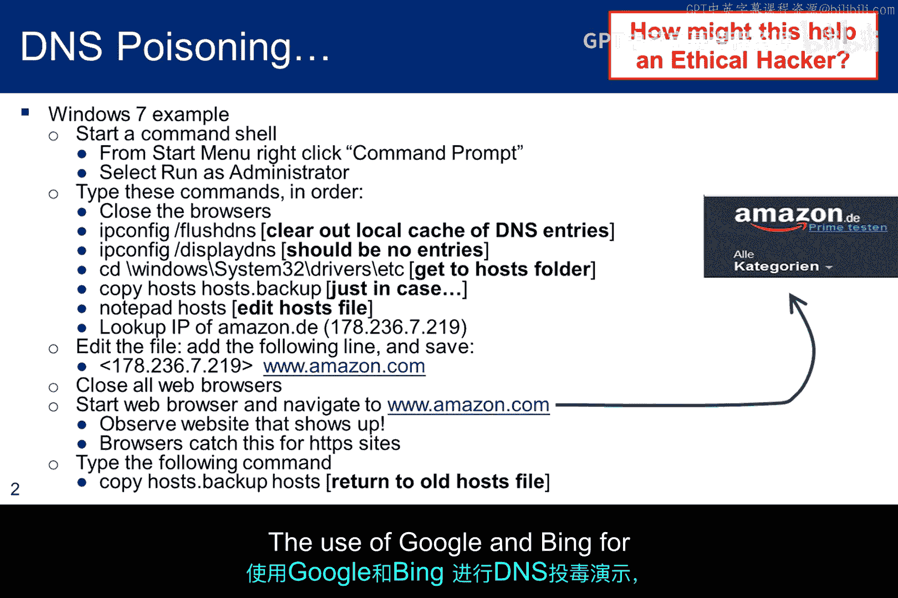
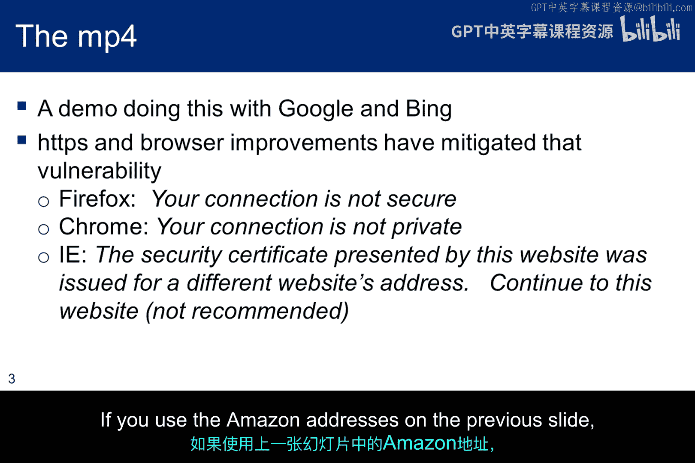
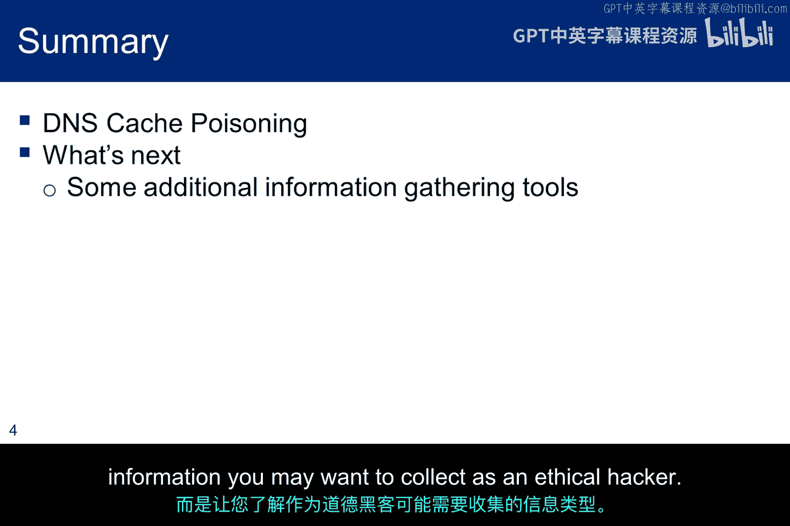

# 约翰霍普金斯大学《道德黑客入门｜Introduction to Ethical Hacking》中英字幕 p20 19_DNS缓存投毒攻击.zh_en -BV1xgu1z1Eau_p20-

This short module is designed to accompany the DNS cash poisoning video that I produced for this module。

 The recorded example is somewhat old and no longer works the same way due to browser and HtTPS S updates。

In the demonstration， I will poison my hostg text file。

 Even though I have my homepage set to Google com after poisoning。

 clicking on the home button will take me to Bing co。

 It is a good demonstration of how the resolver looks in the local host text file first。

 So modifying that file produces unexpected results for the user。

 Instead of switching search engines a more malicious attack might clone a page that requests credentials。

 for example， Gmail。 An attacker might poison the cache to point to the clone malicious web page and collect the credentials when the user enters them。

 An ethical hacker might use this attack as a way to obtain user credentials to gain a foothold during a pen test。

 The websites used on this slide are different than those in the demo。

 Instead of poisoning the Google cache with Bings I address， This slide poisons Amazon co。With am。de。

The use of Google and Bing for a DN S poisoning demonstration no longer works due to browser improvements and the use of H T T P S。

 If you try to duplicate the demonstration with H T T P。 S。

 you will get the following security messages。 Firefox prints。 Your connection is not secure。

 Chrome prints。 your connection is not private I。e。 prints。

 the security certificate presented by the website was issued for a different website's address。

 and it then allows you to continue to the website， but does not recommend doing so。

 If you use the Amazon addresses on the previous slide， it should work fine。

You should try the DN S poisoning example on your own computer。

 so you get a good understanding of what is going on。

 If you don't want to or can't do it on your host， do it on one of the Vms in the ethical hacking environment。

 Just remember to comment out or delete the change to the host file after your finished experimenting。

 The next submodule will look at a few additional information gathering tools available in Cali。

 The goal is not to try to cover them all。 Rather just to give you an exposure to the kinds of information you may want to collect as an ethical hacker。

