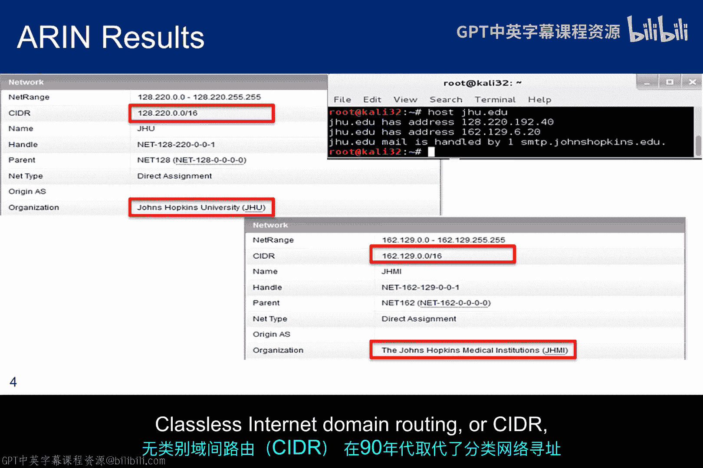
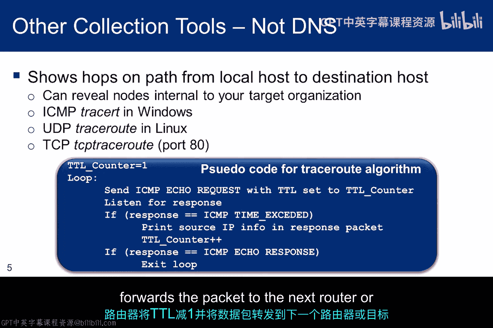
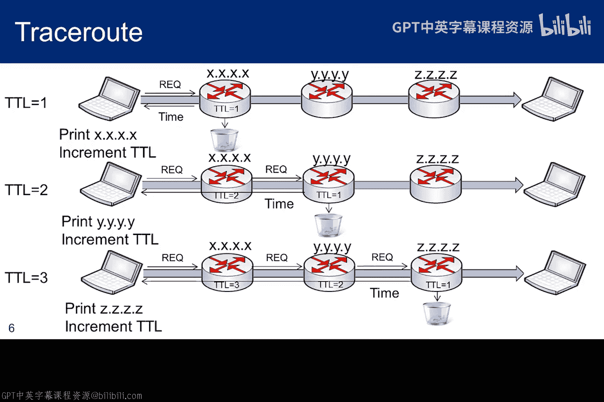
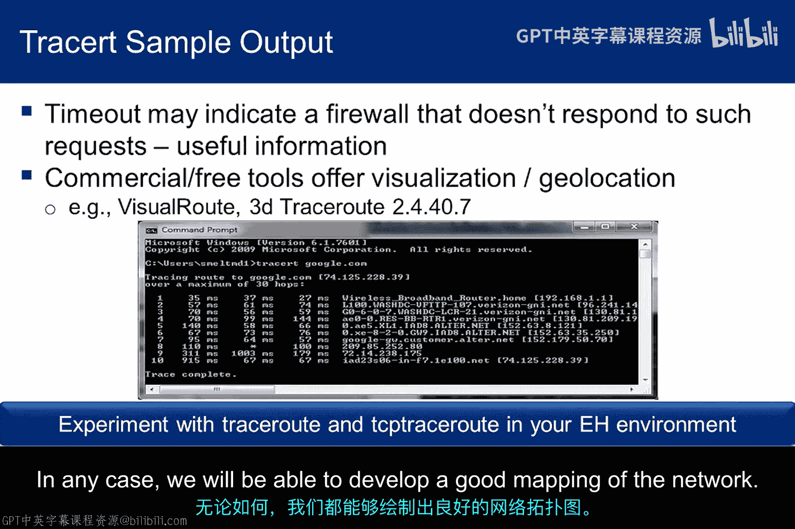
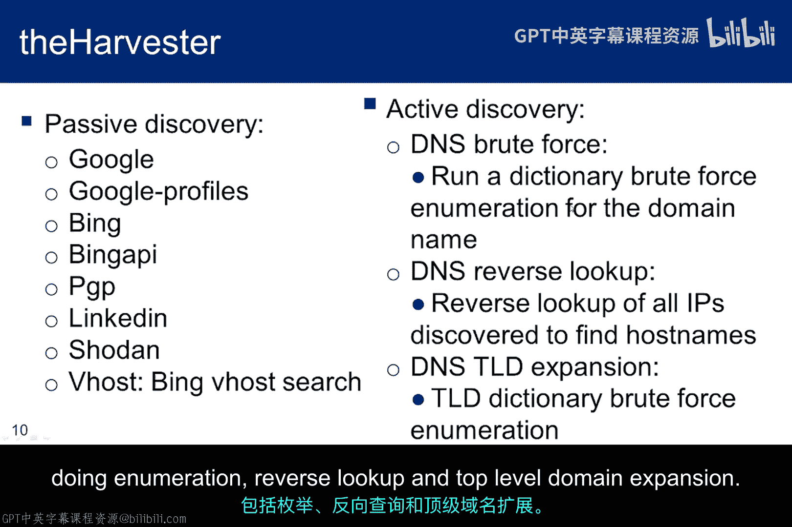
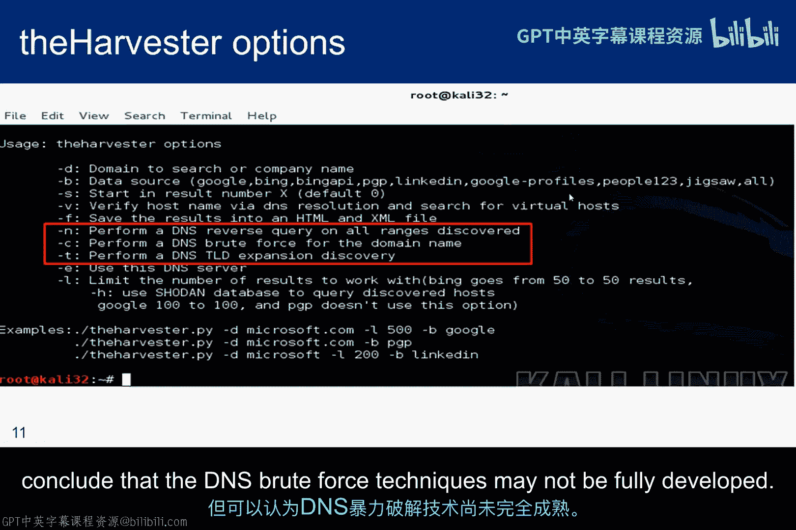
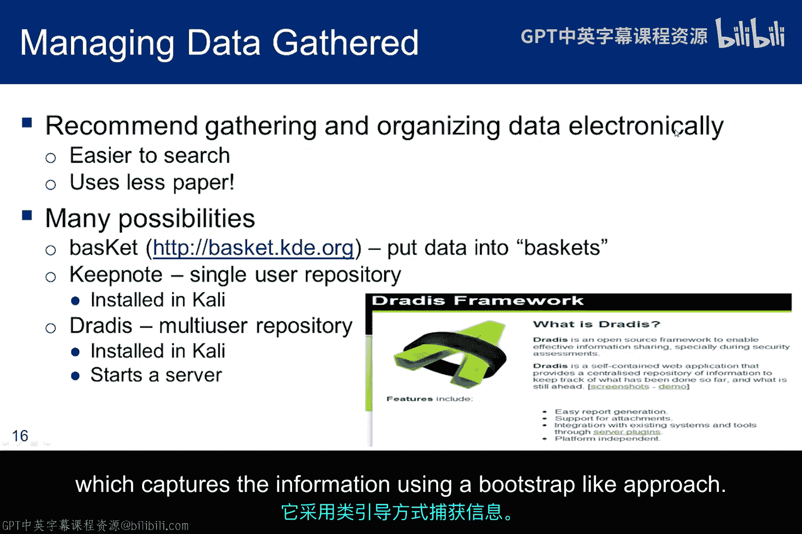
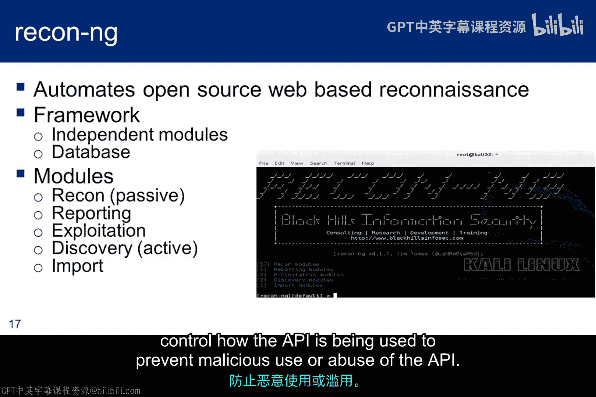
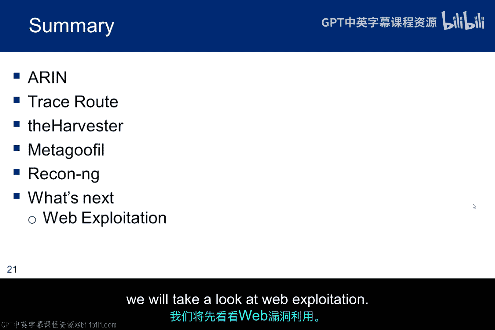

# 约翰霍普金斯大学《道德黑客入门｜Introduction to Ethical Hacking》中英字幕 p21 20_高级情报收集工具.zh_en -BV1xgu1z1Eau_p21-

As noted in the previous submodule on gathering information from domain name servers。

 IP addresses are a critical piece of information for penetration testers。

 IP addresses provide targets for scanning and or potential entry points if vulnerable services are detected。

So this sub module will spend a little more time discussing I P addresses and tools that can be used in collecting them。

 This is the last sub module in the information gathering phase of our methodology。

The Internet assigned N authority， currently， I can。

 delegates Internet resources to the regional Internet registries who， in turn。

 follow their regional policies to delegate resources to their customers。

 which include Internet service providers and end user Or。

 The American registry for Internet numbers。 or Aaronin is the regional Internet registry for the US and Canada。

The errand database contains information about blocks of I P addresses。

 and for a given I P will return the block that it belongs to。

Here is an example of how you can use Er to gather I information。

Run the host command on a given domain like jhu。edu。Currently， two I P addresses are returned。

 If we enter those addresses into the website at W W W dot Aaronon dot net， we see 2。

65536 blocks of I P addresses。1 belonging to the main university and one belonging to the medical school。

 If we were penetration testing J H2， this query allows us to expand our target from one I P to 65536 I Ps。

 although they are probably not all associated with computers。Regarding the cider notation， 128。

2200/ 16 means the first 16 Bs to find the network when the second 16 bits identify the nodes 128。

220。0。0 through 128。220。255。255， or 65536 nodes。If we enter 24t 20 dot 18 1，34， it returns 24。

20 dot 0 do 0 s 15。 The first 15 B define the network and the remaining 17 Bs defined two to the 17th nodes or 131072 nodes。

 Classless Internet domain routing or cider replace the class network addressing architecture in the 90s。

 tracece route is a diagnostic tool for displaying routes and measuring transit delays of packets across the I P network hot by hop。

 The history of the route taken is recorded as the roundtri times of the packets received from each successive host in the route。

 The goal is to determine the networking topology and where devices like firewalls and load balancers are found on the network。

 tracece route in Windows sends ICMP echo request packets。

 which return a response when the packet arrives at a destination node， T C P and U D。

PTce routes are variations， however， it is not uncommon for a firewall to block ICMP echo requests or unlikely UDP ports。

 So TCP trace route based on half open technique， is sometimes more effective in getting through firewalls because it uses port 80 and the half open connection which prevents applications from detecting the probes。

The basic idea of trace route is to take advantage of the time to live field in the I P packet。

 The T T L field was included as part of the Ip packet because without it。

 a misrd or misaddressed packets sent out into the network could possibly travel around cyberspace forever consuming bandwidth by placing a T T L in the packets。

 each router can check it and act on it。 For example。

 If a router that is not the destination of a packet receives a packet that has a T T L of1 or 0。

 it must drop the packet and send an ICMP time exceeded response to the originating I P address informing it that the destination I P address is too far away to be contacted。

 If the T T L is greater than one， then the router decrements the T T L by one and forwards the packet to the next router or destination I P address If that is the next node。

 trace route first sets T T L to one and sends an echo response request。 Since the T T L is one。

T router discards the packet and returns a time exceeded response。

 This includes the router's I P address and timestamp information， providing latency information。

 a calculation of time received minus the time sent in milliseconds。 When the response is received。

 trace route prints out the I， the time and increments T T L。This time， since the T T L is 2。

 the first router decrements the T T L and forwards it to the next router。 Now， the T T L is one。

 So the packet is dropped by the second router， and the response is sent with the second routerrs I P。

 and the latency of transmission。 The information is printed。 T T L is incremented。

 and we proceed to the third router in the path。

This slide shows a trace route from my Windows computer to Google dot com。 By default。

 trace route sends three packets to each hop。 So the output lists round trip times R T T for each for comparison purposes。

 Of course， an important factor that may impact R T T is the physical distance between hops。

 If trace route encounters a firewall or I D S system。

 asterisks begin to appear in the R T T columns， and we get a message request timed out。

 When a pen tester would like to map a target network behind the firewall， as mentioned earlier。

 trace Ro is usually blocked by the firewall because it is normally configured not to respond to these requests。

At a minimum， trace routeute can tell us where the firewall is in the path。

 which may be useful information。 If we are inside the firewall， we can initiate trace Ro B from A。

 and then initiate trace routeute A from B and do a comparison。

 depending on the complexity of the internal network。

 We may get a different number of hops as it transitions different routers。 In any case。

 we will be able to develop a good mapping of the network。

As with many pen testing tools， you do need to use some analytical thinking when you use trace route。

 Here is an example of a trace route to a domain， but it resolves and traces to black lotus not the actual domain server itself。

 This happened because black Lous is a domain provider。 and the actual server may be down。

 You could be easily misguided if you aren't paying attention and interpret the information incorrectly。

The harvester gathers emails， sub domainomains， hosts， employee names。

 open ports and banners from different public sources like search engines。

 PGP Key servers and the Shodon database。 It provides the targets's footprint on the Internet。

In the sample run， partially shown here， it turned up 109 email addresses and 18 hosts。

Sdon exposes on line devices on the Internet to include routers and filters。

 and it is used by the harvester to provide open ports and banners。

The harvester will also find virtual hosts with name based virtual hosting。

 The server relies on the client to report the host name as part of the HTTP headers。

Using this technique， many different hosts can share the same IP P address。

 It is somewhat like natting。Unfortunately， the harvester is not a well maintained tool。

Let's just run through the passive discovery elements for the harvester。

A Google search will provide emails， sub domainomains and host names。

 A Google profile search will provide employee names。Bing， the Microsoft search engine。

 will provide results similar to Google， but will also provide virtual hosts。

 Bing API leverages Microsoft's API， but you need to add your key and the discovery s Bing search Python file。

 PGP searches the PGP Key server at PGP do res dot E。

 LinkedIn uses the Google search engine with specificity for LinkedIn users。

 Show on search engine will search for ports and banners of the Disc devices。

The active discovery techniques focus on the domain name， service， doing enumeration。

 reverse lookup and top level domain expansion。

The enumeration runs through D N S dash names dot text and tries them all。

 But there is no documentation。 And my version of the harvester was unable to locate the DN S dictionary file。

 I couldn't find a T L D dictionary at all。The reverse look up option works well。

 but I think we can conclude that the DNS brute force techniques may not be fully developed。

Metagofi is an information gathering tool designed for extracting metadata from public documents belonging to a target domain。

 Typical file extensions are P， D， F， Doc， X， L， S， P， P， T， doc， X， P， P， T， X， and X， L， S， X。

Metagofi will perform a search in Google to identify and download the documents to a local disk。

 and then will extract the metadata with different libraries like Uhuwa， P D F Minor and others。

With the metadata extracted， it will generate a report with username， dates。

 software versions and servers or machine names。 It may be possible to launch brute force attacks on any open services using the usernames extracted。

 This slide shows the mettagoel options。This is a link to a black hat presentation from 2013 that shows you the value of metadata。

As we close out the information gathering module， we want to think about how to manage the information we have collected。

You can keep a notebook or record everything electronically。

 but you must keep track of what you have done as you follow through the ethical hacking process。

 If you don't do that， you will not be able to develop a comprehensive pen testing and report。

 And if the network is complex， you may forget to report on some important information。

 Here are a couple of possibilities。 Keep note and Dras are available in Cali。 A key differences。

 Keepn does not support multiple users。 While Dras does。

 Another approach is to use a tool like recon Nng， which captures the information using a bootstap like approach。

 As with set， Recon Nng also has the look and feel of the metaloid framework。

 It is a reconnaissance tool that will automate many of the data gathering techniques we have discussed。

It provides built in functionality with simple interfaces to common tasks。

 such as interacting with its database， making web requests。

 and managing API keys to get started after running Recon and G。

 just type help to see the commands available in the commandline interface。

One of those commands is show， which will provide some insight into framework functionality。

 The author describes the recon modules as being passive and the discovery modules as being active After loading a module with the load command。

 The context of the framework may change and a new set of commands and options are available。

The focus of the tool is its database where every piece of information is stored。

 Once in the database， a piece of information serves as a potential input seed for which new information can be harvested。

 This is the real duty of the tool。 A few pieces of information， Botrap the data gathering process。

 The ad command allows users to add initial records to the database。

 which will provide input or seed data for the modules。 modules take the seed data。

 transform it into other data types via the information gathering process and store the new collected data in the database as potential input for other modules。

The query command assists in managing and understanding the data stored in the database。 However。

 a user will need some knowledge of the structured query language in order to interact with Recon NG's database。

 The show schema command provides a graphical representation of the database schema to assist in building S QL queries。

Many of the modules in Recon N G are dependent on API keys for data collection。

An API key is a code passed in by Ricon N G when calling an API to identify itself to the website。

If the API key is not passed， the query may be rejected。 Of course。

 API keys are not unique to Ricon and G。 They may be required by an application using the API。

These keys are used to track and control how the API is being used to prevent malicious use or abuse of the API。

 Here is a list of the recon modules。 You can see the focus on company contacts， credentials。

 domains and locations。

The search command helps determine what to do next in the information gathering phase using the information that has already been harvested。

 The Recon module uses the path structure。 Recon slash input table， dash output table slash module。

 So a module uses information in the input table and gathers information for the output table thus expanding the database of information。

 in order to see all of the modules， which accepted domain as input。

 search for domains followed by a dash， or to see all of the modules。

 which result in harvested hosts search for dash hosts。 Recon N G is a good data collection tool。

 but appears to be somewhat immature and as a result may be in a state of flux。

Recon Nng is a passive tool， but nevertheless， people who own the databases that Recon Nng leverages would like to collect fees for the information they have assembled as a result。

 it may not be a viable tool for nonprofessionals because those fees for API keys will add up quickly。

 That said， here are a couple of YouTube videos that demonstrate how it works。

 The first one shows Landmaster 53's methodology for doing reconnaissance。

 The second one shows how physical reconnaissance can be accomplished through geotaging。

The Recon N G locations tables can store a street address。From a physical address。

 the geocode module returns to the latitude and longitude。 Once we have the la long。

 the push pen module will search for geotagged media near that latitude and longitude。

The module will search for media on Twitter， Flickr， Picasa， YouTube， and show on。

The push pins are returned color coded to show the source of the picture。

 As presented in the YouTube video。 This is the result of a search using the street address of NSA。

 One of the curious facts is there are tweets from the NSA parking lot flickr images from within the building and YouTube video from within the building。

 The push pin module will also create a historical record every 15 minutes to archive the information。

 And， of course， you can visit the sources， and you can actually see the pictures。😊。

This submodule finalizes the information gathering process。 We have discussed gathering IP addresses。

 network mapping， harvesting email addresses， sub domainomain names and hosts。

 and finally assembling metadata from files found on a given domain。In other submodles。

 we have covered physical information gathering， Google hacking， website copying。

 the way back machine， social engineering and DNS data collection。

 Some of these are active tools and some are passive。 And you have probably noticed。

 there has been some overlap among the tools。 but that is to be expected since they have all been developed independently。

 However， duplication of some of the information gathered is not a significant issue。

 What is key is to do enough reconnaissance on the target without the target' knowledge to be able to proceed to the next phase involving active scans of I P addresses in identification of vulnerable services。

 However， before moving into the scanning phase。 we will take a look at Web exploitation。

