# 约翰霍普金斯大学《道德黑客入门｜Introduction to Ethical Hacking》中英字幕 p22 0_移动设备.zh_en -BV1xgu1z1Eau_p22-

We have finished the core discussion of our pen test methodology。

 The remaining lectures are part of the framework and fit into the methodology。

 but will not be included in the pen test report。The first topic will be mobile devices。

 and we will explore the security of those devices and talk a little bit about how they are different than a typical computing device on a wired network。

 technically， we are still in the exploit phase， but we have shifted to mobile devices。

 We will discuss the NSO jail break of the iPhone and the lab will focus on the use of the smartphone pen testing framework or SPF as an ethical hacking tool that can be used against real mobile devices。

 Since we have no devices to test We will only be able to explore its functionality against Android emulators。

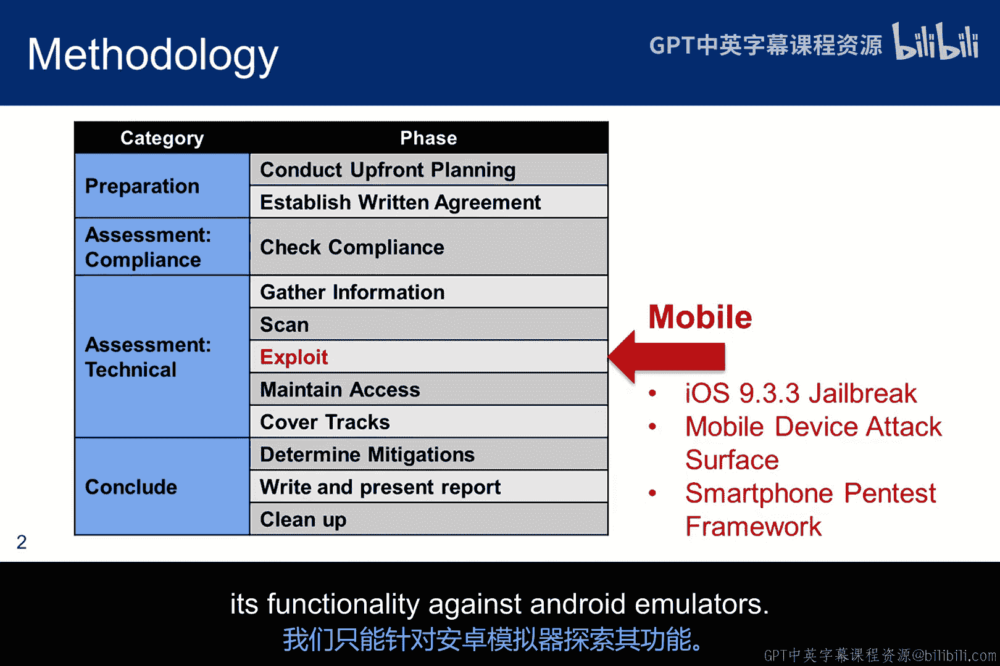

In August 2016， mobile device managers in every organization were in a panic trying to get their corporate iPhones patched because an attack had been found in the wild that could jail break the device。

 My terminology during the module may mix the expressions。 Jail break and route。

 So don't be confused by that。 The community usually uses jail break for I O devices。

 but the concepts are the same。 Both expressions refer to the act of getting privileges on the device。

There are some side effects of jail breaking and iPhone。 The main effect， of course。

 is that all apps are able to run privileged commands。

 And if the app is under control of a malicious actor。

 all the negative activities we associate with getting root on a system。

 createate the same risk on your mobile device。 One of the nice features of a jail brake is it is possible to remove bloatware。

 But Apple voids the warranty immediately。 but a more important aspect is that because of the way the secure boot chain is implemented on Apple devices。

 Ja breaking will brick the device on the next upgrade。

 I won't delve into the details to this effect。 but it is caused because digital signatures can't chain up to a route of trust。

 and you are no longer allowed to downgrade to an old version of the operating system。

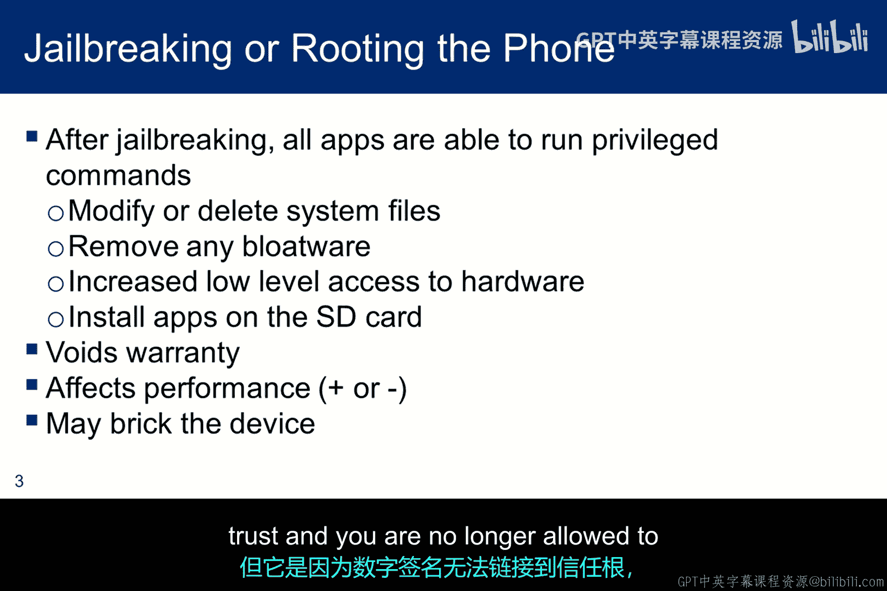

The jail brake was first recognized by a human rights defender in the United Arab Emirates。

 He had previously been the victim of government hacking and spyware。

 so he was suspicious about a text regarding torture in Emiritus prisons So he sent the message to citizen lab。

 a digital rights watchdo at the University of Toronto。

 Citizen La got together with lookout a mobile device security firm and it was soon determined that the accompany E Link would launch a very sophisticated attack on the device。

 The attack was identified as being very similar to other spyware associated with an Israeli cyber warfare Company called NS O Group。

 The jail brake involved the use of three zero days on the device that LED to Emirory corruption and resulted in the installation of spyware。

 The mallware is sometimes referred to as Trident by the security community。

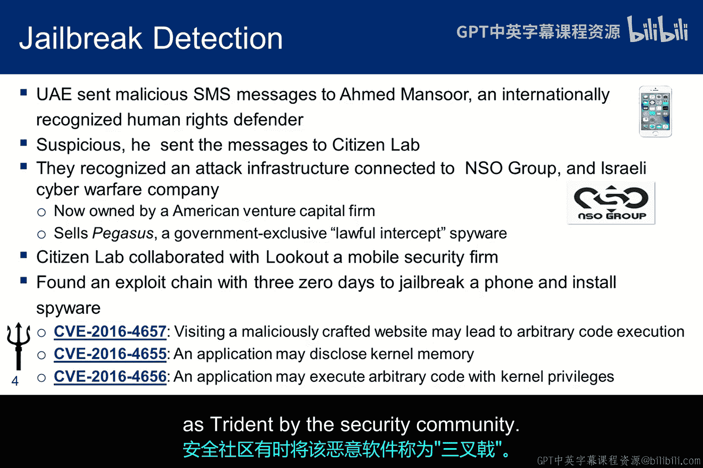

It turns out that this is the business model for NSO Group。

 an organization that sells governments weaponized software that targets cell phones。

 company's basic product is called Pegasus and provides exploits against I。

 Android and Blackberry devices。The NSO group says they only sell to governments on the condition that the cyber technology be used in anti terror or anti criminal intelligence efforts。

 However， that would seem to be somewhat uncontrollable from a public perspective who knows who buys pagaus or to whom the NO group is willing to sell it。

The company as guarded about its products， doesnn't have a website。

 is rather secretive in terms of press interaction and absolves itself of any responsibility。

 In a more recent article about NSL groups spyware sold in Mexico。

 A flat installation fee of $500000 is identified plus per device charges on top of them。

But the information on cost is speculative， at best。

The NSO group does not get a lot of press attention， but allegedly。

 Michael Flynn earned a substantial fee when he served on the advisory board of a related company supporting NSO Group operations。

 NO Group has had some competition， but NO's technology has bubbled up to the surface in the UAE。

 Mexico and Kenya。Traddent has self protection mechanisms built in。

 but it also monitors its processes for discovery and can self destruct。

 Pegasus provides remote monitoring of S M S messages， eye messages， telephone calls， Facetime calls。

 email and several social media services。The malicious software hooks into applications to read the raw information before any processing takes place。

 For example， eye messages are end to end encrypted。

 but the Pegasus malware reads the content before encryption takes place。 And， of course。

 once the device is jail broken and the hooks are installed。

 it is possible to pivot to other apps and collect information。

The malware was in the wild for two years before it was detected。

The zero days that facilitated the attack were patched by Apple as soon as they were discovered。

 However， in the meantime， the NS SL group may have found new zero days or not。

 but because of their secretive nature， it is not common knowledge what the current product is capable of。

The attack starts with a socially engineered message， and various message types are supported。

 The goal is to specifically fish the recipient and hopes he will select the URL in the message。

 The idea is important。 So in the lab， we will explore the use of an S M S message that contains a malicious URL。

 regarding this type of attack。 Many users seem to be a little more careless about clicking on a URL in an S M S message。

 not really realizing that the only thing that has changed is the delivery method and that the same cautions need to be observed regarding a link in this attack。

 if the user clicks on the URL， the browser opens and then closes。

 This could be an indicator to the user that something is amiss。

 or they may just think it is anomalous behavior。Apps crash on a mobile device all the time。

 and it seems likely that this wouldn't appear to be out of the ordinary。 Anyway。

 independent of whether the user is suspicious After clicking the malware immediately carries out the attack to jail break the device。

 and it provides no further indicators to the user。 And once the device is jail broken。

 the spywork can be installed， the hooks are put in place and the spine can begin。

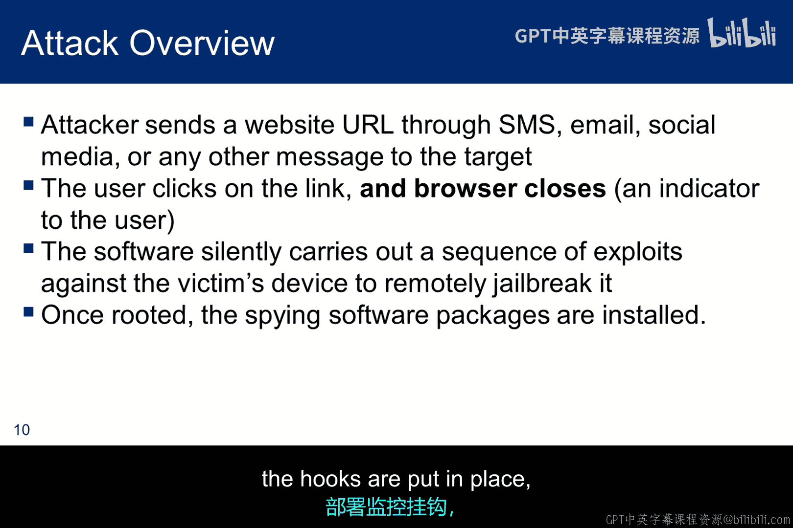

The three0 day vulnerabilities leveraged in the attack are briefly described here。

 The first was based on a safari exploit that allowed arbitrary code execution。

 The second was a kernel vulnerability that leaked information about memory locations。

 and the third corrupted memory， allowing the running of code as route and disabled the system protection mechanisms。

 At that point， the malware had total control of the device and was able to in fireware and open a connection back to the command and controlled server。

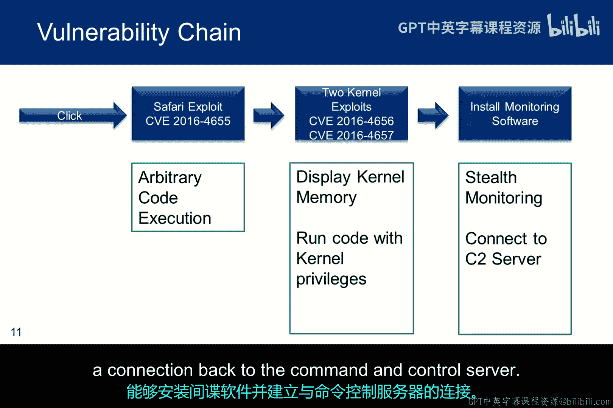

Stage 1 in the attack was to use a Webkit vulnerability to execute arbitrary code and get a foothold。

 Webkit is a browser engine used by Safari and some Linux applications。

 It is also used by the browser in the Android emulators。

 and those who do the mobility lab will explore a similar webkit vulnerability on Android。

 In stage 2， the phone is rooted。 The device downloads an obfuscated package that decrypts itself after being downloaded。

 runs the two kernel exploits。 The goal of encrypting the payload is to circumvent any endpoint security mechanisms that may be present。

 Once the device is rooted， spiware can be installed using root privileges。

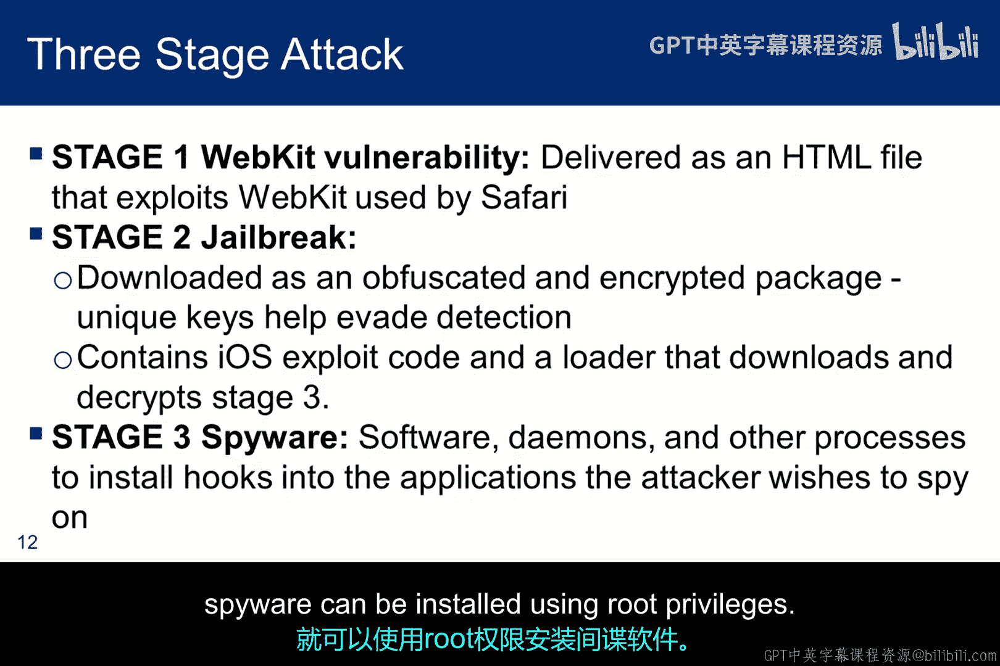

The Webkit vulnerability uses memory corruption to execute arbitrary code。

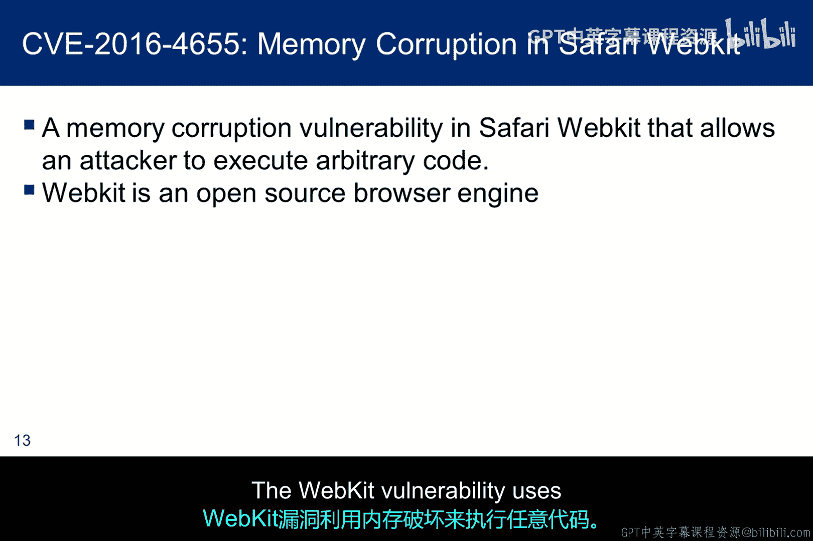

The second vulnerability leaks a portion of the device's memory。

 circumventing protection mechanisms like address space layer randomization。

 It gives Pegas's precise location information for the kernel。

 Once the malware has mapped certain memory location detail。

 It is able to modify instruction pointers to get code to execute to gelbreak the device in the buffer overflow lecture。

 I will discuss information leakage and the discussion includes an example showing precisely how it works on a virtual machine。

😊，That example uses the same approach to get around A SL R。 It maps memory first。

 And once that detail is known， the second phase manipulates the instruction pointer。

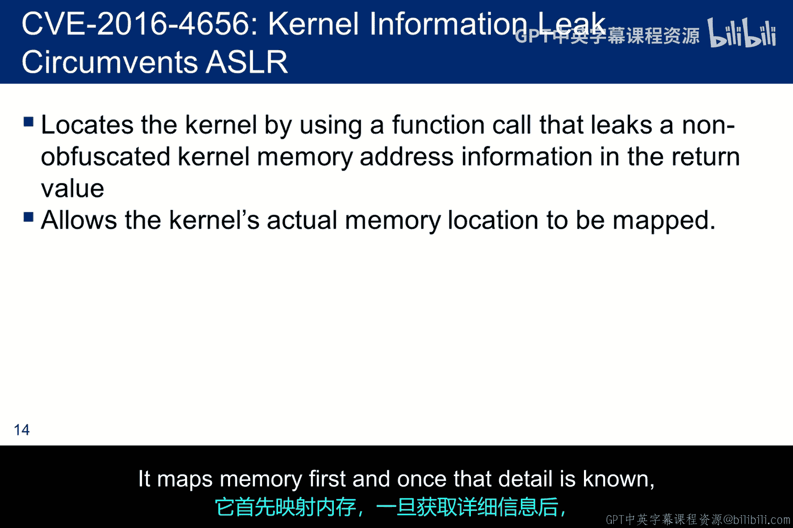

The malware uses memory corruption to exploit the kernelel and then takes several actions to jail break the phone。

 First， it disables the colonel's security mechanisms。

 including code signing so that unsigned code can execute。

And it also disables jailbreak detection applications。

It then remounts the file system and writes the jail brake code to the file system。

 The final step is to delete a configuration file， which forces the jail brake code to load and run with root privileges。

 The malware becomes persistent by replacing a system demon with a binary that calls a script that basically loads the shell code that re exploits the kernel。

 It is important to remember that the fact that code signing checks are turned off is what allows this forged demon to execute any time the system is restarted。

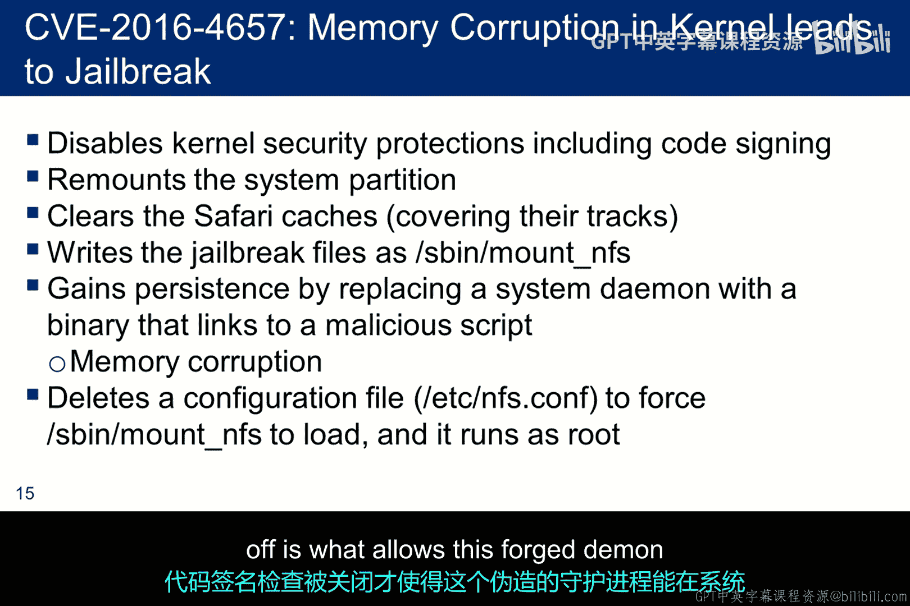

I O has protections built in that prevent applications from interacting in a way that they can spy on each other。

 but on a jail broken phone， device hooks can be put in place by injecting dynamic libraries into normal processes。

 This is accomplished using Saia mobile substrate， which was originally designed to allow third party developers to provide runtime patches to their apps。

 But it comes with a Trident payload and is used maliciously to put spyware hooks into normal apps that came with a device。

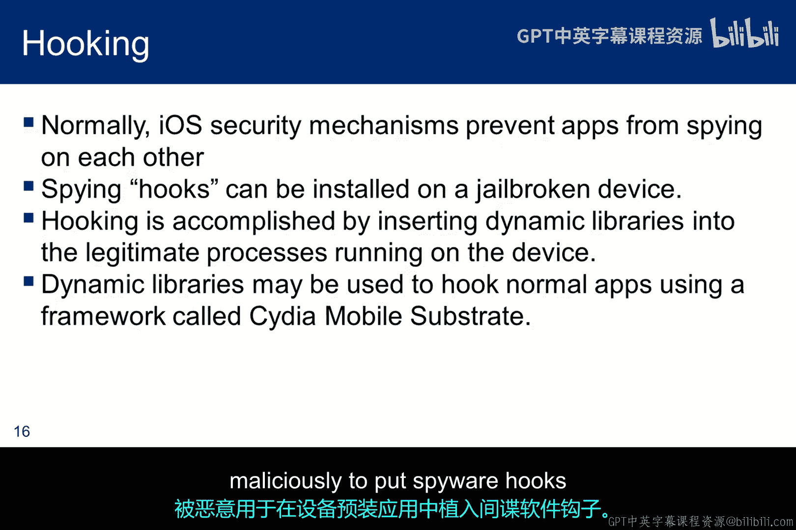

Sud a substrate can only be installed if the device is jail broken as originally designed。

 Once installed， it is a tool that allows developers to select dynamic changes to apps。

 They're called substrate extensions and plug into the apps as dynamic libraries by using the provided API to make all changes in memory。

 multiple developers can safely adapt the same parts of the target program to their purposes。

It is also possible for users who have jail broken phones to install the framework and change the behavior of an app by selecting a different dynamic library provided by the developer。

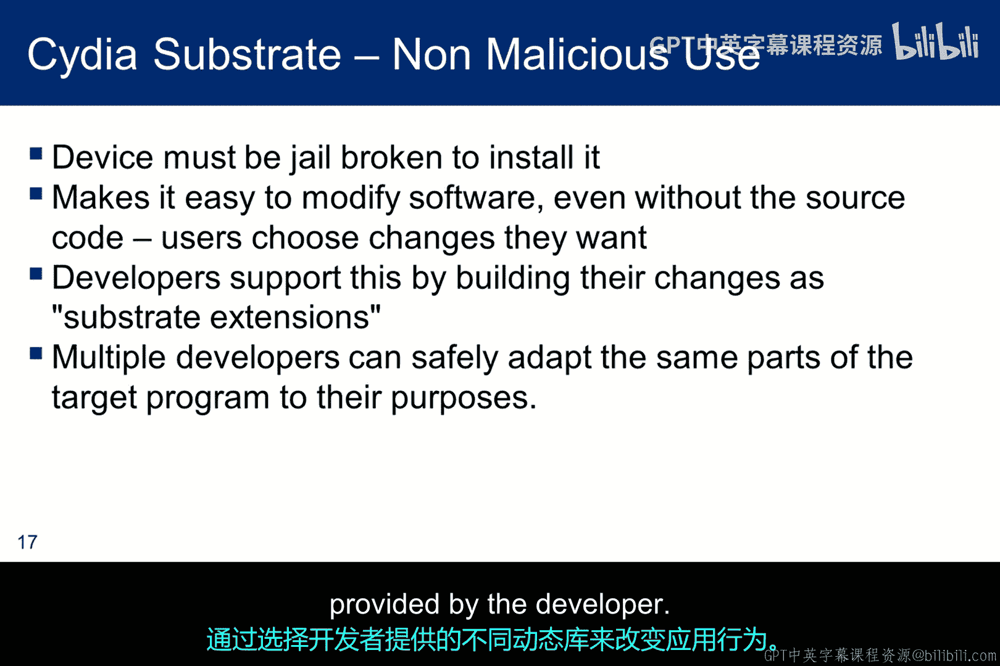

The spyware payload consists of several files， In addition to the society of substrate。

 that are self protection mechanisms。 In my opinion， these are very sophisticated malware techniques。

 A T L S certificate allows confidential exfi of the information collected by the spyware。

 The second as already discussed an unsigned forged system demon runs on reboot to achieve persistence。

 Third， a jail brake detector that removes any other back doors that may have been installed。For if。

 there is a self distructaught component that runs when Trident believes it has been detected。

And finally， there's a tool that disables Lookout's jail brake detection mechanism。

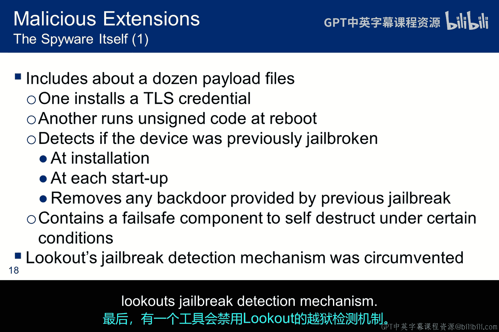

The spyware itself disables auto updates， so the D L L libraries remain in place。

 It also disables the device's ability to enter a deep sleep mode in order to maintain the ability to run。

 communicate and monitor state the command and control channel that excfils the collected data uses S M S。

 But these S M S messages masquerade as two factor authentication messages from popular services such as Facebook and Google and identically mirror ill legitimate two factor authentication exchanges。

Here are some of the important malicious extensions to legitimate applications。 First。

 the system demon loads the key chain and dumps all of the passwords。 The second。

 Maware also captures the Web and WPA keys associated with Wifi networks。 And finally。

 and most importantly， it intercepts all audio and messaging that leaves the device based on triggers associated with each of the Pegasus modules。

 This is done with a set of sophisticated audio and messaging intercept libraries that our modular and extensible。

There are also specialized libraries for each of the key intercept protocols。

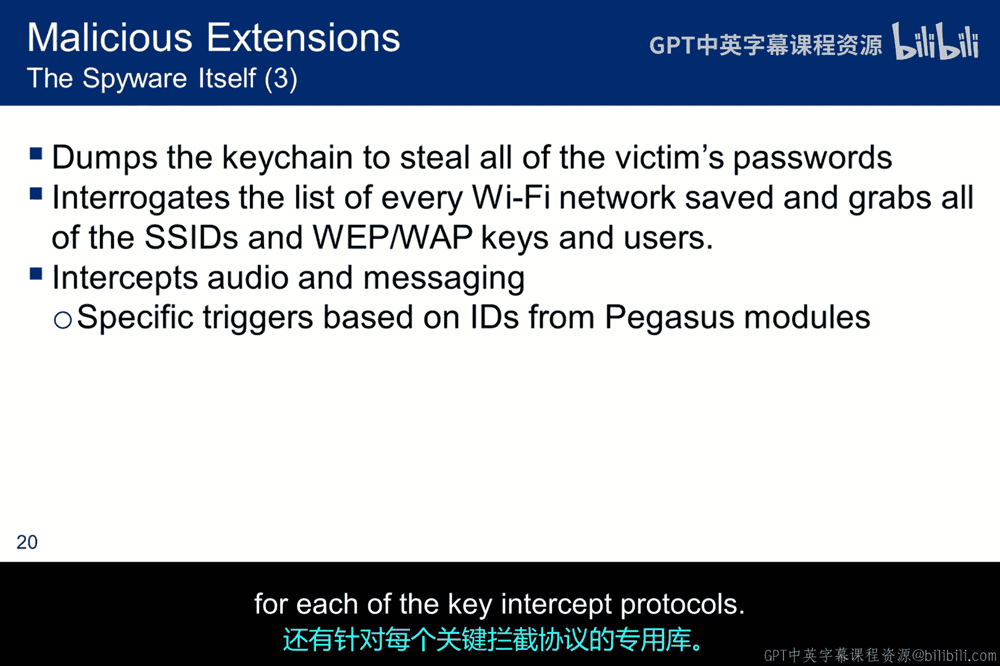

This is a list of the apps that may have been monitored。

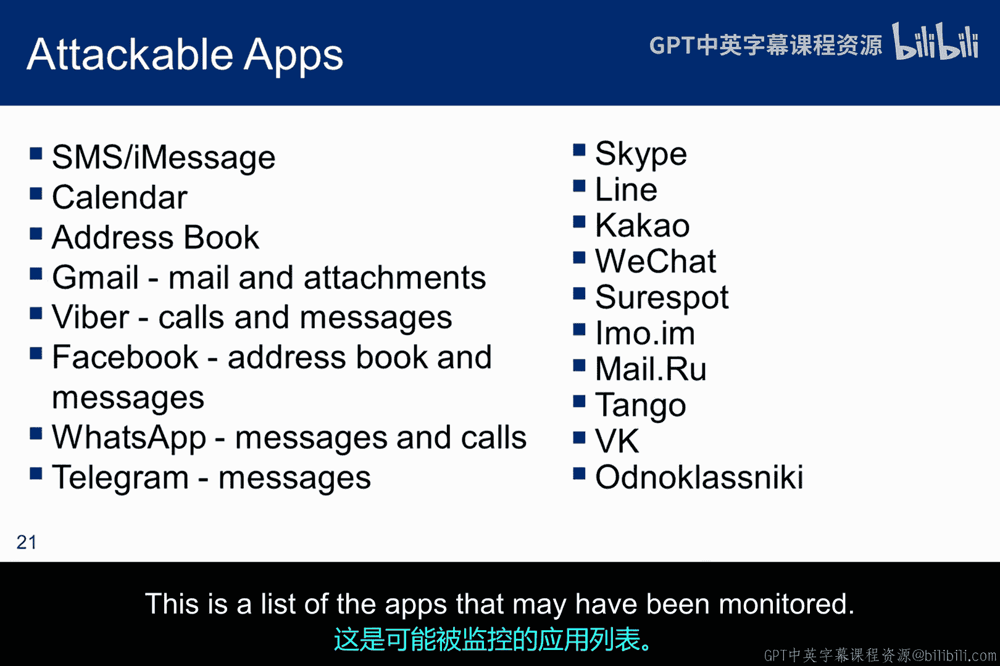

嗯。That covers the NO jail break。 and in some detail， while the vulnerabilities have been patched。

 the techniques still have value。 And you can see some parallels were the tax on computing devices like desktops。

 After all， it is basically the form factor and the addition of an additional radio that distinguishes mobile devices。

Next， I will delve a little deeper into the threat to mobile devices due to their design and their ecosystem。

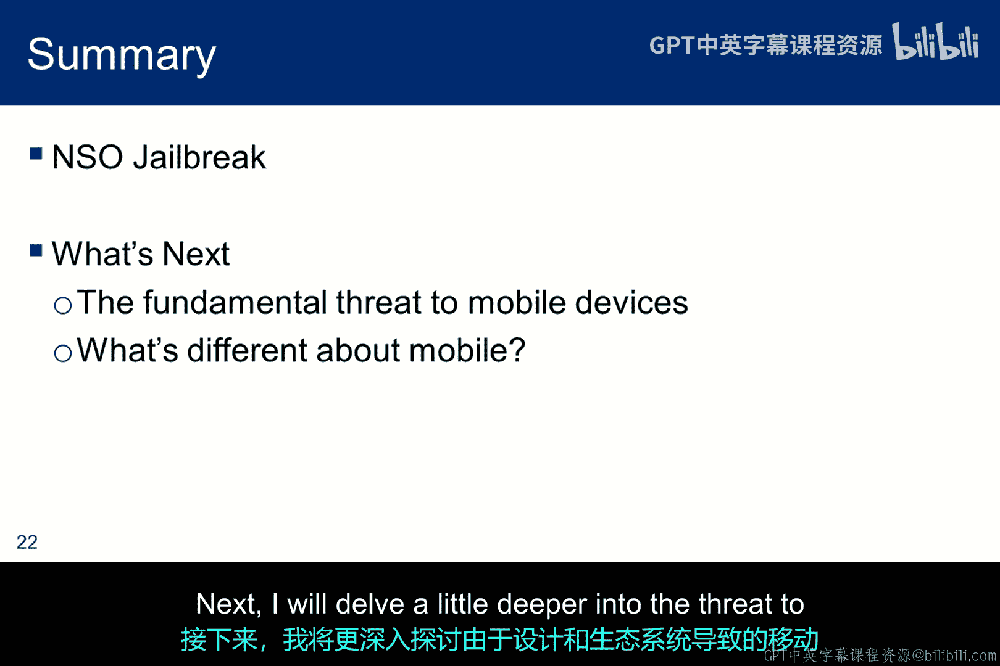