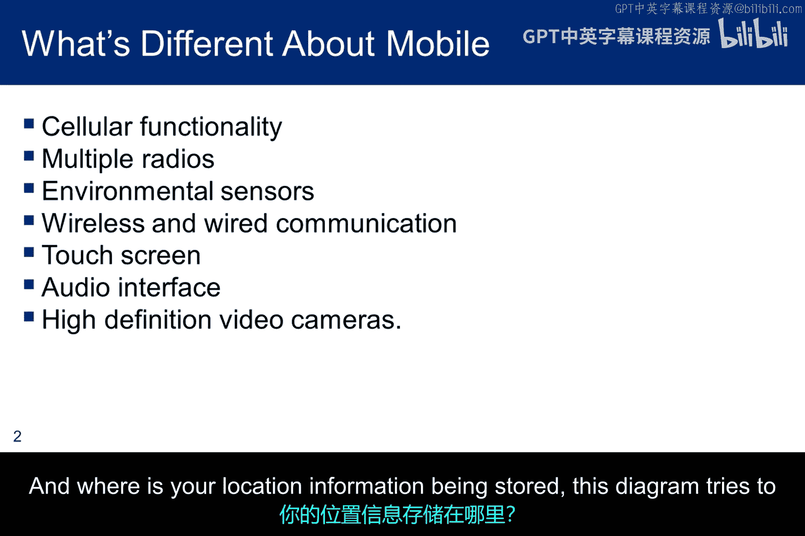
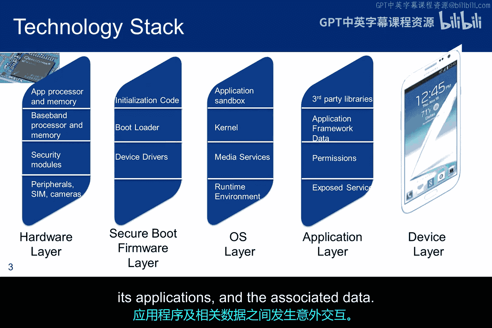
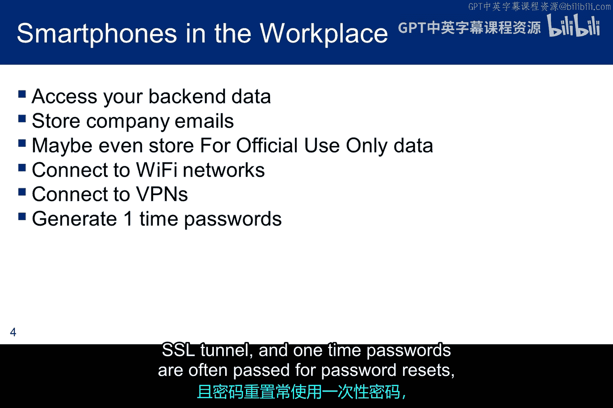
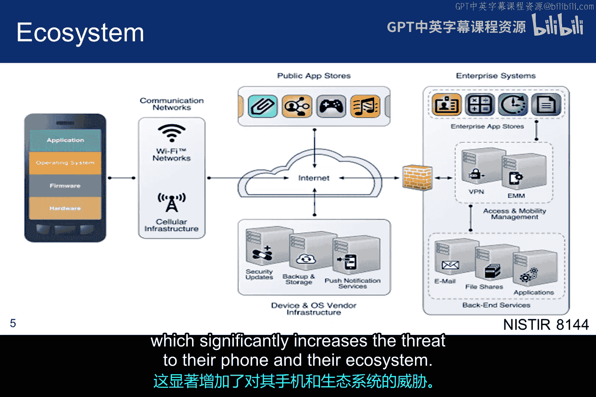
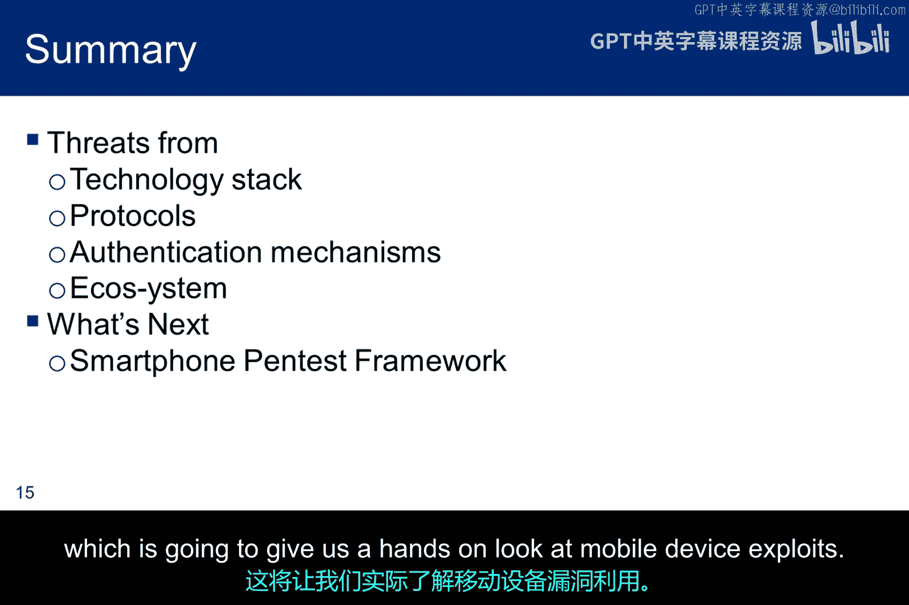

# 约翰霍普金斯大学《道德黑客入门｜Introduction to Ethical Hacking》中英字幕 p23 1_移动设备威胁.zh_en -BV1xgu1z1Eau_p23-

When mobile devices were first introduced， they were no more than cellular phones designed to make telephone calls。

 In the beginning， the targets were basically the carriers。

 and the goal was to make free phone calls to day， the threat landscape has drastically changed as users began trusting these devices with large quantities of sensitive personal information。

This list identifies some of the platform differences between a mobile device and a typical desktop or laptop computer。

These differences are associated with technologies that need to be analyzed in some detail to look for any expansion of the attack surface。

 In many ways， this expansion makes smartphones richer targets that are perhaps less well protected since the security community may still not have reached the top of the learning curve。

I think environmental sensors are a pretty good example of a technology that we may not know how to protect。

 For example， how many applications use georeencing information and how many of those uses are really necessary and where is your location information being stored。

This diagram tries to capture the various levels of technology used in building a smartphone。

 The names at the bottom， providing familiar concepts。

 A separation exists between the hardware and firmware used to access cellular networks and the hardware and firmware used to operate the general purpose mobile O S。

The hardware and firmware used to access the cellular network。

 often referred to as a telephony system， typicallyypically runs a realtime operating system。

 This subsystem is colloquially named the baseband processor and may be implemented on a dedicated system on a chip or included as part of the S O C containing the application processor also running the general purpose mobile O S。

 The firmware necessary to boot the mobile O S， typically verifies additional device code including portions of the mobile O S。

 before a user can use the device。 This involves roots of trust and trusted boot processor。

 If the initialization code is tampered with the device may not properly function。

 Some mobile devices may contain an isolated execution and storage environment used specifically for security functions。

 For example， cryptographic operations or to support digital rights。

Management mobile applications are almost always sandboxed in some manner to prevent unexpected and unwanted interaction between the system。

 its applications and the associated data。

In the workplace， attacks on the mobile device can provide the attacker with a pivot point to a back end infrastructure with all of the organization's proprietary data。

 Of course， the device itself may have sensitive corporate information stored on it in the form of email or attachments stored there。

And， of course， the device provides connectivity to Wifi networks and uses VPNs。

Workplace devices may also use one time passwords to temporarily secure sensitive exchanges。

 perhaps even load software certificates。On a personal device。

 we may not use all of this functionality， but for the most part， there are parallels。

 Cloud storage has many of the attributes of it back end enterprise。

 On purchases using Wi Fi data connections always utilized and encrypted SS S L tunnel。

 and one time passwords are often passed for password resets。 These represent attack vectors。

 no matter who owns the phone。

This shows the ecosystem for a cellular device。 I have included this diagram as a way to illustrate how much bigger the attack surface is than you might think。

 And remember， the attacks can go either way。 The ecosystem can provide vectors into the phone。

 and the phone can provide vectors into the ecosystem。 One comment on the public app store。

 It has to include software from both the O S vendor and third parties。 So one question is。

 how well are the thirdparty apps protected， and in some cases， especially Android devices。

 Use get applications directly from unreliable sources Vi an app store。

 which significantly increases the threat to their phone and their ecosystem。

This is a list of some of the more common threats to mobile devices。

 but it is far from exhaustive In the classroom， I always like to ask students if their phone could be part of a botnet。

Mobile device bonets have been around since 2011， but most users don't think about then。

 Phs usually get replaced more frequently than computers。

 But how would you check to see if your phone has been compromised and is in a bonet。

 We simply don't have a widely available tool set for examining our mobile devices。

 The press has publicized Iot T device bonets， But mobile devices have not really been viewed as a threat。

 even though they could easily be integrated into the same bonet。

Another important idea is the ability to break out of a sandbox and interact with or leverage other applications without jail breaking the phone。

Multiple communication paths offer multiple entry points into a mobile device。

 While a computer might just have a land connection or a w Fi connection。

 mobile devices have not only Wi Fi， but also cellular， Bluetooth， NSFC。

 nearfield communications and S D card interfaces， plus potentially vulnerable dual use power ports。

The GPS interface is a little more complicated。 The phones usually have a GPS chip。

 but to preserve battery life on the phone， they use low power chips。 Since they are low power chips。

 They also use available location information from cell towers to provide precise location more quickly。

Since those chips are low power， they don't work as well when there are no nearby cell towers。

 and the device is totally dependent on the chip。And GPS provides a two forked attack。

 not only is it an entry point， but as discussed earlier。

 once the location information has been determined， which out get it and how might it be misused。

Here is a list of threat categories。 And I'll just talk about the last four on this slide。

 The rest will be covered separately。 One aspect of the supply chain problem is all the devices are manufactured overseas。

 And in spite of how careful a company like Apple may be。

 events could take place on the production line that no one in the management chain is aware of。

 And it isn't just a tax on the hardware or firmware。

 but the software load that goes on to the new device。

 We have an example of a Chinese company that installed a secret back door on hundreds of thousands of phones。

 as reported by ours Technica， security firm cryptowi。

 uncovered a backdoor and the firmware installed on lowcost Android phones including phones from B L U products sold online through Amazon and best buy。

This malware sent P I I callloggues， S M S messages and contact information to servers in China without permission or knowledge of the user。

 Once a bad actor has access to the device， Here are some threats。

 enterprise mobility management systems or E M Ms provide an infrastructure for managing mobile devices in the enterprise。

 They can help deploy policies to all devices and monitor a device's state。

 Exle policies would be only allowing a whitelisted set of applications to run。

 ensuring a lock screen policy is met。 and disabling certain device peripherals like cameras。

 This attack surfaces obviously indirect， but is clearly something a system security engineer needs to worry about。

 threats related to mobile payments include technologies such as USSD。

 which we will explore in the lab， but other attackable payment methodologies include NSC。

Funality and credit card tokenization。The mobile device technology stack consists of the hardware。

 firmware and software used to host and operate the mobile device。

 This is a list of potential attacks on that stack。

This is a list of services that use protocols that could be attacked。

All except the cellular protocols are probably familiar。

 The cellular protocols include the cellular air interface that connects to the base station。

 small consumer cells that extend cell coverage， messaging services， US SDD。

 signaling system 7 and LTE。The three places in the infrastructure where authentication takes place are also susceptible to attacks。

 We encounter the first one， Local authentication。 Each time we log on to our phone。

 whether we use passwords， fingerprints or voice recognition。

 The second one user or device to remote service includes remote authentication that may be completed by a user but can also be completed by the device itself。

 This involves remote authentication to an external process， service or device。

 The last authentication point。 is when the user or device wants to access a network。

 Wifi or cellular， and often involves the use of cryptographic token before the access to the service is granted。

I mentioned the ecosystem threat previously。 There are many challenges。

 but two of the big problems stand down。 One big problem is that some public stores provide access to applications。

 but the owner doesn't have a process for adequately vetting applications。

 The second problem is that third party stores are usually owned and operated by organizations external to any vendors。

 and the downloading and installation of malicious apps。

 provides a wide open vector based on social engineering techniques。

Social engineering S M S messages with malicious links is an obvious attack approach。

 but the worry is users are not as careful about clicking on SMS links as they are about a link in an email。

 It may be a training problem。 Our institutions have taught us even tested us regarding malicious links and email。

 But malicious links and S M S messages don't get the same visibility。 Nevertheless。

 the risk is just as high， and the sensitivity of the data on a mobile device just as critical。

 One big difference between mobile devices and desktop computers is the frequency with which we download new applications。

 which increases the chances of getting a piece of malware When an app store or third party isn't a properly vetted source。

And， of course， the threat from software bugs doesn't change just because we have a different form factor。

 Software is buggy and probably has far more undetected vulnerabilities than we would like to think about。

 And one of the hardest pieces of software to secure is the browser。 Furthermore。

 in the mobile environment， there are software technology differences。

 and the software versions have not always been checked out as carefully as the desktop browser。

 especially as developers rush to create responsive designs for all form factors。

I have discussed several threats to mobile platforms to include the technology stack。

 numerous protocols， authentication points in the infrastructure and the ecosystem in general。 Next。

 I will talk about the smartphone pen test framework。

 which is going to give us a hands on look at mobile device exploits。

