# 约翰霍普金斯大学《道德黑客入门｜Introduction to Ethical Hacking》中英字幕 p24 2_智能手机渗透测试框架SPF.zh_en -BV1xgu1z1Eau_p24-

Yeah。The remainder of this module will focus on the smartphone pen testing framework In this sub moduleule。

 I will introduce you to the framework。 And in the next。

 I will talk about how to use it in preparation for the lab that will ask you to run a few exploits against Android emulators。

There are many tools that evaluate mobile device security。 One pen testing tool is Zanti。

 another is Mobisac。 The link to the mobile security Wiiki introduces tools for forensics development。

 static analysis， dynamic analysis， reverse engineering， hooking and many other topics。

 If you are interested in mobile devices。 There is useful information that you will find interesting。

 But we are going to focus on the smartphone pen testing framework。

 because it is a tool that was available via Github and provides a nice approach to the subject。

 versionion 1。0 was made available by bold security。

 But the developer has moved on to a company called Chevira and begun to refactor the original product。

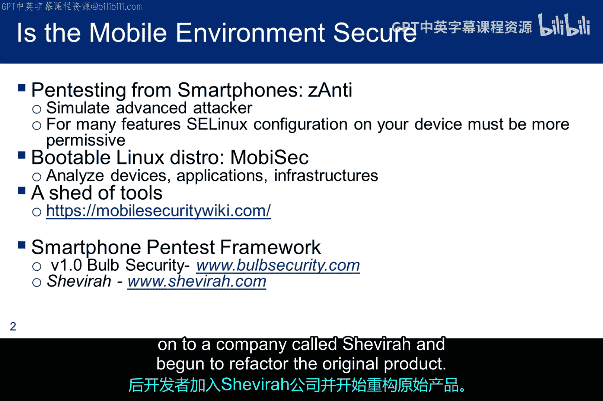

The smart pen testing framework was developed by Georgia Wideman as a DARPA project。

 It was originally available on Gitthub， but it is no longer supported。

 And when the new product called Daga became available。 SF was removed from Github。

 I will provide a tarball of the last Github version for use in the lab， But going forward。

 you may find Daga to be a more useful tool， because it is consistently being updated and improved。

 Unfortunately， the free version has its own limitations due to licensing issues with mobile device vendors。

 But exploring the capabilities and structure of the SPF will give you good insight into how Dga works and how you can use it for pen testing。

 Smart phone pen test framework was open source and provided the ability to launch remote attacks。

 clientient side attacks and social engineering attacks。

It also provided some support for post exploit techniques。

 The effect of the licensing issues is that agents with information gathering functionality to be sent to the target cannot be made available in the free version of Daga。

 For this reason， I have chosen to use SPF as a learning tool。 It is a bit more robust。

 even though it is no longer supported， and it will give you better insight into the functionality in the commercial version of Daga。

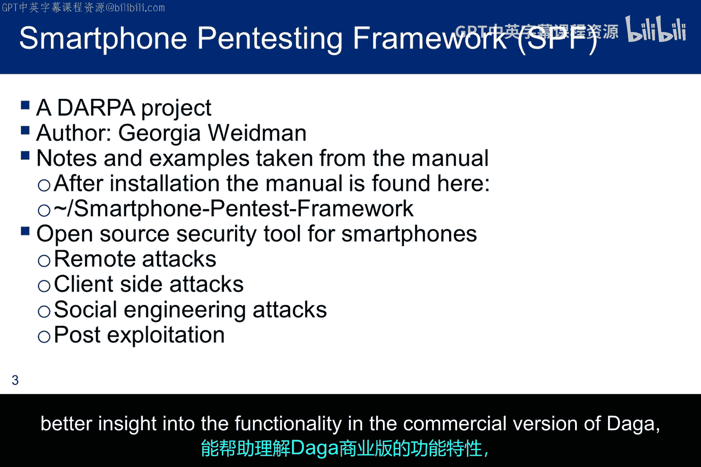

The framework is designed to work as shown in this diagram on the left in the box labeled cali。

 there is a client and a server。As always， the server could be installed on a different box if that adds value to the pen test。

 The client controls the server， which is running the management framework。In our case。

 they are both on Cali。 The framework on the server communicates with a special client owned smartphone that has had a management app installed on it。

The key here is the tester owns the smartphone。 So the app on the phone and the framework know about each other。

 share a communication protocol and can connect up to each other。

 The connection allows the server to send commands to the management app and view any data that if sends back。

 So there is an exchange of commands and data between the client controlled phone and the management framework。

 The last piece of the architecture is the target itself on the right。

 The two communication paths are shown。 The first one is between the management app on the client controlled phone and the target。

 The management app uses this path to send S M S messages to the target。

 These messages may contain either a malicious payload。

 often called an agent in the SF documentation or device commands。

 The second communication path is between the agent on the target and the Web server running on the management server。

 It provides the path back to the。Trolling web server that has been listening for HTTP gets from the target。

The S M S messages sent to the target via the first path may be delivering an agent。

 but they may also be commands to the agent regarding information gathering。

 control commands or commands aimed at privileged escalation。

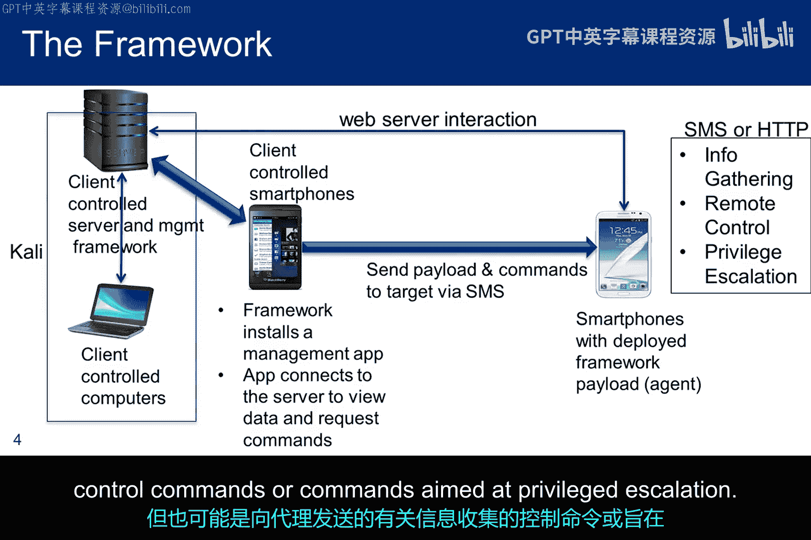

This is a slightly different view of the SPF that discusses the steps that are involved in launching an attack on a target。

 First of all， notice that the two mobile devices have phone numbers associated with them。

 In this picture。 The one we control is 1，5，5，5，5，2，1，5，5，5，4。

 And the one we are going to attack is 1，5，5，5，5，2，1，5，5，5，6。

 The first 8 digits will always be the same。 but the last two may differ。 Sometimes you assign them。

 and sometimes the framework detects them。 In any case。

 it is important to keep track of which is switch。The steps to create an attack are numbered in the diagram。

 First， the framework will create a management app that the framework can use to launch the attacks in the mobile infrastructure from the controlled device。

 Second， the framework sends the app to the controlled device by using the phone number and the Android device bridge。

 The ADB is a command line tool that lets you communicate with either an emulator or a connected Android device。

 The ADB command facilitates commands to install and debug apps。

 and it provides access to a Uni shell that can be used to run commands on a device。 Third。

 the controlled device uses the app just installed to connect back to the management framework。

Fourth， at the request of the management framework。

 the management app relays a payload or agent to the target。 Again， don't mix up the phone numbers。

5th， the management app may relay other commands to the agent on the target。

 but our lab does not explore this feature 6th， the user on the target device clicks on the URL in the S M S message and the agent on the target connects back to the management framework。

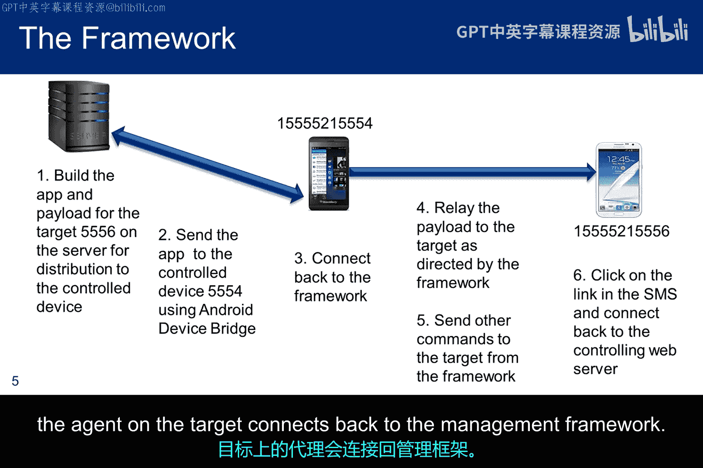

The history of SPF is it was created as a DARPA product by Georgia Wman。

 who publicized it through her security company， B security。 At that point。

 it was freely available on Github。 She subsequently joined up with some other people to form a new company called Chevira。

 The goal was to refactor much of the SPF and provide not only security consulting。

 but an improved product called Daga。 There is a free version of dega。

 and I have explored its functionality， but for a learning tool。

 it is more limiting than SPF because of the licensing problems associated with agents。

 So the lab for this class will focus on using SPF。

 and the insights you gain will be transferable to Dga。

 The lab notes do provide some guidance on how to install Dega for anyone who is interested。

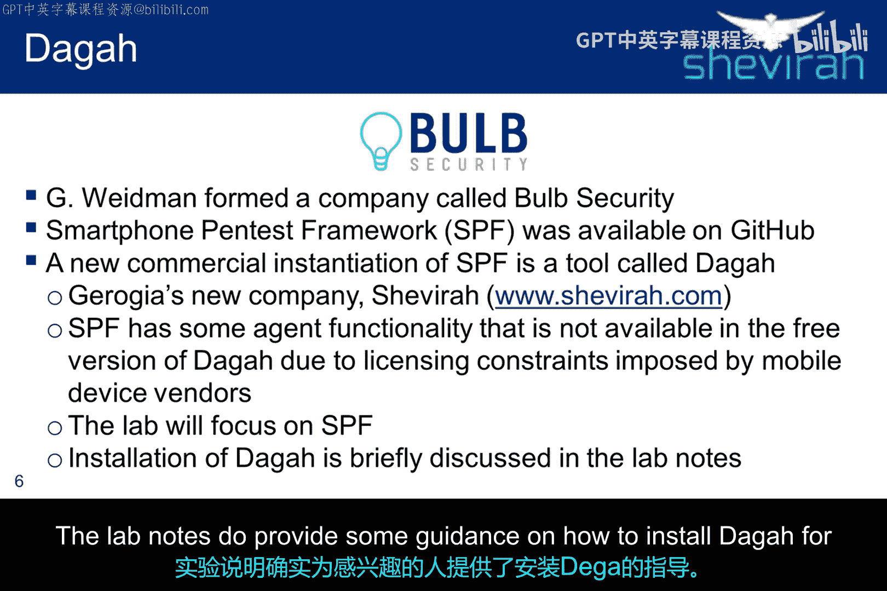

A reminder that this is the first lab that is not mandatory。

 It is one of the six nonmandatory lab from which you must pick any four to complete and hand in A couple of comments on the installation。

 First， since SF is no longer available on Github。 I have created a tar file from my build。

 it is posted on Blackboard as SF dot Tg Z。 A lab will ask you to download it uncompress it and install it on Callli。

 At one time， you could load it on the 32 B version of Callli by setting an environment variable。

 but that feature is being deprecated。 And when I tried it， it already seem to be very unreliable。

 So you want to install it on a 64 B V M。 The SF will also need My SQL Apache2 and the Android S K。

 but those should come with a Cali build。

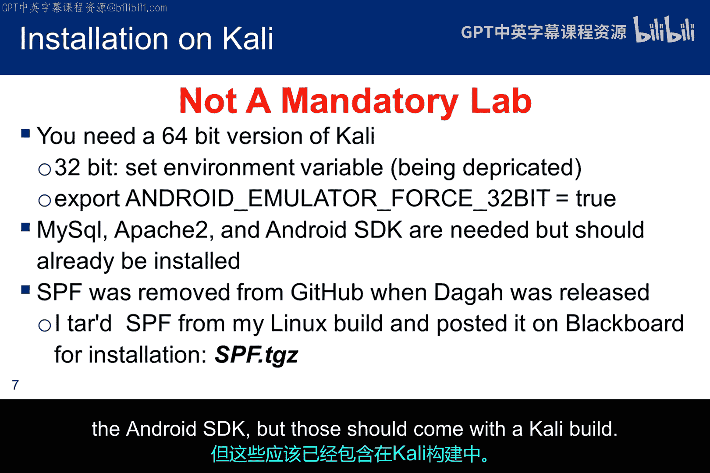

This is a review of the installation steps for SPF。 I won't read through them。

 but I will note that as soon as you unziip the tar file。

 you can access both the user manual and the installation script in the lab notes。

 I have provided a discussion of the script line by line。

 You may want to review that before you do the install。

 So you know what to look for and where to look for it in case your installation does not go smoothly。

The installation script will start Apache and MysQl， but they may not automatically start on reboot。

 depending on your cali configuration， You can either start them manually or reconfigure cali to start them automatically。

 If you decide to do the lab， do not forget to start these services。 Otherwise。

 you will create unnecessary troubleshooting problems for yourself。After you install SPF。

 you need to configure it to work on your system。 You should only need to change three items in the configuration file。

 They are listed here， assuming your cali Dock Ro and Calli I P address are the same as mine。

 These addresses are important for the SPF to keep track of where the Web server and listener。

 it will use are located。At this point， SPF is installed and ready to use。

 but we have no devices to test unless you have a drawer full of cell phones。

 So we need to build some Android cell phone emulators。 When the emulators run。

 they consume a significant amount of host resources， So have patience with this part of the lab。

Another point is that the Android development tools are constantly being changed。

 updated and improved。The approach identified for this lab was based on the tool set at a fixed point in time。

 So the approach may become dated。 As a result， searches on the Internet may provide different guidance to Android developers certainly can choose any tools in any approach you want to use in order to get the Android emulator is working。

 but the guidance in the lab notes should work， even if it is not the latest thinking。

 if you do not have much expertise with Android development。

 I recommend you follow the approach found in the lab notes。

Android SDK tools and Android SDK platform tools are developer package。

 and you do want the latest versions。Then the Android SDK build tools will determine which versions of Android devices you can build。

As always， versions are important because exploits are often linked to specific versions and bugs in those versions。

 Once you download the build tools， you can create emulators by switching from the package tab to the tools tab。

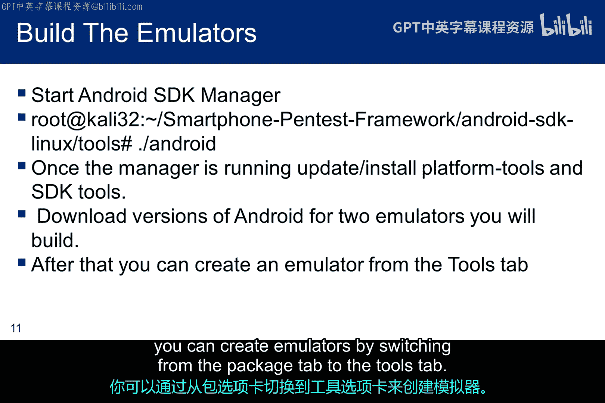

This is a screenshot of the package tab。 The red box shows the tools you want to update to the latest version。

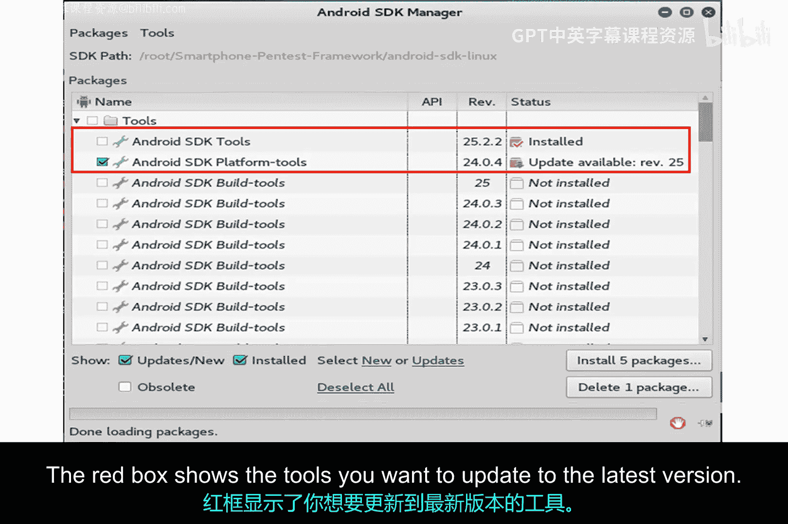

As noted earlier， we need a controlled Android device and a target Android device。

 So we will need at a minimum to emulators， but in fact。

 you will need more than that because the attacks we will run only work against specific versions of Android。

 The second bullet provides a link between the Android platform version and the associated API。

 So to build a Galaxy 7， you would want to build tools for API level 24。

Here is a screenshot of my Android device manager showing some of the emulators I built at a minimum。

 you have to build an Android 2。1 emulator to test the Webki vulnerability。 And I used Android 1。

6 for the US SDD attack， but it should work on Android 2 do1 device as well。

You also want a controlled device emulator。 I use Nexus 4 do O for that。

 primarily because the latter versions of Android seem to require significantly more host resources。

 You can see I built a Galaxy 7， but did not use it in the lab。

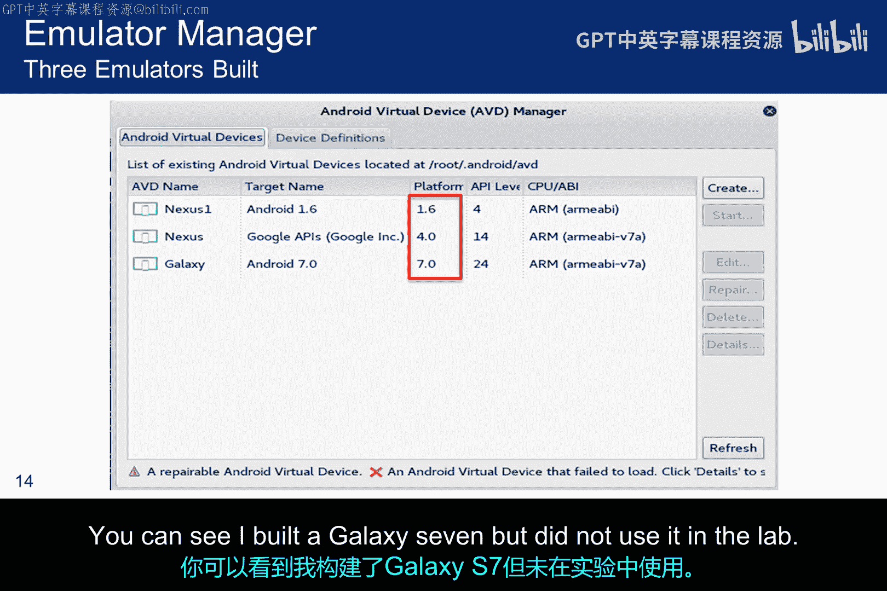

This screenshot is what you see when you click on create to build a new emulator。

 You create the name without spaces and select the platform you want to create from the drop down menu。

 Guid on the remaining selections are that you want to build an emulator for an arm CPU you want to select skin with dynamic hardware controls for controlling the devices from a computer and you want 100 meg S card so you can download files to the emulators。

 When you click on O， the emulator will be built。

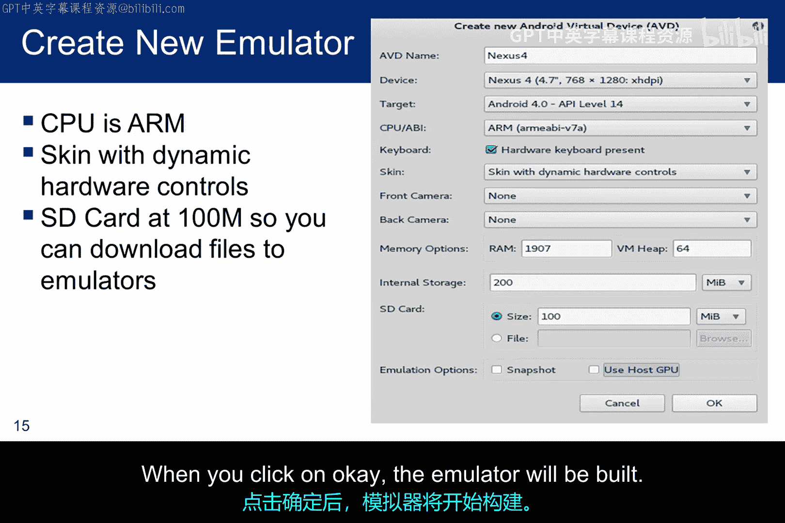

Once the emulators have been built， you can start them from the same Android manager' screen。

 Just highlight the emulator and click start。 At this point。

 you may need a cup of coffee depending on the resources in your host。

 It can take a really long time for the emulators to start。 And we want to start two of them。 One。

 the controlled device and one the target。Here is a screen shot with my nexus 400 on the left and Galaxy 700 on the right。

 It was this kind of exploration that convinced me the galaxy used too many resources。

 You can see the control bar on the right of both emulators。Now。

 you should understand the smartphone pen test framework and how to build Android emulators。

 The next lecture is where we start to have fun by learning how to use the SPF to launch attacks against the target。

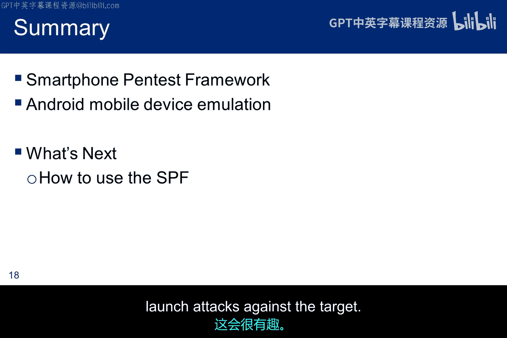