# 约翰霍普金斯大学《道德黑客入门｜Introduction to Ethical Hacking》中英字幕 p25 3_使用SPF框架.zh_en -BV1xgu1z1Eau_p25-

Let's create the management app in the framework。 send it to the controlled device and try using the framework to pen test an Android emulator。

This is a syntax for starting the framework and a screenshot of the C L I menu。

 you will see when it starts。 once it is up and running。

 the first thing you want to do is clear the database by choosing option 7。

 This clears out any data associated with previous uses。 Since I tard the SPF from my build。

 there is most likely some leftover data for my environment and my use of the tool。

 but you may want to do this a couple of times during your testing。

 especially if the framework seems to be misbehaving。 actually， for our purposes。

 you should probably just clear it every time you start the framework。

 Since we aren't really trying to store any data in the database anyway。

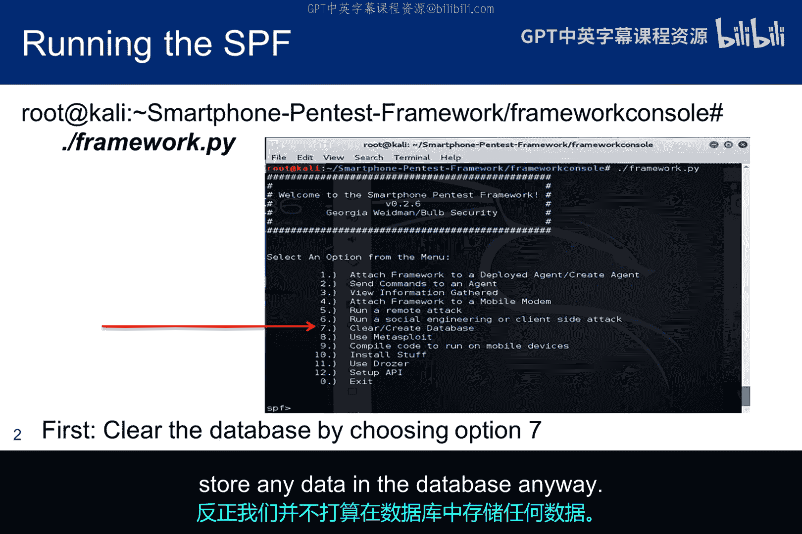

The attack channel from the management device to the target can be either SMS or NFC。

The menus will ask you to make this selection frequently。 since we are using emulators。

 there is not near field communications capability available on any of our devices。

 so you will always want to select S M S。If you were pen testing real physical devices。

 you might want to choose NFCC for delivery of the pay loan。

The first step is to create the management app in the framework and install it into the emulator acting as our controlled device。

 Again， this app will interact with the framework via H TTP and deliver agents and commands to the target via S M S。

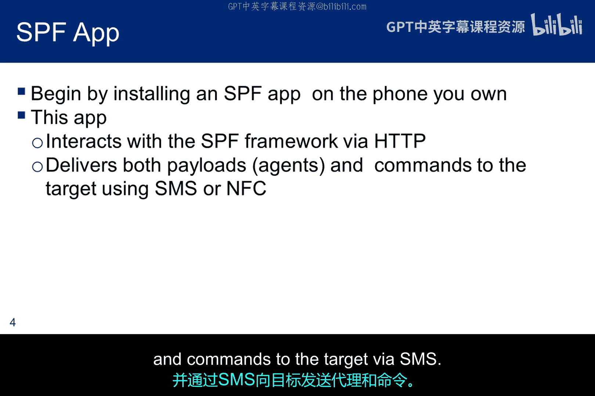

These are the steps to get the managed app onto the own device and then get the app connected back to the framework。

 Select option 4， attach framework to mobile modem。 Obviously。

 we do not have a real modem to connect to。 So don't be confused by this terminology。

 The steps will be the same， even though we are connecting up to the emulated device。1。

 build the app in the framework。 and  two， deploy the app to the own device via AD DB and 3。

 run the app and connect back to the framework。

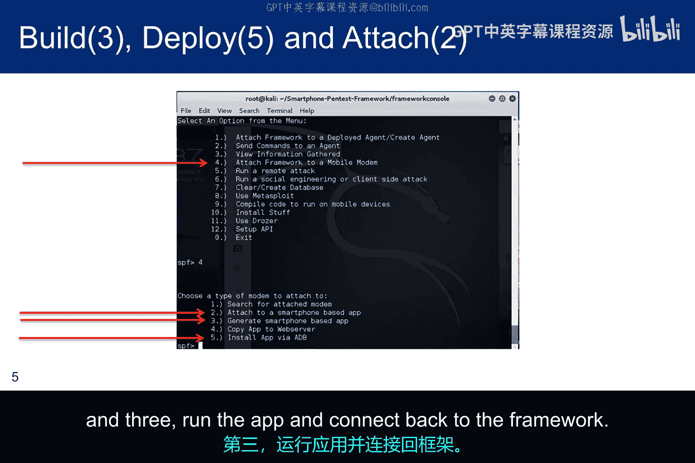

The build menu item is option 3。 generate smartphone based app。 When you make this selection。

 you will be asked for several inputs about the target。 Don't get confused here。

 The framework is building the managed app， but it is asking you about the target or the managed app will deliver the payload。

 It is not asking you about the controlled device where the managed app will get installed。

 This means both emulators need to be running。 So， you know the target's phone number。

 It also means that if you reboot the system or restart an emulator and the target's phone number changes。

 you need to rebuild the management app。The control code can be any seven characters that will be used to authenticate to the payload。

 and the URL is the path to the Web server on the framework that the target will interact with when the link in the S M S is selected for this directory entry enter forward slash and the directory name of your choice。

 I use slash bad this path is relative to the Web server dock route entered into the configuration file when SPF was installed。

 In my case， the complete path will be slash vr slash W W W slash H T M L slash bad。

 even though I just entered slash badd。 If you forget the slash when you answered this per。

 you will end up with files in the wrong place and nothing will work。

 So pay attention to what you are doing， the I P address of the Web server will be handled automatically by the framework。

 So you are not asked about that。After responding to all the prompts， the app should get created。

 and you should get the response。Build successful。 If you don't get a build successful message。

 go back and try again。 Don't keep going， as nothing will work。

The app we just built now needs to get deployed to the controlled device。

 which is done with ADB via menu option 5， install app via ADB。When that is selected。

 the framework will display the devices it detects。 In this case。

 since both emulators are on the network， the SF sees them both。

 Be sure to select the emulator that is acting as the controlled device and not the target。

 When the framework prompts for how to install， select install framework Android app without NFC。

 Since the emulators have no NFC functionality。A success message should be returned。

 If you don't receive that message， do not proceed as every step in the use of the SF depends on the preceding step having been successful。

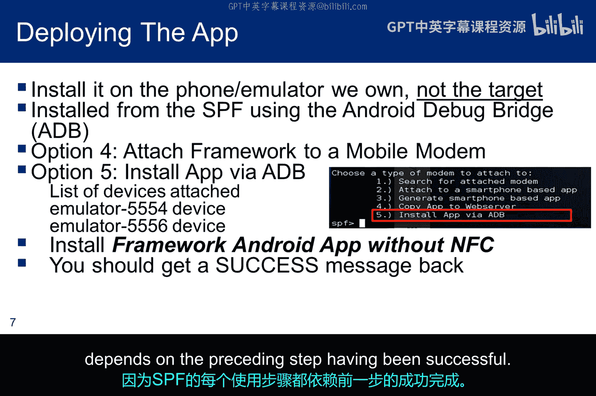

Here is a screenshot of my Nxus emulator with the app installed on it， named Frame Android app。

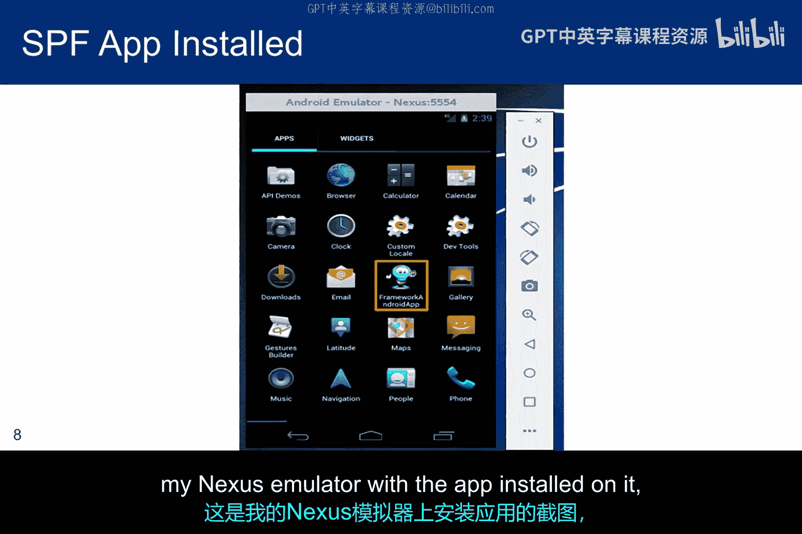

Once the app is installed， it needs to connect back to the framework so it can be managed and controlled by the framework。

 The framework starts this process via menu option 2 attached to smart phone based app。

 After you select option 2， you will see the same prompts as you did when you built the app。

 The big difference is the answer should now represent the managed device， really。

 the attacker rather than the target。After responding to each of the prompts。

 the framework goes into listen mode， waiting for the controlled device to establish a connection。

 So the next step is to go into the controlled emulator and start the framework Android app。

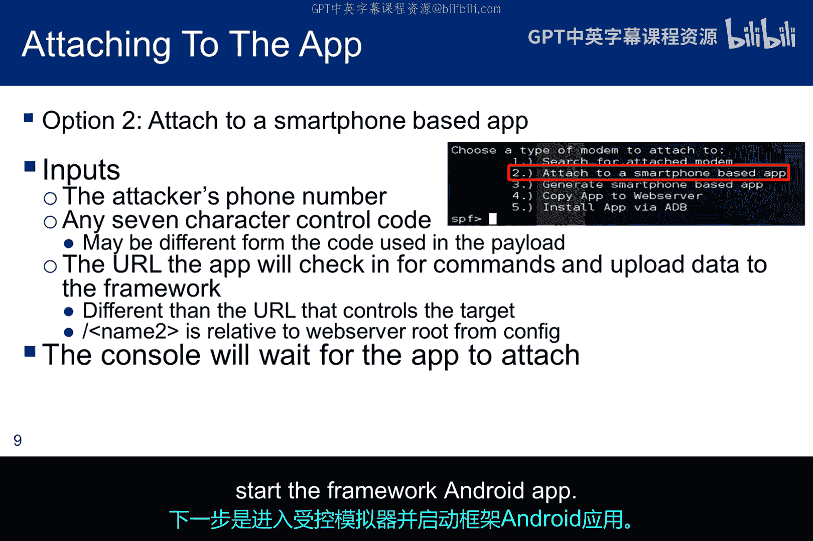

This screenshot just demonstrates that Cally's dock route is used for the SPF directories。

 The one used for the malicious URL that the target connects back to is different from the URL The framework is using to control the framework Android app。

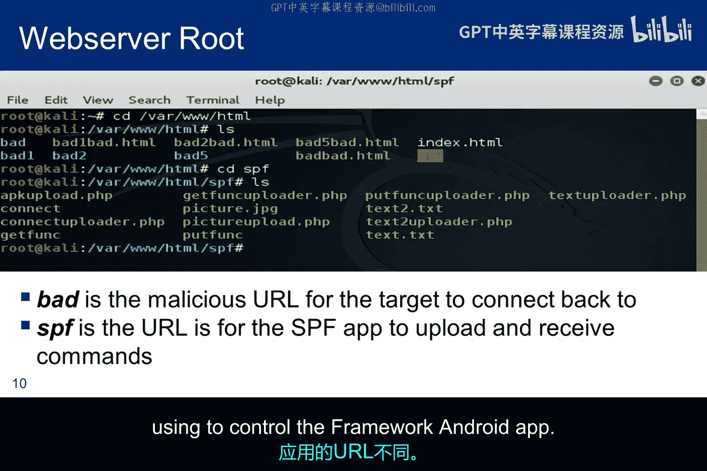

So the framework on Cali is listening at/Vr/ www/ HTMLt/ SPF。You need to go to the emulator。

 start the app and enter the information just entered when you were prompted by the framework。

 After you finish entering the information， click on attach and the framework app on the controlled device will connect back to the framework。

 If the attachment is successful， the emulator will give you a command menu。

 If you go back and look at the framework， you should be returned to the main menu。

 If you do not get these indicators and attachment was not successful。 you should not proceed。

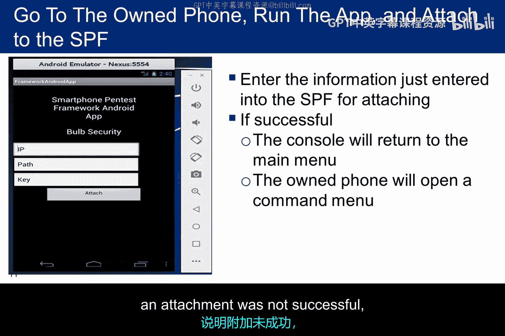

This is a screenshot of the command menu on the emulator after a successful attachment。

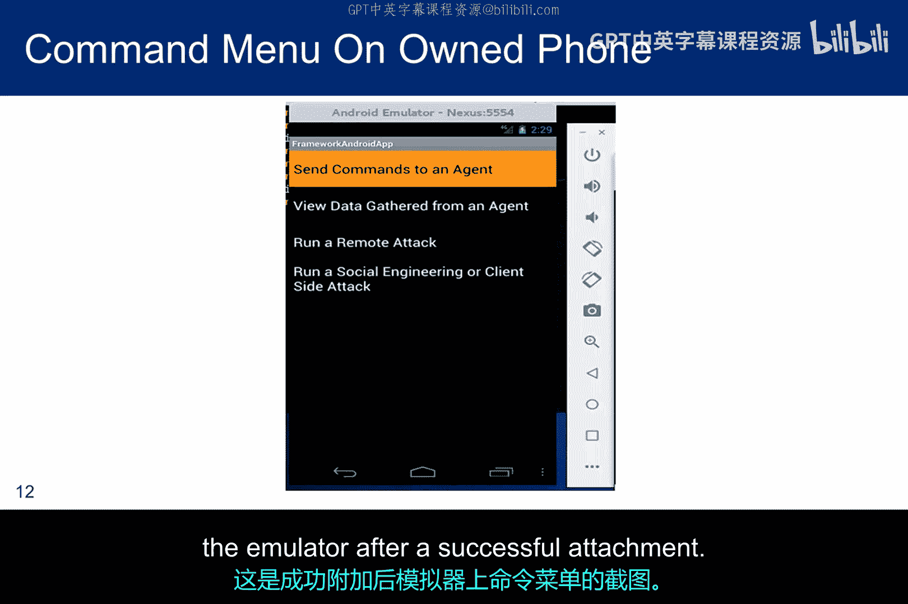

Now， let's try an attack on the emulator serving as a target。 If the attachment was successful。

 you should be in the main menu and can select option 6。

 run social engineering or client side attack。 Then select option 2， clientient side shell。

 and then option 1， C V E 20101759 Webkit Vm Android。

 and you will be asked to respond to several prompts。

 The first prompt is for the name you want to give the malicious web page。

 You want to use a link that aligns with a text that goes into the S M S message to entice the user to proceed to the link。

 The second prompt is for the delivery method。 And once again， using emulators。

 The response will always be S M S。 The third prompt is for the target's phone number where the text message will be sent。

 At this point， the listener on Cali is waiting for a shell to open。 But if the。Is not vulnerable。

 The listener times out and lets you know the target is not vulnerable。 In my case。

 I ran this against my galaxy emulator， which is not vulnerable。 So the listener timed out。

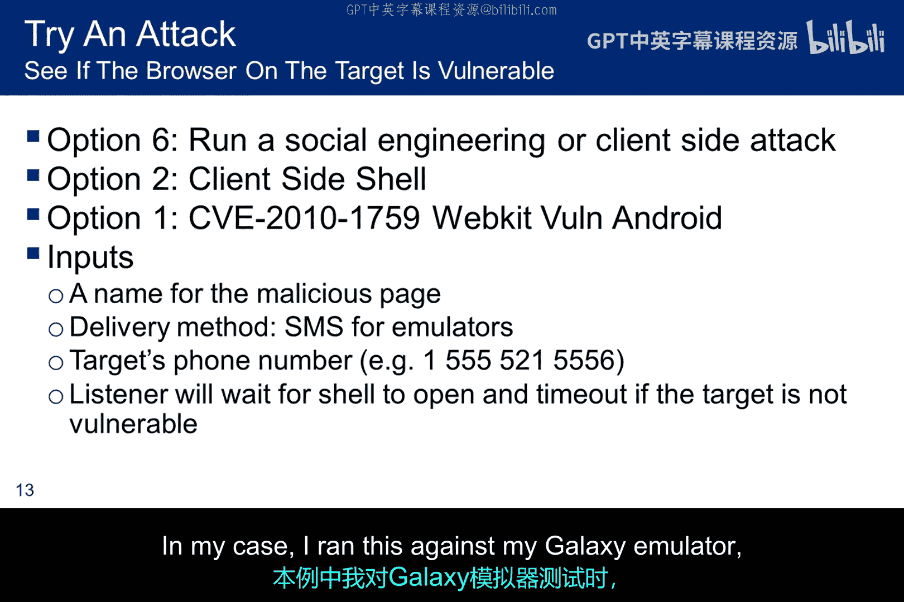

Here is a screenshot of the S M S message sent to my galaxy emulator from my nexus emulator。

 The listener eventually times out。 Notice that the framework sent the message to the framework Android app on the nexus device。

 But at this point， that device is simply acting as a relay。

 So there is no indicator on nexus that a text message was sent。

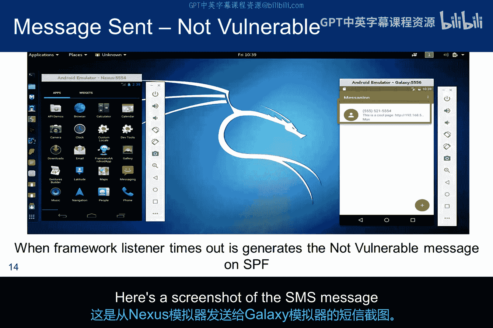

The question is， why didn't the exploit work， And the answer is simple。

 The O S on galaxy is not vulnerable version of the software。The C V E date is 2010。

 but Android V 7 used by Galaxy was delivered in 2016。

 If we reversed the search to see which Android version was available in 2009， It looks like 1 dot 6。

2 do0 R 2 dot1 are our best choices。 I tried the exploit against 1 dot 6， and it didn't work。

 but it did work against 2 dot 1。

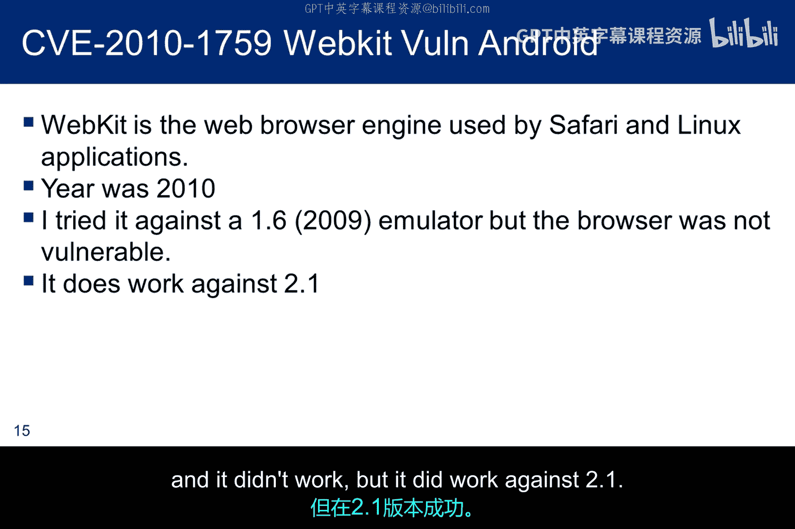

This screen shot shows an attack against Nexus 1， which is Google's first Nexus smartphone based on Donut or Android V1。

6。 But this version was not vulnerable as the red box on the framework tells the user。

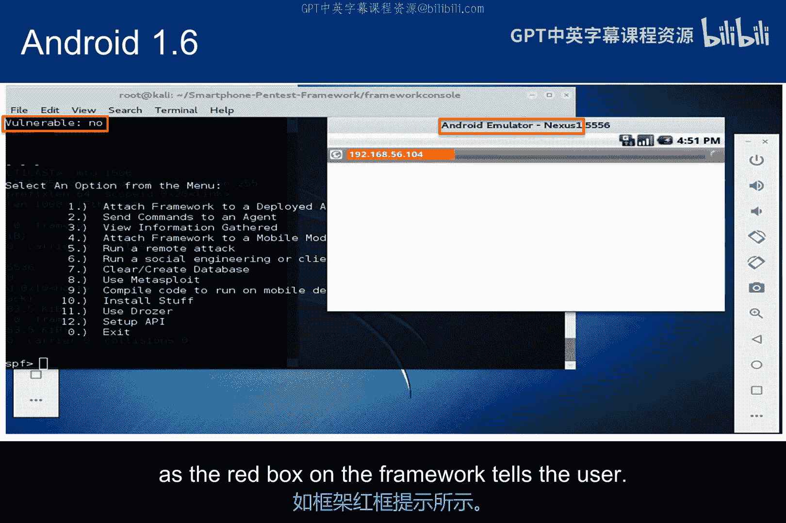

This screen shot shows an attack on Android Virgin 2 do1， which was called acl。

 and this attack was successful。 It shows the S M S message delivered to the2 do1 emulator。

 And when I clicked on the link a shell was opened up on the framework and who am I was automatically run。

 The U I D is 10000， So we don't have root privileges。 but we do have a shell into the mobile device。

 Notice also in the S M S message that I did not provide custom text。

 And I did pick a path name that would typically reduce trust。

 These were not critical issues for the lab。 But in the real world by changing both of these。

 I might convince the user on the target to select the URL in the S， M S message。

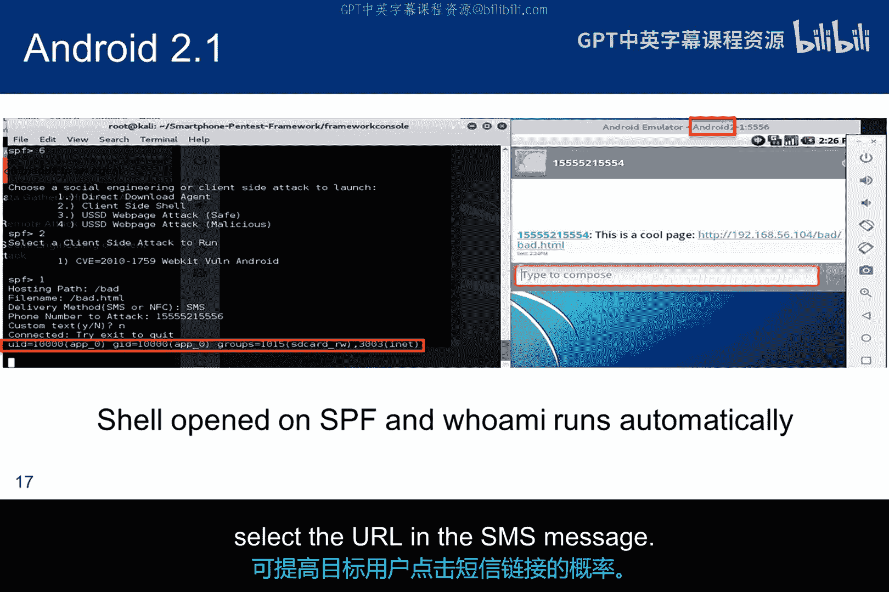

This screenshot just shows an L S command in the shell running on the Android emulator and the responses return all displayed on the SPF framework。

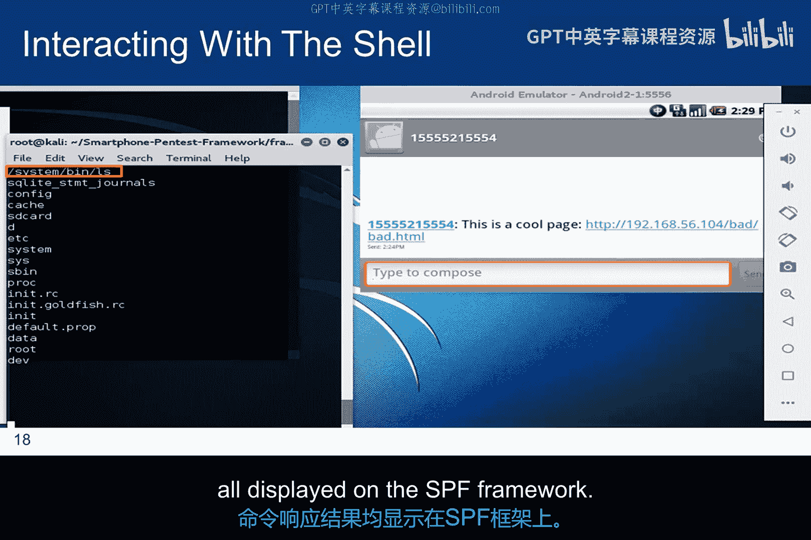

Before discussing a USSD attack， we need to understand what USSD is。

 It is basically a set of feature codes supported by the service provider that can be sent from the device to the provider's servers to request either service or information。

 For example， one feature code might be used to change the phone's configuration。

 Another might request payment information or request a callback。

USSD is usually customized by the service provider。

 so there is no single list of functionality available。

A USSD message can be up to 1 hundred and82 characters。

 and they are typically sent via a connection established on the fly。 Once established， though。

 the connection remains open and can be used for the exchange of data。

That way it works on a phone is you open the dialer， enter the US SDD code and hit dial。

 The code gets sent， and the service provider parsees out the US SDD content and provides the service requested。

A US SDD message always starts with an asterisk and ends with a town sign。

 So it is relatively easy to identify and parse internalnal to the message are groups of integers separated by additional asterisks and the string of individual digits represents either a command or data being sent to the service provider。

Here are some sample USSD codes。First， notice that Verizon does not follow the US SDD standard。

 which tells us that the codes are customized by a provider。

 and we will need to do some research before launching a US SDD attack。Notice， however。

 that universal codes do exist， and these should be used in the same way by each provider。

 Star pound 0，6 returns the I M EI number， which is a friendly piece of information that could be collected by sending the associated USSD message。

 Star 27，67 star 38，55 is another universal message。

 But this is easy to use maliciously by implanting a factory reset on the device。

This shows the steps to launch a US SDD attack on Android 1 dot 6 with phone number 55，56。

 The way it works is the US SDD code is automatically opened in the device's dialer。

 Since these particular US SDD codes are handled locally。

 they do not need to be sent to the service provider。 It is good enough to open them in the dialer。

 and the device will parse and respond to the code。

 That means one needs to launch USSD attacks very carefully， because in the real world。

 it could harm a device， depending on the code chosen。 in our virtual world。

 It is a bit easier to recover by simply restarting or worse case rebuilding an emulator。

For the safe attack， the US SDD code is just star pound 06， which requests the I M E I number。

 Notice， however， that since our emulators do not have a real baseband processor。

 the emulator does not actually respond to the US SDD code。

 but we can see it has been loaded into the dialer。

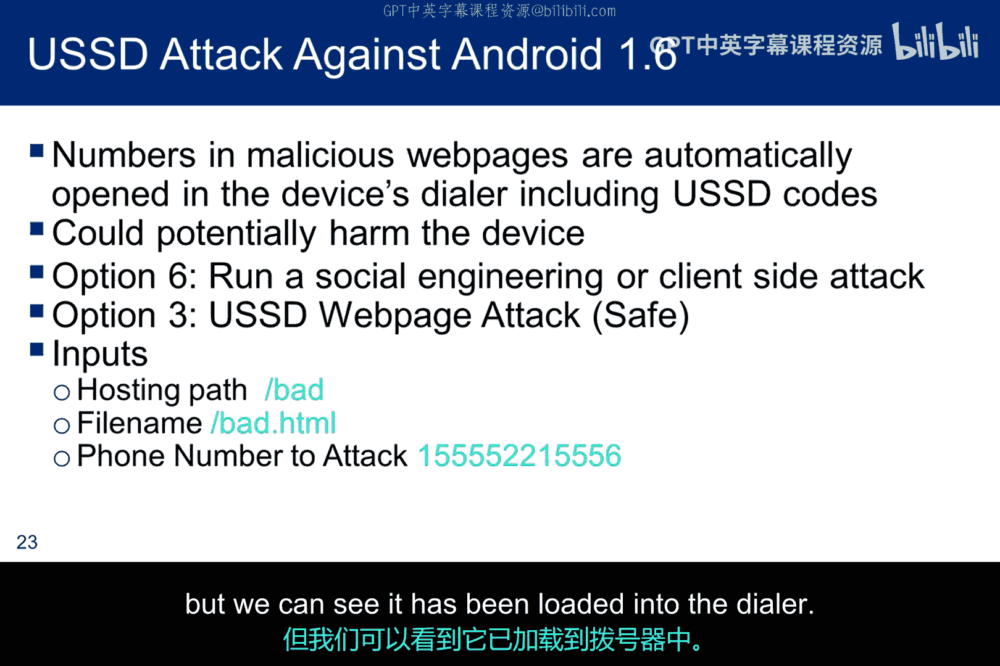

This screen shows I launched the attack three different times as I experimented with the SF functionality。

 I chose a different malicious path each time you can see that when the S M S message arrives and I select the malicious link。

 the US SDD code has been sent to the daughter from the web page。

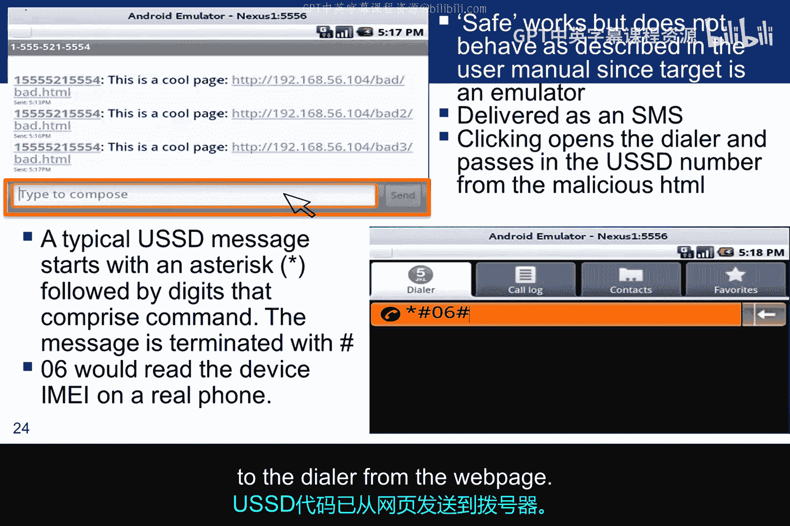

This completes the discussion on how to use a smartphone pen test framework。

 We deployed the managed app， attached the control app back to the framework and launched a couple of attacks against the target。

 We also discussed the I O jail brake and the threat space for mobile devices。 Next。

 we want to learn about Wi Fi exploitation。

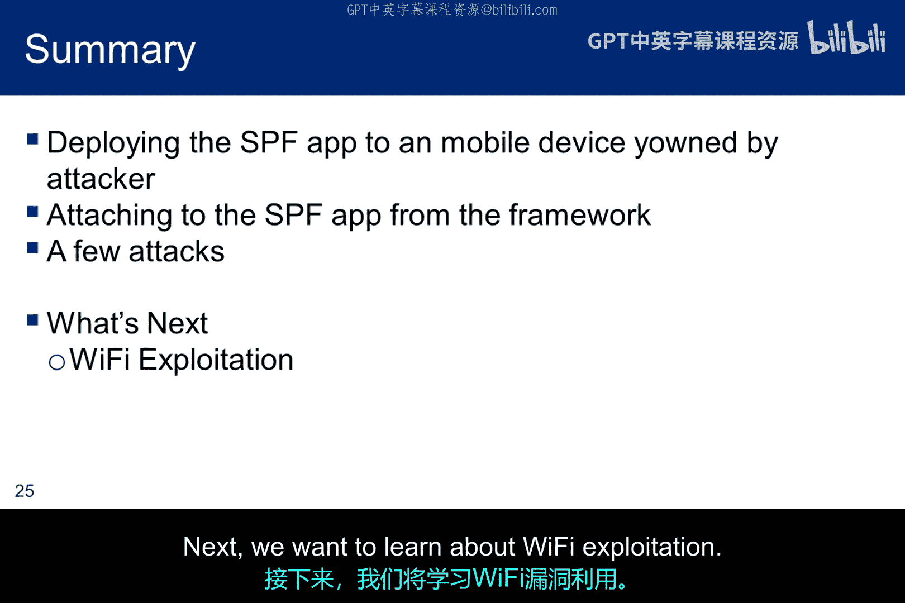