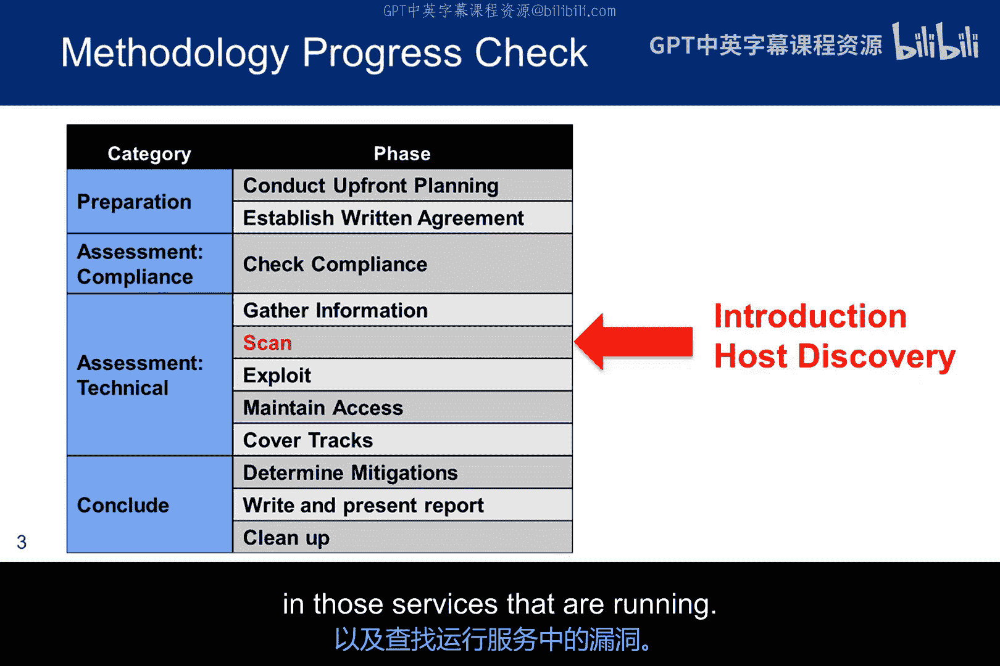
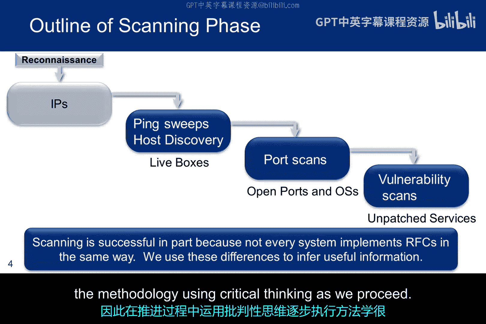
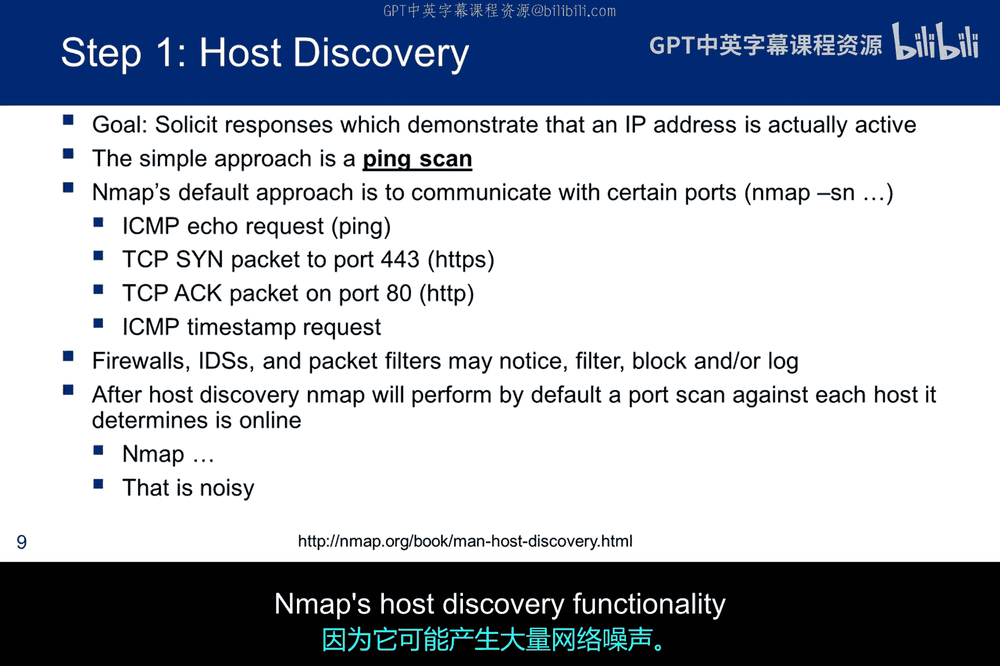
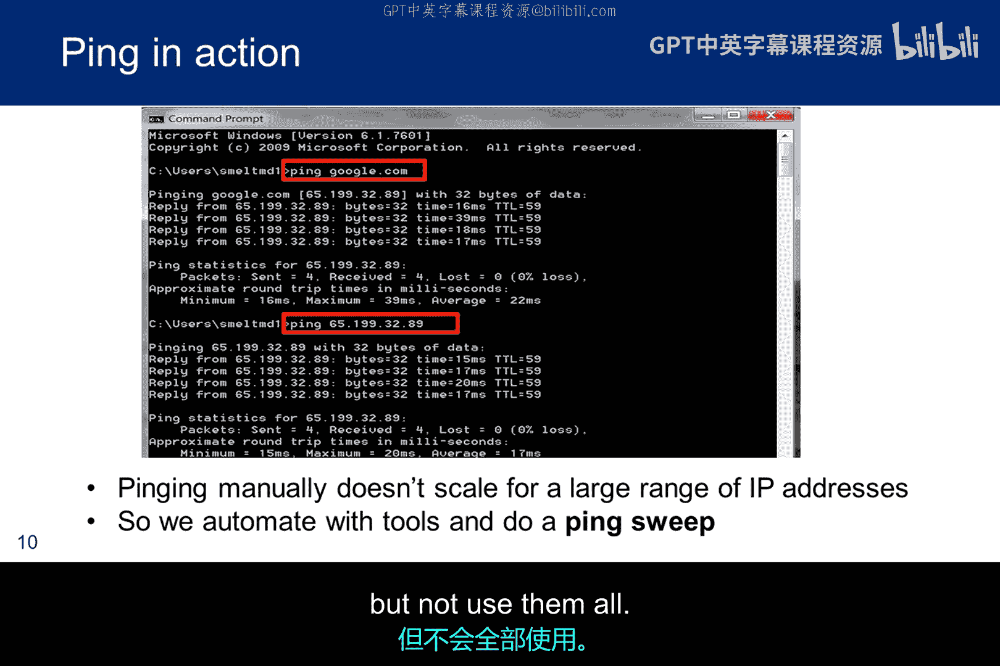
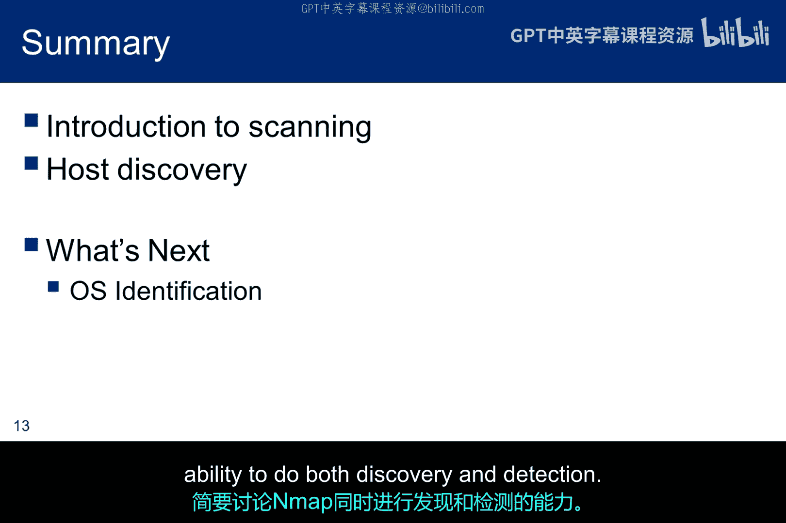

# 约翰霍普金斯大学《道德黑客入门｜Introduction to Ethical Hacking》中英字幕 p26 4_主机发现扫描.zh_en -BV1xgu1z1Eau_p26-

This lecture is on scanning networks and computers once the reconnaissance phase has been completed and provided IP addresses and network segments to be further investigated。

There are multiple components to the scanning process。

 so we will begin with an introduction to the methodology and then spend a little time on host discovery。

 This is the part of the process that tries to determine if computers are up and running on the land segment of interest。

 Other aspects of scanning。 We will cover later in the lecture try to determine the O S and identify open ports and services and look for vulnerabilities in those services that are running。

 This slide illustrates how the scanning methodology progresses。

 We started by doing reconnaissance and gathering I P addresses。

 Now we want to scan using a methodology that drills down to get more and more detail。

 The first phase will try to identify live boxes on the network。

 Techns will include ping sweeps and host discovery scans。

 The second phase will try to identify the O S。

Of those computers that we have already determined are running。

Then we will look at ports that are open and listening and try to identify services running on those ports。

 Finally， we will scan for vulnerabilities in the version of the services we see running。

One of the fundamental ideas for scanners is to leverage the fact that different vendors implement standards slightly differently。

 and those differences can be detected to make determinations about versions of software。 That said。

 it is important to remember that the scanners aren't perfect for numerous reasons。

 So it is important to step through the methodology using critical thinking as we proceed。

The idea shown on this slide is that we would like to model the network。 And when we do that。

 there are four possibilities that we need to consider in our mapping。

 We see computers that are not within the scope of the penetration test。

 and others that we think are part of the I P block but appear to be off line。

 In both cases they can be eliminated from further study。 The other two options。

 are computers that we are allowed and able to scan。

 Some of them will have vulnerabilities and some don't。

 And remember that in addition to workstations and servers， We are also interested in firewalls。

 routers and other network components。 Typ， we are outside the firewall and mapping the internal network is usually going to be less successful than mapping what's in the DMZ。

 As we go about mapping。 trace R T and trace route are easily defeated by a。Firewall。

This is because trace R T transmits echo request packets。

 which most environments block at the border。 tracece Ro will also transmit echo requests If the T L switch is used。

 but by default， it targets UDP ports above 33000。 again， most firewalls block this by default。

 so the tool is easily defeated。But what if a pen tester targets an open port on the firewall。

 In other words， what if they transmit TC P 80 packets to your Web server。

 but vary the T T L values in a similar fashion to trace route。

 This is exactly how the tool TCP trace route operates。

 Tos like this can sometimes help map right through a firewall。

Here is a syntax for the three commands。 You should test both trace route and TCP trace route in your ethical hacking environment to see how they interact with the firewall。

Nmap is the most well known and commonly used mapping tool。 It is free。

 and there is an online manual that will provide additional guidance on how to use it and help you work your way through various tool options。

 The other three tools are not free。 Professional pen testers purchasech these tools。

 but we will not use them in this class， Although you can try them on a limited basis for free。

 This chart adds the text describing the steps in our scanning methodology graphic。 going forward。

 we will specifically discuss each of these steps。😊，One of the simplest host discovery tools is Ping。

 Just try to ping the IP address using ICMP E requests。

 we can also try ICMP timestamp pings that were really designed to coordinate time of day。

These are Internet packets at the same layer as I P。 so they have their own unique message format。

They are contained in I P packets， but are not processed like typical I P packets。

 There are many different ICMP message types。 Many of them deprecated。

 We can also send TCP packets with certain flags set to achieve slightly different goals。 Of course。

 most firewalls and Iss We detect and drop these scans。

 So we may need more sophisticated techniques to actually discover the host。

 A blocked query does not necessarily mean the host isn't alive and well。

 We can also use endm for host discovery。 I will discuss that later when talking about O S finger printing。

 However， you need to be careful when using Nm's host discovery functionality because it can be noisy。

Here is a screenshot of a ping。 You can ping by either domain or I。 When you ping by domain。

 it uses the IP address that the DNS Rer provides。 However。

 notice that Ping only works with a single I address at a time。

 which isn't a scalable tool for large networks。There may be a whole block of I P addresses that are owned by the company。

 and we want to run through them to see which nodes are up and running。 This is called a ping sweep。

 Many times， organizations will be allocated blocks of addresses， but not use them all。

 We need to find the ones they are using。

Here is a picture of a ping message。 You can see it comes as a payload in an I datagram。

 but the ping has a unique format of its own。 It is not usually processed as an I datagram。

 The hetero is 8 bytes So ICMP data may include a 4 byte identifier and a 4 byte sequence number before the ICMP data。

 As shown， Ping requests are type 8 and ping responses type 0。

 There are other ICMP types as well that identify a destination is unreachable or that data packet should be sent via an alternate route。

Ping itself does not facilitate a ping sweep， but there are many tools that do。

 The easiest one to find on most Linux builds is F ping。

 which lets you specify the beginning and ending Ip address。 You can see here。

 I had three Vms running on the external land segment。

 and they were all identified as being live hosts， and it identifies a virtual box adapter as well。

 F ping also accept cider notation， which is a compact representation of an I P address and it associated routing prefix。

 The notation is constructed from the I P address and the prefix size。

 The prefix size is equivalent to the number of leading1 Bs in the routing mask。

The I P address is expressed according to the standards of IPV4 or IPV6。

 and is followed by a slash character and the prefix size expressed as a decimal number， For example。

1921681000 s 24 would be equivalent to192168，1000 with a subnet mask 255 255。 2550 and。1，92，168。

100 do0 slash 22 represents the024 addresses from 192，168，1000 to 192，168，103 dot 255。

I have discussed host discovery， but I focused on ping and did not drill down into the Nm syntax。

 Next， I will discuss O S identification and at the same time。

 include a short discussion of Nm's ability to do both discovery and detection。

