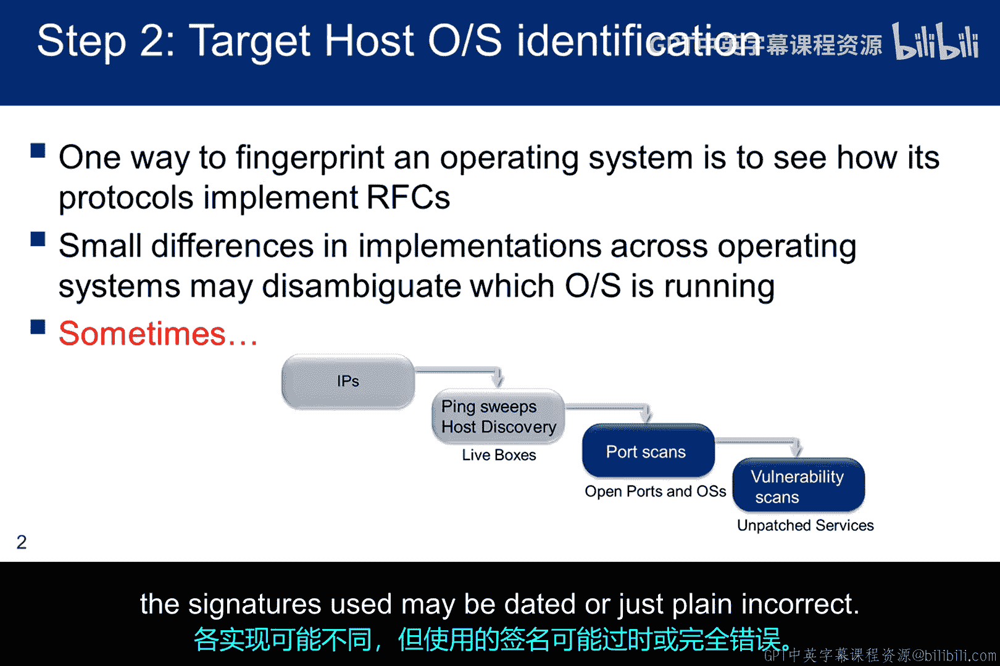
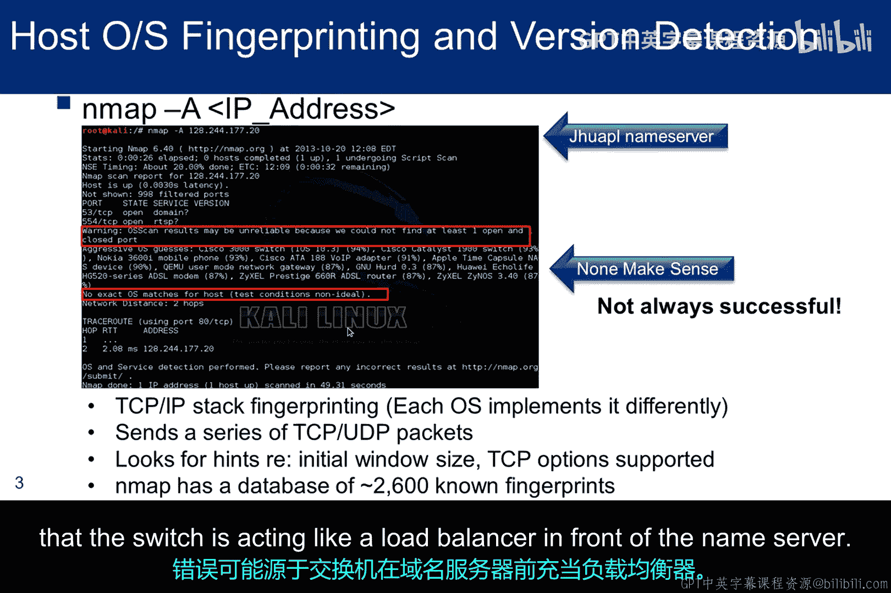
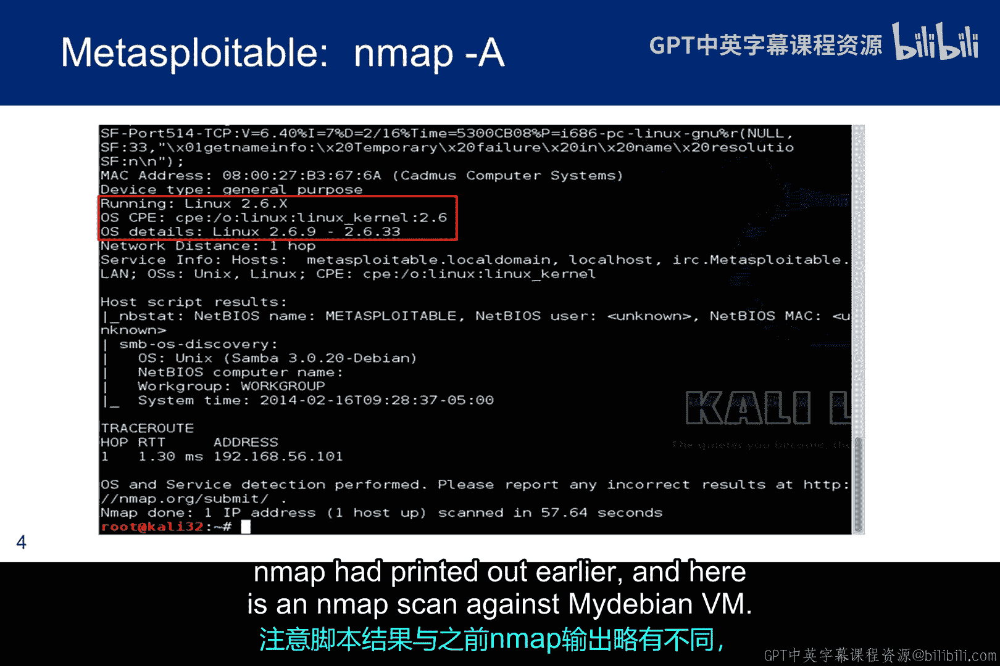
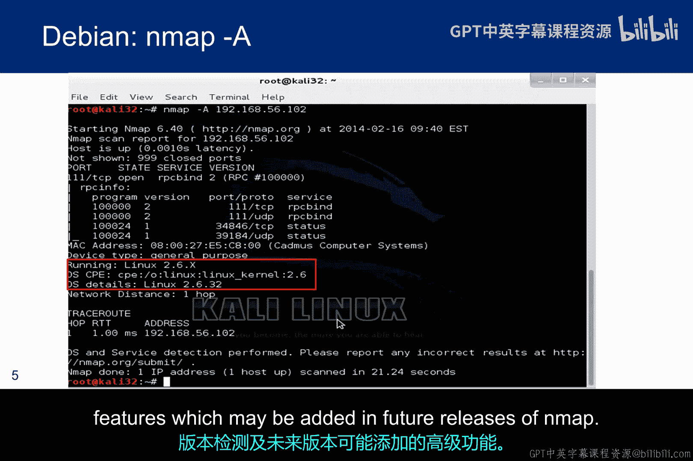
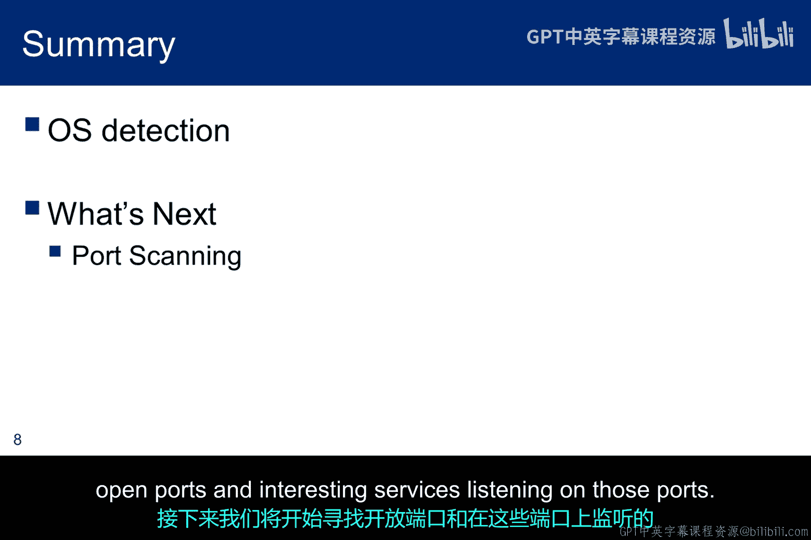

# 约翰霍普金斯大学《道德黑客入门｜Introduction to Ethical Hacking》中英字幕 p27 5_操作系统识别.zh_en -BV1xgu1z1Eau_p27-

OS S identification is valuable information for an ethical hacker when it can be teased out。

 But as we will learn in this module， the detection mechanisms are not perfect。

The differences in how RFCs are implemented sometimes provides a method for host O S identification。

 but not always， each implementation may be different。

 but the signatures used may be dated or just plain incorrect。

Here is a screenshot of an attempt to identify a JA2 APL name server using NMap。

 One of NM's best known features is remote OS detection using TCPI stack fingerprint。

Enmap sends a series of TCP and UDP packets to the remote host and examines practically every bit in the responses after performing dozens of tests such as TCP initial sequence number sampling TCP options supported TCP order detail。

 IPI sampling and the initial window size check Nmap compares the results to its Nm OSDb database of more than 2600 known OS fingerprints and prints out the OS details if there is a match each fingerprint includes a freeform textual description of the OS and a classification which provides the vendor name underlying OS OS generation or version and device type。

The screenshot shows a high confidence， but in this case。

 identifying the O S of a name server as a Cisco switch is incorrect。

 The error could be caused for many reasons。 but may be related to the fact that the switch is acting like a load balancer in front of the name server。

 for Nm， both tack A and tech O will do host identification。

 but Ta A is a little more robust than tack O。 Taco does host discovery and O S fingerprint。

 It is more sophisticated than ping， even though it starts with a ping。 Actually。

 if there is a firewall absorbing pings。 Mm will stop and suggest you turn off pings with T capital P N。

 T A does both host O S fingerprint and version detection。

 The screenshot shows a scan against metaplitable， a vulnerable version of Linux。

 Meplable is sometimes called。

A Uuntu build。 But Uuntu forked from Deian。 So the endm script run by the scanner over the SB protocol identifies the O S as deian。

 Notice the script generated a slightly different result than Endmap had printed out earlier。

And here is an end map scan against my Deian VM。 Both this scan and the precing were run using T A。

The TAC SV option enables version detection， the T O option enables OS fingerprinting。

 and the T A option enables both OS fingerprinting and version detection。

 as well as any other advanced features which may be added in future releases of NMap。

This is a screenshot of the Nm Online manual for Chapter 8 on O S detection。

 I have included it here to make you aware of the detail found in the online manual and also to demonstrate the robustness of the O S detection capability。

This lists the steps that enmap goes through in trying to identify the operating system。

 You can see there is a lot of functionality that is kicked off that you would never see unless you start a scanner and watch the outgoing traffic。

 The enmpped services database contains fingerprints of more than 2200 well known services。

 The Nmpped service probes database contains probes for querying various services and matching expressions to support recognition and parsing of responses。

Map uses the fingerprint information to try to determine the service protocol， for example， FTP。

 Se shellll， Tnet， HTTP， The application name， for example， ISC Bd Aacache H TTPD， Soeris Telenety。

The version number， host name， device type， for example。

 printer or router and the OS family Windows or Linux。

We have just scratched the surface of OS detection。

 Take a look at the OS detection chapter of the Nmap manual to learn more about this subject。

 Now that we know our IPp is up and running and we may have identified the operating system。

 we are going to begin looking for open ports and interesting services listening on those ports。

