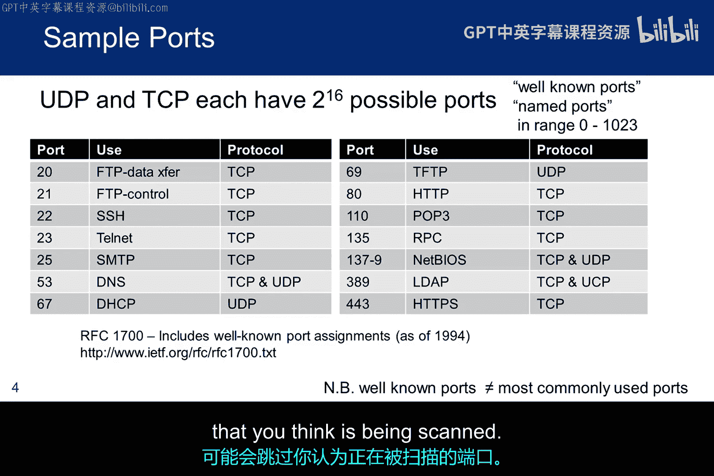
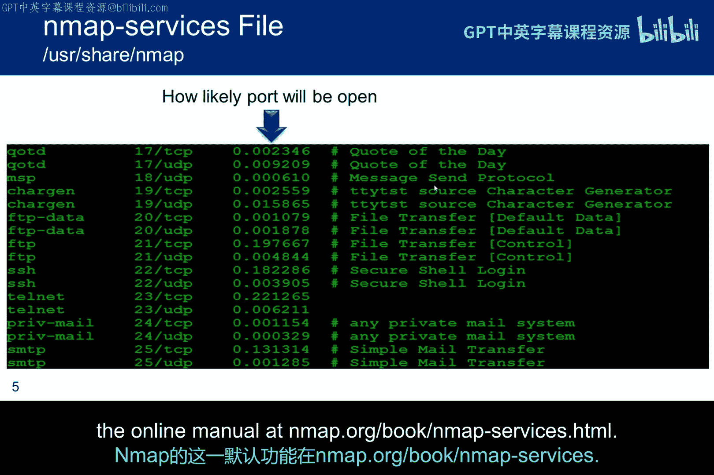
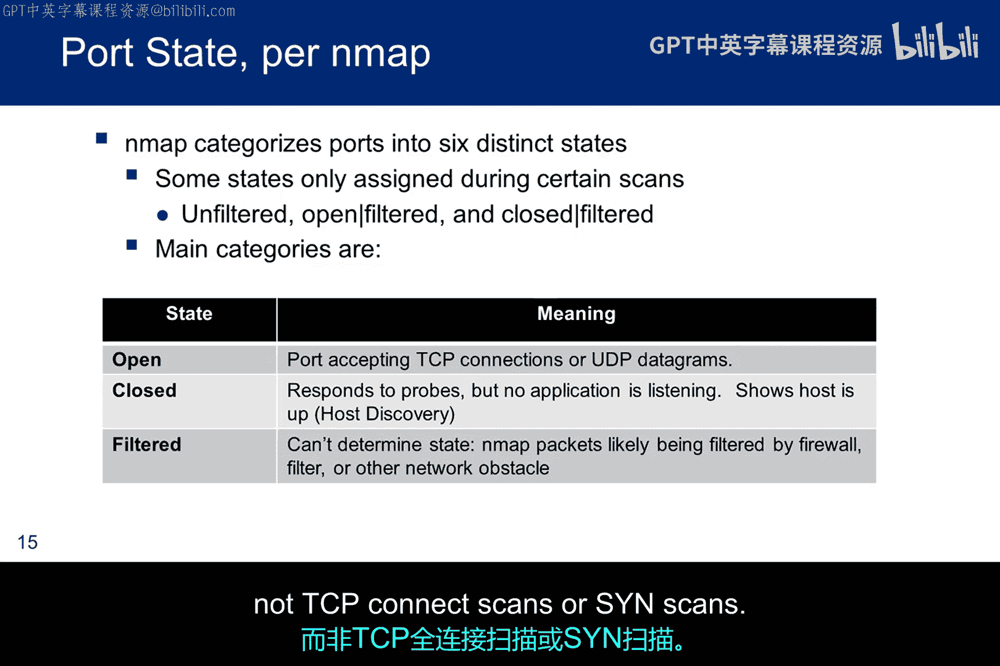
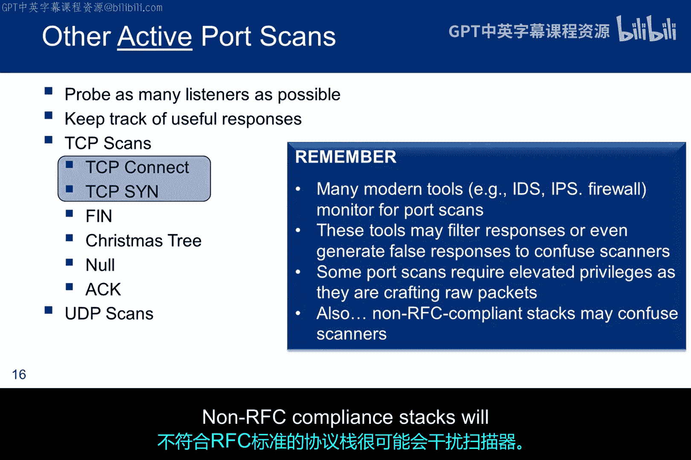
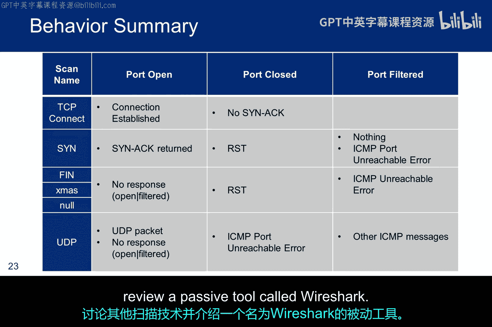

# 约翰霍普金斯大学《道德黑客入门｜Introduction to Ethical Hacking》中英字幕 p28 6_端口扫描第1部分.zh_en -BV1xgu1z1Eau_p28-

Port scanning is the art of decmining which ports are open with services running。

 It is easy to do this when the computer doesn't have any protection mechanisms around it。

 But when it does have a device like a firewall in front of it， the task is more complicated。

We have identified the fact that the computer is running。 We can send packets to it。

 and we may have determined the O S。 But as we begin to look at individual ports。

 we find that we are still in the scanning phase of our e hacking methodology。

This is another view of what ports are。 We have an address。

 and there are potentially many ways to get into the house。

 but we don't know which of the entry points are accessible or unlocked。 And for sure。

 we don't know what is behind them。 So the idea is。

 we are going to go push on the doors and windows and see what happens。

When the user doesn't specify the ports to be scanned。

 endm looks at the most 1000 commonly used ports。 This speeds up the endm scan。

 but may miss ports moved by administrators。 The table shows a few of the most well known ports。

 as defined in R C 1700， some of which we opened on the firewall。 However。

 the first024 well known ports are not the same as the 1000 most commonly used ports scanned by endm。

 This idea is important to understand。 If you don't specify a specific port or range of ports。

 you could be skipping over one that you think is being scanned。

Enmap maintains a file of the most commonly used ports in the endm services file。Normally。

 unless the user specifies otherwise， Endmap will scan the first 1000 entries from this file。

 after it has been sorted by frequency。 This sort takes place for each scan protocol， In other words。

 the UDP and TCP scans， are handled independently of each other。 the command line switcht F。

 which stands for fast， limits the scan to the first 100 ports on the list rather than the first 1000。

 to speed up the scan。 If port frequency information isn't available。

 which may result from the use of a custom Nmap services file。

 Endmap scans all named ports plus port 0 through 1023。

 Most Linux distributions defined named ports at s Esy s services and Windows has it at back slash system 32。

Back slash drivers， back slash Etsy back slash services。

 These typically intersect with 1024 well known ports， but there are name ports far beyond 1024。

 This default functionality for Nm is discussed in the online manual at nmt org s book slash nmservices dot Hm L。

Here are four techniques for finding open ports。 Act port scanning and passive port scanning are obvious。

 but you can also try to get information from a system administrator。 and Exfil documentation。

 Exfil of network configuration information is often a first step that an A tries。

 Often months before the attack is actually initiated。

 The YouTube link shown here is from Schmookcon。 It includes a demonstration of scanning the entire Internet for VNC servers on Port 5900。

 Vi network computing or VNC allows you to access and control your desktop applications wherever you are in the world。

 What is interesting is they built the virtual infrastructure to actually scan the whole Internet。

 modillo， blacklist that includes certain government organization and those who have requested not to be scanned。

Here are a few port scanning tools， and there are many others。

But we will focus on endm for our active scanner， because it is readily available。

 commonly used and continually improved。Enm has been around for a long time。

 but is still often used by system administrators to scan networks。 They may use other tools as well。

 but Mm is always in the tool box。 We have already briefly discussed endm functionality to include discovery and O S detection。

 And now we will focus on port status and services running on those ports。But first。

 a comment on host discovery。 Endmap starts with ICMP pings。

 but then moves on to other packet types on specific ports。 Finally。

 returning to ICMP timet packets Vi pings。 Another important point is endm has a scripting engine。

 NSE， this tool provides a lot of enhanced functionality over classical endmap to include the ability to run some vulnerability scripts。

 and more scripts are added all the time。 In fact， you can submit scripts for inclusion in the tool。

 More on this later。 But the key is that endm is gained functionality and is evolving to become far more than a simple tool used to identify open ports。

To understand the most common end mapped scan types。

 we need to understand the TC P connection protocol In the event。

 A TC P connection is a bit of a mystery to you。 This picture just puts the idea into the common context of a phone call。

This shows the TCP Connect sequence， often called the three way handshake。

 The initiating party sends a sin packet， receives a sin act packet and returns an act。

 At that point， TCP traffic can be exchanged among the parties involved。

To be a little more specific for the S packet， the active open is performed by the client sending a S to the server。

 The client sets the segment sequence number to a random value。 A for the S act packet。 In response。

 the server applies with a S act。 The acknowledment number is set to one more than the received sequence number。

 In other words， a plus one， and the sequence number that the server chooses for the packet is another random number。

 B。 Finally， the client sends an act back to the server。

 The sequence number is set to the received aknowledment value。 A plus one。

 and the acknowledgment number is set to one more than the received sequence number， B plus one。

 And notice that the set up a connection。 The initiator must specify which port to connect。

When people talk about send packets and act packets。

 they mean packets that have the associated flags set。There are many ways the flags can be set。

 but for scanning purposes， we are most interested in the three that are highlighted in red Act indicates the acknowledgment field is significant。

 All packets after the initial syn packet sent by the client should have this flag set。

 R Tier reset tells the receiver to reset the connection。

S means the receiver should synchronize the sequence numbers。

 Only the first packet sent from each end should have this flag set。

Some other flags change the meaning based on this flag。

 and some are only valid when it is set and others， when it is clear。Next。

 we want to talk about the two most commonly used Nm scans。

 TC P connects scans and S scans for TC P Connect。 Nmap completes the entire three way handshake。

 Then it sends a reset to tear down the connection gracefully。 A syn scan。 on the other hand。

 stops and sends a reset before the connection is established。 Therefore。

 it is sometimes called a half open scan。One major difference between the two is a sin scan does not care what the response is to the initial sin。

 It sends a reset， no matter what， While a TC P K scan needs a sin act to establish the connection。

 Other important properties are shown in the table。 TC P scans are more graceful。

 should never crash the target and don't require root privileges。S scans， the endm default。

 when you don't specify a type， are faster and stealthier， but usually do require root privileges。

The issue of privileges is critical when you gain a low level foothold on a box and want to scan a remote device on the network before pivoting a sin scan will probably not be available without escalation。

For a half open scan， a synac response indicates the port is listening。

 and a reset is indicative of a non listener。However， if a synac is received。

 you immediately send a reset to tear down the connection。

 One advantage to this scanning technique is that fewer sites will log it。

This screenshot shows a TCP connect scan trying all ports on the given I address。

 You can specify an I address， an I block， or if the Is aren't sequential。

 you can specify a file containing I addresses to be scanned。As discussed earlier。

 if you don't specify ports， Nm scans the most common ports for the protocol。In this table。

 we see the common inferences made by end map as a result of a response to scan packets。

 We want to identify open ports and possibly filtered ports。

 Since filter does not always definitive information。

 Open ports will probably have services running on them。

 and we can explore vulnerabilities in those services。

 The other three states are unfiltered open filtered and closed filtered。

 which we will discuss later。 They represent results of a specific scan type。

 not TCP connect scans or S scans。

We have discussed TCP connect and TCP S scans， but there are several other scan types as well。

 The Christmas tree scan gets its name from the fact that several flags are set。

 and it is lit up like a Christmas tree。 Many modern protection mechanisms may filter responses or even generate false responses to confuse scanners。

 And as we discussed for sin scans， Some require elevated privileges in order to craft raw packets。

 This will pose a problem if you only have low privileged foothold on a box。 And， of course。

 the signatures are based on the differences in RFC implementations。

 So non RFC complianceant stacks will most likely confuse the scanner。

 This table shows which bits are set for each of the nonstandard scan types。

The idea of sending non standard initial packets， In other words， not S packets。

 is that the flag settings are unexpected， and the packet may just get through the firewall。

 So it is responded to， rather than just being dropped。

 This tactic of sending unexpected initial packets。

 is less likely to work against modern I D S and I P S technology。

 but may work against simple firewalls and filtering routers。

The approach to each of these scans is the same。 Set some unexpected bits in the initial packet and see what happens。

 The idea is to try all three， as the L S， firewall or I D S may respond to one of them while absorbing the others。

 Three responses can be expected。 A reset means the port is closed。

No response means the port is open filtered， and an ICMP unreachable error means the port is filtered。

 In the case of Windows， it will always send a reset when initial packets are received with unexpected bits set。

 It does this， regardless of the port state。 So these special scans aren't very productive。

 Of course， this means windows may be viewed as noncompliant with RC 7，93， But on the other hand。

 this noncompliance is exactly what the scanner depends on to draw inferences。

When a TC P ax segment is sent to a closed port or sent out a sync to a listening port， the RSC 7。

93 expected behavior is for the device to respond with a reset。

 So when it is used against unfiltered systems， Open enclo ports will both return a reset packet and endm labels the port as unfiltered。

 This means it is reachable by the act packet。 but endm cannot determine whether the port is open or closed。

 Ports that don't respond to the act or send certain ICMP error messages back are labeled filtered。

 The idea of an a scan is the protection mechanism may just get confused and think the act is a response to an internal request for a connection。

 Thus， the mechanism would allow the packet through。

An attacker can use TC P A segments to gather information about firewall or A C L configuration。

 The idea is to discover information about filter configurations rather than port state。

 This type of scanning is rarely useful alone， But when combined with sin scanning gives a better picture of the type of firewall rules that are present。

When combined with sin techniques， an attacker can gain a more complete picture of which types of packets get through to a host and thereby map out its firewall rule set。

A scanning， and combined with sin scanning， also allows the attacker to analyze whether a firewall is stateful or nonsstateful。

 If a sin solicits a synac or a reset， and an act solicits a reset。

 the port is unfiltered by any firewall type。 If a sin solicits a syn act。

 but an act generates no response， the port is statefully filtered。

 When a sin generates neither a synac or a reset， but an act generates a reset。

 the port is statefully filtered。 when neither sin nor act generates any response。

 the port is blocked by a specific firewall rule， which can occur via any type of firewall。

 The comparison is stateful and stateless firewall is one of the major elements of our ethical hacking lab。

 The firewall we build is stateless。 Can we determine that from scanning。

 Does it help us get through the firewall， and how come we improve the。Functionality of the firewall。

UDP scans are similar to TCP scans， but are run against ports that typically run UDP services like DNS or DHCP。

The inferences drawn by endmap to the UDP responses are shown here。One note for UDP。

 when endm receives no response to a UDP probe， it could mean the port is open， filtered。

 or maybe the port or response was simply lost on the network。

Another aspect for UDP scans is when the target host has rate limiting enabled。

 which temporarily blocks the response to UDP scans， I the scan time considerably， when this happens。

 Nm resends the initial probe。 If endm detects very poor network reliability。

 it may try many more times before giving up on a port。

 This improves accuracy but also lengthens scan times。

 So when performance is a critical aspect of a pen test。

 scans may be sped up by limiting the number of retransmissions aloud。

You can even specify techac max retris 0 to prevent any retransmissions。

 though that is only recommended for situations such as informal surveys or occasional missed ports and hosts are acceptable。

 This option causes endm to wait the given amount of time between each probe it sends to a given host。

 This is particularly useful in the case of rate limiting。 Soeris machines， among many others。

 we usually respond to UDP scan probe packets with only one ICMP message per second。

 any more than that， sent by endm will be wasteful。

 Configuring endm with techac scan delays at to one second will keep endm at the slow rate。 Actually。

 endm tries to detect the rate limiting and adjust a scan delay accordingly。

 but it doesn't hurt to specify it explicitly。 If you already know what rate works best。

Here is a summary of the other states that may be inferred by Nm。

They would only occur in response to specific scan types， not connect scans or half open scans。

 Unfiltered is a response to a scans only and means the port is accessible。

 but endmap can't determine whether it is open or closed。 Open filtered results from U DP I P。

 Fin null and Christmas scans only。 It means the port appears to be open， but is unresponsive。Closed。

 filtered results from I P I D， idle scan only。It uses a zombie。

 and the I P I D increment cannot distinguish between closed and filtered。

 An idle scan is a completely blind port scanning technique。

 Atters can actually scan a target without sending a single packet to the target from their own I P address。

 Instead， a clever side channel attack allows for the scan to be bounced off a dumb zombie host Intrusion detection system reports will finger the innocent zombie as the attacker。

Besides being extraordinarily stealthy， this scan type permits discovery of I P based trust relationships between machines。

 Fundamentally， an idle scan consists of three steps that are repeated for each port。 One。

 every I P packet on the Internet has a fragment identification number。 I I D。

 Since many operating system simply increment this number for each packet sent。

 probing for the IId can tell an attacker how many packets have been sent since the last probe。

 So the first step is to probe the zombie's I I and recorded。

 This probe will cause the II to increment 2 for this step。

 forge send packet from the zombie and send it to the desired port on the target。

 depending on the port state， Targ's reaction may or may not cause the zombie's I I D to be incremented。

 Step 3， probe the zombies I I D again。the target port state is then determined by comparing this new II with the one recorded in the first step。

 After this process， the zombie's IPID should have increased by either one or two。

 An increase of one indicates that the zombie hasn't set out any packets。

 except for its reply to the attacker's probe。The lack of scent packets means that the port is not open on the target。

 and the target sent the zombie either a reset packet， which was ignored or nothing at all。

An increase of two indicates that the zombie sent out a packet between the two probes。

This extra packet probably means that the port is open。

 The target presumably sent the zombie a synenac packet in response to the forged sin。

 which induced a reset packet from the zombie。Increases larger than two usually signify an unreliable zombie hosts。

 It might not have predictable I I D numbers， or it might be engaged in communications unrelated to the idle scan。

 even though what happens with a closed port is slightly different from what happens with a filtered port。

 the attacker measures the same result in both cases， namely an I I D increase of one。 Therefore。

 it is not possible for the idle scan to distinguish between closed and filtered ports。

 When endm records an I I D increase of one。 It marks the port closed filtered。

This table summarizes what end map will infer for various responses to each scan type。

 Notice that ax scans are not included in the table because they really are providing information about the firewall。

 not ports。 This ends Part 1 of port scanning。 Part 2 will examine a few examples。

 Disc other scanning techniques and review a passive tool called wirechar。

