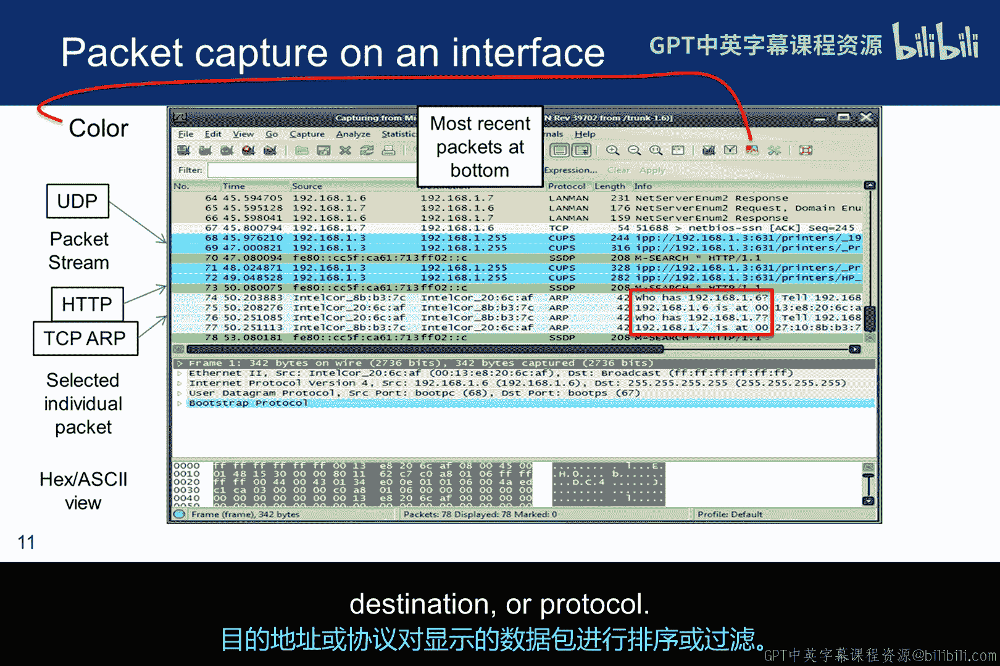
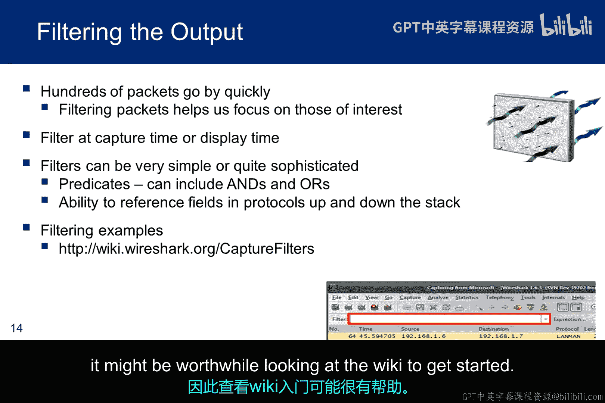
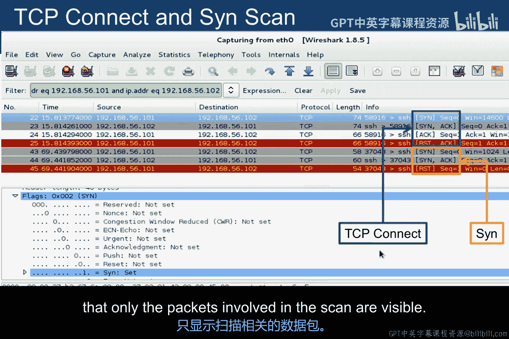
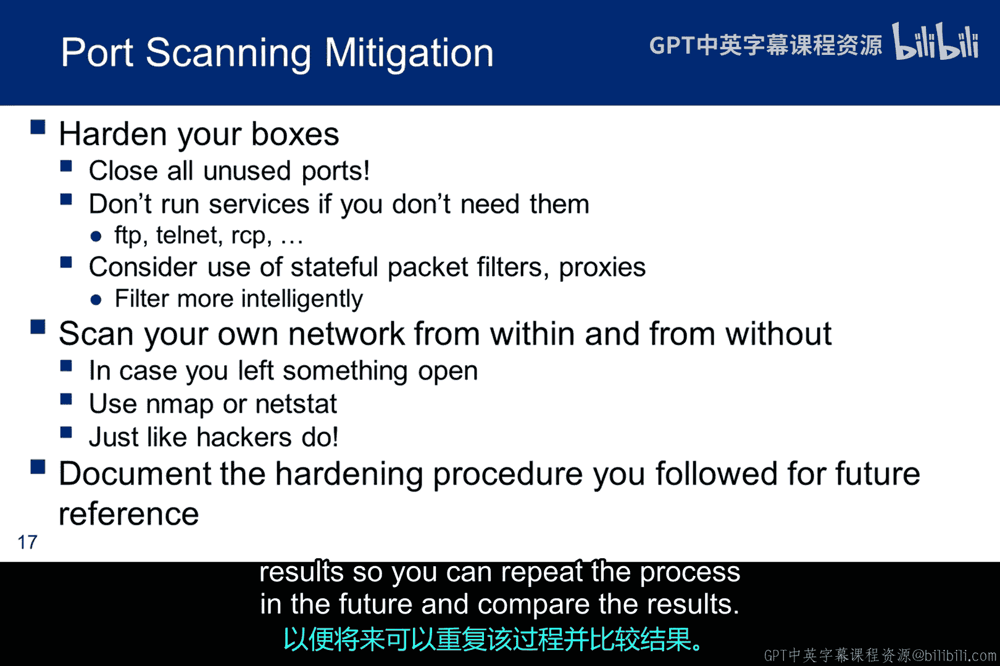
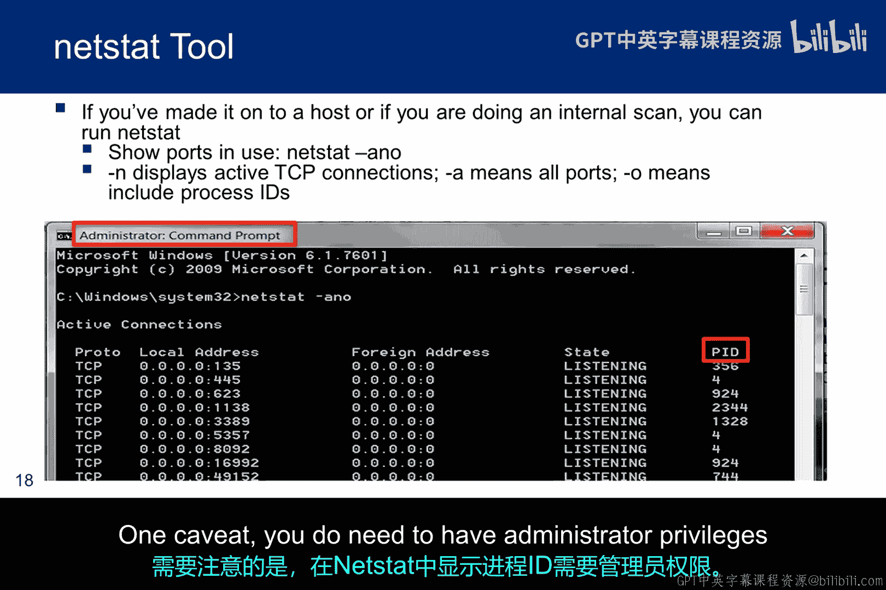
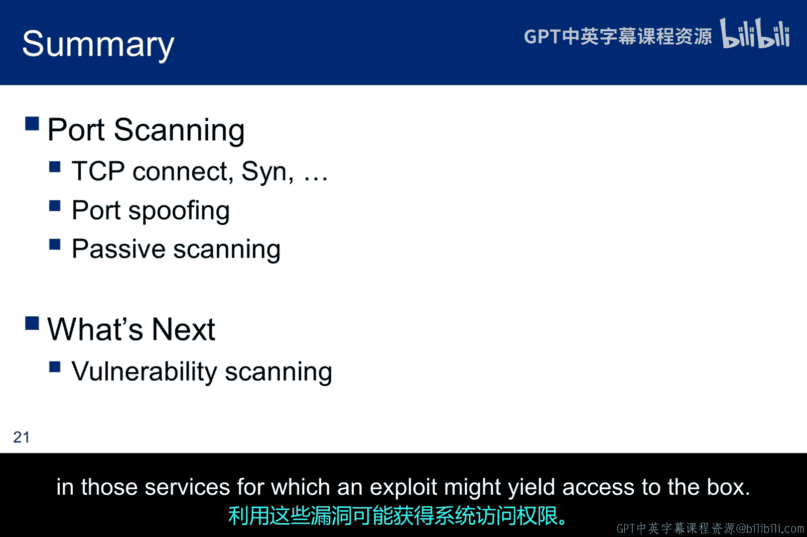

# 约翰霍普金斯大学《道德黑客入门｜Introduction to Ethical Hacking》中英字幕 p29 7_端口扫描第2部分.zh_en -BV1xgu1z1Eau_p29-

This submod continues the discussion of port scanning with a few examples and map options to hide the scanner's I P。

 port spoofing and passive scanning using wire shark。

Enmap was run against Windows X P on the same segment with the Windows firewall off。

 and it shows three open ports。 It is interesting to note that some of the more well known ports are closed out of the box。

 showing that Microsoft was learning and doing a better job securing their builds。

With Windows firewall on， no ports are open。 The latency statistic is a running time out value maintained by endm to determine how long endm will wait for a probe response before giving up or retransting the probe。

However， if we run end map against metaplittable on the same segment。

 the result is entirely different。 We are starting to get a feeling for just how vulnerable metapltable is。

Enmap does support a couple of scan options that help hide the identity of the scanner。

 The first is T D， which is a decoy option that mixes your I P address in with a list of other I P addresses you have specified。

 The target can't be sure where the scans are coming from。 Of course。

 many of the responses will be sent off to other machines。

 but it doesn't matter as long as you get them Also。 The second command line switch is T S。

 which results in a spoofed I P address。 In this case， nothing is returned to your machines。

 That means you either have to have a sniffer on the target segment to capture responses or you have to be using a technique like an idle scan。

 with decoy scans， the target I D S might report 5 to 10 port scans from unique I P addresses。

 but it will not know which I P was actually scanning the target。In which were innocent decoys。

 while this can be defeated through router path tracing response dropping and other active mechanisms。

 it is generally an effective technique for hiding your I address。

 If you don't put me in the I string， Nm will put you in a RA position。

 If you put it near the end of the I string， Some scan detectors may not record the I at all。

 You can also use R And D to generate a random nonreservd I address。

 decoys are effective with the initial Ping scan during remote Os detection and with S scans。

 but they do not work with version detection or TCP connect scans。Finally。

 it is worth noting that using too many decoys may slow down your scan and potentially even make it less accurate。

Some ISps will filter out your spoof packets， but many do not restrict spoofed I P packets at all。

 With spoof scans， you can make the targets think that someone else is scanning them。

 but since the I P is spoofed， you do not get packets back。

 Port spoofing is different than I P spoofing because you actually change the source port number。

 not necessarily the I P address， which may allow the scan packets to get through a firewall。

 One surprisingly common firewall misconfiguration。

 is to trust traffic based only on the source port number For example。

 packets from DNS or FTP ports are sometimes let through some naive administrators assume that no attacker would notice an exploit such firewall holes。

 In other cases， Admins consider this a short term stopgap measure until they can implement a more secure solution and then they forget the security upgrade。

Of course， secure solutions to these problems exist in the form of application level proxies or protocol parsing firewall modules。

 Unfortunately， some of the insecure solutions are easier to administer As an example。

 the I S filters that shipped with Windows 2000 and Windows XP contain an implicit rule that allows all TCP or UDP traffic from port 88。

 the Kberro port。 Similarlyly， at one time， the Z alarm personal firewall allowed any incoming UDP packets with the source port 53 DNS or 67 DHCP。

NMap offers T G and Tt source port options to exploit these weaknesses。

Something provide a port number and endm will send packets from that port where possible。

 Most scanning operations that use raw sockets， including S and UDP scans。

 support the option completely。 The option notably doesn't have an effect for any operations that use normal operating system sockets。

 including DNS requests， TCP connect scans， version detection and script scanning。

 setting the source port also doesn't work for O S detection。

 This command line option may be useful in our ethical hacking lab。

 when we are trying to scan Vms behind the firewall。

 Spoofing the source port will generate more useful results。

Passive scanning not only provides anonymity， but since no packets are sent to the target。

 it hides the fact that the pen tester is even collecting information。

 although it is a passive technique by sniffing packets off this segment。

 it is still possible to determine the source and destination I P addresses in the packets and what kind of packets are being exchanged。

 Obviously， a passive technique can take much longer to collect information because there may be a very low traffic volume at various times during the sniffing session。

The most well known sniffer is wirere shark at one time called etherreel， and it is a free tool。

 The best way to collect information is to have access to the segment for one of the parties of interest。

 Wireshark can be used without direct access to the segment。

 but those techniques are a little more complicated。

 Wireshark does use the Pcap library for packet capture。

 It is called Libcap on Linux and Win Pcap on Windows。When where a shark starts。

 it provides you with a set of interfaces that have been detected。

 The user can then select the interface to be monitored and capture all the packets seen by that interface。

 Also， if a Pcap file has been saved from a previous scanning session。

 you can also see the file names and select a file to open for analysis instead of monitoring an interface。

This is a screen that is rendered from the interface menu。

 You can select the interface to monitor and start monitoring。

This wire shark string capture shows the three main frames at display information collected on an interface。

 The top frame is the packet stream collected on the interface being monitored as they pass by on the segment。

 It includes the source and destination Is， the associated protocol and some additional information。

 You can also see that the packet types are color coded to simplify reading the packet stream。

 In this case， UDP packets are blue。 H TTP requests are green and TCP R exchanges are light gray。

 but that is all configurable。 The second frame shows additional packet detail。

 When you select a specific packet and want to drill down In the case of a TCP packet。

 you would be able to see each field of the frame to includes settings like bits set in the flags field。

 The bottom frame shows the ASI associated with the middle frame for each field highlight。

In the middle frame， the associated ASI gets highlighted in the bottom frame。

 It is also possible to sort or filter the packets displayed by time， source。

 destination or protocol In the red box， you see some ap exchanges in which I Ps get associated with Mac addresses。

Notice the info feel for the art packets。 First， there is a broadcast request。Who has this I P。

 Then there is a response from the device with that I P that says that I P is at Mac， so and so。

This is displayed if you select the color configuration button。

The packet capture screenshot showed some arp messages。

 so I wanted to take a minute to review how ap works as it comes up over and over in the penetration testing discussions。

In this picture， PCA knows the destination I P address， but not the Mac address of PC。

 so it can't communicate。 The art protocol will help PCA determine the Mac address of PC。

PCA first checks its local connection table for the Mac address of the target I。

 but PC A doesn't have any entry for PC。 So PC A broadcasts an our request。

 It broadcast to Mac F F dot F F dot F F dot F F do F F asking about the destination Ip address192。

168 do0 do 3。 Every connected device on the broadcast domain will receive the request。

 In this simple case， PCB and PC will receive the frame。

PCB will drop the request because at the layer3 destination IP will not match PCC receives the Ap request because the layer 3 address matches 192168。

0。3 and PC updates its own local connection table with the IP address 192168。0。1 and Mac address 00。

00。1a。3。02。56 of the requester PC Then PC sends an ap reply packet to PC using unIcast information PCC just stored in its local connections table PC receives the ap replyly packet and updates its local connections table with IP address192168。

0。3 and 00。e0。fe。09。c2。11 Now PC has the Mac。Of PCC and they can communicate Notice the black text added to this graphic shows what you would actually see in wire shark。

By the way， ap poisoning is one of the techniques we mentioned to sniff packets off a switch In this type of attack。

 the arp caches in both PC and PC are poison。 This type of attack fools the two computers。

 trying to communicate into thinking that the third computers Mac address is the Mac address of the other machine。

 This will cause the switch to route traffic between PC and PC to the man in the middle where you can sniff it and then send the traffic along as if nothing happened。

 This type of attack can cause havoc in some switches and lands， So it needs to be used carefully。

 If you've ever started war shark。 You know， hundreds of packets are captured immediately。

 even on a simple network。There are numerous low levelve activities and exchanges taking place on the wire that a user doesn't see。

 but are critical for successful networking。 In fact。

 there are so many packets captured in a short period of time that the complexity is sometimes overwhelming。

 wireshark helps us address this complexity by providing a filtering mechanism。

 that filters what we see。 A simple example would be to filter on source and destination I P。

 It is possible to filter packets as they are captured or you can capture them all and filter what is displayed。

 The filter and engine is very robust and provides sub binary logic operators to create extremely sophisticated real combinations。

 Some users do not find the wire shark filter menus very intuitive so it might be worth while looking at the wiki to get started。

This screen shot shows the packets captured during a TCP connect scan in green。 It shows the packets。

 as discussed earlier。 Sen， Senac and a， followed by a reset to gracefully terminate the connection。

 It also shows a half open scan。 C Senenac reset。 in the middle frame。

 you can also see the syn flag has been set for the syn packet highlighted in blue。

In the filter bar shown in green， you can see I have filtered on the source I P and the destination I P so that only the packets involved in the scan are visible。

This set of pictures taken from the Wireshark web page shows various approaches to using wire shark successfully。

 The two configurations at the top left with red borders show possible network configurations。

 one with a hub， which leverages shared media and one with a switch， which does not。

 When the hub is used， it is easy to collect data as it passes by。 Unfortunately。

 hubs aren't used much these days， except in wireless configurations。 in a switch configuration。

 even in promiscuous mode， The adapter is not going to see the packets with a different address than its own。

 The adapter will behave exactly the same。 whether in promiscuous mode or not。

The remainder of the diagrams show how wire shark may be used to capture packets when the switched media is being used。

In number 3， we want to collect data from a single host。

 and we are able to start wireshark on that host。In number 4。

 we are able to insert a hub into the ethernet line of interest and connect a wire shark machine to the hub。

In 5， the switch has a monitor port， and we are able to connect a wire shark machine to that port。

 In number 6， the wire shark machine has two nis， and we are able to connect the computer itself to the ethernet line as a bridge。

 a man in the middle attack。In number7， we insert a tap and connect a wire shark machine with two nis to the tap。

In number 8， we have another man in the middle attack where we are connected to the switch and do our poisoning。

In number 9， we use Mac flooding to bombard the switch with fake Mac addresses until the switch can't keep up。

 The switch then enters a fail open mode and starts acting as a hub by broadcasting packets to all the machines on the network。

To protect your computer from hackers doing port scans to collect information and subsequently launch attacks。

 the first two things you need to do are close any ports that are not absolutely necessary and stop any services that may be configured to run out of the box but are not necessary and in some cases may be insecure。

 Stateateful devices like firewalls can also help protect your infrastructure by allowing more fine grain control over the filtering process。

You should also scan your network from the outside just as if you were a hacker and from the inside to protect against insider attacks。

 we have talked about endmap， But once you have a foothold on a box or if you are on the inside。

 Netstat will provide useful information。 Whenever you do this kind of configuring and scanning。

 document the steps and the results， so you can repeat the process in the future and compare the results。

Here is a Nestt screenshot that shows ports and use and active TCP connections。

 This kind of information is useful for identifying a C2 channel。

 If you think one or more of your boxes might be part of a bonet。

Run Nestt and check the foreign addresses and ports to see if there is an unexpected connection that needs further investigation。

 You can use tools like who is to study unknown I Ps and see if the site is legitimate。

 Work carefully when you do this， because some antivirus software。

 sets up connections to servers in foreign locations。 These may be legitimate。

 but they may not seem so without detailed investigation。

If you decide the connection looks questionable， the process ID identifies the process that is controlling the connection。

 You can subsequently create a task list， find the matching PID and kill the process。

 One caveat you do need to have administrator privileges to display process ID in Ne step。

A sin flood is a denialous service attack that tries to overwhelm a service listening on a port with so many sin packets that the buffers fill up。

 and the server can no longer respond to requests because kernel memory is exhausted。

 The server may or may not crash。 But for sure， the buffer fills up and is unable to accept additional connections。

 This is a very old attack that is no longer effective because we have learned how to mitigate it。

 Most servers implement the mitigations And in many cases。

 the servers have so much capacity that it would take a very large spotnet consisting of high powered servers itself to have much of an effect。

R S C 49，87 discusses mitigations to sin floods。 Some of the mitigation ideas are interesting。

 For example， the idea of a sin cache minimizes the amount of state that a sin allocates on the target。

 In other words， the target does not immediately allocate a full transmission control block or T C B。

 The full state allocation is delayed until the connection has been fully established。

 Another example， in order to avoid memory exhaustion。

 The operating system may also associate a backlog parameter with a listening socket that sets a cap on the number of T Cs simultaneously in the sin receives state。

 This action protects a hosts available memory resource from attack。

 but the backlog itself represents another smaller resource vulnerable to attack。

 With no room left in the backlog。 It is impossible to。

new connection requests until some TCBs establish a connection or they are otherwise removed from the sin received state。

We have discussed scanning in some detail。 TCP connect scans and S scans are foundational techniques。

 We also discuss some other ideas for getting packets through a firewall to include spoofing the port from which the packet originates and passes scanning while it would normally take longer。

 It is more discet。 Now that port scanning has provided information on open ports and services running on those ports。

 We want to move on to identifying potential vulnerabilities in those services for which an exploit might yield access to the box。

