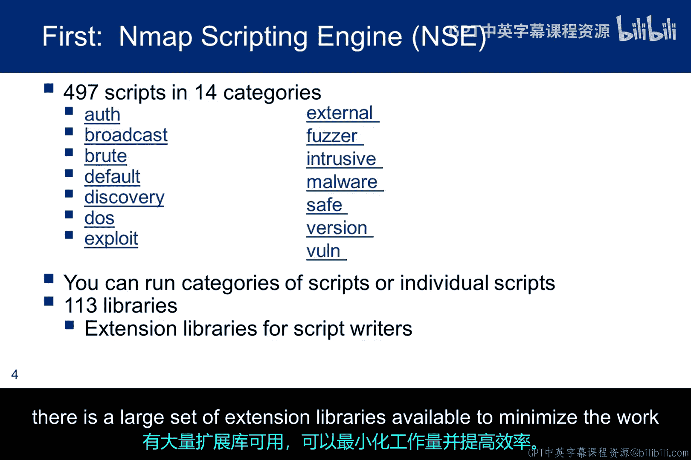
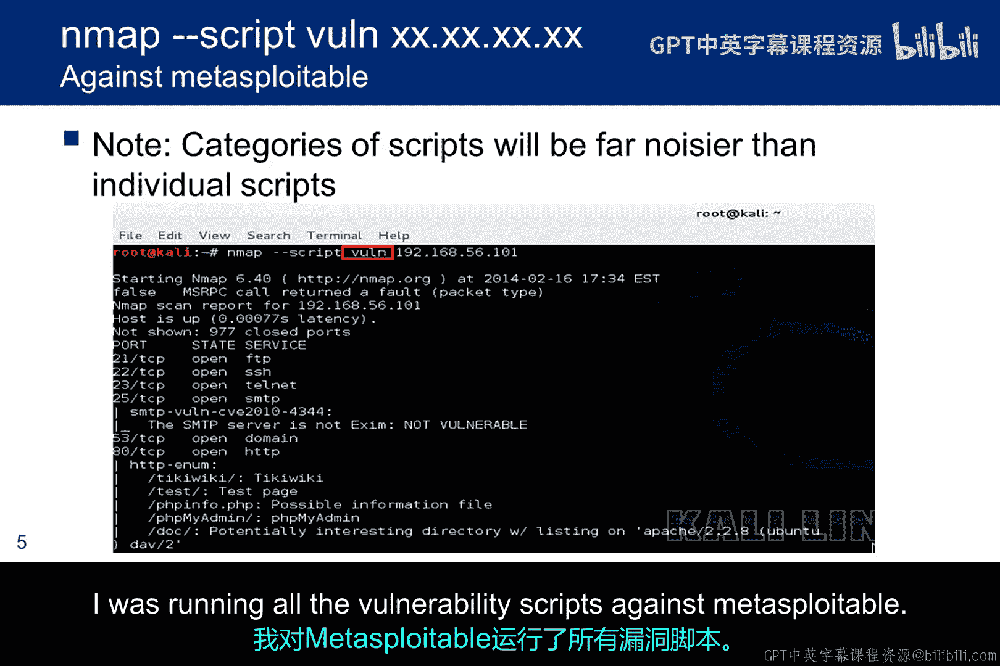
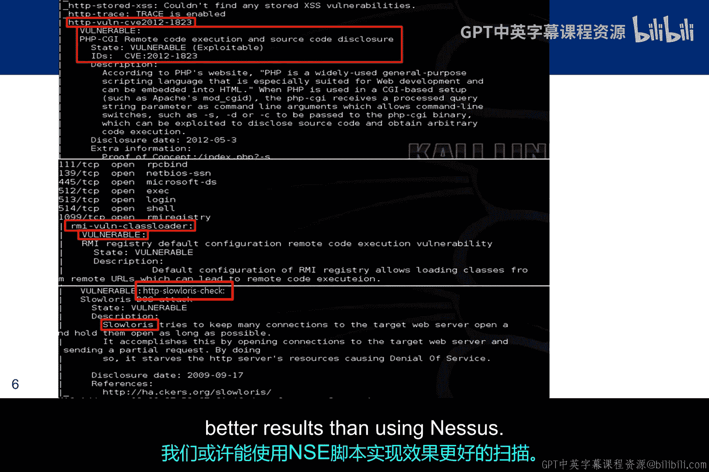
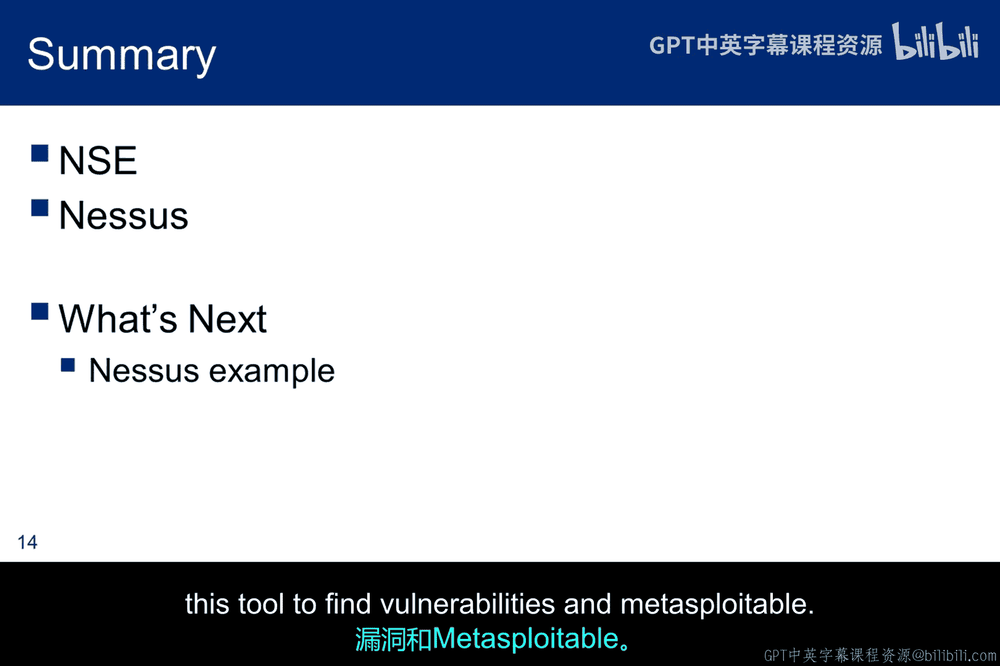

# 约翰霍普金斯大学《道德黑客入门｜Introduction to Ethical Hacking》中英字幕 p30 8_漏洞扫描.zh_en -BV1xgu1z1Eau_p30-

Vulnerability scanning uses version information to try to identify vulnerable services。 However。

 the tools use a very active approach to scanning。 In fact， in some situations。

 it actually throws exploits at the target to make a vulnerability determination。 That said。

 scanners are far from perfect。 They sometimes identify vulnerabilities that are not actually exploitable。

 This is definitely the case for free tools。 and we will discuss an example of this in the exploit module。

Vulnerability scanning is the third phase of the scanning methodology after host discovery。

 O S detection and port scanning。 The basic idea is to identify vulnerable services that have not been patched。

 There are numerous tools that do vulnerability scanning， but we will focus on Neus。

 because it is a well known tool used by many penetration testers。

 and there is a free version available for us in our class。

 This type of scanner is sometimes called a network scanner because it probes network services Vi web apps。

 Web servers or databases。 Although the boundary between scanners is usually quite fuzzy。

 Open V S was actually forked from the Neus baseline。 They have diverged now。

 but the framework and associated scanning techniques are quite similar。

Speaking of overlap among scanners， Endm's scripting engine moves endmap from a well known port scanner into the realm of a vulnerability scanner。

 NC runs scripts contributed by the endm community。

 The number of script categories has changed and continues to change as the product matures。

 but recently， there were 14 script categories in almost 500 scripts。

These scripts provide a significant amount of functionality。

 and two that are of interest for this module are discovery andva。

You can see there are other categories that will be of interest when we move into the exploitation phase of our methodology。

 and if you are interested in writing and contributing new scripts。

 there is a large set of extension libraries available to minimize the work that has to be done and improve productivity。

You can run individual scripts or all the scripts in a category or even multiple categories。

 In this screenshot， I was running all the vulnerability scripts against meplable。

And here are some examples of what Van turned up when the scan was run against metaplable。

 The first red box shows a PP CGI vulnerability that is a well documented vulnerability from 2012 and allows remote code execution。

 The second shows a R M I configuration vulnerability。

 The point in discussing NSE is that while we are going to focus on Neus。

 It would be worth your time to explore NSE。 in our lab when we get a foothold on the internal segment。

 we find Nm installed on the old server。 we might be able to use NSE script to facilitate a better scan with better results than using Neus through the firewall。

The client server architecture of Nessus allows a remote client to interact with a server and establish scans of a third computer separate from the server。

 The design allows servers to be placed at various strategic points on a network so that tests can be conducted from different points of view。

 A central client or multiple distributed clients can control all the servers。

 These features provide flexibility for the penetration tester。

 Cl are available for both Windows and Linux。 The Neus server performs the actual testing while the client provides configuration and reporting functionality。

 Neus depends on a database of plugins that in some cases。

 check for vulnerabilities by throwing exploits。 These plugins are cached locally。

 and there are around 40000 of them。 There are basically small blocks of code。

 Neus sends to the target machine and a caution。Some plugins actually exploit a vulnerability in the process of determining its presence。

The Neus Use guide provides installation instructions and the package name for a Cai installation。

 Since Callli is a Debian build， you do want the Debian installation。

 The version given on this graphic is old now， but using the current version number should result in a successful installation。

Although the limited version of the software is free for home use。

 it is still necessary to register to get an installation key。 This shows the link for registering。

 which requires nothing more than name and email。The installation key is good for 24 hours and is delivered by email。

 You want to have the key available before starting the installation because navigating to the registration screen during installation does not always goes smoothly。

 once the installation is complete。 in order to use Nesus start the demon first。

 then start the browser of your choice on the client and navigate to port  88，34 on local host。

 In this situation， the server demon is running on Call and Callli also acts as the client。

 you will need to enter the activation code and create an administrative account which is used to log in in the future。

 Once activated， Nesus will start to initialize and download the plugins。

 This takes a very long time， especially the first time Neus does it。

 But Nessus goes through the same process every time you log in。 So it may be slow。To get running。

 But on subsequent starts， since it already has many of the plugins。

 it is quicker as it is mostly checking for updates and downloading new plugins。

This is the login screen which is rendered on subsequent connections where you use the admin account you just created to log in。

We introduced endmpped scripting engine and worked through the installation of Neus。 Next。

 we will go through a Neus example to get an understanding of how to use this tool to find vulnerabilities and metaable。

