# 约翰霍普金斯大学《道德黑客入门｜Introduction to Ethical Hacking》中英字幕 p31 9_Nessus工具实例.zh_en -BV1xgu1z1Eau_p31-

The goal of this submodule is to provide you with enough insight to successfully scan your Vms with Neus。

 The exploitation submodule has a demonstration of menloid。

 And the first few minutes of the demo Also cover some of the material discussed here because the selection of the exploit is dependent on the results of the Neus scan。

 So you may find it helpful to skip ahead to that submodule to watch the beginning of that video。

The first thing you have to do is establish the Neis scanning policy。

 The idea is to provide the tool guidance on what type of scan should be run and how it should be configured。

 For example， the default network scanning policy does not include a web server scan unless it is switched on in the policy configuration menu。

 One note， Engabrezen's book uses old terminology that is no longer used by Nesus。

 So don't look for terms like safe or invasive。 The highest vulnerability categories are critical and high。

 So those are the vulnerabilities we will want to start with。

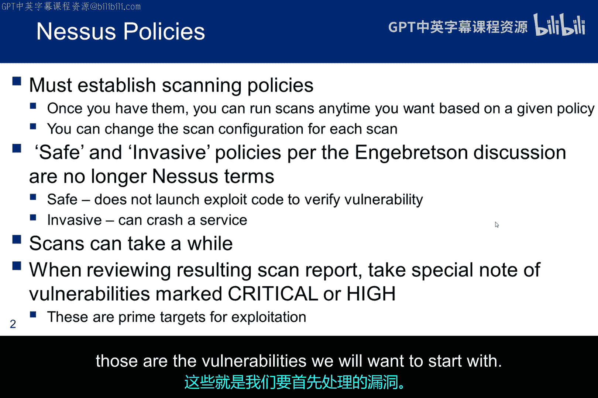

This shows the scan types that can be selected。 Most of the options require an upgrade as shown by the purple bar。

 but basic network scan is available and will provide good experience with how the scanner works and how the results are presented。

 So after selecting scan from the initial menu， This screen asks for the scan type that should be run。

 which must subsequently be configured。 You should explore the differences between basic network scan an advanced scan to decide which is the best choice to complete the scanning lab。

 And you may want to run the Web app tests to see how the results compare with Oos Zap run in the Web exploitation module。

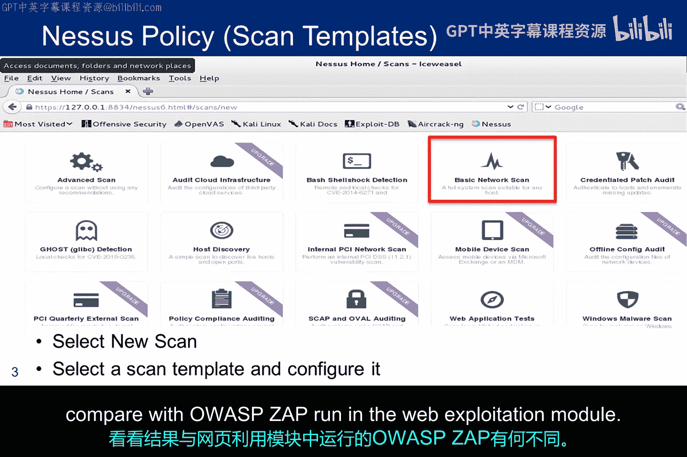

Once the policy is selected， the basic configuration settings are available through the menu on the left for the basic network scan。

 Web server scanning is turned off， but can be activated through these menus。 In this case。

 I have named a scan meta exploitable。 No firewall in order to track and compare results with other Vms with a firewall up and down。

 The goal for the pen test report is to scan with the firewall up， But for learning purposes。

 The lab will ask you to also scan with a firewall down。 as the results will differ significantly。

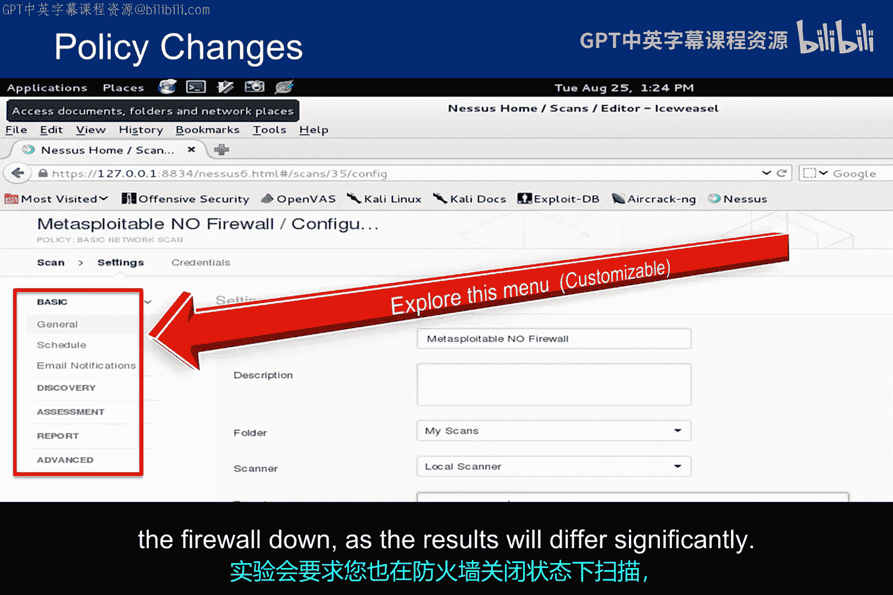

We will not explore a credentialed Meus scan in this class。

 but they are important when scanning networks for patching and compliance with security policy。

 The idea is， neus is provided with S S H credentials。

 which are used to log into the system being assessed。

 This approach not only provides more accurate scan results。

 but will not crash the system being scanned。I recently encountered a red team that was not allowed to use Neestus to scan a system controlling one of our national assets because it had an operational impact on some of the devices in the network。

This is one of the big problems with using Neus in an operational environment that might be overcome with a credentialed scan。

 However， depending on the goals of the penetration test。

 your client may not want to provide the team with credentials or may not be interested in identifying compliance issues。

 This is one of the areas where pre engagement interactions with the client are critical。

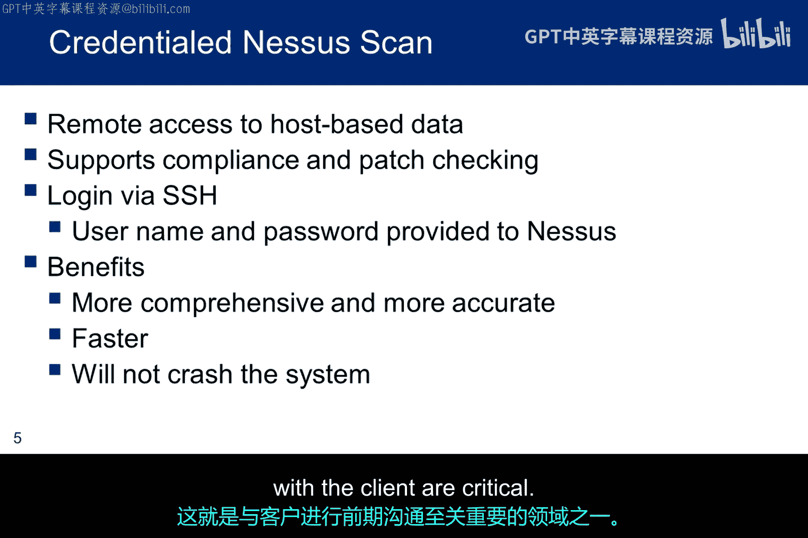

These are the steps necessary to scan metaplable in our ethical hacking environment。

 Don't forget to start the bepwe proxy and turn off intercept。 Of course。

 your I P address may differ。 And a reminder， both the Neus initialization and thenesss scan may take some time to complete。

 So plan ahead for that。

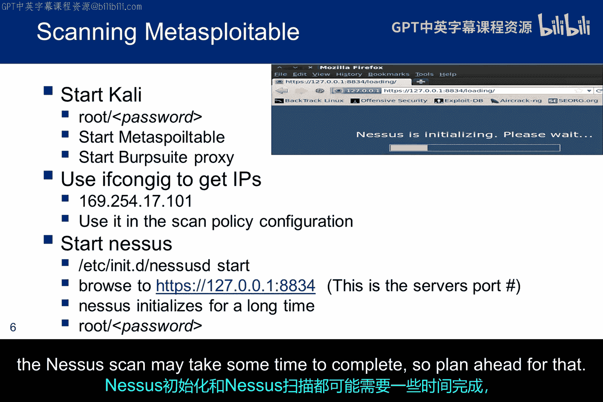

These are the steps to follow once logged into tonessus。

 Pick the scan type first and give the scan a name that will help you track the results。

 Select the I， configure the basic options based on what type of results you want to see from the scan and launch the scan。

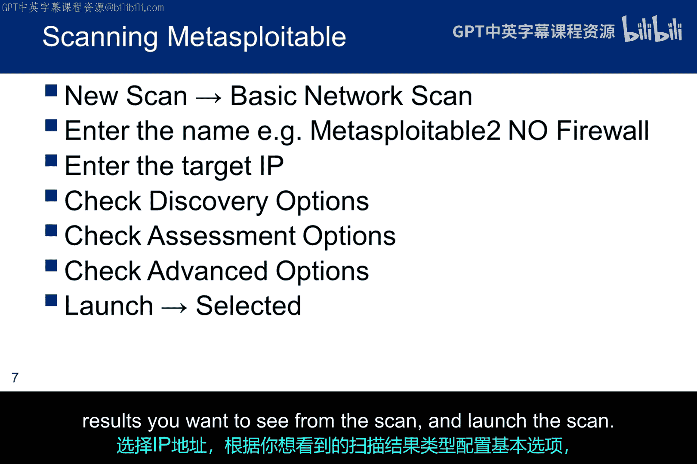

This is a high level look at the scan results when I ran a network scan against metaplable with the firewall rules slued。

 The bar is color coded。 red is critical and blue is informative in this scan without a firewall。

 Neus has identified 7 critical vulnerabilities。 Your results may differ slightly。

 depending on the version of neus you are running。 The number of plugins that have been added。

 and the basic policy configuration settings。

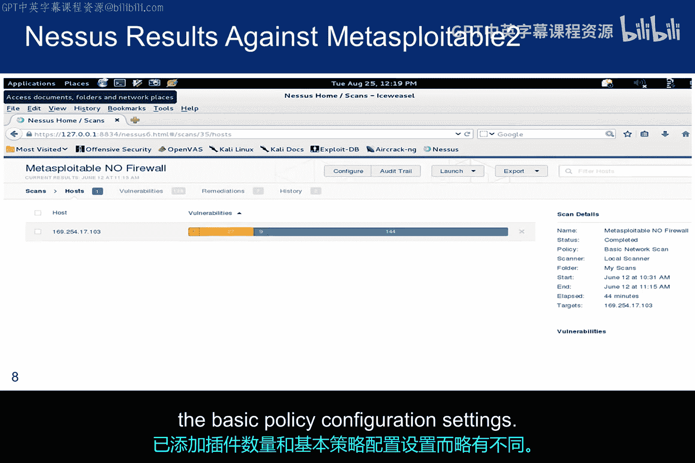

Clicking on the Nea summary bar lets you begin to drill down into the details of the scan。

 Here you see a brief description of the seven critical vulnerabilities。

 I have highlighted the Sammba buffer overflow vulnerability that we will explore further to see how Neus and metalo can be used together to successfully get a foothold on a system being pen tested。

😊。

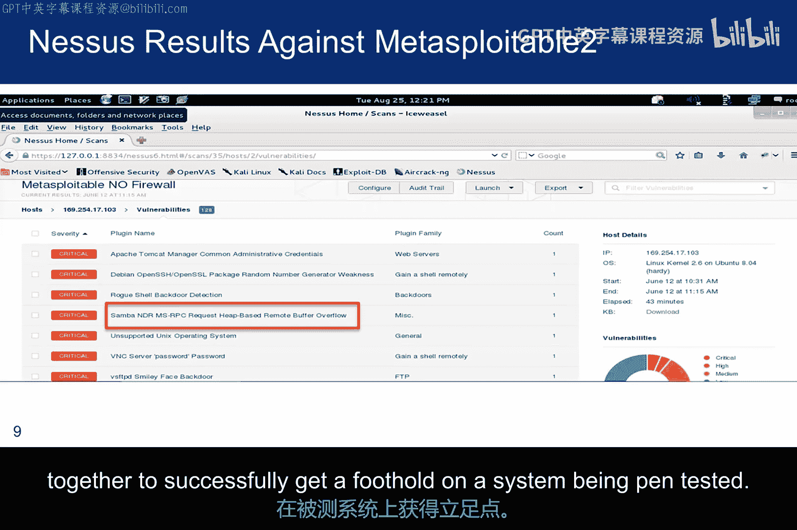

By clicking on the highlighted vulnerability，Additional detail is displayed。 In this case。

 an upgrade recommendation is provided telling the user that the version of samba installed and metaplable is not current and is vulnerable。

 A CV V E number is provided， and that will provide a line to additional detail about the vulnerability。

Common vulnerabilities and exposure numbers is a database maintained by MIre and supported by US Cert and DHS。

 Nesis also provides the CVSS score for the vulnerability。 In this case， the score is 10。0。

 which is the highest， and means it is a critical vulnerability。

 The common vulnerability scoring system is an open metric for determining the severity of a vulnerability and is occasionally leveraged by students for their pen test metrics for the pen test report on our small virtual network。

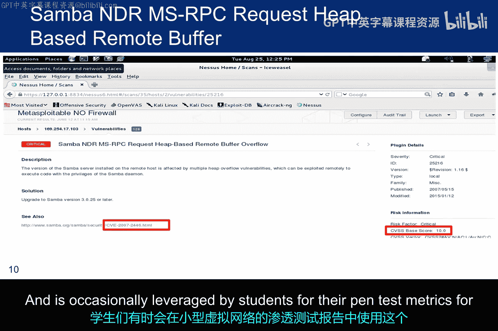

If you scroll down on that page， you also see how this vulnerability might be exploited for metaloit。

 Neus recommends the samba I S A I O trans names， Heap overflow exploit。

 We will find out in the exploit module that that specific exploit isn't going to work。 Nevertheless。

 we will find a successful approach。 And this is an important point when using these kinds of tools。

 What do you do when you get off track and the straightforward approach isn't working。

 A good penetration tester， like a good hacker has to be knowledgeable about the fundamentals and be able to think out of the box。

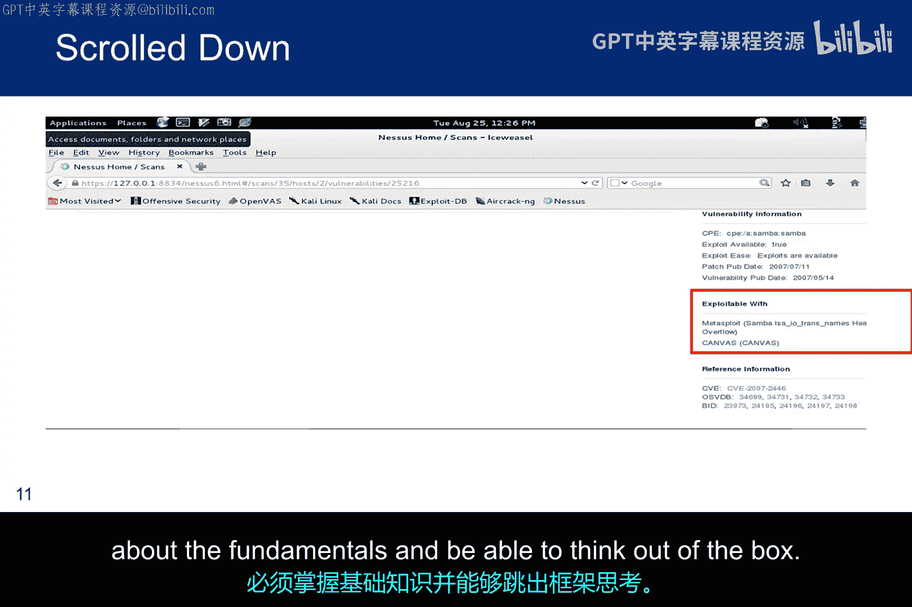

Once again， Open V A S was forked from the Nessus baseline。

 So it works in a similar manner and has some commonality， but has evolved along a different path。

 Some students actually like Open V A S better than Nessus and some don't。

 many think Nessus is a more viable tool since the professional version is used by red teams。

 At one time， the scanning homework S students to compare the two scanners。

 but Open V A S has been a little buggy， So that has been dropped。

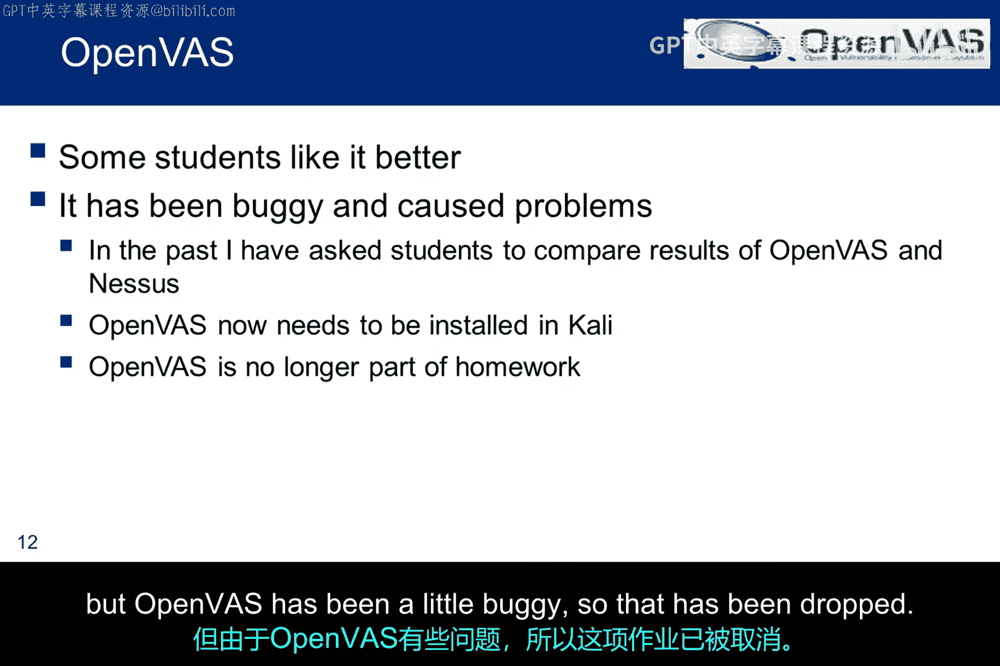

If you are interested in learning a little about Open V A S。

 this provides the steps for getting it running。 As with NASus。

 it takes a long time to download the plugins， which are called network vulnerability tests。

 If you decide to play with it， notice that it uses a different port number than NAS's。

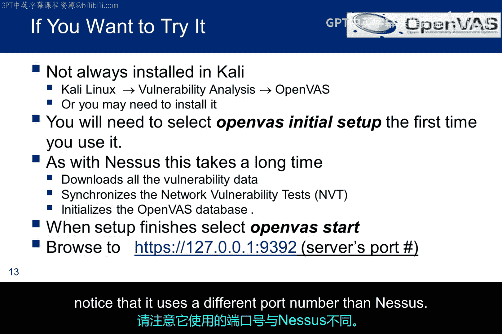

This has been a brief introduction to you in a vulnerability scanner。 And a reminder。

 the first part of the demo video in the exploitation model includes running the scan covered in these slides。

 The next module will cover a couple of interesting questions。 First。

 is it possible to scan devices behind a Nat device。 And second。

 can you scan anonymously using tourr。

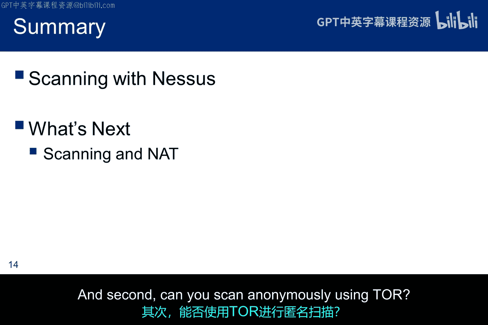