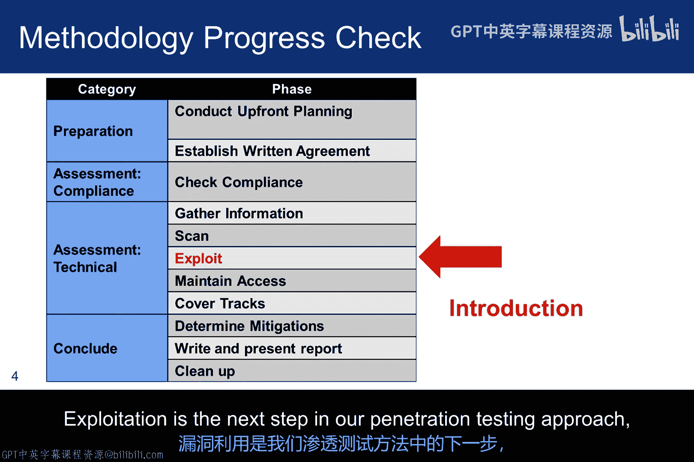
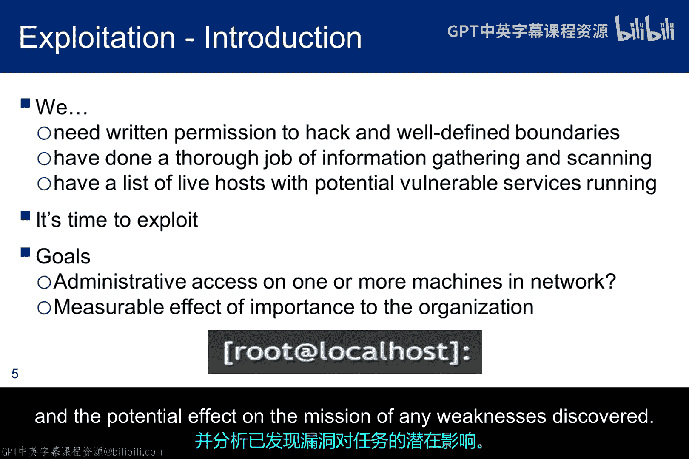
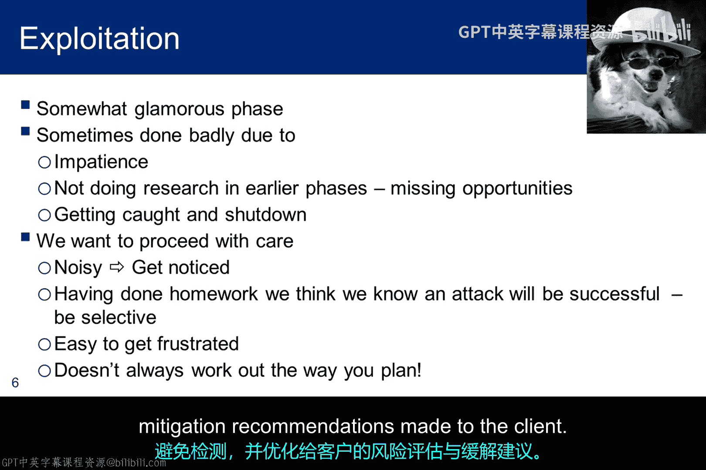
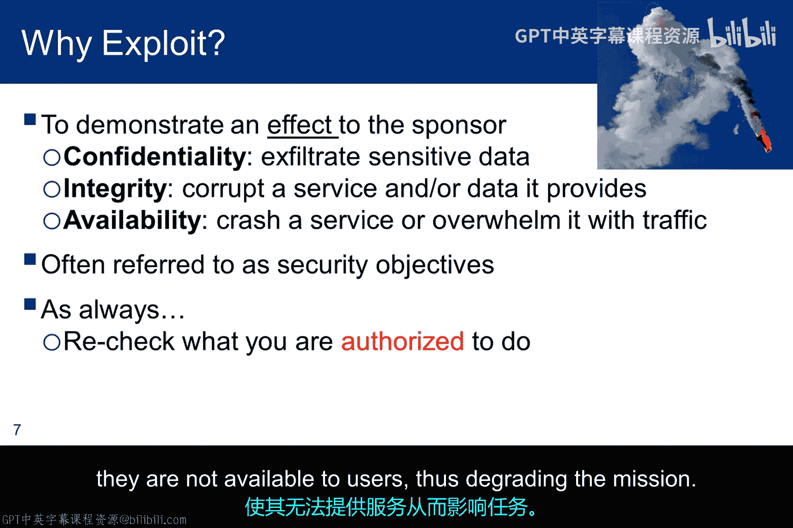
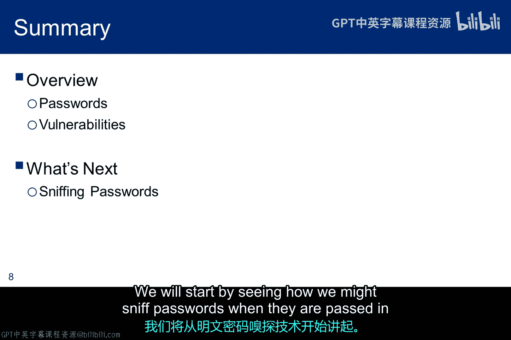

# 约翰霍普金斯大学《道德黑客入门｜Introduction to Ethical Hacking》中英字幕 p32 10_漏洞利用导论.zh_en -BV1xgu1z1Eau_p32-

This module moves into the next phase of ethical hacking exploitation。

 The sub module more or less introduces at a very high level。 the ideas we will cover。

This slide puts the lecture in context of our methodology。

 Expitation is the next step in our penetration testing approach。

A reminder that exploitation is against the law。 So it is critical to have a written agreement defining the boundaries of the penetration test before entering this phase of the methodology。

 it is also important to have completed the reconnaissance and scanning phases。 In other words。

 we should have identified some vulnerabilities that we want to try to exploit。

 Our goal is to be surgical in our approach and not just throw a bunch of exploits to see which work。

Such a hail merry approach may work， or it may not。 but for sure， you will be detected。

 Another reminder， gaining root privileges on a device is not our goal。

 Our goal is to develop some metrics regarding the security state of an enclave and the potential effect on the mission of any weaknesses discovered。

Scrip kitties definitely think of exploitation as glamorous。

 and it is pretty rewarding for all of us when we get admin privileges on a box。

 but we do need to proceed methodically。 It is important to be thorough and to avoid detection。

 as that may bias the results of the test。 In fact， Wors case。

 the network operators may disconnect a system from the network altogether if they detect the attack。

 We want to find the right balance between effective techniques and potentially ineffective techniques in order to conserve test time。

 Avoid detection and optimize the risk assessment and mitigation recommendations made to the client。

To discuss the benefits of the exploitation phase， we can put it in the context of the three classical security objectives。

In terms of confidentiality， we want to demonstrate to the client any weaknesses that would allow for exfiltration of important and sensitive information such as credit card numbers or personally identifiable information。

 in terms of integrity。 we want to find weaknesses that might allow an attacker to modify information such as PII in a database。

 modify customer order information or even defface the organization's webage， And finally。

 we need to demonstrate the risks associated with crashing or overburdening mission critical systems so they are not available to users thus degrading the mission。

This concludes the introductory comments， and we will begin to drill down into techniques for compromising passwords。

We will start by seeing how we might sniff passwords when they are passed in the clear。

嗯。