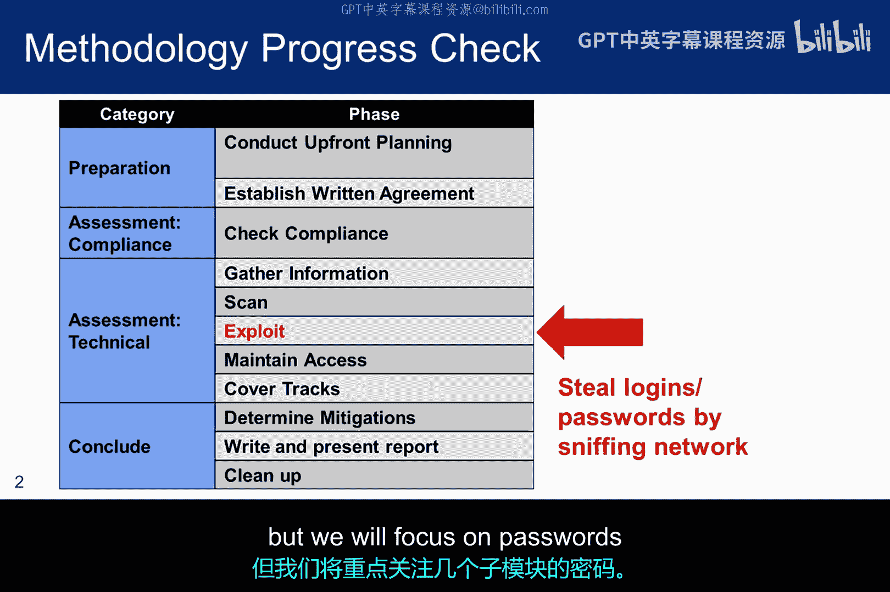
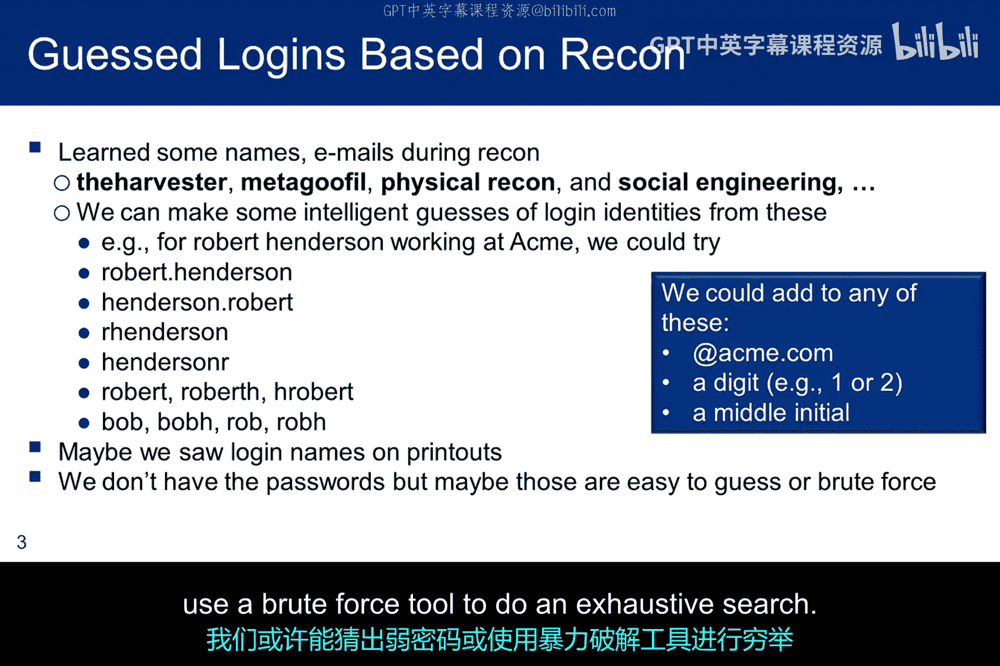
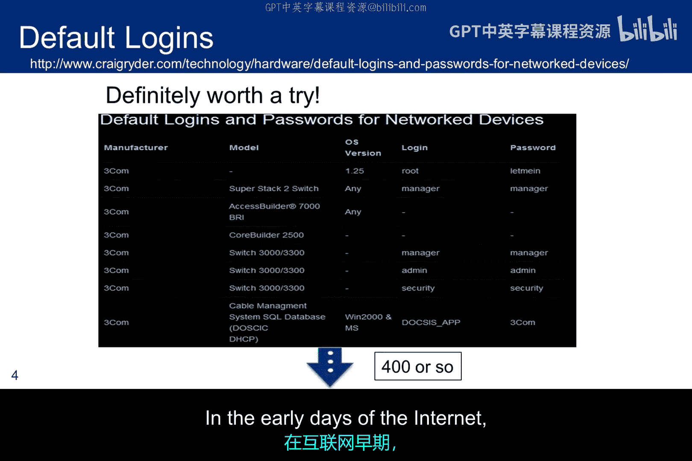
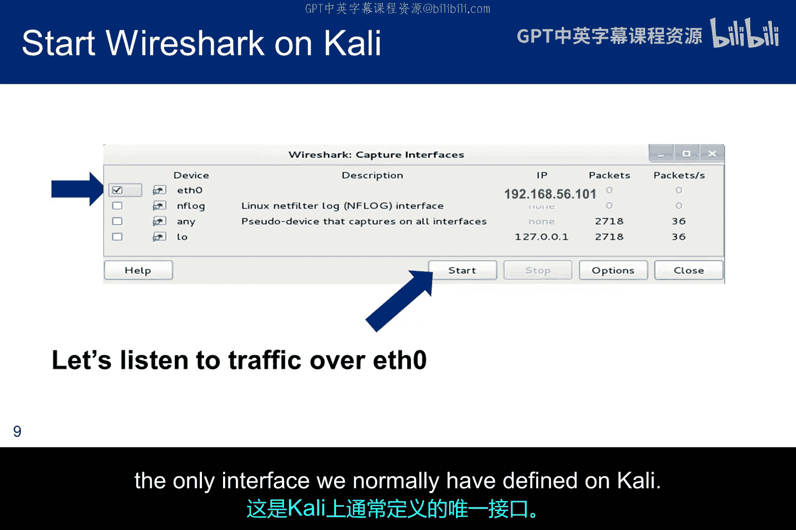
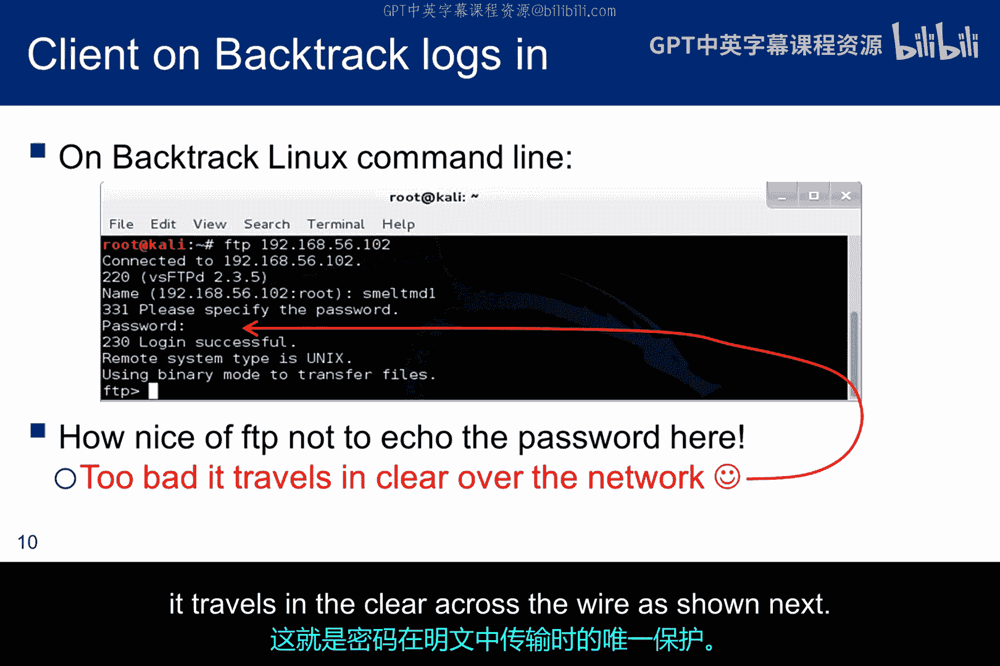
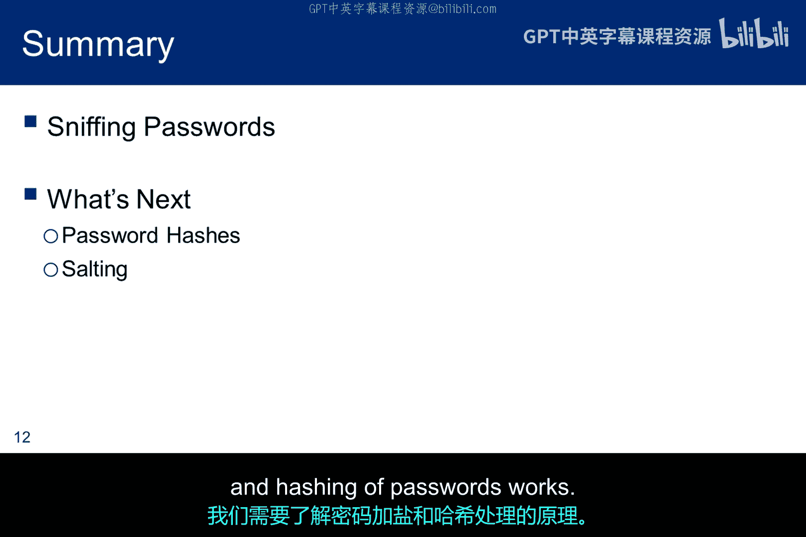

# 约翰霍普金斯大学《道德黑客入门｜Introduction to Ethical Hacking》中英字幕 p33 11_密码嗅探.zh_en -BV1xgu1z1Eau_p33-

Password sniffing is a technique for capturing passwords that are not protected。

 While most of us understand the risks and no passwords need to be protected on the network。

 there are still services that use unsafe protocols not to mention passwords that while they may be protected default to well known passwords provided with common unmodified accounts with respect to the methodology。

 we are still in the exploit phase， but we will focus on passwords for a couple of submods。

During the reconnaissance phase， we discussed several tools that will help harvest names and email addresses。

 We can use the local part of the email address and names we have identified to try to guess what the login Is might be organizations that are not security conscious。

 might actually use the local part of the email address as the I D。 but that increases risk。

 So organizations with more security knowledge no longer take that approach。 In this example。

 if we have determined a user's name is Robert Henderson。

 You can see a few patents that might be helpful in determining the user I D。 Of course。

 even if we figure out the user I D， we still need the password。 However。

 given the I D we might be able to guess a weak password or use a brute force tool to do an exhaust search。

And， of course， default accounts using default passwords are still left in place on occasion when systems are configured by inexperienced administrators or by mistake。

 you should keep a list of default logins and always try them before putting energy into other techniques。

 This particular link will provide more than 400 common default passwords， So it is worth saving。

 you do want to use caution。 However， when searching for this kind of list。

 as you may find yourself on a malicious site。

In the early days of the Internet， passwords were sometimes passed in the clear。

 Here are three services that were， and obviously still are guilty of passing credentials in the clear。

 Of course， the R services may not ask for credentials at all if a username is found in the R hosts file。

 But when they are not found and the user is required to submit credentials。

 they are passed in the clear。 And when they are passed in the clear and we have access to the land segment we can probably start up a sniffer and capture the packets on the wire as they pass。

 As of Mysql 5 do 5 do 10， a client side authentication plugin is available that sends a passwords to the server without hashing or encryption and this pluginin is built into the MysqL client library。

Snis will capture all packets passing on the land segment if the network adapter is promiscuous。

 not just those destined for the N's Mac address。 This is essentially a definition of promiscuous mode。

 There are similar adapter properties and tools for wireless lenss as well。

 although we typically use the terminology monitor more often than promiscuous mode。

 One very well known wireless tool is Airmon and G。

 which is just one of a whole suite of wireless attack tools。

 One key difference is that in monitor mode， the sniffer is collecting all packets from all SS I Ds。

 and the payload is very likely to be encrypted with Wep or WPA2。There are other sniffers available。

 TCP dump is useful because it is native to Linux。 Both Kain and Abel and Ettercaamp do some sniffing。

 but sniffing is really a secondary function。Kane and Abel is fundamentally a Windows password cracker。

 but it can sniff traffic on switched lands or simulate men in the middle attacks。

Ettercap is a suite for men in the middle attacks， but also sniffs live connections。

FTP is one of the services that passes credentials in the clear。

 Before I discuss sniffing those credentials， I want to review the FTP handshake。 As I talk about it。

 Think about the fact that some firewalls tracks state from one step of the handshake to the next。

 In step 1， the client's unprivileged command port，1026 context。

 the server's well known command port 21， and sends the server its data port Port 1027， in step 2。

 the server sends an act back to the client's command port。In step 3。

 the server initiates a connection on its well known local data port 20 to the data port the client specified earlier。

1027。Finally， the client sends an act back to the server data port， as shown in step 4。

Stateful firewalls keep track of the fact that there are two sets of ports for an FTP session。

 and they will block any external connection requests that haven't gone through the handshake。

 in the following slides， we will capture the FTP credential。

 The client will be Callli and the server will be Uuntu and we will capture the credential with wireshark running on Callli。

 but it could also be done with TCP dump on Uuntu。Pro FTP came with Z。

 and this slide suggests you can create a data directory of your choice in your home folder and then change the FTP demon configuration to write to that directory。

 Of course， we will be able to capture the credentials independently of the FTP directories。

 This just lets us check any transfer we may try while testing。Start wire shark on E T H 0。

 The only interface we normally have defined on cali。

Now， open a terminal in Cali and start an FTP session with Uuntu。 Notice that the screen shot is old。

 When I took the screenshot， the I P address for my Uuntu box was 102 instead of 103。

 and it was on the same segment as Callli。 Also， the server was V S FTP， not pro FTP。

 Don't get confused by that。The userr I D is passed to the server， but notice that when it is typed。

 the password is not displayed in the terminal。 Unfortunately。

 that is the only protection the password gets as it travels in the clear across the wire。

 as shown next。

The first three packets set up the TCP connection， send Sac Act and request FTP service。

 The fourth packet is the second step in the handshake in which the server responds to the FTP request。

 before moving on to the second stage。 the FTP data stage。 the authentication takes place。 First。

 the client sends the username。 the server acts and requests a password and the client sends the password。

 As you can see， it is unprotected and readable。 Once authenticated and FTP data session is started。

 allowing the transfer in either direction。 But the credentials have already been s sniffed。

We've discussed password sniffing， but before we can discuss password tracking。

 we need to understand how salting and hashing of passwords works。

