# 约翰霍普金斯大学《道德黑客入门｜Introduction to Ethical Hacking》中英字幕 p34 12_密码哈希.zh_en -BV1xgu1z1Eau_p34-

This lecture covers the basics of how passwords are managed and stored in Linux。

 Similar approaches are used in Windows。 One caveat is Windows does not use salts。

 which in one sense， may make password attacks more productive。

Moving on from known unencrypted passwords， the next discussion is about how passwords are protected。

 so they aren't easily read。

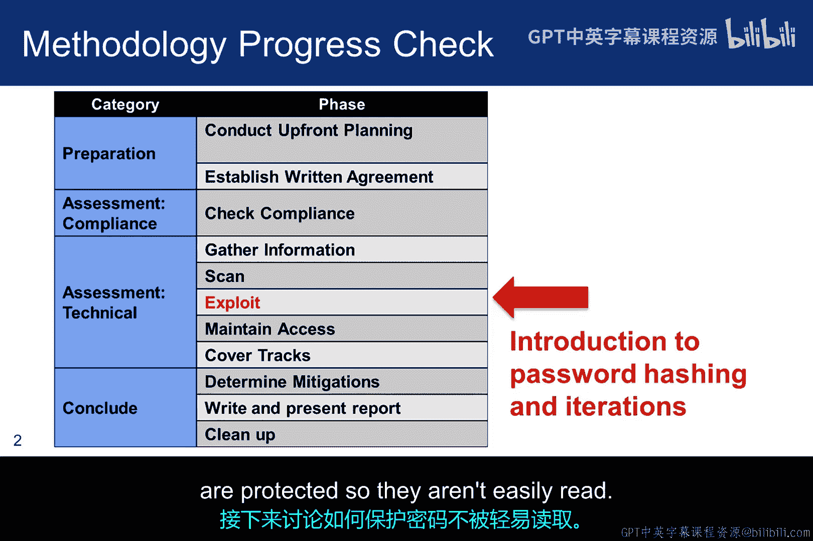

The fact that passwords are a common authentication mechanism means the risk of compromise is high if they are not properly protected。

 One of the typical approaches to this problem is to require users to use longer and more complex passwords。

 The problem， of course， is this can backfire because users will reuse passwords if allowed。

 and often write them down。 Some users try to get around this by using keyboard patterns。

 which have their own set of risks。 In addition to a user's selection of noncomplex passwords。

 We also need to consider how passwords are stored。 Some websites store your actual password。

 not the hash。 They do this for password recovery reasons。

 They receive the credential using an SSL tunnel， but most send it by email for recovery purposes。

 If a website sends you your password， you should always reset after recovery。

Although not all sites enforce this， the more sophisticated and more secure approach used by many websites is to store the hash and send you a reset link when necessary。

 But even when a password is a hashed credential， it could be replayed。

 depending on the protocol used。

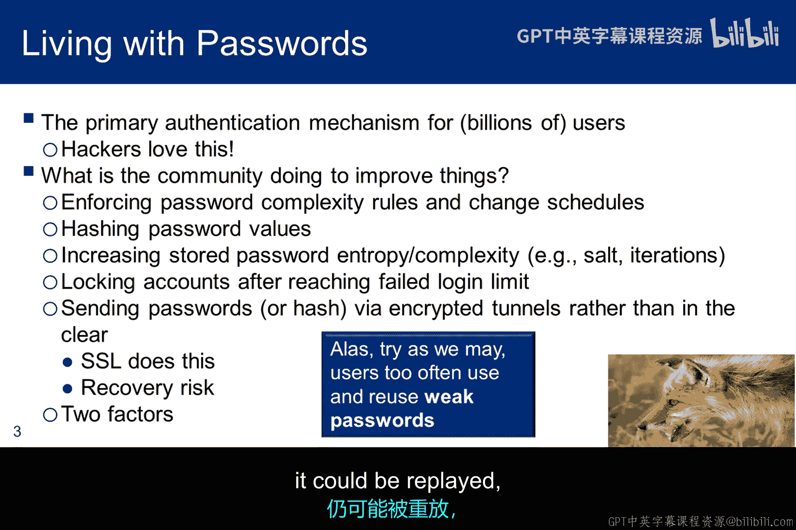

Based on executive order 1，3，6，9，1， NISist has new guidelines for identity proofing in the federal government under this guidance。

 when a password is used as an authentication mechanism， A second factor is required。

 The special publication discusses six options。 Ac factors are one。 A bingo look up card 2。

 a secure out of band connection 3， a secure I D like a one time password device or4。

 an embedded cryptographic device。Most importantly， email is no longer authorized。

 and SMS S will soon be deprecated as well。

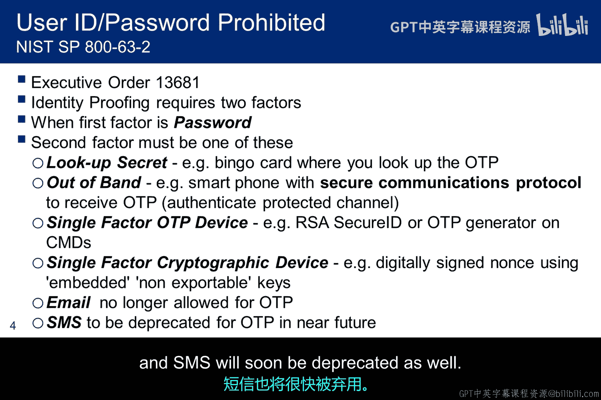

Passwords were indeed stored in the clear at one time。

 They were stored where you see the X in the password file to day， if a shadow file is not used。

 you might see a password hash there。 However， when shadowing is used as nearly all systems are configured。

 you will just see the X and have to look at the shadow file to see the hash。

The shadow file can only be read or written by rude， but it is not encrypted。

 even though you might expect that the bottom screen shot shows the shadow file with three fields for each user。

 The first field identifies the hash function。 In this case， sign 6 means it uses 256 B shot 2。

The next two fields use 64 B encoding， which I will explain in a moment。

 But an important fact is that it is a simple， well known， reversible encoding mechanism。

 So it provides no confidentiality。 The second field contains the encoded salt。

That salt is concatenated with the password， and the result is hashed with the algorithm identified in the first field。

 Then everything is encoded。 So the salt is encoded， but stored in the clear modulo encoding。

 So you should be asking yourself how it adds value to the protection mechanism。

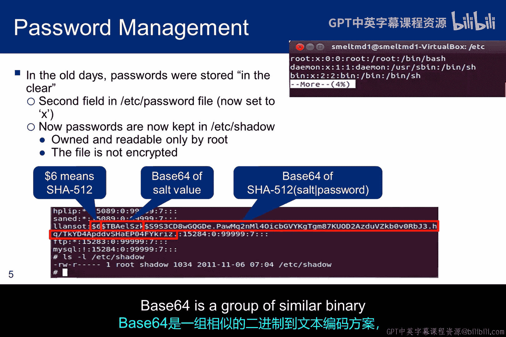

Base 64 is a group of similar binary to encoding schemes that represent binary data in an ASII string format by translating it into a base 64 representation。

 B 64 encoding schemes are commonly used when there is a need to encode binary data that has to be stored and transferred over media designed to deal with textual data。

 For example， email。 The idea is to ensure that the data remains intact as alphanumeric characters without modification during transport。

 This type of encoder has been around a long time。 And for base 64。

 the algorithm is based on 6 B strings。 So starting with 24 B of binary data typically thought of as 3 Bs。

 we mark off 6 B at a time until all the data is marked。

 Those 6 Bs represent a value in the ASII table。 So the 4，6 B strings in base 6。

translatelates to Ka forward/ f。The thought is K A forward slash F is easier to transmit using email than the bitch string。

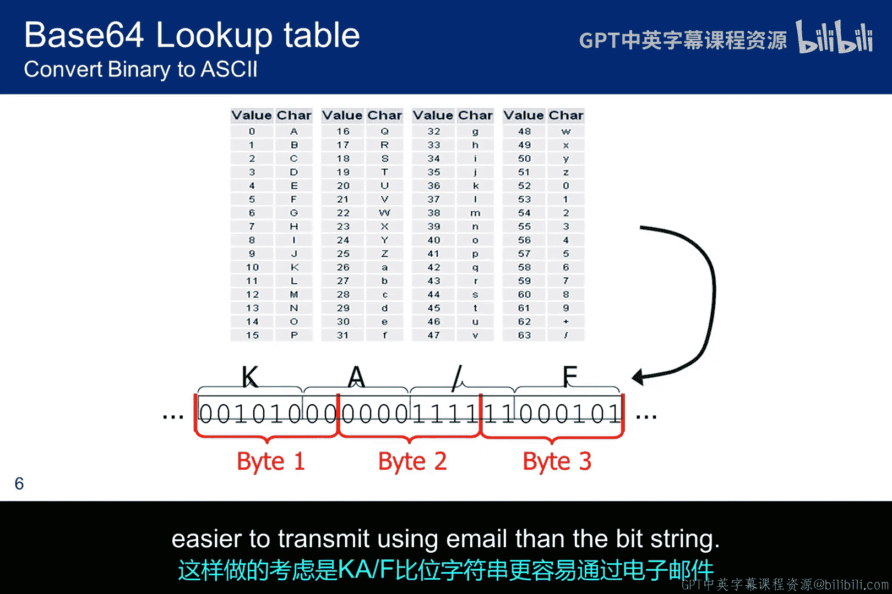

Strong crypto does not help much if the crypto keys are weak。 And for some systems。

 the keys are either passwords or are based on passwords。

 Those passwords can be weak for many reasons， but an important contributing factor is the size of the key space。

 We should really use  a hundred 28 B keys to be secure。

 But the use of 8 bit passwords will put us in a key space with at most 56 B。

 And if we let the user select the password， the key space is going to be much smaller than that。

 So no matter how strong a keystar crypto mechanism is。

 we need to make sure the password is much longer than 8 characters or else。

 we have the weak protecting the strong。

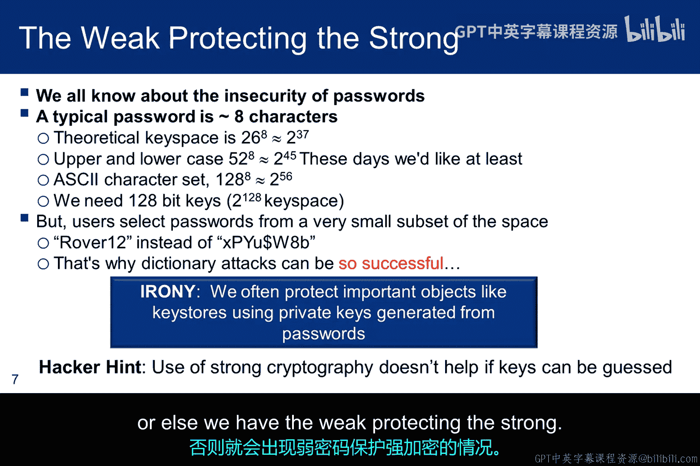

Here is an example of a dictionary。 a hacker might use when the passwords are not salted。

 He starts with a list of possible passwords， which he has collected。

 possibly from sources like the Rock you hack。He computes the shot to hash and does base 64 encoding。

 Now， assuming he has excelleed the shadow file for a system。

 It is simple to do a look up and get the password for a user， assuming it is in the dictionary。

 He may have to create multiple tables， depending on the size of the digest used by a system。

 but everything can be precomputd to simplify a。

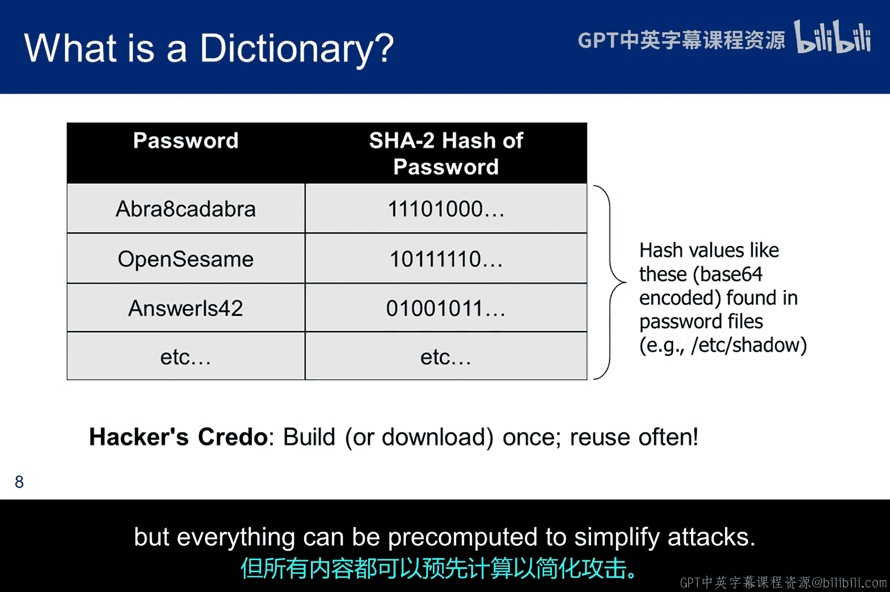

In order to increase the computational complexity of a hacker's task。

 the idea of a salt was introduced。 This is a random number that is different for each user。

 The user's salt is concatenated with the user's password before hashing and encoding Now。

 for the hacker to do any kind of precomputation。 The dictionary must be computed for each random number used as a salt in a given system。

 since each password has a different salt。This significantly enlarges the key space that the hacker has to deal with。

This is how authentication works On the top when an account is created。

 a salt is generated and concatenated with a password before hashing and encoding。

 Then everything is stored in the shadow file。 When a user wants to log in。

 he enters his I D and password。 the O S looks up the salt in the shadow file decocodedes it and concatenateates it with the password。

 The result is hashed and encoded and compared to the results stored in the shadow file。

 If the two match， the user is authenticated。

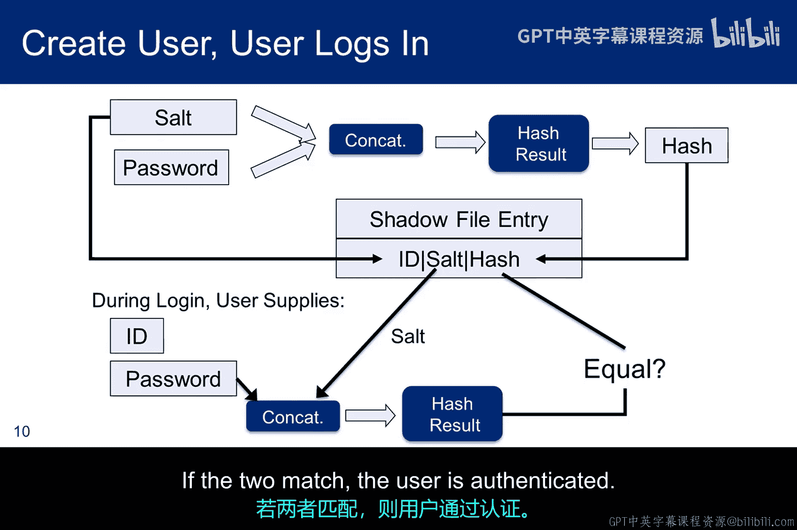

This is similar to the table we saw earlier， but now it incorporates the idea of a salt。

 The hacker has to create one of these for each salt in the shadow file。 In this case。

 only salt 1 has been precalculated。 The computational complexity can be increased further by iterating the number of times the hash function is applied。

 In this case，1000。 Since the number of iterations used is also stored in the shadow file。

 it could be made different for each user。 although the impact on complexity won't be significant。

 managing the precomputation process is much more complicated。

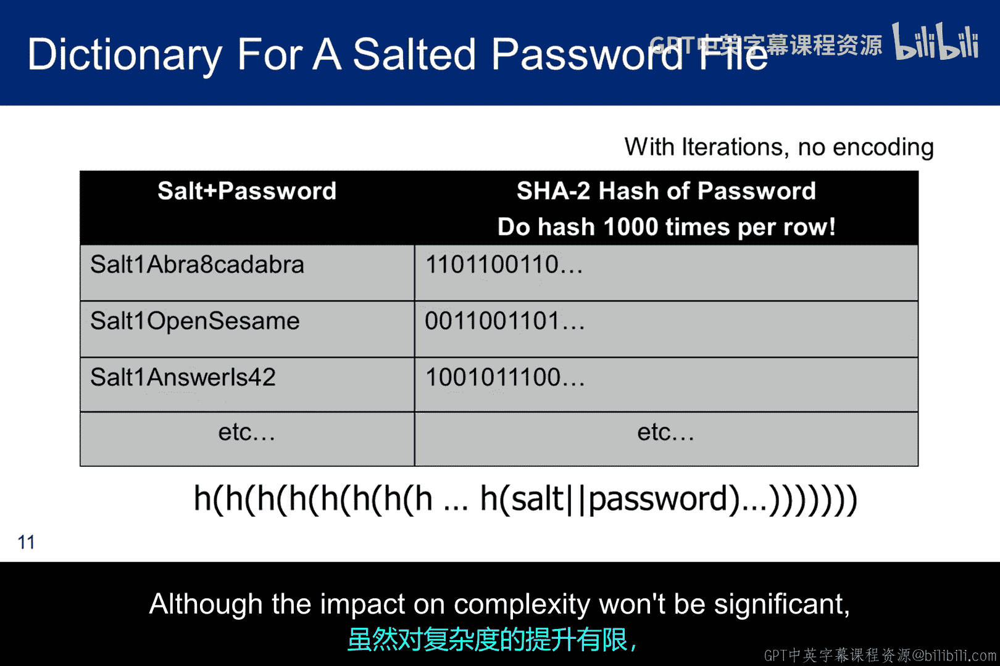

These are the steps the hacker has to go through to use a dictionary When the passwords are salted。

 I have simplified slightly by using the same number of hash iterations for each user。

 but it is possible to do it either way， using the pluggable authentication module。

 Pam or writing a script and using the Pam succeeducce if module。

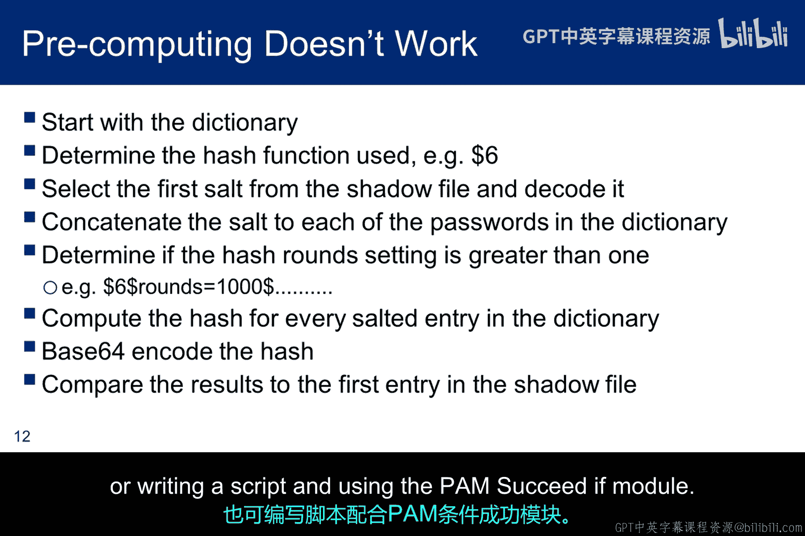

For each salt， you need a separate dictionary， and the iteration count makes the creation tedious and time consuming。

 especially if the number is different for each user。

And you need to be aware of the fact that Windows does not salt passwords。

 So if hackers can get their hands on a sand file， dictionary attacks may proceed much more efficiently。

Microsoft has not changed tos due to the effect on legacy software and the need to remain backward compatible。

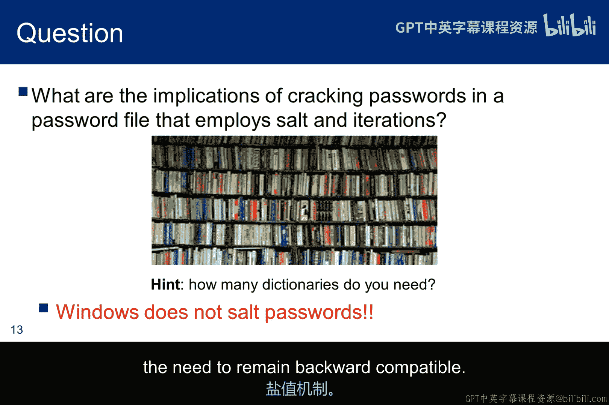

Password guessing may be an extremely effective approach to gaining access to a system because many people never change their password。

 They reuse old passwords， and they rarely use a random string of characters。

 They choose passwords they can remember。But if you can't guess the password。

 cracking tools can help Online tools are useful when the password file has not been exfiltrated。

 although login attempt limits can complicate the online effort。 However。

 if the password file has been ex filleded， massive offline resources like cloud computing and GPU clusters can be used。

We have discussed how hashing and salting fit into the password based authentication process。

 and now we will spend some time looking at on and offline cracking。

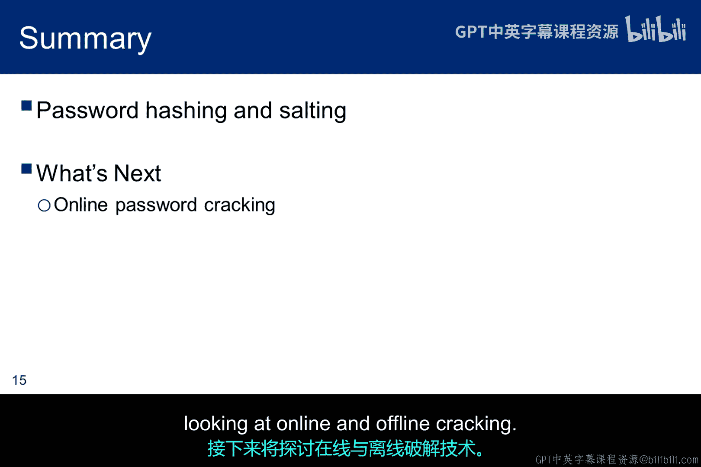