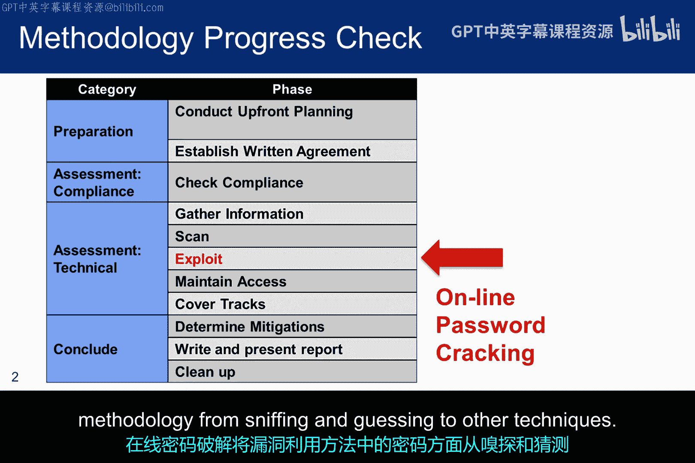
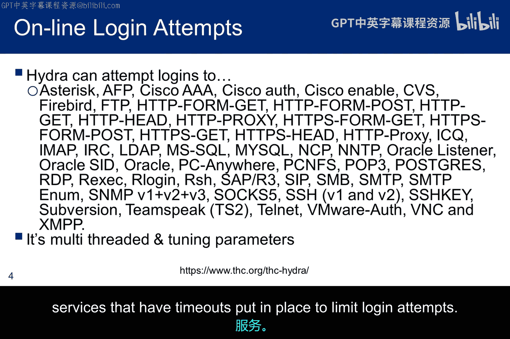
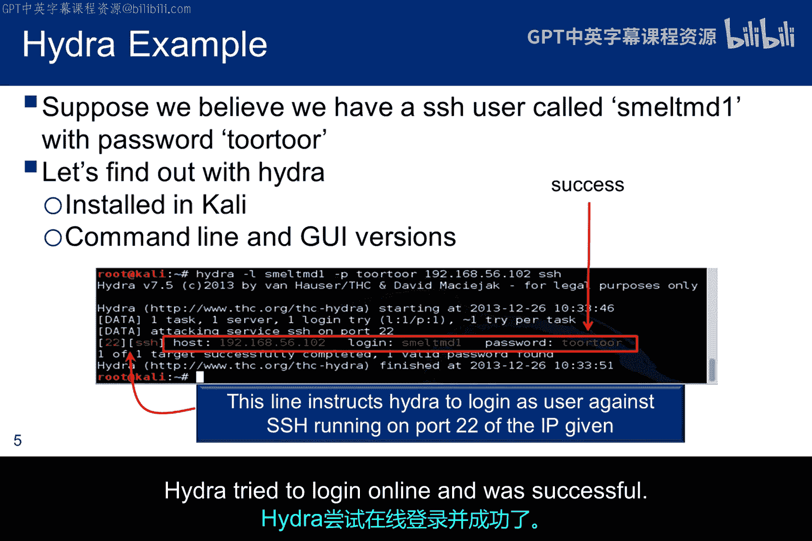
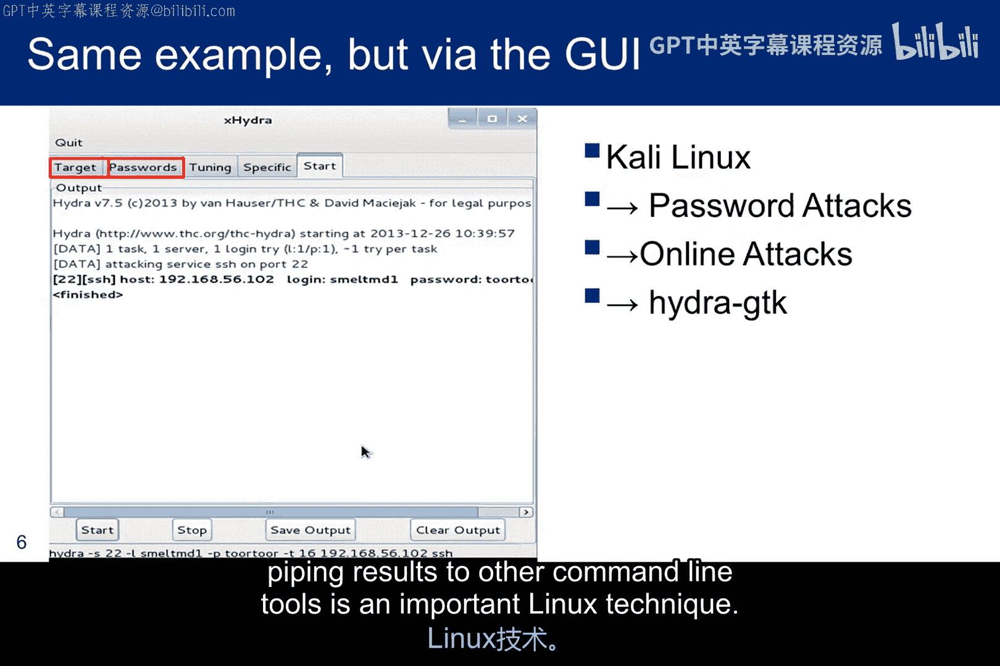
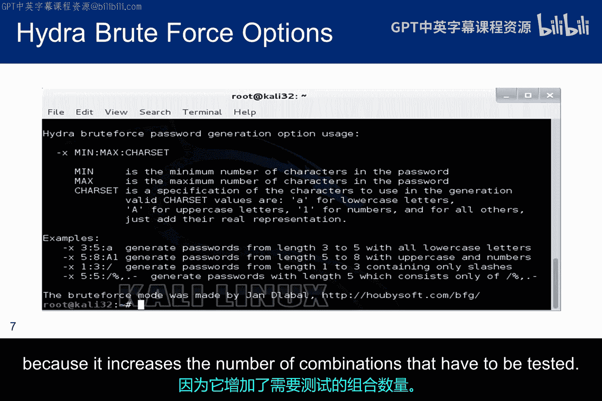
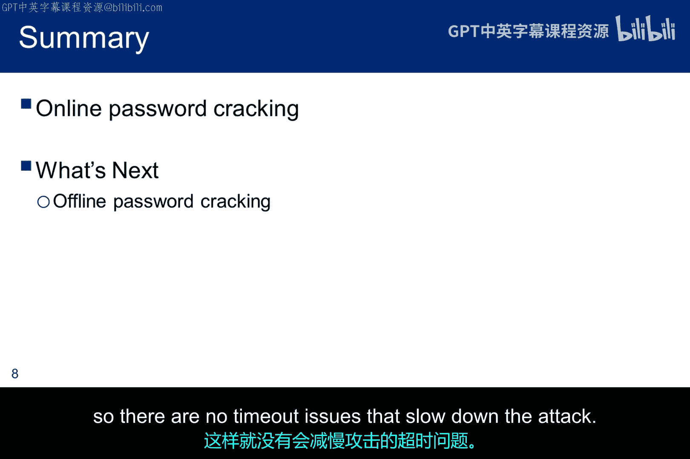

# 约翰霍普金斯大学《道德黑客入门｜Introduction to Ethical Hacking》中英字幕 p35 13_在线密码破解.zh_en -BV1xgu1z1Eau_p35-

This will be a very short discussion of one online cracking tool， Hydra。

Online password trackinging extends the password aspect of the exploit methodology from sniffing and guessing to other techniques。

2 online trackinging tools are meusa and Hydra。 Engaretzson discusses meusa。

 So I will only cover Hydraa。 It's not really a cracker。 It's more of a robust password guesser。

 You provide a list of login Is and plain text passwords。

 and Hydra will test them online to see if they work。

 That means we need to leverage some of the social engineering techniques first to capture I Ds。

 Then we make our password list available to see if the one we are trying to compromise online is on the list。

 Hydra also has a brute force option with a command line switch that lets you specify length and alphanumeric combinations that should be attempted。

Hydra has been designed to work on many different login protocols， as shown on this slide。

 and it is multi threaded to improve performance against multiple servers simultaneously。

 It also includes timing control， which is used to try to deceive the authentication services that have timeouts put in place to limit login attempts。

One of the services Hydra will attack is secure shellll。

 Suppose your social engineering has turned up smelt M D1 as a possible user I D。

 And suppose you know Tor is a common password for a hacker using Cali。 So when Tor doesn't work。

 you decide to try To tour， the command line provides Hyda， the guest user I D， the guest password。

 the I P address where the service is running and the service name to be attacked。

 Since no port information was provided。 Hydra assumes a standard SS H port22。

 Hydra tried to log in online and was successful。

There is also a GuI version of the Hytool if you are more comfortable with that。

 but as always I recommend the command line version because options may not all be available in the GuUI and piping results to other command line tools is an important Linux technique。

The Hybrote force options lets you specify the minimum length and maximum length of the passwords to try。

 This is important because the maximum length determines how long the attack is going to take。

 especially if Hydra is waiting between attempts to try to deceive the server。

And the character set specification will also affect brute force attack time because it increases the number of combinations that have to be tested。

Hydra is one of many tools available for cracking a password by actually trying to log in online。

 Next， we will look at cracking a password when the password file has been excfiled。

 so there are no timeout issues that slow down the attack。

