# 约翰霍普金斯大学《道德黑客入门｜Introduction to Ethical Hacking》中英字幕 p36 14_离线密码破解.zh_en -BV1xgu1z1Eau_p36-

。Offline password trackinging is a two step process。First。

 Excelel the password file and second run attacks on that file。

 This discussion focuses on the second step in the process， attacking the password file。

 using John the Reper。As with on， offline password cracking continues to extend the password component of our exploit methodology。

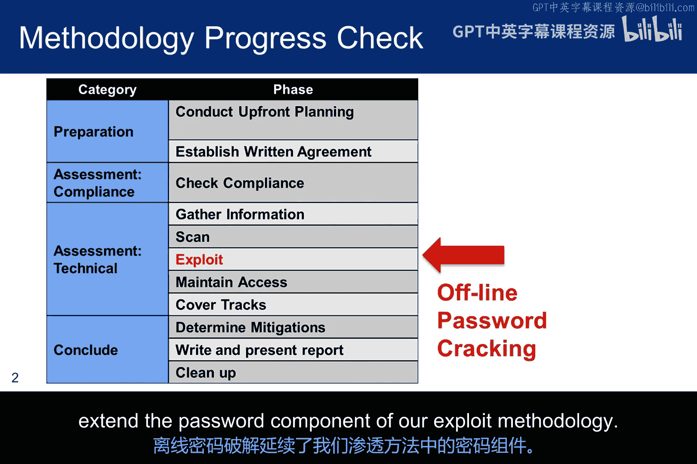

John the Reper and hashcat are two tools that you will need in the exploit lab。

 I will not discuss hashcat， but there is lots of documentation online And Kelly has hashcat help files built in that you can reference Loft crack is a similar tool for Windows。

 we will not use loft crack。 But since we have created a Windows V M you may want to experiment with it for Linux。

 we can copy the password file with root privileges but extracting the Samm file on the Windows box is a little trickier because Windows keeps an exclusive lock on the Samm file when the system is running。

 a common approach is to boot the hardware with a Linux live USB mount the Windows disk on the Linux O S and copy the file over。

 there may also be persistence issues with the Linux USB depending on how it was built before enlargeging the attack surface to include the。

Password and shadow files with existing accounts and potentially complex passwords。

 We can look at a simple script that adds two new accounts with very simple passwords and then calls JTR to crack them。

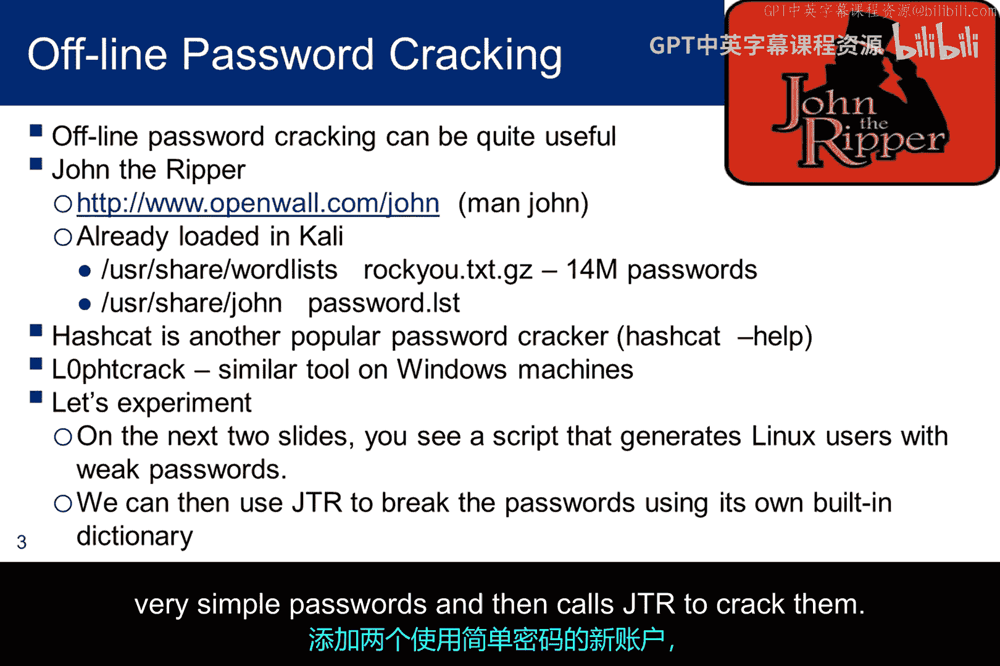

Before looking at the detailed script， let's look at the big chunks that you may want to think of as being pseudocode。

 On the left are the text based descriptions of the system and function calls。

 and the details are shown on the right。 So the first step is to delete any passwords that may be left over from previous runs of the script。

 There shouldn't be any。 So this is just a precautionary error control。 Next。

 the script adds two new users with weak passwords。

 John the Ripper depends on the P A S S W D and shadow file being combined into a single file。

 This is usually called unshadowing。 So that is the next step in the script。JedR runs。

 and the cracked passwords are stored in a file called target。 Finally。

 we clean up by deleting the file containing the cracked passwords and removing the newly added users from the system。

 And if you decide to run this script， you want to back up the password and shadow files。

 just in case there is an error in your version of the script that damages those files。

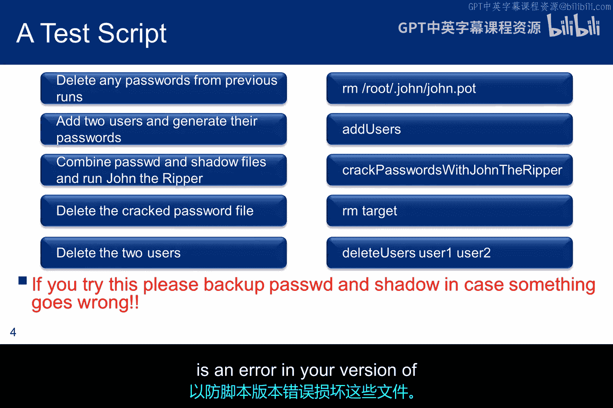

This is the first part of the script， but execution actually begins in a different part of the script。

 As shown on the next slide。 You should read through the script on your own。

 but a couple of comments are in order here。1 in the generate password function。

 T 5 means the hashing algorithm is going to be M D 5。

 and we need to tell JT R that when we run it 2， a deian build like Callli typically guides the essay to add users with the a user command。

 but that command prompts for the password， So the script uses user ad。

 which allows the hash to be generated via generate password。 and then pass to user ad 3， finally。

 notice the simple passwords。 ABC 1，2，3 in password。

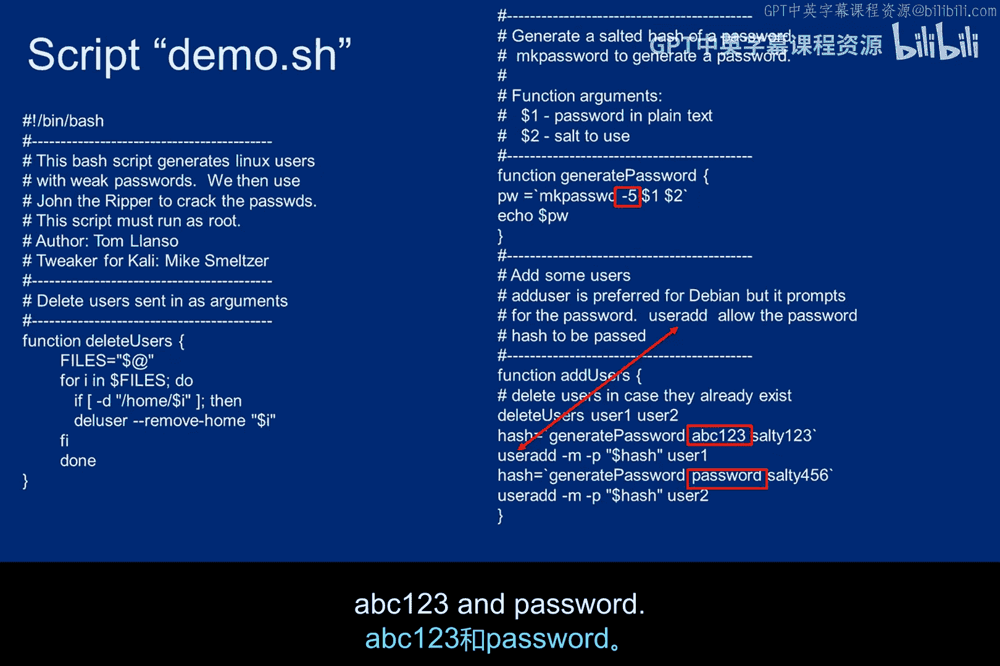

This slide shows where the script starts。 And you can see the function and system calls are the same as shown earlier in what I called pseudocode and note that the JTR call is past M5 for the hash format。

The unshadow command in the crack function merges the password and shadow files。

 We did add users using M D 5， but Call will typically have the shadow file created using shot 2。

 So make sure you don't mix those two up when running J T R。

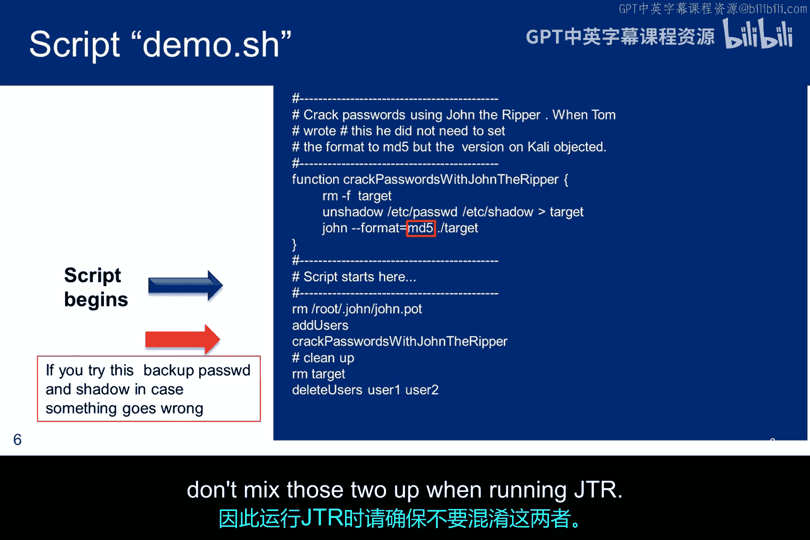

This screen shot shows the output to the screen when I ran the script。

 John quickly found the weak passwords。 Remember， you do have to have root access to read the shadow file。

 So for the script to run correctly。 in order to unshadow。 you need root permissions。 Obviously。

 this won't be an issue on Callli。 but it might be if you try to script on a different VM。

 If you are not attacking your own system， capturing the shadow file can be done in much the same way as capturing the Sam file discussed previously。

 boot the hardware using a Linux live USB on which you have root privileges。

 mount the disk and copy both the shadow and password files to the USB。

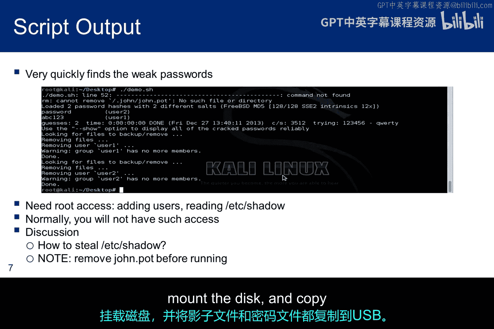

JT R runs through three phases when it tries to crack a password in the single crack phase。

 It tries login names， the user's full name and the user's home directory name as candidate passwords。

 All are available in the password file and a large set of mangling rules are applied to the contents of these fields as well。

 In the second phase， JTR uses a word list。 If the user's word list is not specified on the command line。

 JTr uses its default word list。 Pass dot LST。 This dictionary is limited。

 so it is typically more productive to provide one。 Finally。

 it shifts into the incremental crack phase， which is a brute force approach。 In this phase。

 you have to identify the character set to be used in the password length， similar to Hya。

 If you are going to be cracking Windows passwords。

 Use any of the many utilities that dump password hashes。

Either land manager N or N TLM in PW dump output format。

 Some of these utilities may be obtained at www do openwallt com slash passwords s Pw dump。

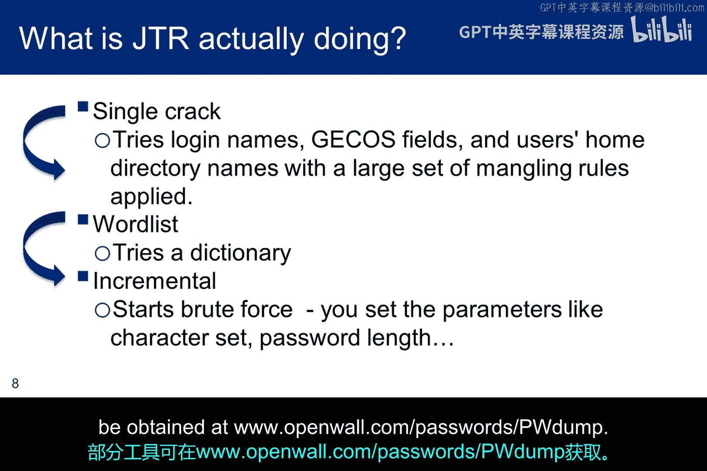

As the screenshot shows， Call provides several other word lists at slash user slash share slash word lists。

 and JTr's word list is not included in the directory。

 Rocky was probably the most famous list because it came from an online gaming breach in 2009 and yield at 32 million passwords。

 One interesting trivia point is that if you convert the file size of 139 MBbys to bytes and divide by 32 million。

 you get an average password length of 4。5 characters。

The version that comes with Caley only has 14 million passwords in it rather than 32 million。

 So I assume over half of them may have been such poor choices that they needed to be eliminated from any respectable dictionary。

And there are dictionaries available on the Internet， but many are not free。 That said。

 if you are looking on the Internet for a password list。

 be very cautious of finding yourself on a malicious website。

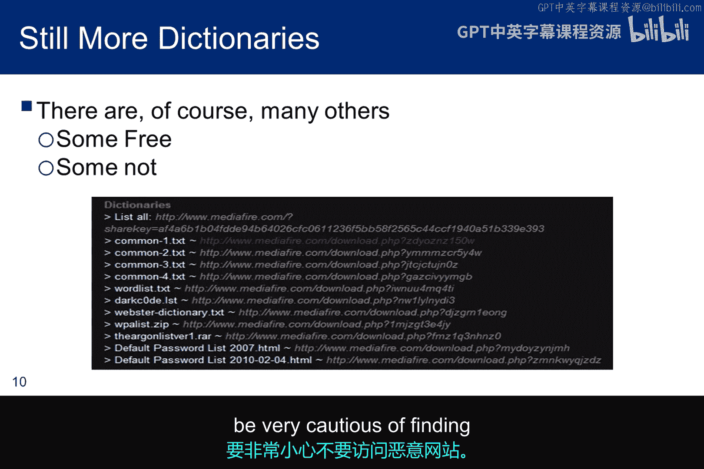

Like most tools， J T R has a gooey version called Johnny。

 This screen shot is very dated as the Gooey has been updated since I ran it。

 But what is important is just like J T R。 Johnny does run through all three cracking phases。

I had used Webgoat as the password for Webgoat， and Johnny got it in about two minutes。

 The password Tor， Tor was still running after 17 hours。

 which tells you that in the incremental phase， Vms just don't have the horse power necessary to crack complex passwords。

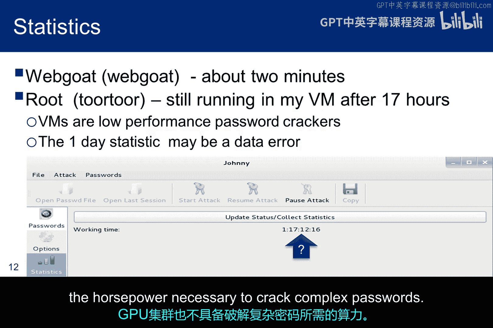

This is a picture of a GPU password crackken cluster。

To say it can crack every standard Windows's password in less than 6 hours is misleading。

 because a brute force attack will clearly depend on the length limits of the passwords。

 It is much more meaningful to note， it can do 350 billion guesses a second。

 This is an X K C D comic that makes the point that common substitutions and the addition of keyboard symbols may not be the best choice for a password。

 On the other hand， taking words from common phrases like four score in 20 years ago is weak as well。

 Even the first letters of a well known pass phrase is weak。 Haers know these phrases as well。

 Passwords that are hard to crack。 come from picking a number of random words and string in them together。

 In other words， it is not a phrase。 Anyone one has heard before。

 So it probably won't be in a dictionary。 And it also increases the complexity。

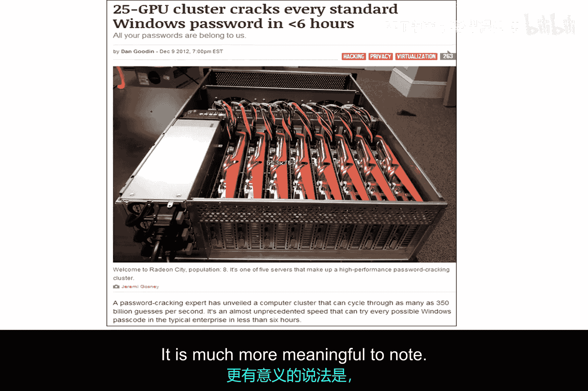

Significantly against brute force tools， most of our SAAs increase the complexity even further by making us add in numbers。

 keyboard characters and uppercase letters。 By the way， this is a comic。

 So I would guess the entropy numbers may not be defendable。

That finishes the password component of our exploitation phase。 Now。

 we want to move on to one of the more well known vulnerability exploitation tools called Mepoit。

 We will use the free version。 but the professional version has significant additional functionality。

 If you work in an organization that does penetration testing。

 You may have some experience with the enhanced version。 Please share that on the discussion board。

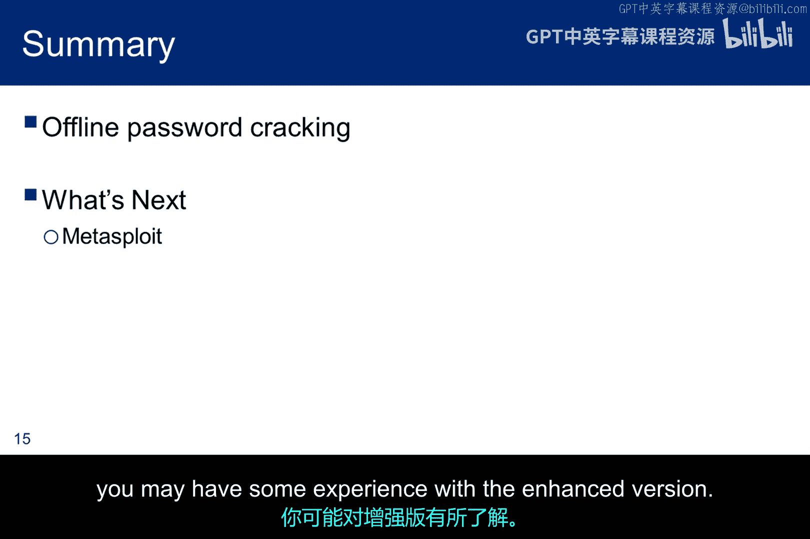