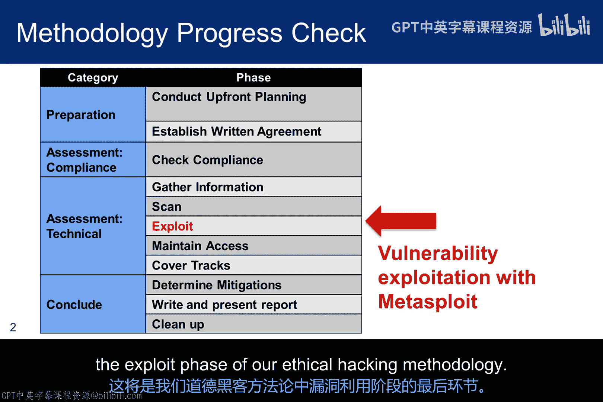
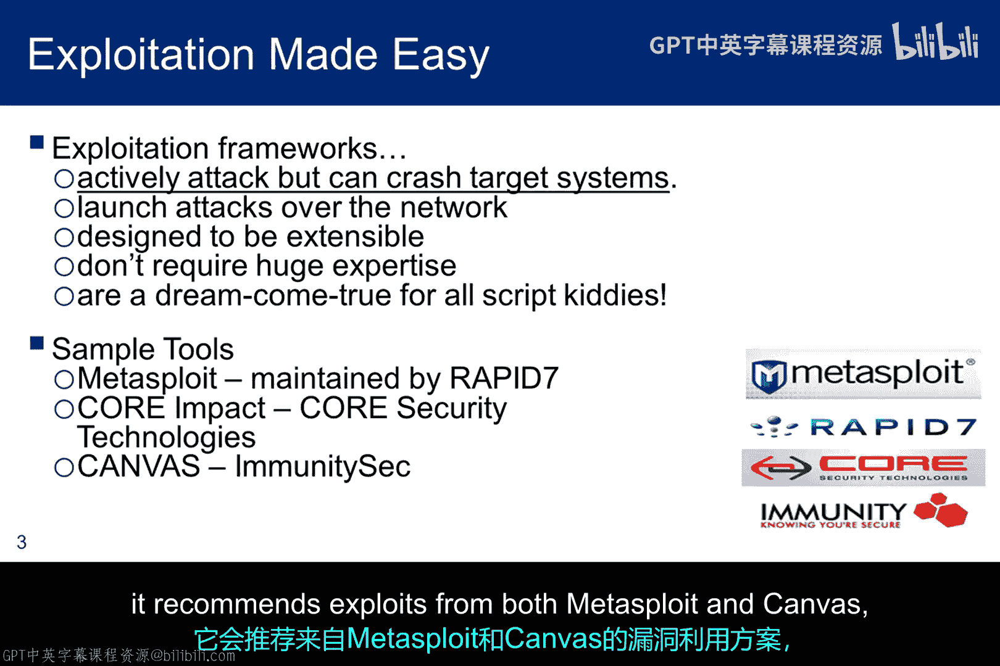
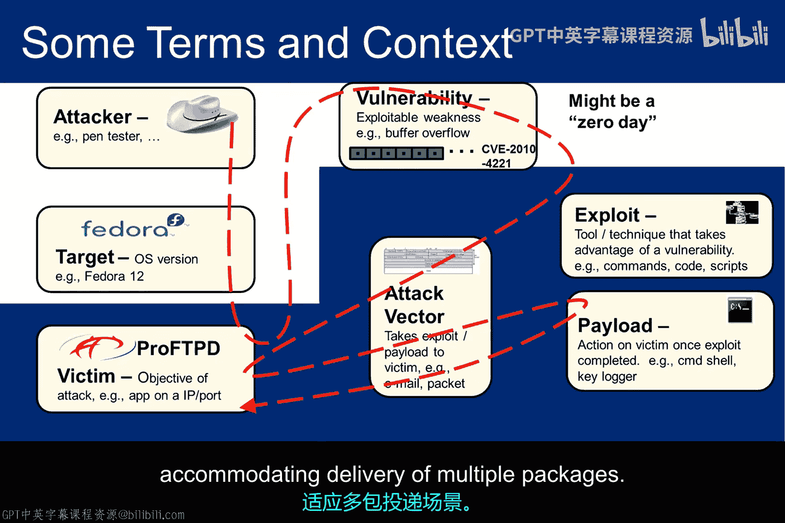
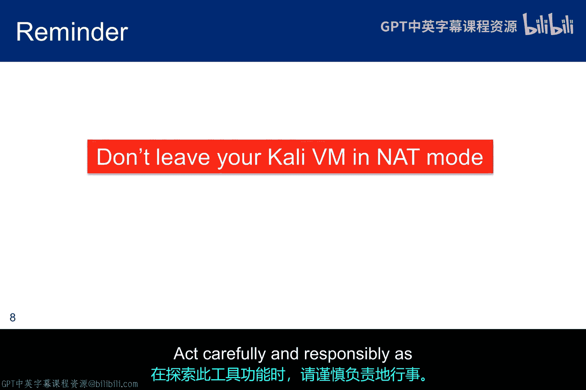
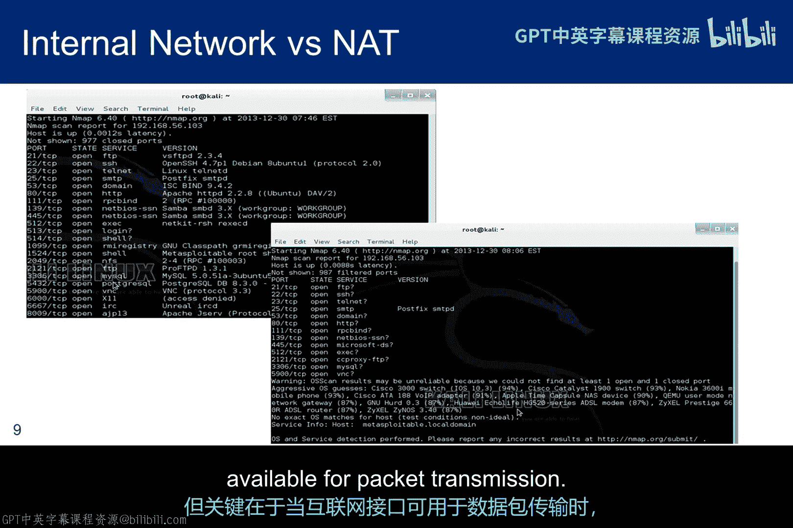
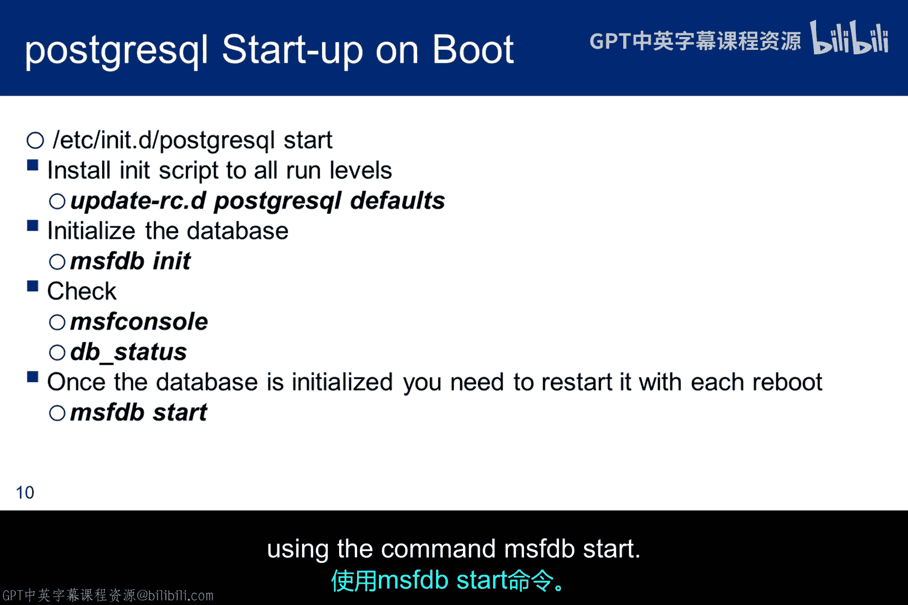
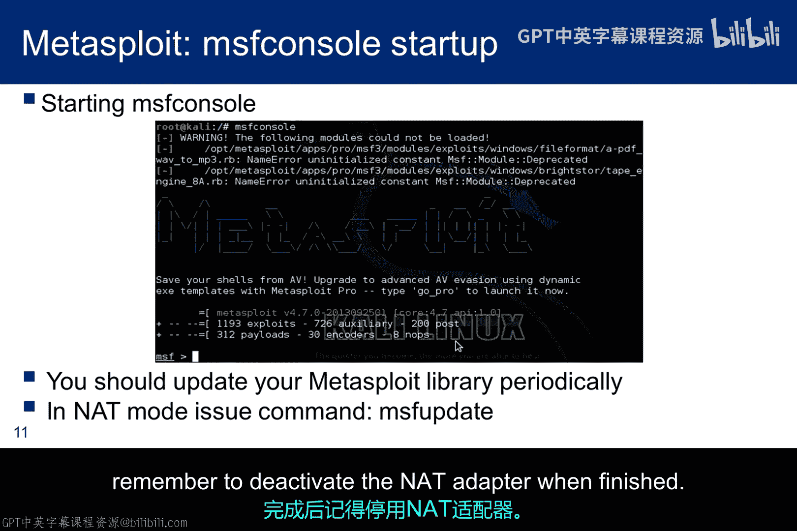
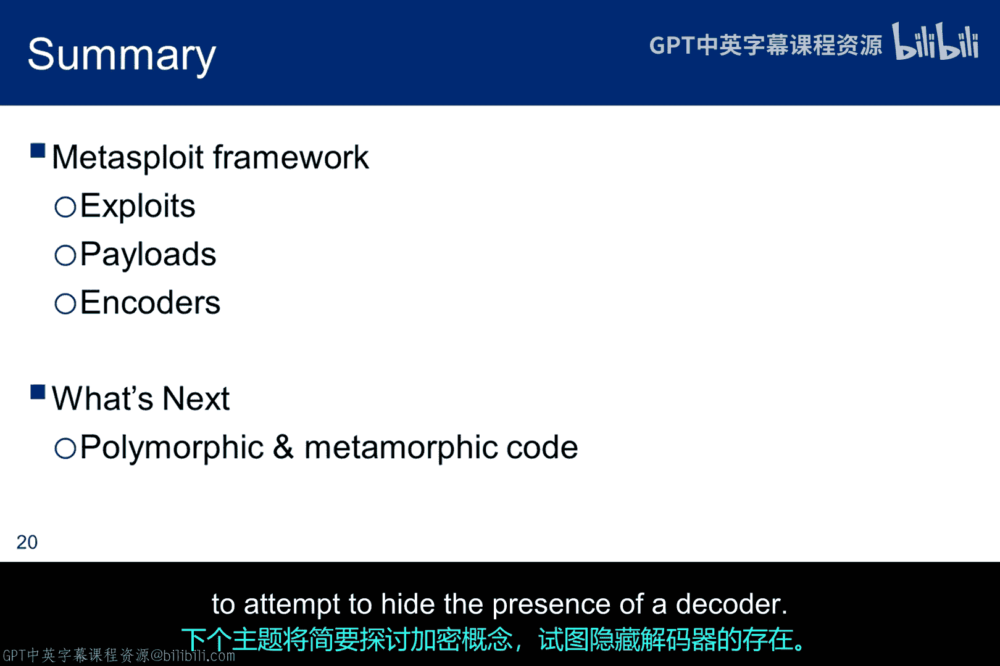

# 约翰霍普金斯大学《道德黑客入门｜Introduction to Ethical Hacking》中英字幕 p37 15_漏洞利用实践.zh_en -BV1xgu1z1Eau_p37-

Next， we will delve into the use of a vulnerability exploitation tool。 As noted earlier。

 there are multiple tools， but we will work with metapoit。

 One of the more well known tools used by both red teamers and script kitties。

This will be the final piece of the exploit phase of our ethical hacking methodology。

Exploitation frameworks have many benefits， but I think the extensibility feature may be the most important。

 because that allows multiple participants to contribute new tools to the community。

 A framework based design also contributes to a tools's popularity。

 because it makes the tool easier to use。 Even with a much more limited level of understanding of the details。

 Of course， that makes it popular with script kitties as well。

 One thing to remember about exploitation tools， is they may crash the system because the exploit has unexpected effects。

 Here are three tools and there are others。 But when Neus identifies a potential vulnerability。

 It recommends exploits from both metaite and canvas。

 So they are integrated across the pen testing community。

 We discuss this slide in the lecture on hacker context。

 But here I have added a blue background to highlight the two step process of leveraging and exploit and。

And delivering a payload， the cyber kil chain that came out of Locking Martin provides a slightly different view of this picture。

 That model uses this terminology。 Weaponization is the step that couples the with a back door into a deliverable payload。

 Deliry sends a weaponized bundle to the victim via email， Web， USB and so forth。

 Expplicationation leverages a vulnerability to execute code on the victim system。

 and installation puts them all where on the asset。

There isn't a significant difference between the two views。 But as you learn about Menlo。

 you will see that the exploit and payload may be sent separately。

 The kill chain is more closely coupled to an email or USB attack vector and less aligned with a network delivery。

 accommodating delivery of multiple packages。

Metapite was created around 2003 using Pearl scripts。 It was eventually rewritten in Ruby。

 And if you want to contribute exploits to the framework， you would need a good knowledge of Ruby。

 When Ra 7 purchase Mepite in 2009。 Part of the agreement was that there would always be a free version。

 and Rapid 7 has continued to maintain that version。 It does have three user interfaces。

 but I will only talk about MF console。 If you have a preference or one of the other interfaces。

 you are welcome to use it in the lab。The online tutorial is quite comprehensive and worth exploring if you have the time at W Ww dotoffdashsecurity dot com slash minlo unleashed。

Metaloit is called a framework because it is a modular pluggable architecture that makes it easy to add exploits and use exploits added by others。

 The architecture shown here is simplified， showing three user interfaces at the top and important plugins at the bottom。

 an exploit plugin would be some code that takes advantage of some vulnerability like a buffer overflow。

 An example of a payload would be shell code that executes after the buffer has been overflowed。

An example of an encoder would be a tool that removes nullles。 In other words。

 string terminators from the package sent to the buffer。

 Encors also attempt to hide the exploit from intrusion detection systems and firewalls。 However。

 they aren't terribly effective because vendors track new encoders as well and adjust their detection mechanism to accommodate the new encoders。

 Menp provides several encoders and pickix one by default If the user doesn't explicitly use one。

The process for using metaloit begins with reconnaissance。 Information gathering and scanning。

 Once a potential vulnerability is identified， the user has to tell metaloit which exploit to try。

 After the exploit is selected。 Metaloit pairs down the applicable payload list。

 and the user must pick a payload。 Then there are three sets of I P addresses that can be set。

 L hosts is usually local host， which is the attacking machine In our case。 Callli。

 Our host is the remote host or target。 S RV host is typically where the listener is set up。

 waiting for a connection back from the payload on the target for the lab。

 we will start the listeners on Cali。Metapite also has a Postg SQL database to keep track of activities related to the target network。

 It allows quick and easy access to scan information and provides the ability to import and export scan results from various third party tools。

 This information can be used to quickly configure module options， But most importantly。

 it keeps the results clean and organized。This is just a reminder that metaloit needs to be used within your ethical hacking environment。

Venturing into the Internet will likely be a violation of the Federal。

 Computer Fud and Abuse Act and numerous state laws Act carefully and responsibly as you explore the functionality of this tool。

This screen shot shows that if you leave the Nat interface open。

 you may get a more limited set of results。 Of course， these are end map scans。

 not metapolate results。 But the point is that the tools behave differently when the interfaces to the Internet are available for packet transmission。

These are the instructions for getting Postgs sQL to start up on boot。

 But even after you have that configured， you will still need to start the database for metaloid each time ca reboots using the command MSFDB start。

This screenshot shows the start of Mepo at the bottom of the display is information about the number of exploits。

 payloads and encoders that are available in your version。You should update your build periodically。

 but a reminder， remember to deactivate the addeder when finished。

In metaloid， the term exploit is a technique that takes advantage of a flaw。

 It may execute a buffer overflow， leverage a configuration error or do an injection。

 If a programmer has been careless about checking input。

Exploits are ranked Once you have identified a critical vulnerability。

 You can search metalo for associated exploits。 There will usually be more than one。

 but they are not all created equal， and the ranking provides a relative comparison of dependability。

 the higher the score， the more likely the exploit is to work。

 And the less likely it is to crash the target。Once you have a foothold on the target。

 Mepoloit provides post exploit modules that can be run on the compromise target to gather evidence。

 escalate and pivot deeper into a target network。As noted previously。

 Meloit separates the exploits from the payloads。 Once the exploit has leveraged a flaw。

 the payload represents the malicious activity， It might execute a program or provide a shell that can be used by the attacker。

 The last bullet shows an important idea。 The payload may start a listener on the target that the attacker has to connect to。

 The attacker can also start a listener on the attack machine。 And in that case。

 the payload connects back and creates what is called a reverse shell。

 Reverse connections are usually preferred because they are less likely to be detected by a firewall。

 Also， there is no listener running on the target waiting for a connection that might be discovered by an administratorist。

In this example， a listener is started on Cali。 The exploit is sent to the remote host。

 followed by the payload。 When the payload executes， it connects back to the attacking machine。

 creating a C2 channel。 At this point， the attacker may just use the shell interactively or metaloit may send additional payloads like post exploit payloads。

 or a very special payload that creates a very special shell called mepreter。

Encoderrs change the payload code for several reasons。

 One reason is to eliminate certain embedded characters。 For example。

 nulls create problems for string copy， and string copy is often taken advantage of in a buffer overflow exploit。

 So nulls need to be taken out of the attack packages。

 Another reason is encoding provides one approach for hiding from defensive mechanisms。

Do multiple encodings complicates the creation of malicious code signatures。 For example。

 suppose the attacker encodes a well knownn payload 10001 times。

 but the idea only has signatures up to 10000 different encodings to challenges with encoding or the payload size increases with each encoding。

 And in order to support auto decoding。 The attacker has to provide the decoder。 In this case。

 it is the decoder that provides the attack signature。

 So it doesn't matter how many times it is encoded。

 We will discuss the idea of metamorphic and polymorphic viruses later。

 but the idea is to circumvent the defender's ability to identify the decoder。As noted。

 metaloit has to send the decoder so the payload can be decoded and executed on the target。

 like exploits， encoders are rated。 Some are better than others。

 And Meloit provides a default decoder， which has changed from Shicataganai to Powerhell base 64。

M S F Venom， T L will list all the available encoders， along with their ratings。 There are over 30。

 MF Venom is also an interesting tool because it can be used to generate malicious payloads。 In fact。

 we will use it to create an exploit against Windows 7 in the lab。As I noted earlier。

 after the first payload has executed， for example， create a reverse shell。

 A second payload may be sent， and a very special one creates a unique special purpose shell called Mat interpreter。

Materpreter has much more functionality against a Windows machine。 So for most of our labs。

 it won't play a significant role， but I will demonstrate a choose against a Windows machine to show you the power of the show。

 One really important aspect is Matterpreter does not start a new process when it starts。

 So it is more difficult to detect。One important capability of Matpreter is the migrategra command。

 which moves the mepreter server into a different process。

 The server initially starts with the privileges of the exploited process。 But if that process dies。

 the meter server dies as well。 For example， exploiting I。

e is common because of all the vulnerability it has had。But if the browser is closed。

 the mepiter server dies。 Migrate provides a way to move it to a process that is persistent。

As highlighted in yellow， once the reverse shell is established。

 Meplate will send the second half of the payload， which runs and waits for the interpreter server to be sent。

 At that point， a interpreter shell can be created and communications established。

I have introduced the idea of exploits， payloads and encoders。

 but encoders require the use of a decoder。 So the next topic will briefly delve into the concept of encryption to attempt to hide the presence of a decoder。

