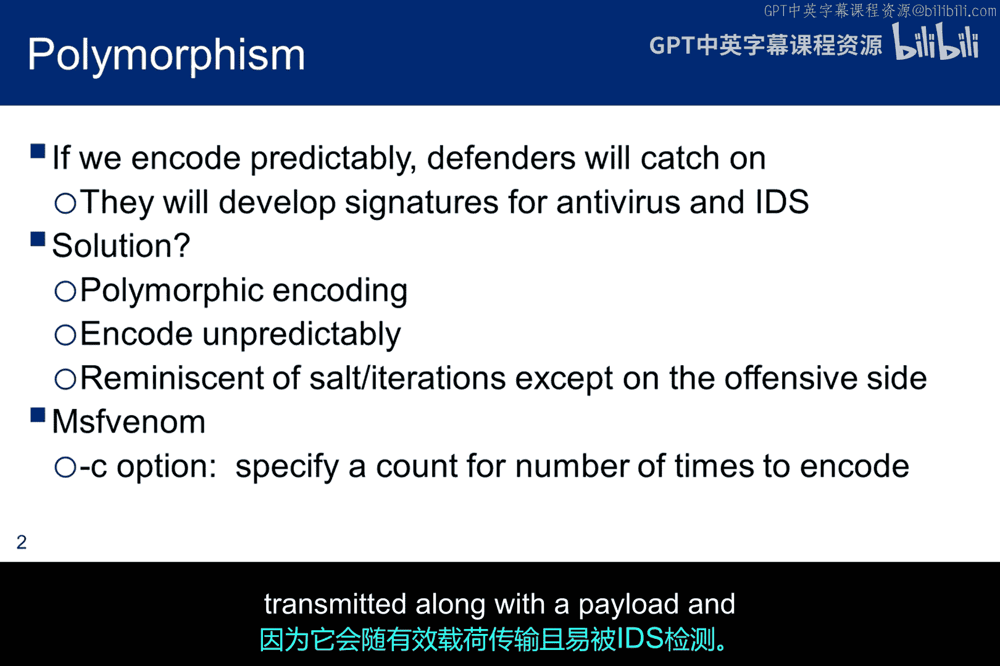
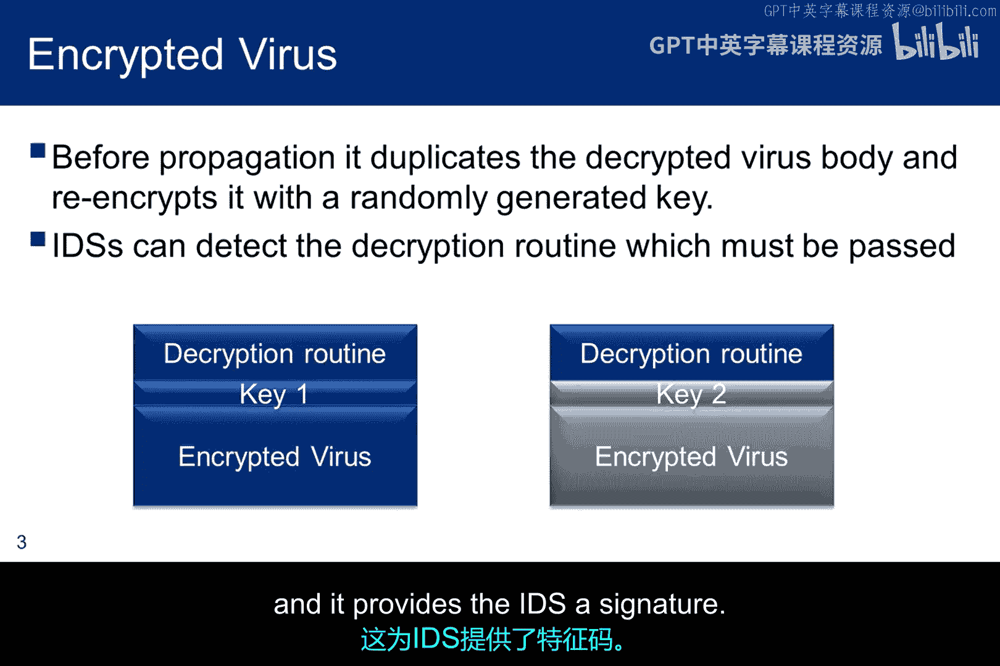
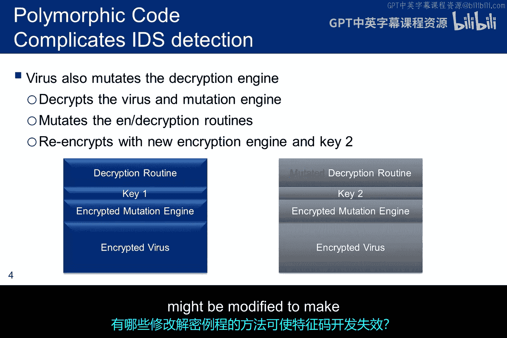
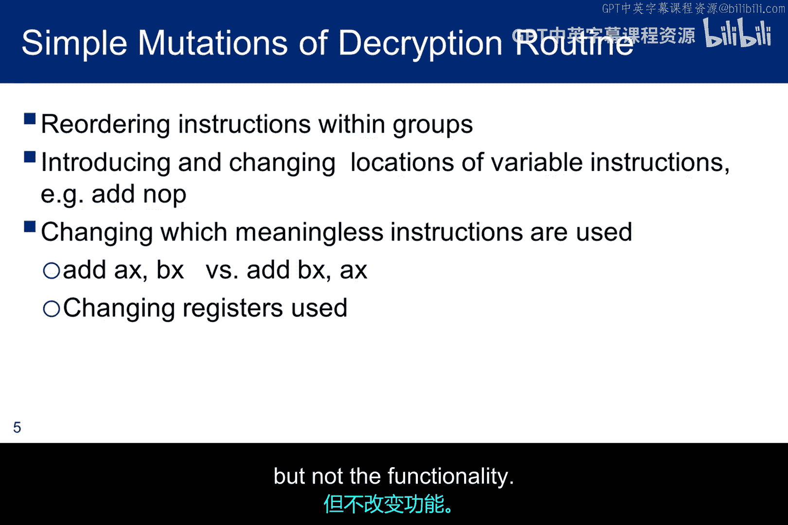
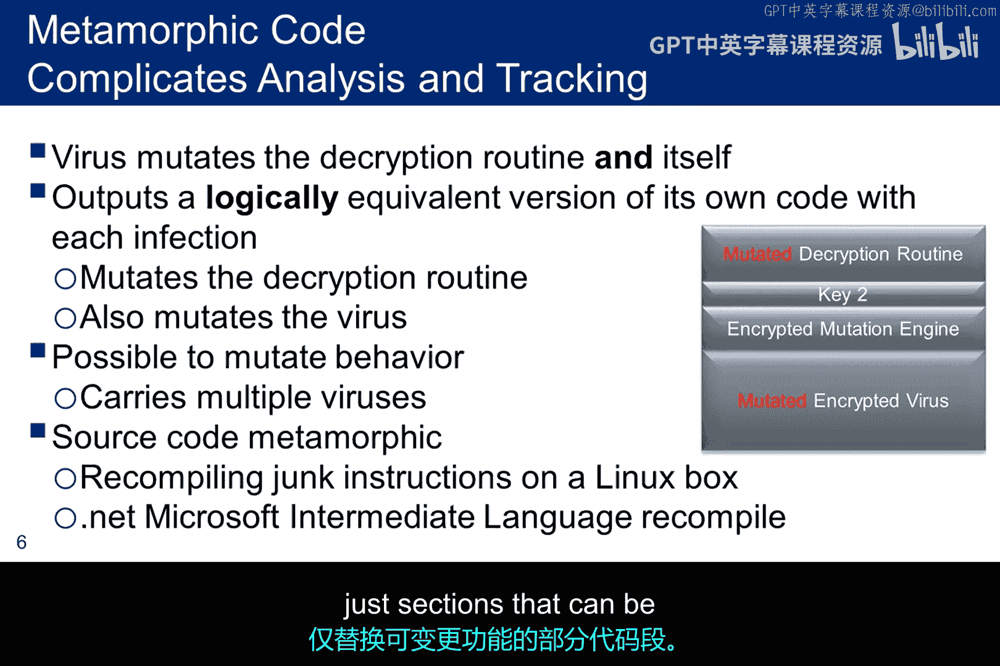
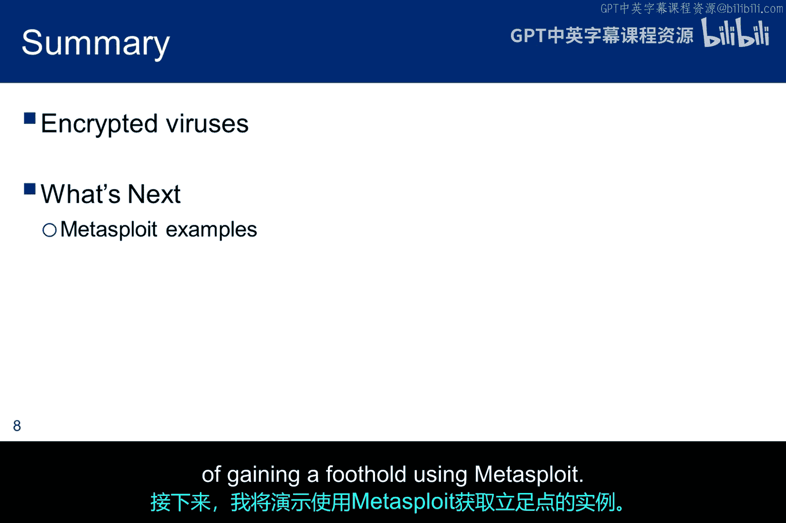

# 约翰霍普金斯大学《道德黑客入门｜Introduction to Ethical Hacking》中英字幕 p38 16_多态变形代码.zh_en -BV1xgu1z1Eau_p38-

This module does not discuss ethical hacking tools， Rather。

 it looks at the structure of polymorphic and metamorphic viruses to give you a feeling for what you might have to consider when trying to avoid an I S or IPS S。

The key idea is to encode unpredictably。 That could involve changing the number of encodings with a tool like MF venom。

 But ultimately， the decoder has to be hidden since it will be transmitted along with a payload and is easy for an I D S to detect。

This shows two copies of the same virus。 The one on the left is encrypted with key1。

 and the one on the right is encrypted with key2。 So each time the virus propagates。

 it changes itself。 So trying to create a signature of the virus is ineffective， but in both cases。

 the decryption routine is unchanged， and it provides the I S a signature。

This shows two copies of the same virus， but it is called polymorphic and completely changes all of the content when it propagates。

 including the decoder。 The idea here is to add a mutation engine to the virus and the function of the mutation engine is to modify the decryption routine。

 when the virus on the left propagates， it uses key1 to decrypt both the mutation engine and the virus。

 The mutation engine runs on the decryption routine to change it in a way that the binary is different。

 even though the decryption function is unchanged。 A simple example might be the addition of noops to the binary。

 Then key2 is chosen， and the mutation engine and virus are reenrypted with the new encryption routine。

 The new key has changed the virus and the mutation engine has changed the decoder。

 So what are some of the ways the decryption routine might be modified。

To make developing a signature impossible， these are some mutation techniques。

 one approach is to reorder instructions or groups of instructions in a way that doesn't affect the calculations。

 One can also add instructions like no ops， move constants into registers that are not used in the program or add to registers。

 even though the result isn't used。 If registers A X and Bx are not used。

 you can also change the order of the addition to morph the code。

 These are just a few ideas and there are numerous other techniques。

 all of which change the content of the code， but not the functionality。

 Memorphic code takes this mutation idea up1 notch。 In this case。

 both the decryption routine and the virus are modified。

 So the result is that in addition to circumventing the ideas， virus changes。

 keeping the virus logically equivalent， but changing its form。

sForensics and any attempt to track the virus。 In addition to the idea mentioned previously。

 we also have the concept of source code metamorphic。

 This involves the inclusion of the source code in the payload and recompiling on the target。

 It is possible to do this。 by using a compiler typically found on a Linux box。 For example。

 the new C compiler。On a windows box where a C compiler is less likely to be found。

 it is possible to leverage the dotnet framework to compile Microsoft Inter language code。 Finally。

 the metamorphic component might modify the behavior of the virus。 so that the effect is different。

 In this case， the malicious package actually contains multiple viruses。

 and the mutation engine switches among versions。 It may not duplicate the entire virus。

 Just sections that can be switched out to change the functionality。

Here are a few other ideas for creating a logically equivalent metamorphic virus。

 Sping registers was mentioned earlier， but if the I S has a good hex scanner。

 it is possible to detect those types of changes。 If the virus has multiple modules。

 it is possible to simply switch the order。 since they are typically called by symbol。

 If you have 10 modules。 There are 10 factorial permutations that would change the form of the virus。

 before data execution prevention。 It was possible to build the virus on the stack on the fly。

But that technique is less effective now， and the simple techniques。

 like changing the definition of a constant， applied to the polymorphic code as well。

We have discussed encrypted viruses， which you can think of as being an encoded payload。

 That is as much a tool for an ethical hacker as for a malicious hacker。 Next。

 I want to work through an example of gaining a foothold using metapo。

