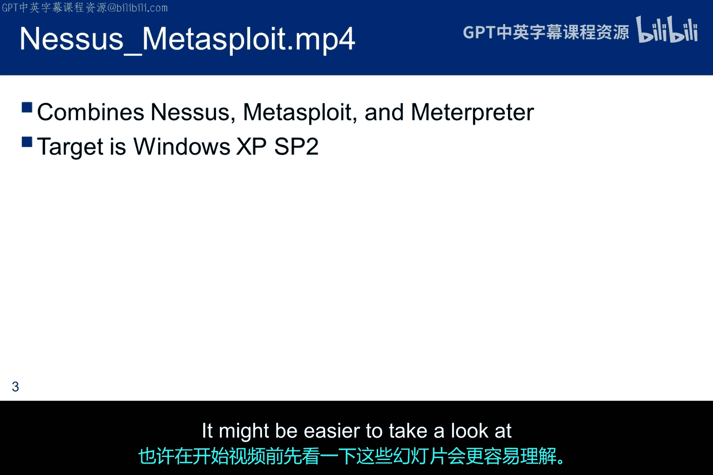
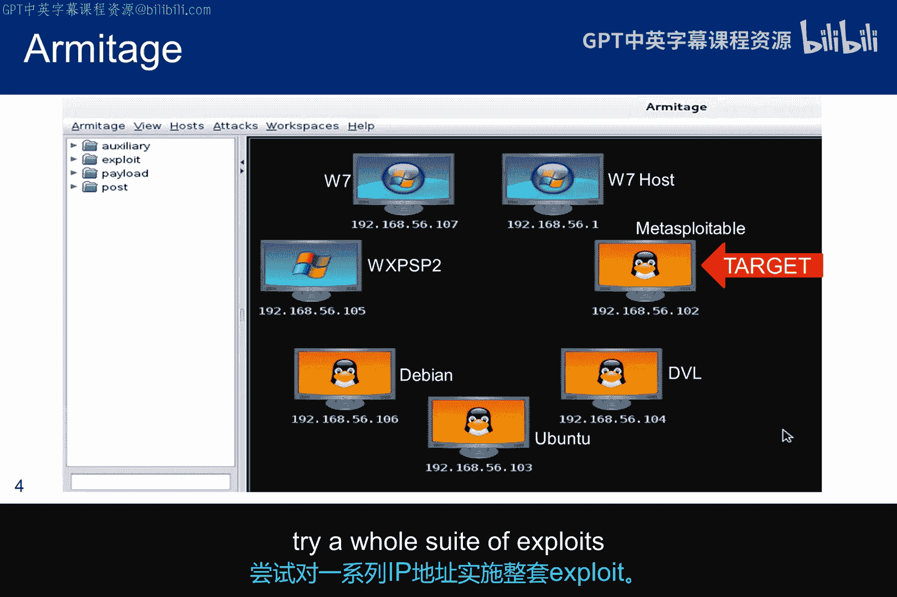
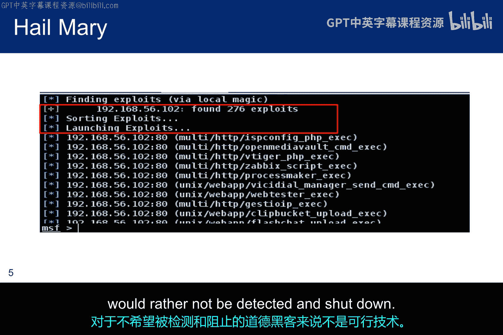
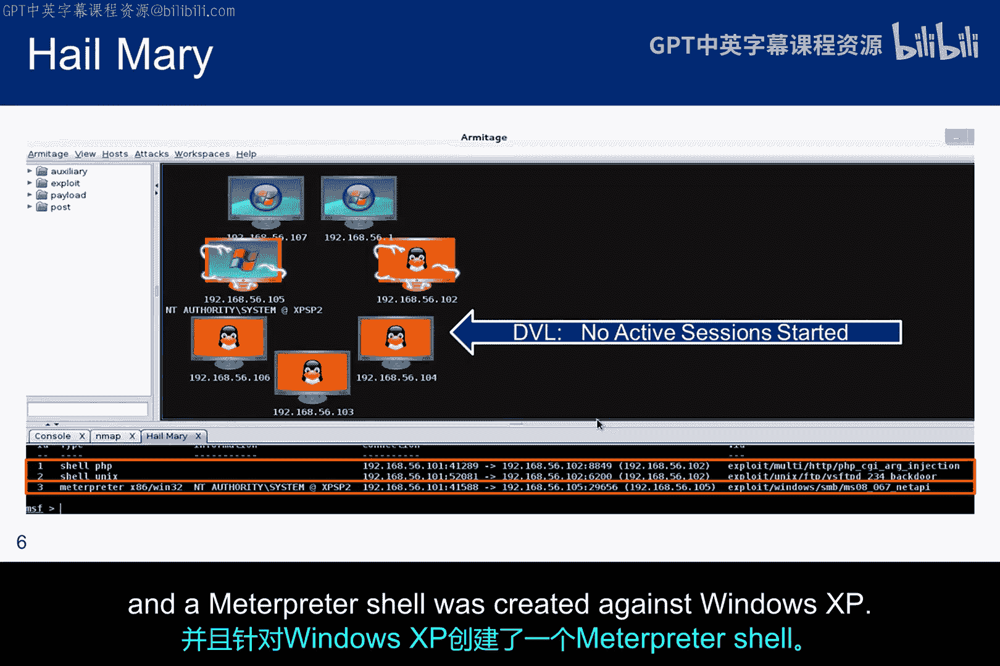
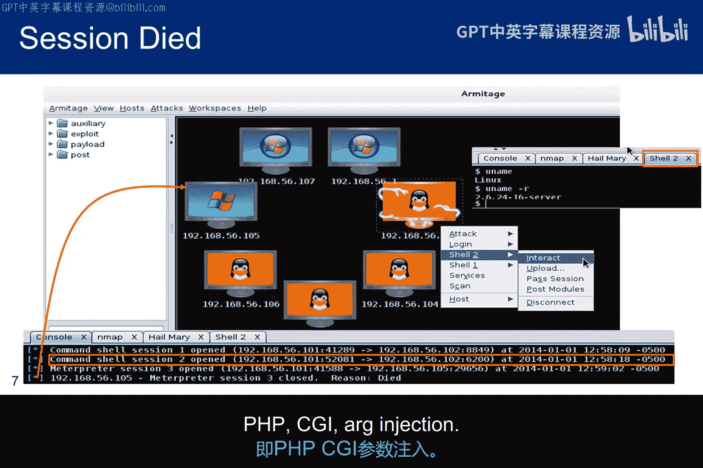
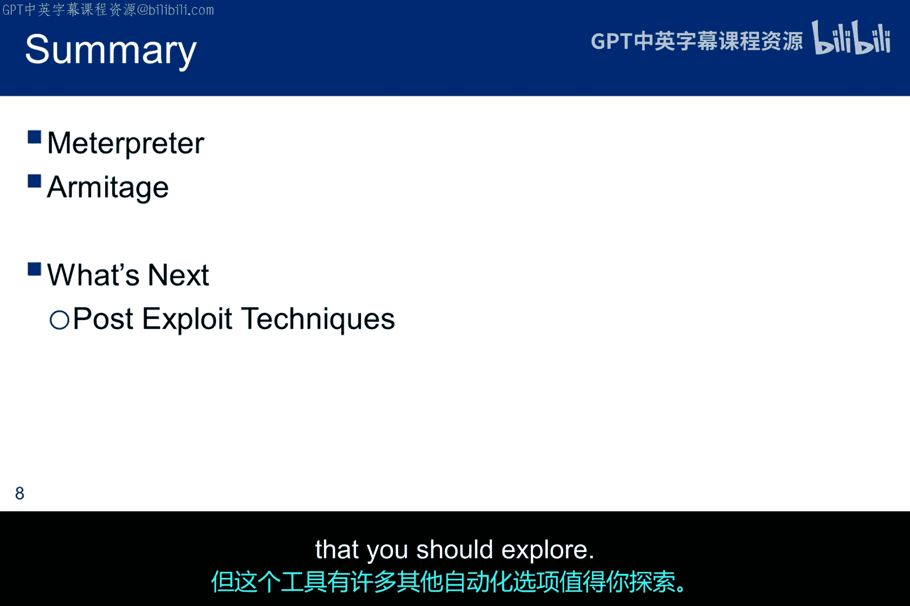

# 约翰霍普金斯大学《道德黑客入门｜Introduction to Ethical Hacking》中英字幕 p40 18_Meterpreter演示与Armitage工具.zh_en -BV1xgu1z1Eau_p40-

If you didn't look at the demo video when suggested in the scanning module， you want to do so Now。

 Meplit is run against Windows X P， which is deprecated now， but nevertheless。

 it opens a interpreter shell and shows much of the functionality available via interpreter。

You saw this slide earlier， but I wanted to remind you that starting a interpreter session involves multiple phases。

 First， you have to get a foothold and send a payload that creates a reverse shell back to Cali。

 In the second phase， there are two steps。 The second half of the payload is a D L。 L injection。

 which accepts the transmission of a interpreter server。 Once the server is in place。

 the communications can begin。 As you watch the demo。

 keep track of each of the steps enacted by metaid。The demonstration video takes about 20 minutes。

 You can watch it as time permits， but I still have a few slides that provide screenshot for a tool called Aritage。

 It might be easier to take a look at them now， before starting the video。

The screenshot shown in the slide was taken when all of my Vms were on the same segment。

 and there was no firewall。 So it is a different configuration than you have in your ethicalical hacking environment。

 If you try to duplicate this， your results will differ unless you reconfigure。 In this case。

 the target is going to be metaable。 But D V L or damn vulnerable Linux。

 and the Windows X P or potential targets as well。 One feature of armitage is it will run a hail Mary and try a whole suite of exploits against a range of I P addresses。

This screen shot shows that the Hail Mary threw 276 exploits at the target I P addresses。

 that is going to be very noisy and not a viable technique for an ethical hacker who would rather not be detected and shut down。

This screen shot shows two VMs were compromised， but not damn V Linux。

 probably because it is a different kind of learning tool。 At the bottom。

 you see in red boxes that two shells using two different exploits were started against metapltable and a mettroter shell was created against Windows X P。

This screen shot shows the meter shell to X P2 died quickly after being established。

 but the metaable shells are still active， and right clicking presents a menu for interacting with a shell。

 in this case， shell 2。 Unfortunately， if you run Aritage against the Strad house network。

 including the Windows 7 Clan with the firewall up you won't get any sessions。

 If you drop the firewall。 You should get a session on metaitable using the same exploit you will use in the lab。

 P H P CG I Arg injection。

If you haven't watched the Matpreter demo， don't forget to do that。

 Even though the target is Windows X P， it shows some pretty interesting Matpreter functionality。

Armage is more of an automated exploit tool。 The Hail Mary attack is far too noisy for anyone one。

 except maybe script kitties， but the tool has many other automated options that you should explore。

