# 约翰霍普金斯大学《道德黑客入门｜Introduction to Ethical Hacking》中英字幕 p41 19_Web应用渗透.zh_en -BV1xgu1z1Eau_p41-

Mutilideday is a free open source web application that supports experimentation with penetration testing in hacking web applications。

 The current version of mutilude code named No Wasp Muilday versionion 2 dot X。

 was developed by Jeremy Drin A K， A weaponized。 versionion 2 dot X is based on Igrrian Iron Geek Crenshaw's Muilude project。

 which is now referred to as Muilday1 dot X or Muilday classicic。

It is still available on sourceforge alongside the current project。

A new version of mutilda2 dot X comes with metaplable， although it is not the most recent version。

 this modules lab will discuss options for updating mutility in metaplable。

 The website you'd see on the screen ion Greek dot com is maintained by Adrian and has lots of information about computer security。

 It is worth browsing。 The specific links shown on the slide has a set of videos from a penetration testing workshop based on mutil day。

 Much of the material in the lab associated with this module was extracted from these videos。

 If points in the lab are confusing to you。 Some of these videos may help clarify points of confusion。

There are also many aspects of mutility that will not be covered in this module。

 nor in this class that you may want to explore on your own。

Adrian Crenshaw's information security material is used by several universities in their cybersecurity programs。

 and Jeremy Din as a professional web penetration tester。

Returning to our ethical hacking methodology， Web exploitation skips the scanning phase。

 I have taken this approach because I want to keep the scanning and network exploitation lectures close together。

 And at the end of the Web exploitation lecture， I will discuss Web app scanners to realign us with the abstracted methodology。

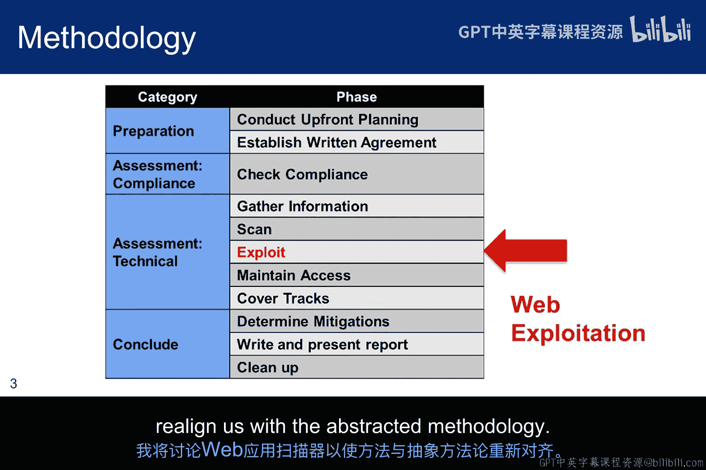

The Oosp top 10 is a list of important web vulnerabilities developed by subject matter experts。

 You can see the 2010 and 2013 lists differ， and a new list for 2017 has recently been released for public comment。

The colors here identify the differences in the lists。

 That suggests three vulnerabilities have been dropped， and three have been added。

 but it is really only two since missing function level access control actually contains failure to restrict U access。

 We are only going to explore three of these vulnerabilities as highlighted in red boxes。

 you can see they are on both the old and the new list indicating they remain important attack vectors that we need to understand so that as ethical hackers。

 we can exploit them and as defenders protect our cyber infrastructures from them。

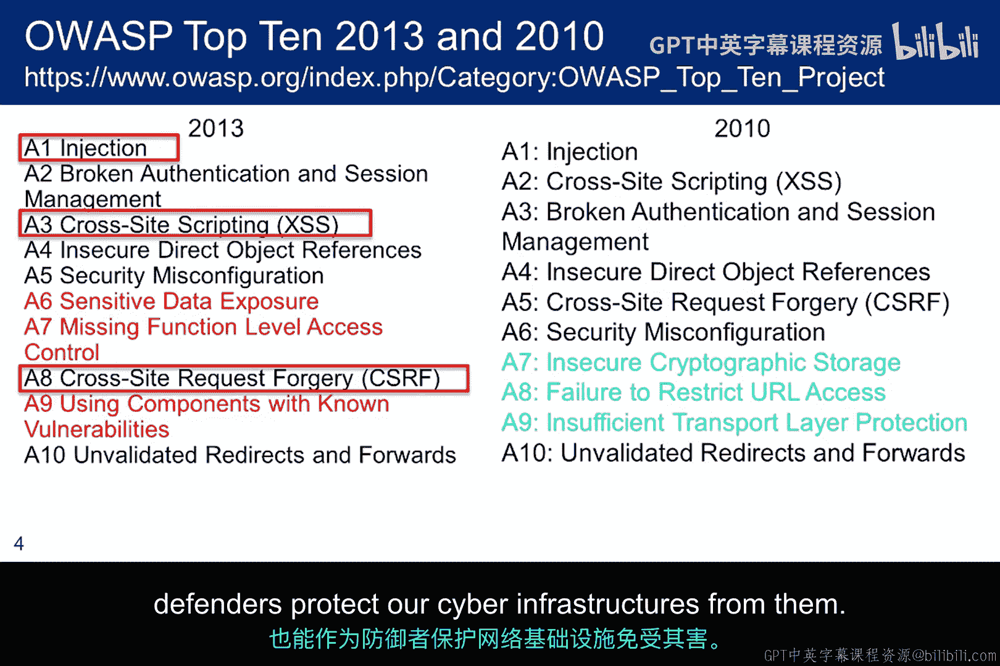

Open web application security project or Oosp is a nonprofit focused on improving software security。

 There are several different projects being studied within Oossp， but the Oos top 10 is well known。

 It been around for 10 years or so and is updated periodically。

 It represents a broad consensus in the Web security community about what the most critical web application security flaws are。

 The list you see here is Oos top 10 from 2010， and updated Oos list came out in 2013 and is supported by the current version of mut。

 but metapltable2 comes with an older version of mut version 21 19。

 So we're going to stick with that for the technical reasons。

 The topics we will cover are on both Oosp lists 2010 and 2013。

 but if you want to maintain a state of the art penest environment。

 you will want to go with the latest version if it works in your environment。

 I experienced some technical。Problems with the latest version。

 and that problem has been listed as a source forge bug since January 2014。

 The bug does not affect all configurations， So the latest version may work in your environment in the lab and will give you some guidelines for how to check it out。

 Please let me know if you get the current version to work with a virtual network。

 Here is a brief reminder of how a web browser interacts with a web server。

 The browser sends an H TTP request to the Web server and the Web server returns a file。

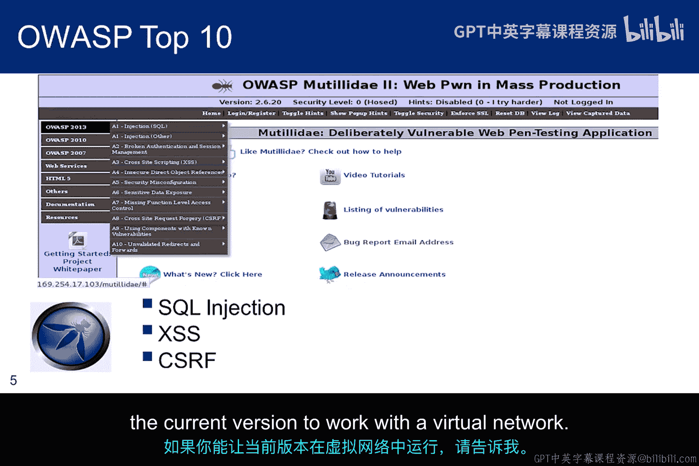

In the old days， a web server would generate and return a static H M L page。 Web 2。

0 and AJx has changed that Today， the Ph P content that is returned by the Web server is generated dynamically。

 In fact， there may also be code on the web page that's not even rendered by the browser at all。

 asynchronous updates to the web page are managed by interactions between this code and the web server and may involve no interaction on part of the user。

 This dynamic component is where some of the vulnerabilities lie that we are going to explore。

 Another important idea shown on this slide is that the Web server acts as an isolation mechanism for the database。

 because all the requests go through the Web server。 In fact， some naive administrators think。

 the Web server protects the database。 we will see in this module that is not the case。

 While the Web server proxies everything going to the database。

 In into careless web server code can not only。A database， but also provide other attack vectors。

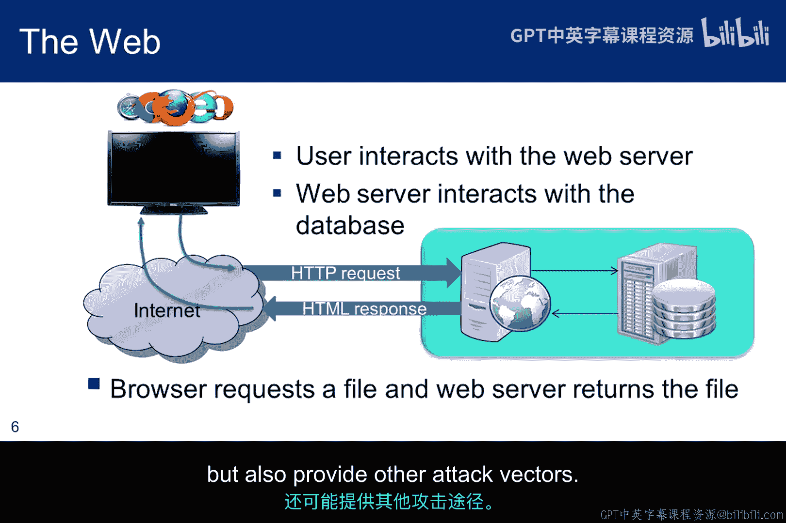

A proxy is an application that acts as an intermediary processing requests from clients who are requesting resources from servers。

 The fact that the proxy is in the middle processing these requests means the processing can be temporarily halted。

 In our case， we are interested in in proxy between the browser and the Web server installed on the same machine as the browser。

 The outgoing H T TP and incoming Hm messages can both be captured。

 reviewed and modified before they are forwarded。 One of the proxies that comes installed in Cali is Bpsuite。

 Another is Webcar。 Bpsuitite is nice because it provides a whole suite of tools useful for penetration testing a web server。

 It is very useful for identifying injection points。

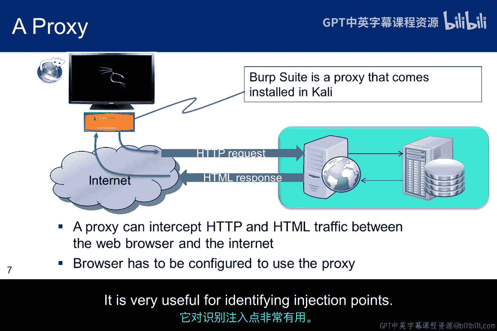

Since databases on the Internet are installed behind web servers and since access to the databases only allowed by the Web server itself。

 some website managers naively believe that the database is safe。 Of course。

 we know there is always the inside or a attack threat but putting that aside this module will discuss some techniques referred to as SQL injection that may allow us to indirectly gain a significant amount of information from the database。

 In this context indirectly means we go through the Web server and trick it into passing along requests that help map the database。

 The idea of SQL injection is that the information passed to the web server from the browser is not what the programmer anticipate。

 If the Web programmer has failed to filter the expected input。

 The SQL query forwarded on to the database may be modified via what is input into the browser and may perform unanticipated actions。

It may provide enough information that it creates an attack vector into the database。

Before discussing a SQL injection example， I want to refresh your memory on how SQL works。

 In this case， we have a simple table called users， and it has four columns， I D name。

 password and signature。 there are only three rows in this simple table。

 but that is enough to explain the SQL statement at the bottom。 before doing that。 However。

 I want to point out that the password is stored in the clear and not hash a serious security mistake。

 The SQL query will return monkey。 Blue text represents the SQL commands。

 black represents the column names in the table。 gray represents the table name and red represents the selection criteria。

 So this statement says look at the table named users and find the signature from the row。

 When the name equals admin and password equals admin pass。

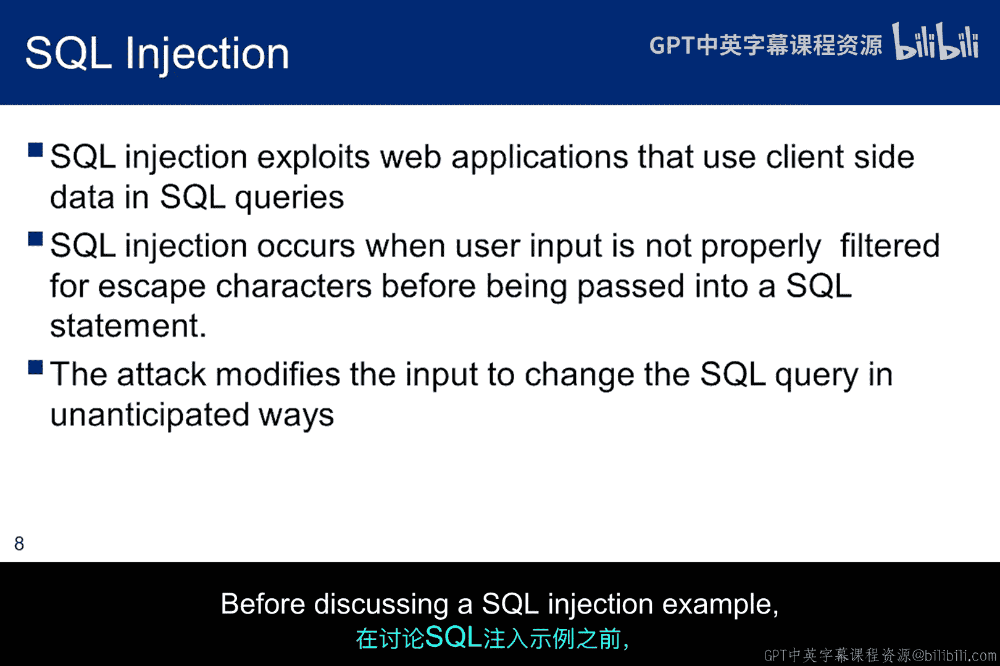

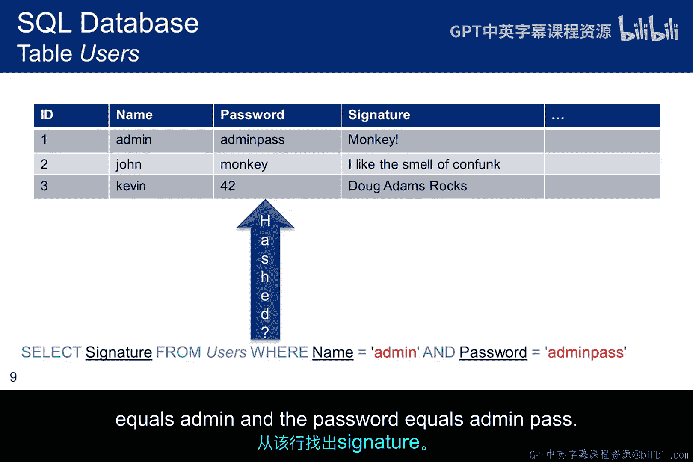

Here is a simple animation of how SQL injection works。 First， we see a normal query。

The information input in the browser is what the programmer anticipated。

 It is parsed by the Web server， and the resulting SQL query is forwarded。

 asking the database to return a specific user when the password entered is associated with that user in the user table。

 This kind of selection statement might be used in a procedure that is authenticated in the user on login when the name and password are entered in a form。

Of course， the password passed will be a hash if the password entered to protect it in transit。

The second query is an injection in which the name entered is not what the programmer anticipated。

 Rather， it is an unusual string of characters that， if not filtered。

 will be passed onto the database as if it were a name。 We will discuss this in some detail later。

 But when that happens， the database may log in an unauthorized user or return information that isn't with the programmer anticipated。

 In this case， the target of the attack as the database。

 In the Web server provides the attack vector。

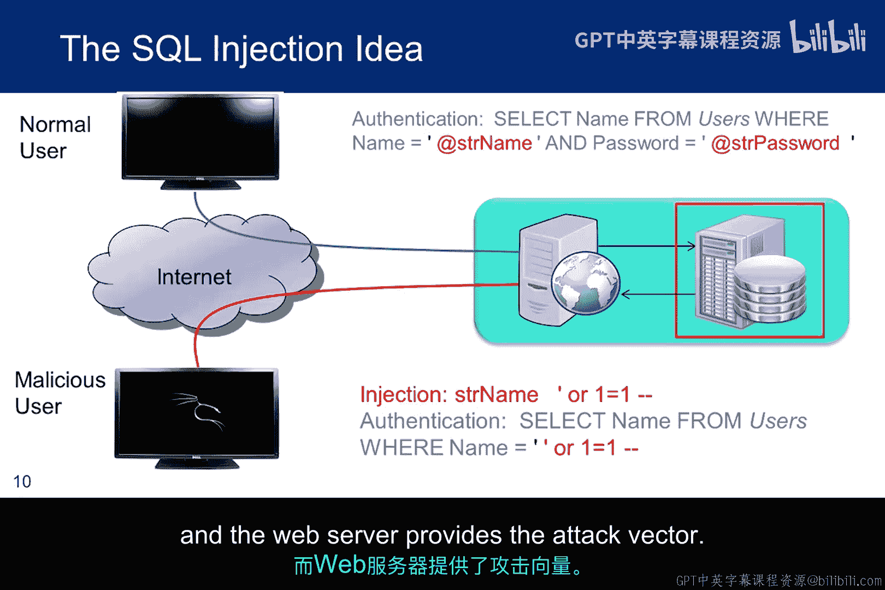

The second weakness we will explore is cross height scripting。 The idea of X。

 S S is to get a browser to unknowingly execute some malicious script。As shown in this list。

 a malicious script can accomplish many different objectives。

 We will eventually explore the first and the second items on the list。

 stealing a session cookie while a session is active which allows us to hijack the session and keep it live。

 even after the authorized user has logged off。 we won't explore the others on the list。

 but we see frequent newspaper articles describing some of the others。 And a reminder。

 most of us allow jascript to run automatically。 In fact， for Mozilla。

 you have to install an ad on to have some control of jascript。

 And even when running jascript to set to prompt mode。

 it isn't always easy to decide whether you should let it run or not。

 How do you decide if it is malicious。😊，This means if you go to a website that has been poisoned without taking any action。

 the script is going to run。

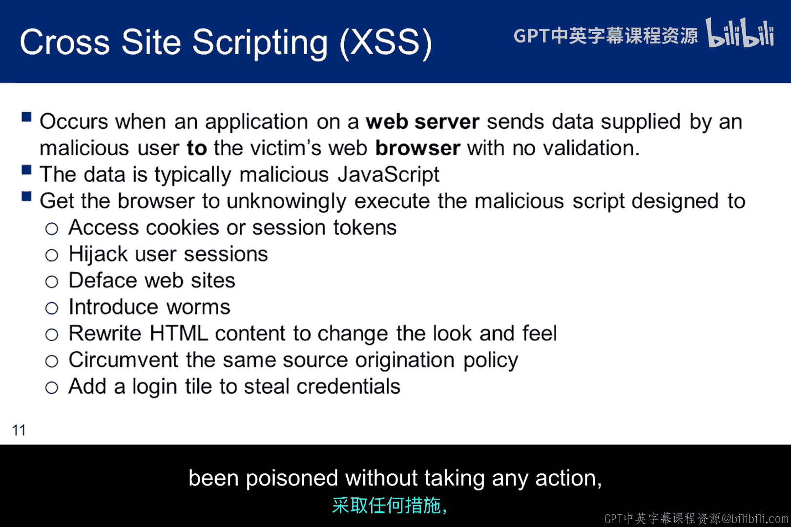

There are three well known excessS S attacks， reflected， Dom injection and stored。

In reflected attacks， the injected script is reflected off the Web server。

What is reflected might be an error message or a search result。

 But what is key is that it includes some script that was originally sent to the server by the browser as part of the request。

One obvious question is， how does the malicious script get into the victim's request。

 They are usually delivered to the victim via a secondary route。

 something like an email message or some interaction with a link on a different malicious website。

 When a user is tricked into clicking on a malicious linknk。 a specially crafted post or ga。

 It submitted。 It contains injected code that travels to the vulnerable website which reflects the attack back to the user's browser。

The browser then executes the code because it came from a trusted server that we intentionally navigated to in stored attacks。

 malicious scripts are stored often in a database， and it is returned to a victim when requesting information from the database。

The X， S， S lab will spend a significant amount of time on this attack。

 Dom injection is really a client side attack。 The server is not returning executable jascript to the browser。

 Instead， data that has been sanitized by the server or possibly never sent to the server。

 for example， it is passed by email， is converted to executable jascript by the existing code running on the page。

 an attack payload is executed as a result of modifying the Dom environment in the victim's browser so that the legitimate client side code runs in an unexpected manner。

 The page itself does not change， but the client side code contained in the page executes differently due to the malicious modifications。

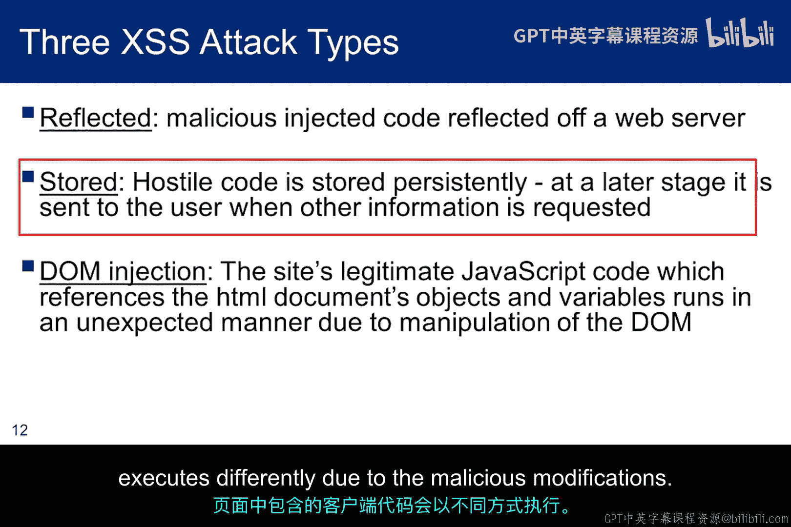

Poisoning the blog means poisoning the database。 The first step in poisoning the blog of a vulnerable web app is to include a malicious script when the blog entry is posted。

 This will get stored in the database。 And if the Web app is vulnerable。

 it will run the script instead of displaying it。 Once the blog is poisoned and innocent user visits and views the blog。

 When that happens， the script is returned with the blog entry。 but it isn't displayed for the user。

 The user can even tell it's there。 The browser simply executes a script because of the way the vulnerable web app has pared the script into the Hm。

 Once the script executes the attack is successful。

 and the action performed by the script takes place。 The victim may or may not post a blog entry。

 But for sure， he has become a victim。The target， in this case is the browser。

 The goal is to get the browser to execute malicious script。

 And the reason it works is because the browser trusts the Web server。

 Crossite request forgery is the third type of Web app vulnerability we will explore。

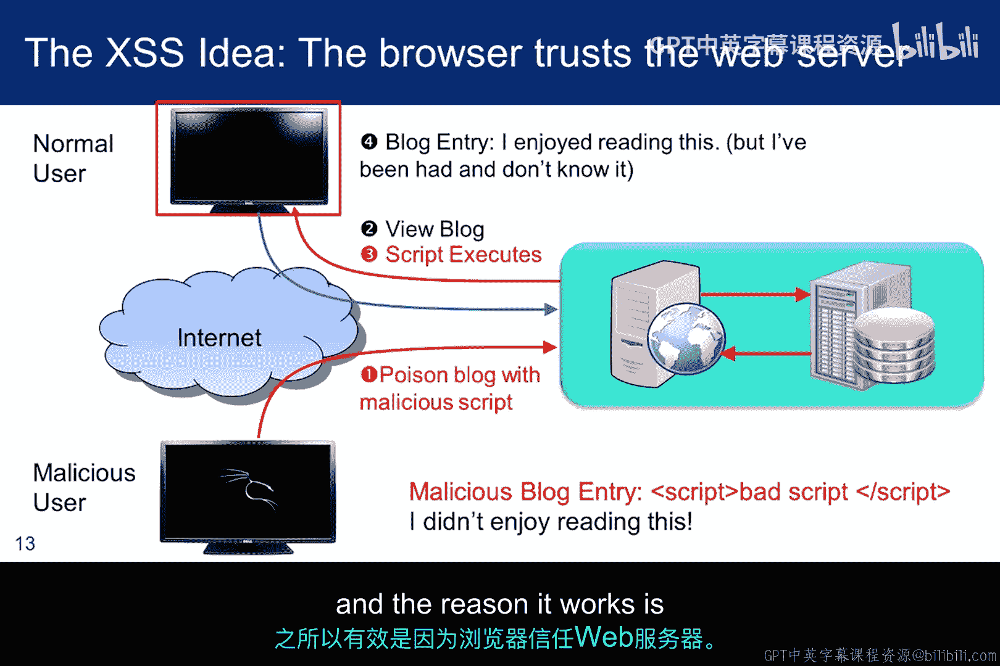

The idea is to leverage the fact that once a user authenticates to an application。

 a session token is used for subsequent transactions。

 So the attack is to force a browser to attach a valid token to a forged transaction that performs an action the user doesn't know about and didn't intend to perform。

This is often explained in text books with the funds's transfer example。

 A forged transfer request gets secretly sent to the bank by simply attaching the session token since the victim is already logged in。

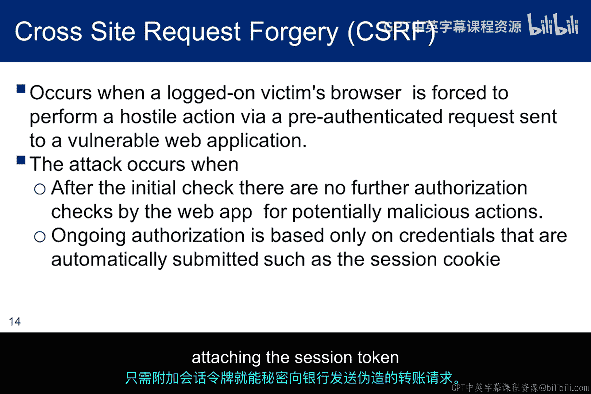

In X， S S， the attack was successful because the browser trusted the Web server。

 This attack will be facilitated because the Web server trusts the browser。

 The attack goes like this。 First， a browser logs into the application and receives a session token。

Whenever a valid transaction is sent to the application， a cookie is attached。

 The application checks the cookie， sees it as valid and completes the transaction。 Now。

 a malicious user is able to forge a transaction。 For example。

 if both a victim and the attacker have accounts from the same bank。

 The attacker can capture some of his own web transaction and use the detail to forge a transaction that will transfer funds from the victim to the attacker。

He then sends the forgery to the victim's browser and gets the browser to send it along to the Web application with the session cookie attached。

In this case， the target is the Web application that trusts that an authorized browser wouldn't perform unintended transactions。

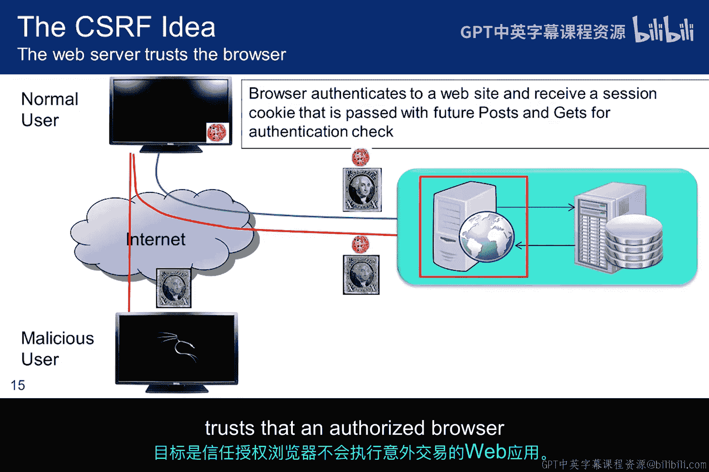

CSRF tokens are an important approach to mitigating CSRF attacks。

 The idea is for the Web app running on the server to provide a CSRF token as a server signature on the form that the user is viewing。

It is usually hidden on the page somewhere When the user fills out the form and presses submit。

 the token gets read off the page and is returned to the server。

This allows the server to verify the token is the same， and that the input came from that form。

 In other words， it wasn't filled out by a rogue jascript on the user's behalf。

 as a rogue jascript would not have access to the current token on the Web app form。

A malicious attacker can collect a CS SRF token by visiting the site himself。

 but it will not match the one the user received when he logged in。

So this has been a notional level introduction to some critical Web vulnerabilities。

 One targets a back end database， one targets a web server， and one targets a user's browser。

 We will explore all of these in more detail。 A follow on PowerPoint lecture will explore SQL injection。

 and then you will be asked to attack the back end Mysql database via a vulnerable Web server mutilda in metaplable。

 too。There will be no additional lectures on X，SS or CSRF。

 but a detailed hacking lab will take you through the steps to successfully launch both types of attacks。

 And when you are finished， you will wonder if you should ever again view someone else's web log。

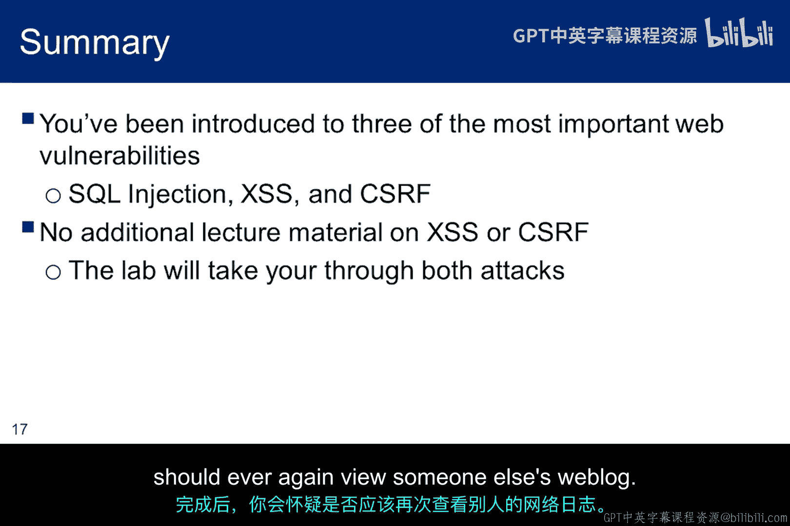