# 约翰霍普金斯大学《道德黑客入门｜Introduction to Ethical Hacking》中英字幕 p42 20_SQL注入攻击.zh_en -BV1xgu1z1Eau_p42-

Next， we will discuss sequL injection。 A reminder。 The techniques we will discuss in this lesson are illegal if you try them on a real website with a real database。

 you will probably be committing a felony。 Do not try these techniques outside of the ethical hacking environment you have created for this class。

 The only exception to this is if you have been hired as a penetration tester and have an agreement in writing that you have been hired to test a specific website。

As mentioned in the first lecture， SQL injection is used to gather information about a back end database。

 This is accomplished via a web server that does not adequately screen data being submitted by the user via forms presented to the user on the database access page。

The attacker's goal and our goal in the lab is to submit what appear to be valid and syntactically correct SQL requests to a database that the Web application programmer never intended to be submitted。

 What is returned is information about the database and sometimes information about the contents of the database。

 These kinds of attacks are often performed against E-commerce sites。

 where there is a web application providing the storefront and a back end database with lots of credit card numbers and P I I。

All of this information can be and is sold on illegal forums in which the buyers clandestinely acquire the information and use it to steal identities and make illegal financial transactions and purchases。

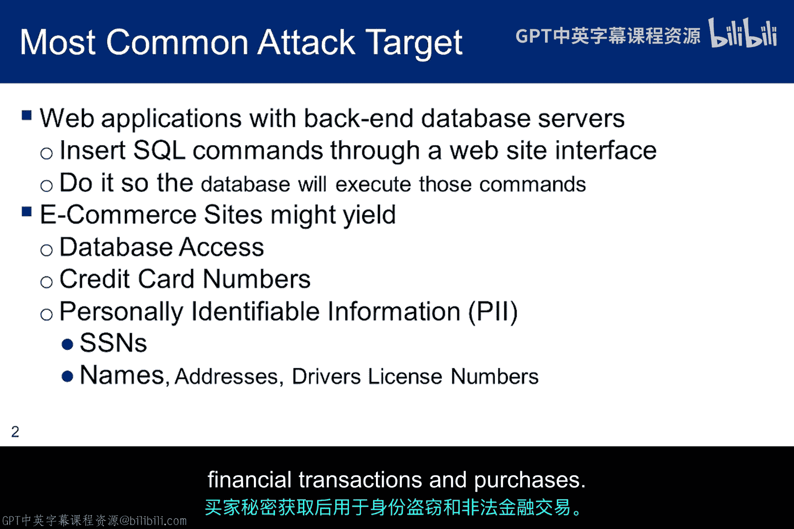

There are three strategies that are used to attack SQL based databases。

The first can be described as an attack on the query itself。

 The idea is to just submit some characters and see what happens。 Typically。

 this involves trying characters that are often used as delimiters in the SQL query。

 The database may respond to these characters。 We will discuss context a little later。

 But the idea is to understand and leverage the syntax of SQL queries in order to submit malicious but meaningful characters or strings of characters。

The second strategy is to use normal queries that can reveal information。

 You do this in a way that is not unusual， but by manipulating what you submit。

 you are able to parse information received to infer important details。

 An example would be the different ways you can assign a number to a row identifier that might get a different response from the database。

 For example， It could be an integer， a hex value， a mathematical expression。

 Even a SQL expression and so on。We will eventually discuss a topic known as blind sl injection。

One can argue this technique is also an example of leveraging the language。

 although it usually involves an attack on the logic query as well。

The third strategy is to take advantage of the logic of a SQL database to cause a database to return extra or different information than intended。

 This can be used to map the database。 The programmer never intended that this information be returned to the user。

 but weak or missing data filters in the web application allow it to be requested and passed back。

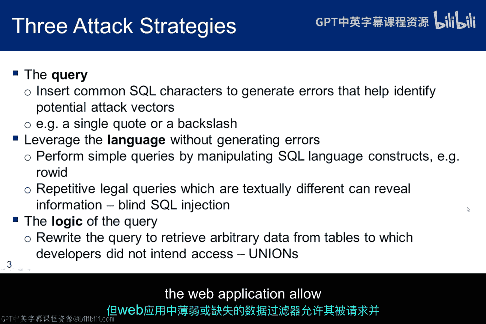

In this module， we aren't going to really address direct attacks on the database。

 but in the event you had direct access， you should try to use the default configuration information to see if any of the default I D password combinations work。

Here are a couple of default credentials， and the ports the databases are often listening on。

 There are many more credentials for a database like Oracle。

 This slide is simply a reminder that a direct attack may be an option。

Associated mitigation steps involve not using default passwords。

 Deleting unnecessary or unused accounts and changing the port。 Of course。

 modifying the port won't have much of an effect on a knowledgeable attacker。

 He will just do a scan of all the ports until he finds a database service listening。

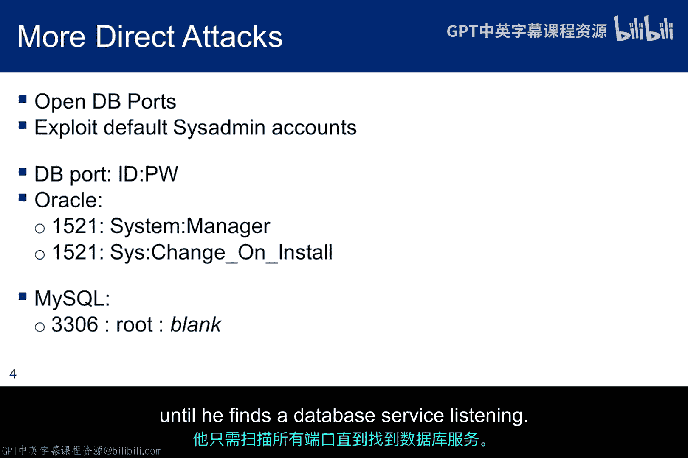

Here are four basic SQL commands out of potentially thousands。

 writing complex SQL code can be a very challenging task。

 even for an experienced database programmer。 If you were to become a database pen tester。

 you would want to learn much more about SQL。 But these commands show how to create a simple table and insert data into it。

 query the data in the table or delete the table。Notice that the create table is so simple。

 It doesn't even have key constraints。 It is just an example of a simple command that may be used in an interface exposed to users via a web server。

What is important here is to understand some of the simple concepts of sQL syntax so we can begin to understand how sQL injection takes advantage of it。

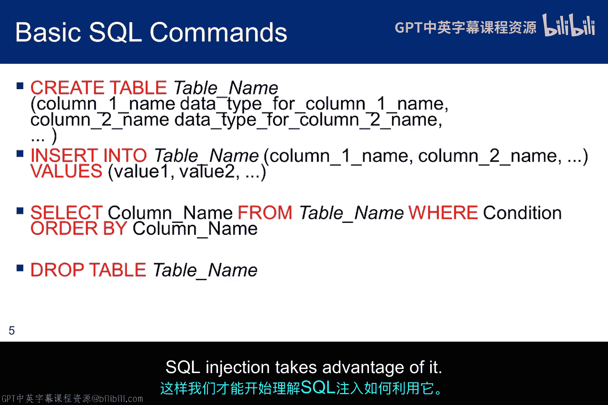

Here is an example of a very simple database log on process。

The form interface displayed to the user prompts the user for name and password。

The variables used for user input are denoted in red， in the queries shown。

After the user input is accepted， the web application inserts the information submitted into the procedure。

 and it is executed。 The query then runs through the user's table to see if there is a row。

 where the username and password in the row match those supplied by the user。 If such a row is found。

 the username is stored in the variable SR off check。

 which indicates that the user has been authenticated。

 If there is no row that the user supplied data matches。S chair Ocheck will simply be empty。

 and the user will not be authenticated。

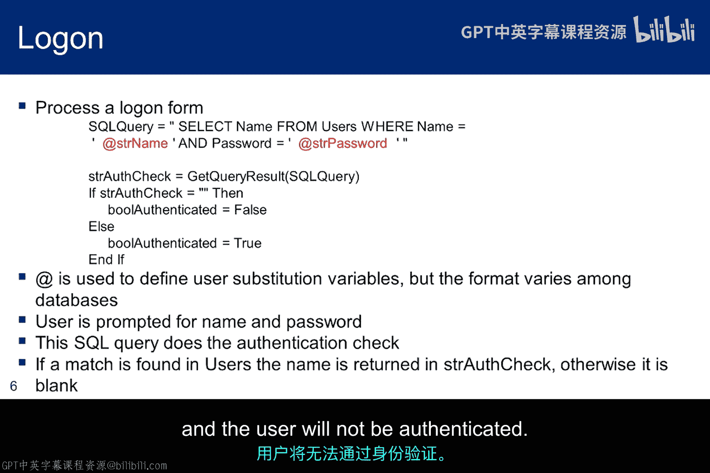

This is a classic sQL injection example。Notice that the first single quote from the injection in red。

Is paired with the first single quote of the query in black。

And the last quote of the injection in red is paired with the last single quote of the query in black。

 This example is beginning to demonstrate the idea of the context that the injection finds itself in。

 The injection has to maintain proper syntax。 In this case。

 you begin by closing out the first name comparison。

Then the last quote of the query provides a suffix for the injection。

 making it syntactically correct and completing the query。

 What happens is the first single quote closes the first check to see if name matches since indicates nothing。

 Not nu。 Na equals nothing will be evaluated as false。

 and the logic engine will move on to the second part of the expression to see if it is satisfied。

Since the last quote of the query closes the injection。

 the second comparison checks to see if nothing equals nothing， which will always evaluate the true。

Since the logical connector is an ore， the first part of the where statement will be satisfied on the first record in the user table。

 The same attack on the password causes the password check with the same injection to evaluate to true on the first record。

So the select will be satisfied on the first record in the table。

 and if this has been used as a log on procedure， you will be logged in as the first user in the table。

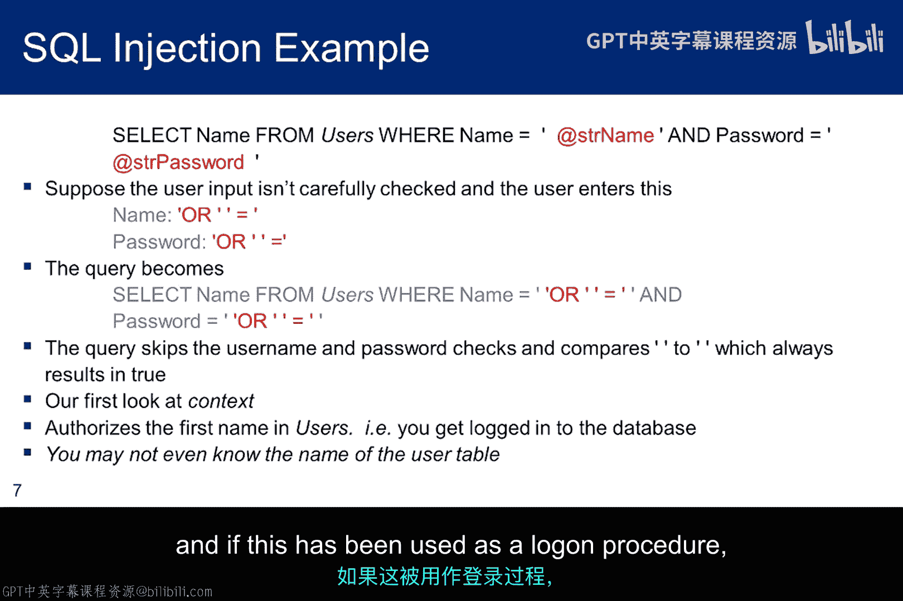

Here is another example。 After the injection is processed。

 the database engine will inspect the employee's table looking for a row where city is set to nothing。

 It will evaluate to false， and no records will be returned。 However。

 these records will be combined with what is returned from the second part of the injection。

That is what union means in Sequel。 Since nothing equals nothing will always evaluate to true。

 As with the previous injection， all the records in the table will be returned from the second select statement。

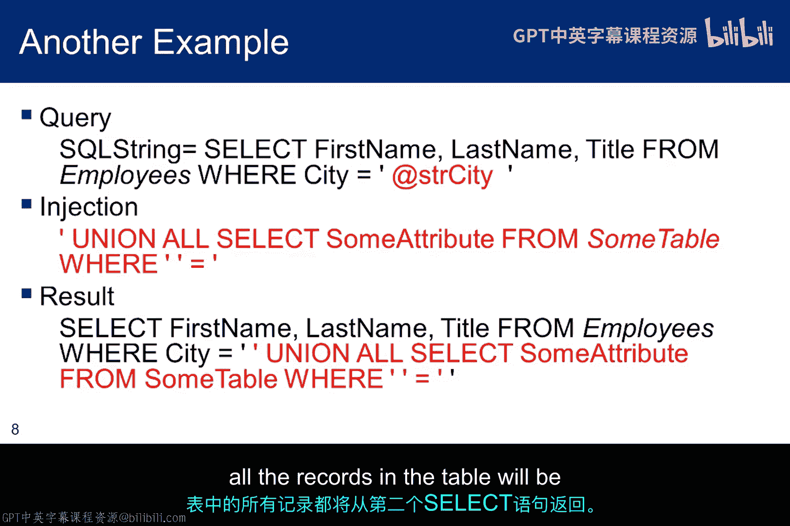

Here is a slightly different example with different context。

 The programmer's intent is that the variable will be an integer identifying the user for whom information will be returned。

The injection provides the expected integer， but follows it immediately with a second SQL statement。

 D table， which deletes the user's table， and the database becomes useless until it can be restored。

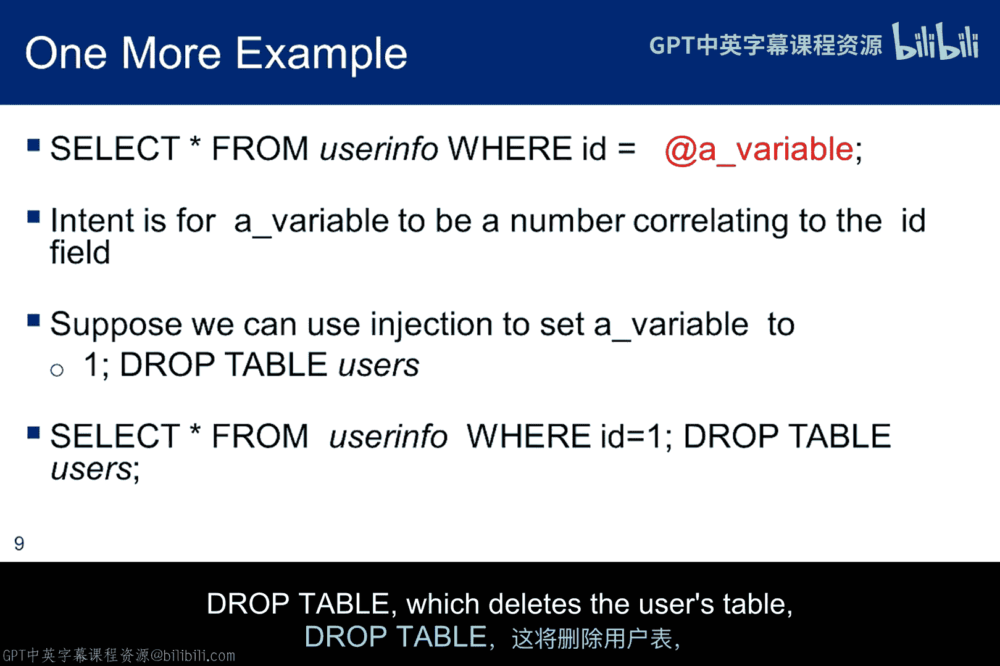

This slide shows one way of classifying SQL injection based on how data is transferred from the database to the attacker。

In band is considered the most common type of data transfer that attackers use to extract information。

 The information generated by the injection is presented back to the attacker on the web page。

 using a normal H M L return path out of band involves sending requests via the Web。

 but having information returned via other channels like email， SMTP or even DN S Cory's replies。

To learn more on this subject， Deffcon 15 from 2012 has a video titled SQL injection and out of band channeling Iferential or blindlind Ins used the normal in band channel for viewing the data。

 but the injections are not doing anything unusual。

 Information does not result from injections that create unintended queries。 Rather。

 inferences are based on queries combined in a very special manner that allows the attacker to draw inferences。

 blindlind SQL injection to be discussed later is one example in which the attacker uses what amounts to a character by character brute force attack on a user's name and password。

 Another example of a specific type of blind injection is a time and injection。

The idea is that the attacker is able to induce a delay in displaying pages for when condition。

 say true。And display the response faster for another condition。 Sa falses。

 This allows the attacker to draw inferences in mapping the database schema。

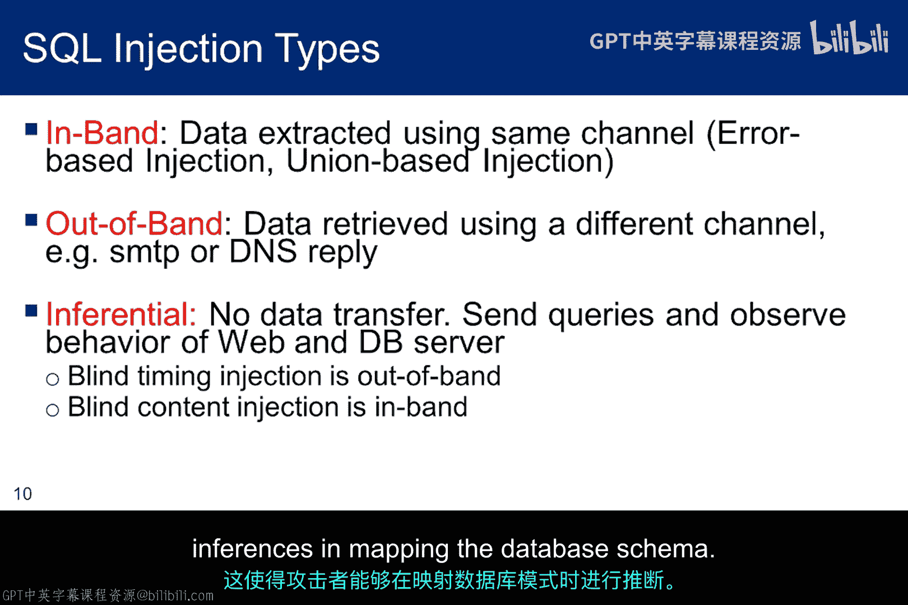

We've discussed Google hacking before。 It refers to using Google to gather information that assists and hacking attempts。

 Google has some advanced search capabilities that help us。 specifically。

 we can use Google directives to find specific database pages that meet certain criteria。

 For example， we can use Google to find database login pages。

Using the directive in URL R colon login PP will turn up vulnerable sites where the attacker can try simple injections to quickly determine if the site might be vulnerable to injection and whether he should spend more time investigating。

 In this case， Google gives us a login page， but no context。

 so we can start by trying both single quote and double quote to see if either will match the prefix or suffix of the query and cause the database to respond。

 The injections shown here are a slightly different approach than the or injections we tried previously。

 In this case， a single quote closes out the name comparison。

But the injection closes out the sQL context by using comment characters。

 So after the failed name comparison to nothing and successful one equals one comparison。

The common characters cause the rest of the sequel checks to be ignored。 By the way。

 for this to work in my sequel， you will need to enter a space， dash， dash space。

 When you are doing the lab， do not forget the final space。

 or you will get responses that don't seem to be working。

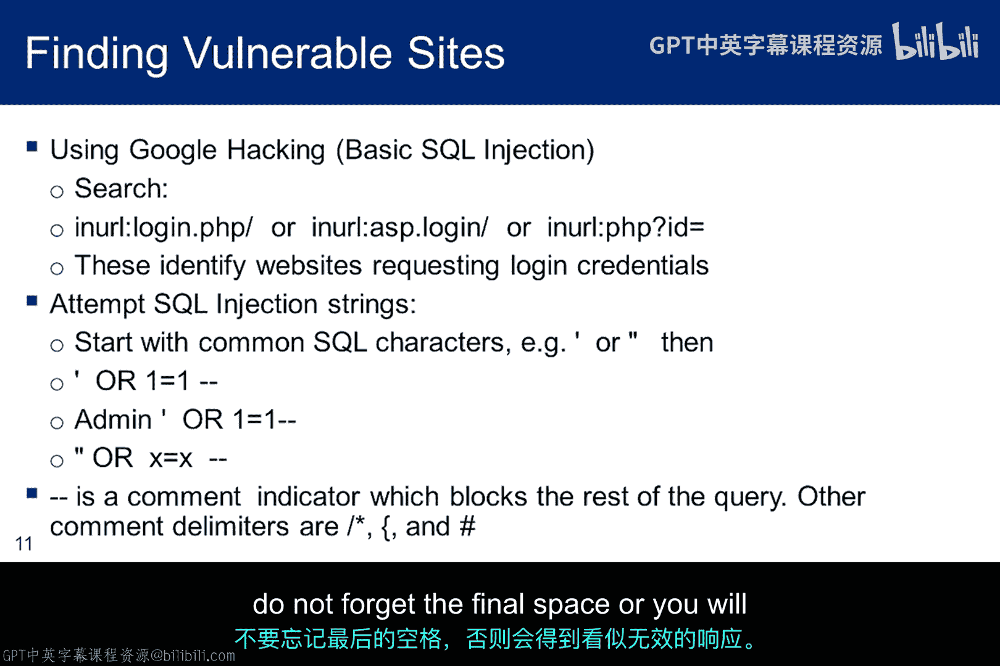

These are just some examples of other Google searches that might turn up a database that could be attacked。

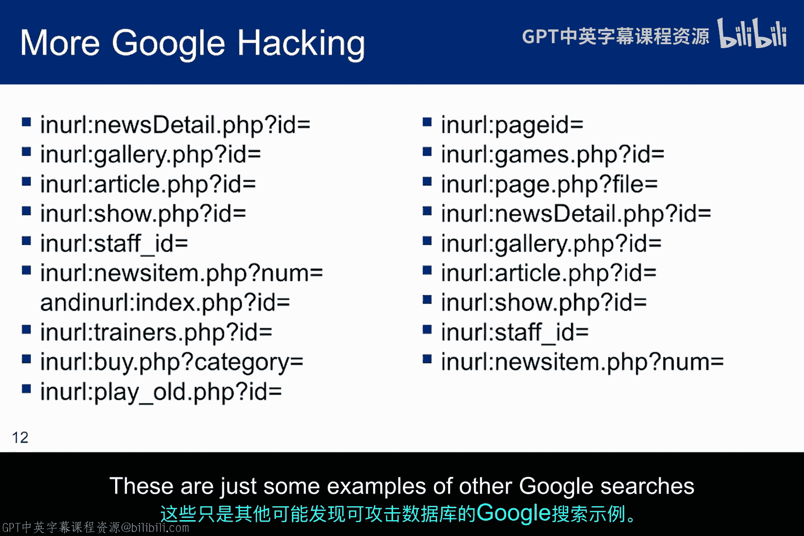

In summary， we've discussed some simple ore queries， a simple union query。

 and presented search strings that can be used to identify databases that may serve as potential targets。

Before we delve more deeply into SQL queries and mapping databases。

 we need to spend a little more time on SQL context。

 The next lecture will investigate where an injection will land when it gets parsed by the Web server。

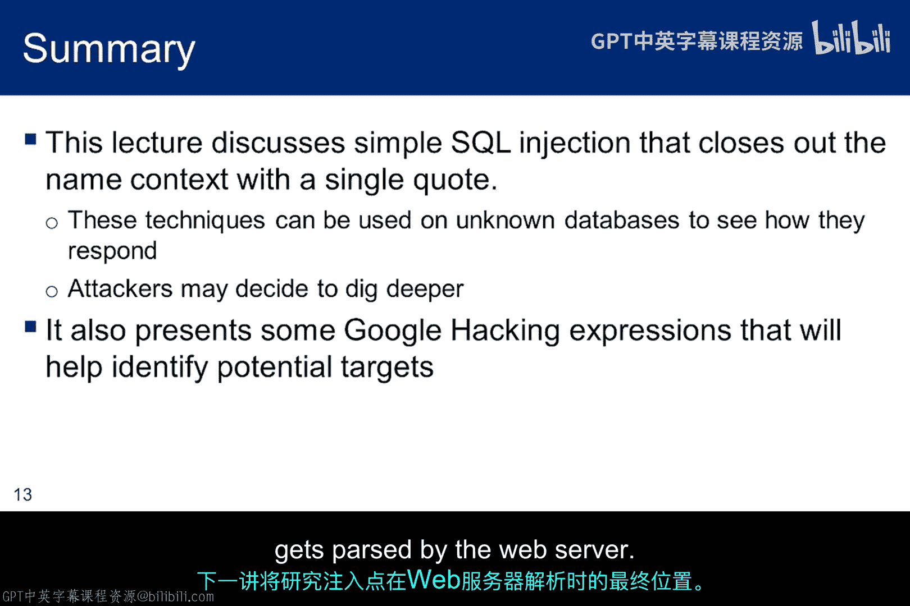