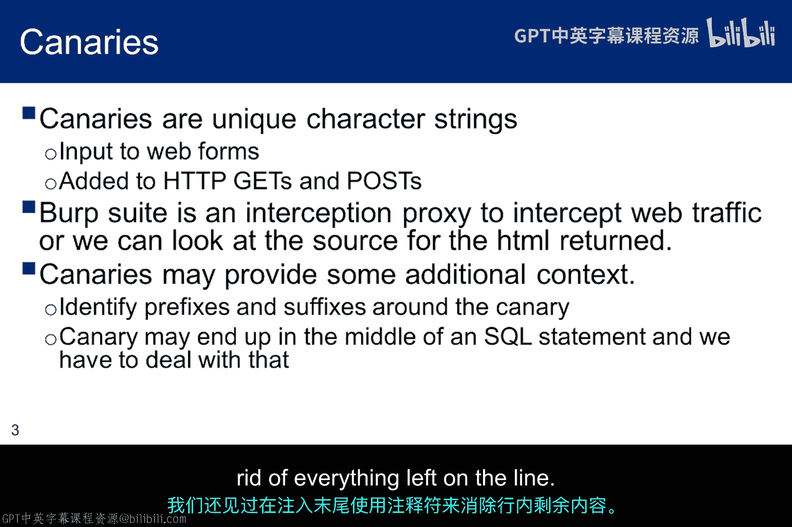
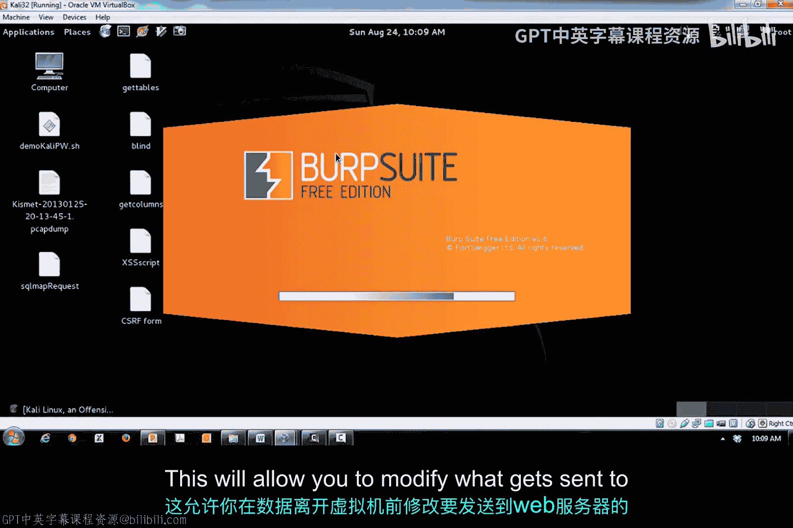
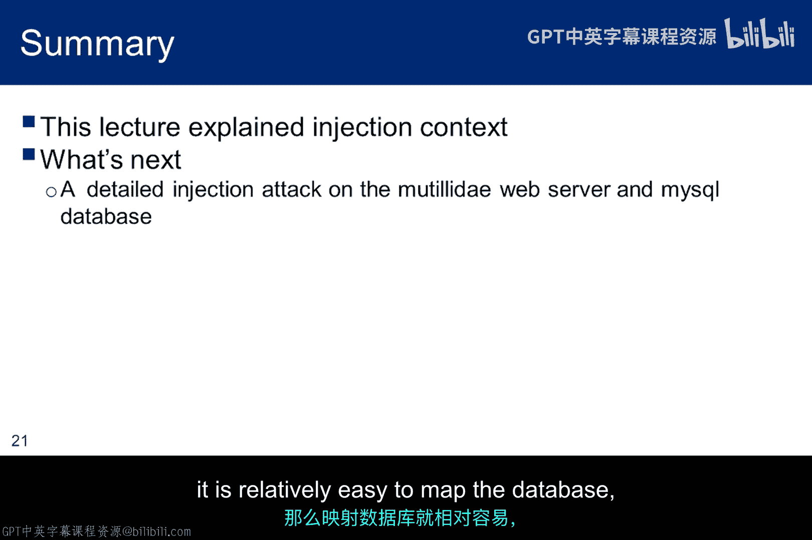

# 约翰霍普金斯大学《道德黑客入门｜Introduction to Ethical Hacking》中英字幕 p43 21_内容安全研究.zh_en -BV1xgu1z1Eau_p43-

In this video， we will discuss context。 This refers to the location where an injectional land when the Web app pares input from the user for SQL injection。

 knowing the eventual context will let us modify the injection in a way that makes the final sQL statement syntactically correct。

 yet still yields information not intended to be revealed by the programmer。

 We have no knowledge of the context when we start。

 but we've already seen that single quotes may close a comparison and allow an additional SQL clause to be executed。

 But if that doesn't yield any information， there are other characters that routinely show up in a SQL statement in the list shown on this slide。

 the term canary just refers to a unique string of characters that can be traced when the H Ml is passed back to the browser to look for the canary。

 we would use a proxy like burp suite to capture the response or we could look at the source code with fire bug。

 Both of these are tools you will explore in the lab。 of course。may not be returned at all。

 if that is the case， we can try other characters。 The best case would be to generate an error message that provides the context to us。

Without context， lots of information may be required to determine the next steps in penetration testing a web app when we do inject context specific character strings。

 we hope to give back disclosures regarding application exceptions， application paths。

 platform paths， or SQL commands all of which will be useful in refining injections。Of course。

 if we are injected to another context like Javascript， the context will be totally different。

 We will see that when we look at crossite scripting and crossite request forgery in the lab。

 If a web programmer tries to stop simple sQL injection by filtering out single quotes in the user response。

 he is probably making a mistake， as that may still be vulnerable to other types of injections。

So just like a hacker or a penetration tester， the programmer also needs to be aware of all the possible context on the page so we can write secure code by using unique character strings。

 we can search complex HTP or HTML， both input and output and find the canary。

Burpsuitite will allow you to intercept getss and posts。

 and the HTML that is returned so we can search them to find canaries and study context In terms of context。

 a prefix would be added to the front end of the injection to correct the SQL syntax in the queryrry generated by the web app。

Similarly， a suffix would be added to the end of the injection。 In both cases。

 we just want to get the syntax right so the injection gets executed instead of being reject。

We've seen an example of an ore injection with a single pick prefix to close out the one supplied by application code。

 and we've seen a suffix that on its own looks incomplete。

 but it deals with a single pick at the end supplied by the application code。

 We've also seen a comment character at the end of an injection that gets rid of everything left on the line。

At this point， I want to give you a short introduction to Burpweite。

 the interception proxy that stands between。The browser and the web server。

 you started in Call going to applications， Call Linux。Top 10 security tools， Bpwe。

This will allow you to modify what gets sent to the web server before it leaves your virtual machine。

 and you can also look at the HTML that gets returned by the web server before it is rendered in the browser。

Berb suiteite has several tabs and subts。 First 1 I want to talk about is the proxy subtab。

 This is where we'll see the messages that get intercepted by burb suitee。 So right now。

 intercept is on， we can turn it off， turn it back on， it's on now。 So when we go to Calalinex。

 If we now browse to metaplable 2， we'll see that that get was intercepted by。Burp suite。

 so we can forward it on to the Web server。 And this is a response we'll get back from the Web server。

And here's a little 404 that has to do with a save icon that we can just forward。 We won't see that。

And now we see the page rendered in the browser。If we choose me tillil a day。

 it'll also be intercepted。The Gt will be intercepted。 We send it on the Web server。

 We get back the response。 Now we see a much longer response with a lot of code because this code is all going to generate the interface for the Miilde access to the database。

 So we forwarded onto the browser。 and you can see it's been rendered in the browser。

 So at this point， we're going to turn off proxy。 We sort of talked about that and talk about the target tab。

The target tag keeps track of all the pages that you visit in black。 The pages you haven't visited。

 but that are that represent anchor tags on the web page are in gray。

 So there sight that you could visit。That may or may not exist。

 It's just reading the anchor tags and nothing more。 if we want to， actually。

Check and go out and visit these sites。 that'll give us a way to sort of scope or penetration testing。

 We do this。 We pick the site we want to look at， right click on it。And say， spider it。

And this will start spttering in it well， now you can see links are being added if it's actually going out in。

Trying to visit the various anchor tags that it's found。

 and notice that it asks you to submit a form。The idea here is that there may be pages behind this form that。

That you want to see that you want to include in the scope of your penetration tests。 So。

 so we go ahead and submit the form。 and it's going to ask five or six times。

As it continues to spider and you can see here。If we go down to mede and the index。

 you can see that in dark， it's added。Several websites that it's visited internally within our virtual hacking environment。

That are available from the Webster， the ones in gray course are typically are。

Websites that we are not going to be able to see right now because we're in host only mode。

 Another thing about the target tab is for each site visited。

 you can look at the request and you can look at the response。And this pain gives you。

Minute by minute accounting of the sites that it's visited， so if we just highlight this one。

 there is the request， there is the response。If we go to the spidering tab now。

 we can see that it's it's continuing to spider。 So it's trying to visit all those websites。

 So it's no longer in a passive mode where it's just reading anchor tags。

Its actually going out and trying to visit the sites。

 The last important tab for now is the repeater tab。 There's another form。

The repeater tab gives us a way to edit。Posts and gets on the fly。 And so if we wanted to say。

 change。ForThe page from the login PhP to a different PhP， we could edit it right here。

Put in the site we wanted to visit， click on go and it would send it off。

 And what's important about this is if we just go ahead and do this。

 But what's nice about the repeatpeer tab is you don't have to go back to the browser and key in text。

Over and over and over， you can just do the editing right here， in fact。

 you could even create a script too。Autommate that so it's a way to automate some of the penetration testing ideas。

Next， I will discuss a few additional screenshots to demonstrate additional burpsuitite functionality that was not part of the demo。

 First， we have functionality similar to what is found on the proxy Intercept tab in the left panel。

 you can see a list with the URL R for my Uuntu Vn Bpsuitite keeps track of all the getss that are sent to the Us in this list that Bp Suite spiders and any additional manual requests as well。

It also captures the responses In this screenshot， the get message has been sent to mutilda on the request tab。

 In this screen shot， you see the response for mutil。

 This is the same content we saw on the proxy intercept tab， but the mechanism is a little different。

 because the requests and the responses will be available on the target tab。

 even when the intercept switch is turned off。The filtering functionality is available from the target tab S map tab。

 Just right click on the filter box in our lab， this won't play much of a role。

 But if you are spidering a very robust nested website with many anchor tags。

 These settings help reduce the clutter that you have to look at， for example。

 URLls that are out of scope for the penetration test。The repeater tab was covered in the demo。

 but I did not cover one important feature， which allows you to intercept a get on the proxy page and send it to the repeater by just right clicking on the raw data H T TP that was intercepted and selecting sendend to repeater。

Now， back to the slide is where I will talk about injection points in the proxy rawd data tab。

 You can see the parameters are color coded in red。 You can also select the parameter tab。

 and Bp suite will identify them for you。 It will provide the variable type， the variable name。

The current value， all of which can be modified before forwarding to the Web server。

 These are the injection points， places where you can insert characters to try to generate results the programmer didn't think about。

 This is usually where the canaries will show up in the getss。 By the way。

 you can right click on the intercept page and switch from get to post and back to get if you want。

 If you do that， you will see the difference in structure between getss and posts。

 This is important to understand if you are trying to inject a parameter via the URL instead of the form itself。

 If a request is sent as a post， you won't be able to pass parameters in the URL。

 So you would need a proxy to make changes。 We will discuss this issue again and reflected crossite scripting where you might want to use an email to inject a script as part of the URL。

 When the web page is generating a post， this won't work。

Here are some screen shots that accompany the injection point discussion in the target tab。

 the raw data shows the parameters in red， but I have also underlined them so that they stand out a little better。

Switching from rawadata to parametersms， Bp Suite has identified the same parameters that could be changed when the get is intercepted。

Finally， this screen shot shows the same content in both get and post form。

 The content is all the same， but the format is different。 Most importantly。

 you can see that the post no longer has parameters in the get header。

 So the body of the H T T P has to be modified， making a proxy like burb suitee a very useful tool。

When you type in an injection via a request captured in burp suiteite。

 you can also ask Bepsuitite to encode new characters as you type them。The idea is。

 the Web server looks for two basic categories of characters。

 Those used in HtTP requests and those used in the payload。

 when an injection gets added to the payload， it may include characters that the web server parses as H TTP。

 And as a result， the character string gets corrupted and the injection fails or you get back a bad request error from the Web server。

 The idea of encoding is to make sure the characters in the injection payload do not get parsed as HtTP basically encoding eliminates any overlap between HttP and SQL So the PhP parser in the Web server gets the entire character string and the payload decodes it and sends it in its entirety to the database on the proxy page right click on whitespace around the captured request and select and code issue type。

As you modify the request in burp suite， the characters will be properly encoded as you type。

There are different ways to write the SQL template that the form data will be plugged into。

 and depending on how this is done by the programmer。

 will determine how the injection has to be constructed。 The terms shown on this slide。

 direct and indirect injection。 capture this idea。One of the key ideas is that SQL does not require quotes around numerical values。

 but if the application doesn't enforce a restriction on the input data。

There is a potential for this parameter to be exploited。In the first case。

 without quotes present in the template， any string literal other than the number will be part of the sequel statement and will not be treated as a literal by the database。

 resulting in a direct injection。 This does not mean that a value other than a number will be placed into E MP I D。

 but that the absence of quotes allows the query itself to be changed。 In the second case。

 with quotes in the template， The injection will still work as long as we are able to break out of the template。

By understanding the context and matching the two single quotes from the template in a matter that is syntactically correct。

A final thought about context， we can break out of the template by carefully constructing the prefix and Sussex to match the expected quotes。

 or we can try to just deal with the prefix for the first input parameter and use a common statement to circumvent the rest of the statement。

 matchingching is a little more graceful， But if we are unable to get an error message that provides a good description of the context。

Trying the comment may be the only choice。 SQL injection or any kind of injection for that matter is dependent on understanding where the inserted characters are going to land when they get to the Web server。

 where they land will determine how the Web server will parse them before forwarding them to the back end application for SQL。

 of course， the back end is a database。 Air messages generated by anomalous characters will sometimes generate error messages。

That， in turn， reveals something about context。 In general。

 when you don't have any information on context， you have to use your knowledge of SQL and the parametermeter identifiers on the form page to try to guess where the context might be。

 For example， when a login page asks for a name， there is a good chance that it will be single quoted。

 but we have no knowledge of how the Ph P program will parse it。 If the code has been well written。

 all attempts and injection should not allow you to break out of the context。

If you are able to easily break out， it is relatively easy to map the database， as we will see next。

