# 约翰霍普金斯大学《道德黑客入门｜Introduction to Ethical Hacking》中英字幕 p44 22_数据库映射技术.zh_en -BV1xgu1z1Eau_p44-

This lecture will focus on gaining information about mutil day。

 The same techniques should work more or less on any vulnerable database web application。

So how do we start Google hacking helps identify web servers with databases behind them。

 So the next step is to visit the website and look for tax vectors。In the case of mutililladay。

 one thing we see is a form that will return user information to account holders。However。

 we are not an account holder。 So what do we do and what can we find out。

This is just a screenshot of the Muil user information screen。

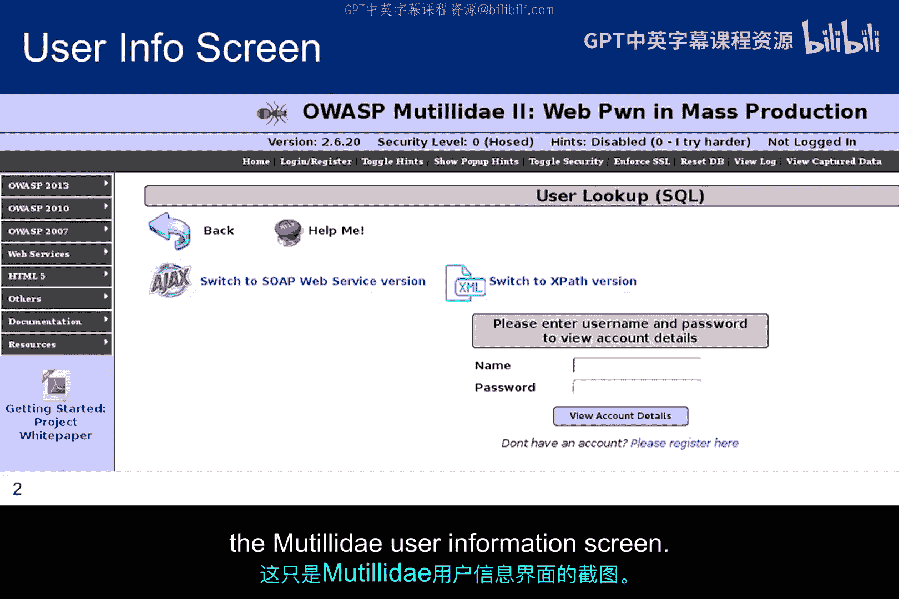

As mentioned earlier， we can start with a canary like Mike。

 But even though Mike doesn't have an account， we won't get any useful information。

 The syntax in the query is correct。 So the error message just says the account isn't recognized。

 but it doesn't reveal anything。However， we've talked about the characters found in context of a SQL query like unmatched parentheses。

 and so forth。 If we try a single quote in mutility。

 the database returns an error message that tells us something about the proper syntax for user input。

 The database is trying to help us get logged in。 but it is revealing too much information in real life。

 a programmer should have never allowed this to happen。Now， we have some insight in how to proceed。

As discussed earlier， now， we know we can create an injection with a single quote。

 followed by the injection itself， followed by space， dash， dash。

 space to comment out the rest of the line。

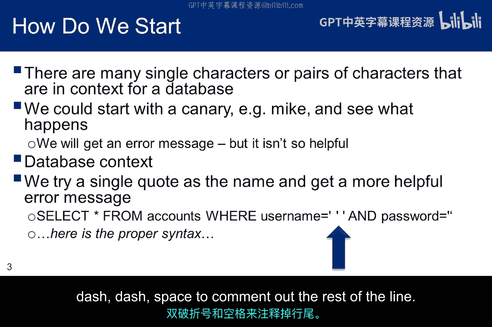

It will be easy to complete the lab assignment without really understanding context。

 and that would be a mistake。 You need to be able to answer these two questions， One。

 what is the value of having the app exposed to SQL query and two。

 how do we use that information to manipulate query strings to produce the observed results？

The Web app should not expose the query， but when it does。

 we gain a lot of information about what the qua string should look like。

 Once we know that we can construct the strings that the programmer didn't anticipate having to parse and those carefully built strings will provide important information about the back end database that either an attacker or a penetration tester can leverage to gain even more detail。

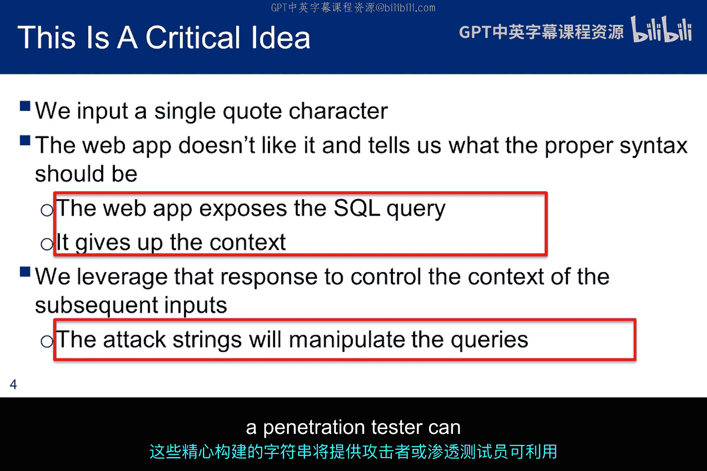

A reminder， if you forget this， your injections will fail and you will get super frustrated。 space。

 dash， dash， space。A sQL union combines the results of records return from two sQL queries。 However。

 a union fails unless the number of fields in the sQL responses are the same。

 and the data types for the columns match。 If the two conditions are met。 the union returns。

 all the records from the first query plus all the records from the second query。

 An important idea concerns the null literal。 Since a null value has a data type of any。

 null will always permit a union If the number of fields in the two responses is the same。

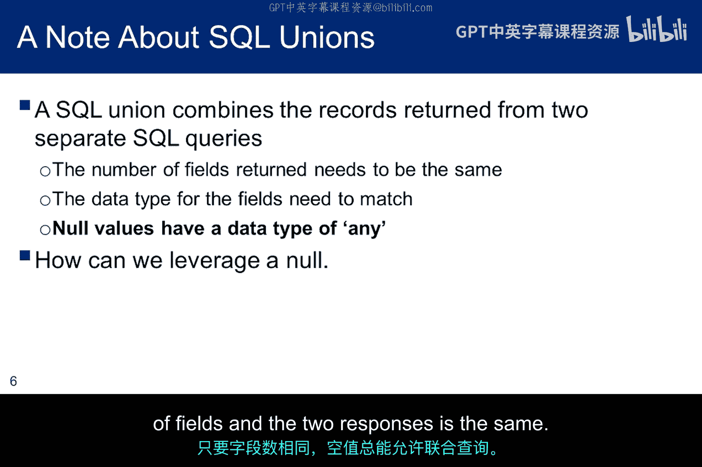

This is mutilate user information screen that we will be working with for this discussion。

 The programmer's intent was that the user would enter a name and a password。

 And on submitting the forms's information， get back the details for the user's account。

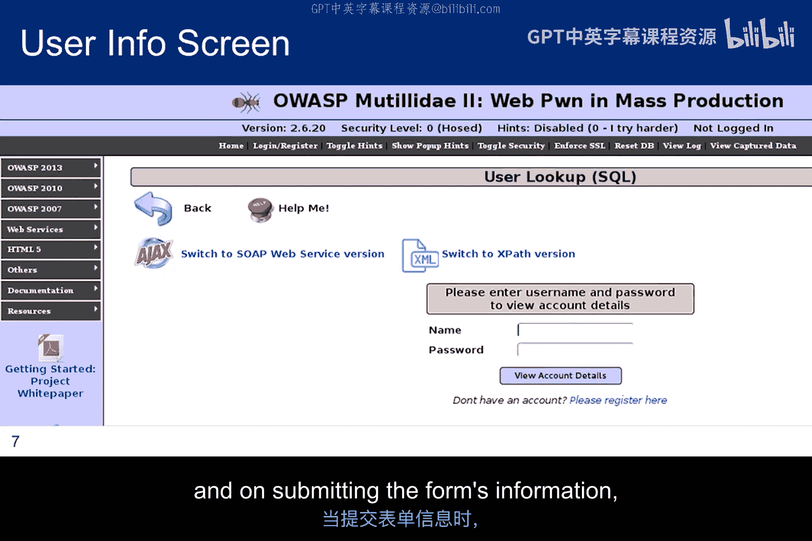

One note， Microsoft PowerPoint likes to convert a double hyphen to a single long dash。

 So when you see that， as you do on this slide， remember that a comment is a double hyphen from the error message we received earlier。

 We know we can inject a union statement。 How can we use that to gain information about the back end database。

Since a null will union with any data type， we can start a union injection with a single null。

 We get a syntax error because the number of fields doesn't match the number of fields in the table that has user information in it。

 we don't know it yet， but most likely this is the user table。 In fact， you get syntax errors was 1。

2，3 and4 nulls。 But when you enter five nulls for the union。

 you get back information instead of an error。 Again。

 this works because the null data type will union with anything。

 But if the number of columns isn't the same in both query results， you get an error。

 So when we don't get an error。 the number of nulls matches the number of columns in the table that has the user information。

 So now we know the number of columns in the table with the user information。

 But we don't know much else。 How should we proceed。

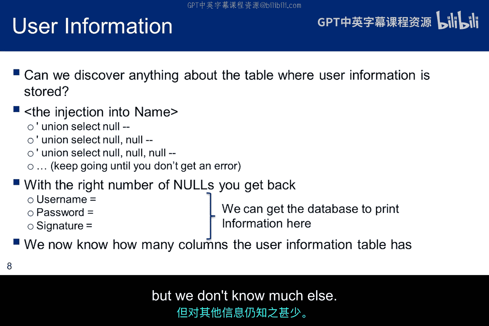

King that the integer 1 is castable to most data types。

 it will probably match the data type in the union。

So we can try putting a one into our injection instead of a null to see if it will be returned by the Web app in the records that are selected。

 If we try inserting a one in the first column， nothing is returned。

We don't really know what that means or how to interpret it。 However。

 if we try it in the second column， we see it gets returned as user name。 Now。

 we know that if we can inject some SQL function call requests in the union injection。

 we might be able to gain additional information。When you do this in the lab。

 you should check the other columns to see how they behave also。

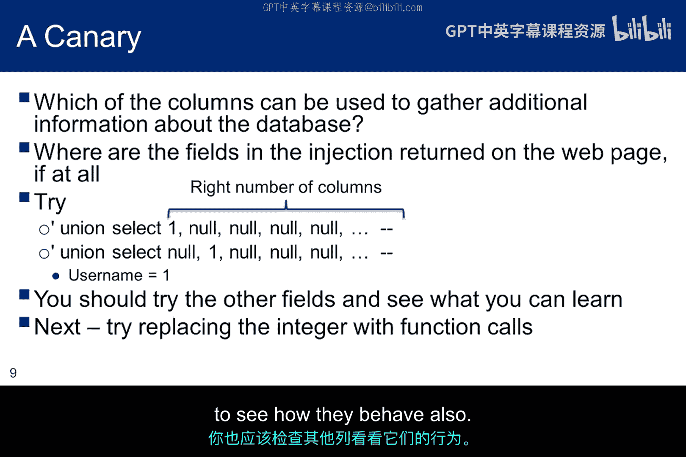

We know the Union query works， and we know the second column will be returned as username。

 So what do we do to get additional information about the database。

We can try the version function call and we get back the PhHP version number。

Mutilday had already provided that as part of the normal display。

 but a web server normally won't and shouldn't do that。 In some cases。

 it may be necessary to add version returned as username as part of the injection。

 but not for mutilude， Similarlyly， injecting the database function call will return the database version。

 Note that in this case， the data type of the username is Alian numeric。

So the data type constraint associated with the union is satisfied， and the information is returned。

That kind of injection might not work in all of the columns。 For example。

 if the data type was integer， it would most likely fail。

 Try it on the first column and see what happens。

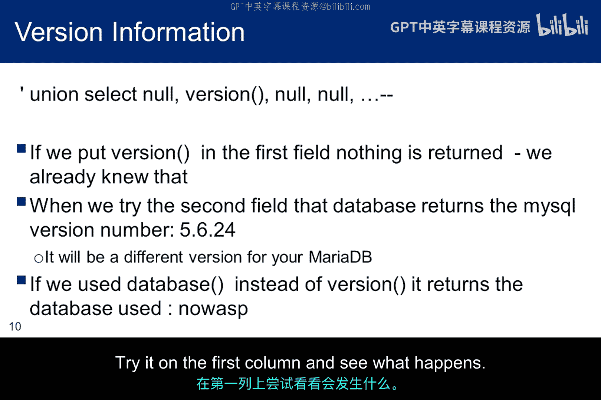

So at this point， we know how many columns are in the table that contains the user information。

 but we don't know the name of the table。 Is there a way to modify the injection to get the table names。

 The answer is yes， and it continues to use the unit injection in the MysQl command line interface。

 we will get the same result。 If we entered Select table name from information schema dot tables。

 You can see the similarity between the C I entry and the injection where we replace the null in the vulnerable column with a table name。

The problem with this injection is it will give us all the table names for all the databases that have been established in My SQL。

 So the next step is to constrain the table listing to those in the database of interest。

 We already determined the databases Oos 10， so we could constrain using the where statement on either database or Oos 10。

That query will limit the response to just those in the database we are attacking Vi all the other databases that have been created in MysQL。

 What we are starting to see is that some expertise in SQLqueries makes SQL injection much easier。

 This is an important idea。 If you want to do penetration testing on database web applications。

 or if you want to protect databases from hackers， you have to understand structured query language。

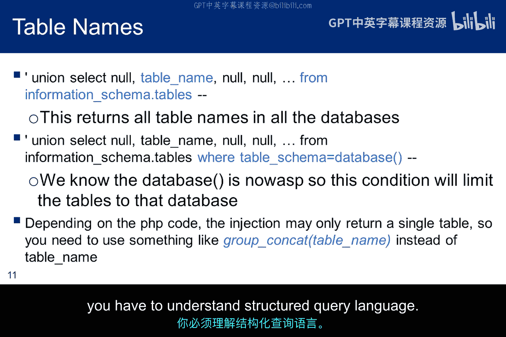

These are the tables in Oos 10 that get returned by the last injection。And just based on names alone。

 we can guess where the names and passwords are probably stored。

If you are using the latest version of utility， for which the database is no wass rather than Oos 10。

You will get these tables and 7 others。 In either case。

 you can confirm the table names using the command line interface in My SQqL after starting my sQqL and using either Oos 10 or noos。

 just type show tables， So now we are interested in the accounts table since we are pretty sure it has five columns and it may contain the names and passwords。

 However， at this point， we still don't know the column names and can't confirm anything about the table contents。

And as you think through these ideas for accounts in the lab。

 you will be asked to apply the same techniques to both the accounts table and the credit cards table。

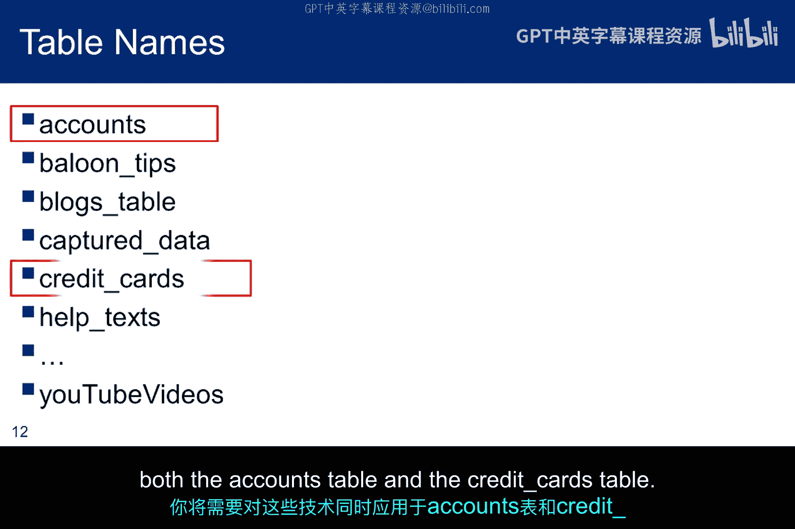

An alternative strategy could be to try to guess the table names。

 and we can make good educated guesses like the ones shown here。

 but we might never have guessed the name accounts for the user table。Rather than guess。

 sQL injection helps us be more methodical。

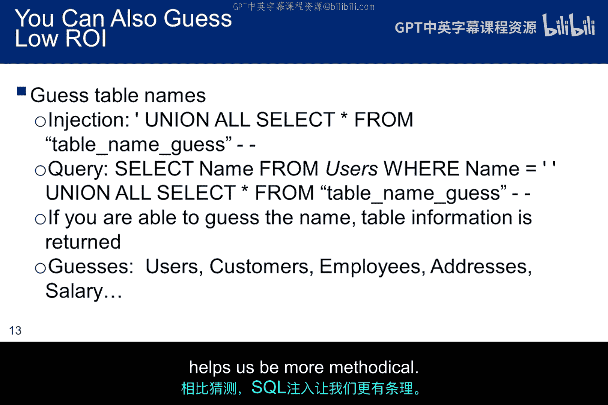

So we know the table name， the number of columns and the database name。

 but how do we get the column names， We can use the same injection technique focusing on columns instead of tables。

 And again， you see why some expertise in SQL and table structures is helpful， as with tables。

 column name injection will yield all the column names。However。

 the column names will come back listed in the order they are found in the schema。

Since the previous injections showed accounts as the first table in the schema。

 and since we know it only has five columns， the database yields the column names we are interested in。

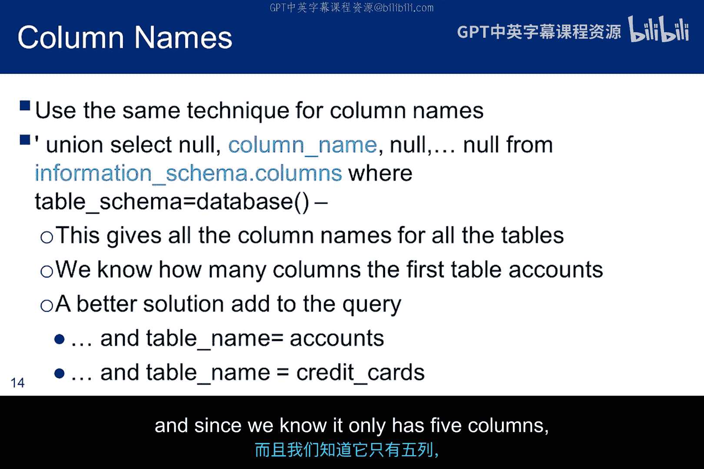

Now， we see that table accounts contains usernames and passwords。

 The password column would normally contain password hashes。

 but mutility has left that complexity out of the equation to make it easier to focus on the web server and the database。

 We only have to worry about a tool like John the Ripper to work on the hashes。Finally。

 the same union injection with a different sequel expression will return the usernames and passwords。

 I've mentioned group concat before as a technique to get multiple pieces of information simultaneously。

 In this case， we are first going to concatenate the username and passwords with a column separator to make the response easier to read。

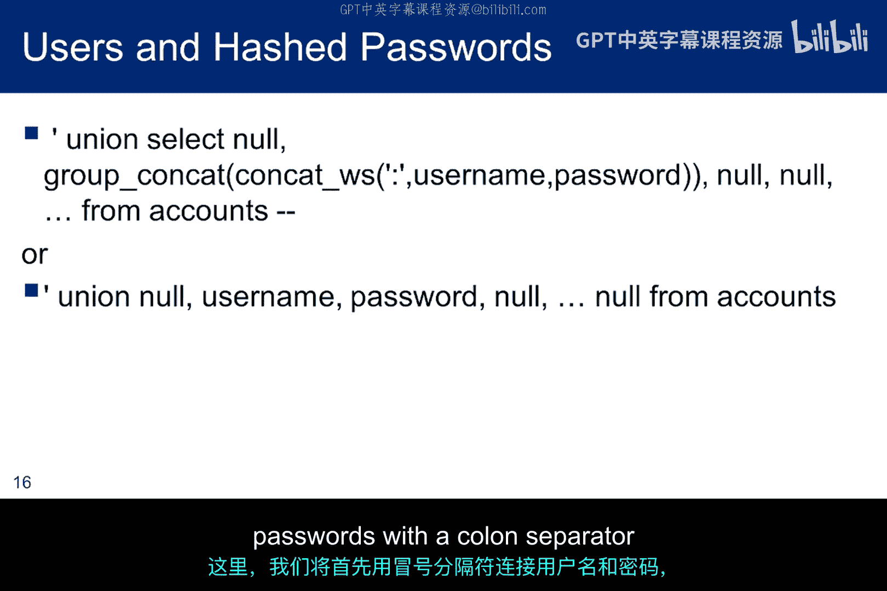

And we get the users and passwords。 This is the same response we get if we enter select username password from accounts in the command line interface。

 Again， the passwords are not hashed。They were hased。

 the next step would be to try a password cracker or a dictionary attack on the hashes。

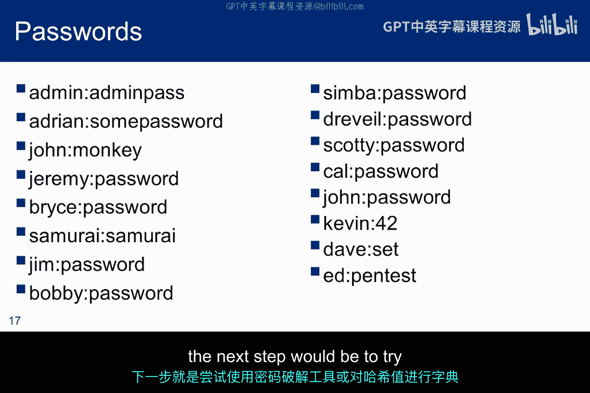

In summary， given that mutility is vulnerable to injection。

 we have discussed how to recover the database name， all the table names in the database。

 all the column names for all the tables。 And once we identify the user table。

 All the user names and passwords。 The same technique can be used on other tables。

 It can be used to recover credit card numbers or P I I like name。

 address and social security number。 in the next submodule， we will discuss blindsql injection。

 This applies in situations for which the web server is vulnerable。

 but the amount of information returned is very limited。

 It becomes necessary to gather pieces of information bit by bit。

 It is more of a brute force approach in the sense that we try all the letters in the alphabet to recover names for tables。

 columns or users， character by character。

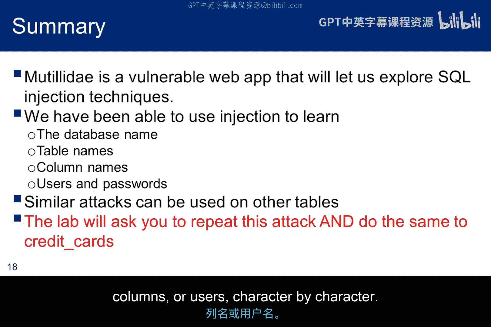