# 约翰霍普金斯大学《道德黑客入门｜Introduction to Ethical Hacking》中英字幕 p45 23_盲注SQL攻击.zh_en -BV1xgu1z1Eau_p45-

In this sub module， we will discuss blind SQl injection。

 which gives us an approach to try if the database web server doesn't give up quite as much information as mutilda did。

Blindsequl injection is called blind because the hacker doesn't receive any significant output。

 He may not have any context， and he probably can't see any values in the content returned by the injection。

 even though the database may be vulnerable to injection。

 The ideas we have been discussing up to now won't work。

 Blindsequl injection works differently by drawing inferences based on how the server responds to certain requests。

 The requests are crafted so that the response yields one bit of information at a time。

 It is sometimes described as asking a series of true false questions to get the answer to a much longer complex question。

The server may answer the true false questions in a couple of ways。

 It may send an error message or not send an error message。

 Another approach is to introduce injections that slow the server response or speeded up to gather bits of information。

 Some examples will follow， but it is a very time consuming process。 The bits collected may come。

 one character at a time。 And since it is accumulated bit by bit。

 The injected requests have to be modified for each bit collected。 For example。

 to infer relevance of an individual character in a name may require that 26 requests be submitted in order to avoid this kind of tedious work。

 To have been developed to draw the inferences and automate changes to the questions。

 Ones toolsQl map will be used in this modules lab。

 Here is an example of how blindsql injection might work。

 This injection runs through a user table and looks to see if the first character of each user's name。

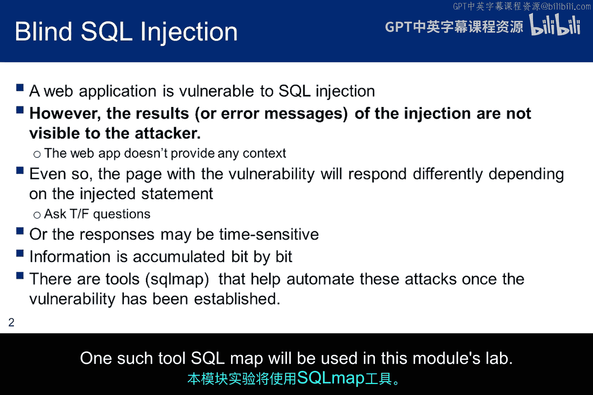

Matches in A。It counts up the number of matches。 And if there is more or more。

 it returns an error because 0 is not equal to1。 If it doesn't find any names that begin with a。

 then 0 equals 0， and no error is generated。 Once you find the first character of a user's name。

 You move on to the second character and use a slightly modified injection to capture the second character and so on。

 Eventually， you will get the name of one user in the database。 And as this process continues。

 it is possible to get the names of all the users。 Of course。

 this technique doesn't just work on user table and user names。 It will work on all the tables。

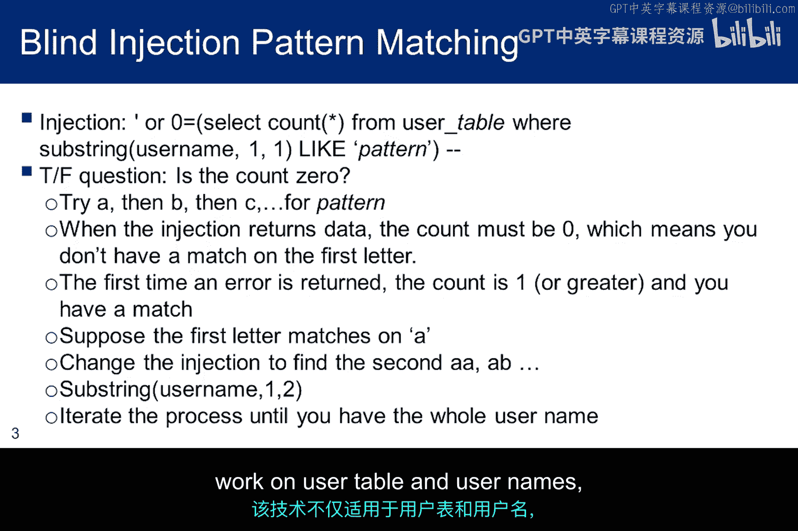

If you started to do blindsQL injection on Umatil's accounts table。

 you can see the sequence of injections you would have to go through to draw out the name admin。

 In this case， you would identify the a on the first injection and identify the D on the fifth injection and it would take 13 more injections to capture the M since M is a 13th letter of the alphabet and so on。

 Clearly， a time consuming tedious but effective process In the previous example。

 we knew the name of the user table， but how did we get that This slide shows some blind injections that could be used to capture the same information discussed earlier in the umatil day mapping lecture。

 First injections shown here， yields the table names In the case of Owas 10。

 you can pick out the user table pretty easily For our complex databases。

 We might have to do additional work。 For example， we might have to find the column names for each table in the database。

 until one turns up that looks like it probably contains a list of the user。

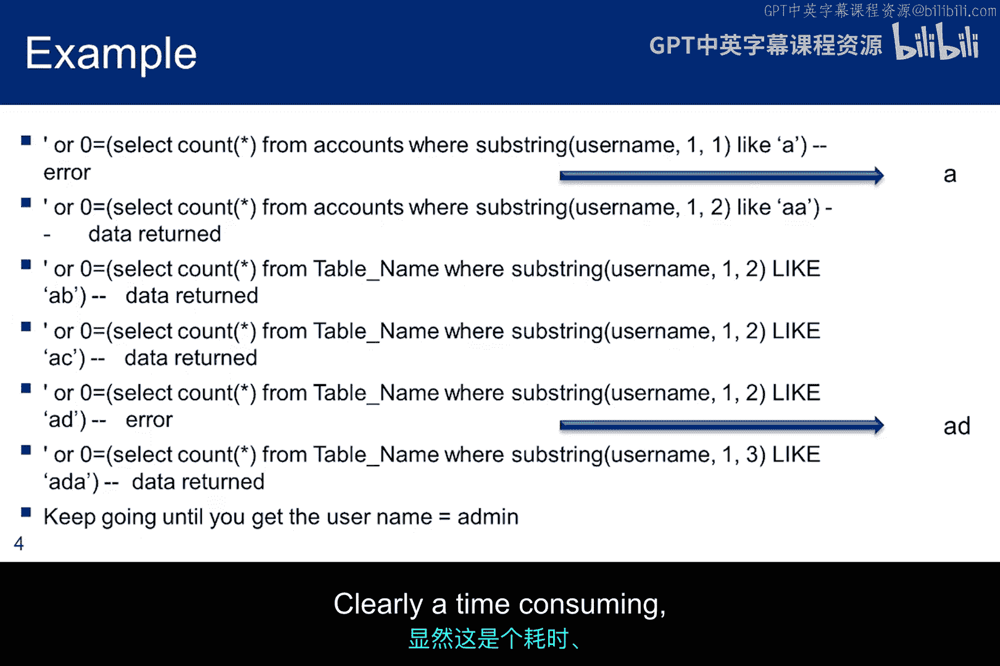

The other three injections on this slide give up the name of the database。

 the name of the columns in the user table， and the users in the user table。 however。

 in each case the information would be captured bit by bit rather than through the more direct approach that gave up the information with a single query。

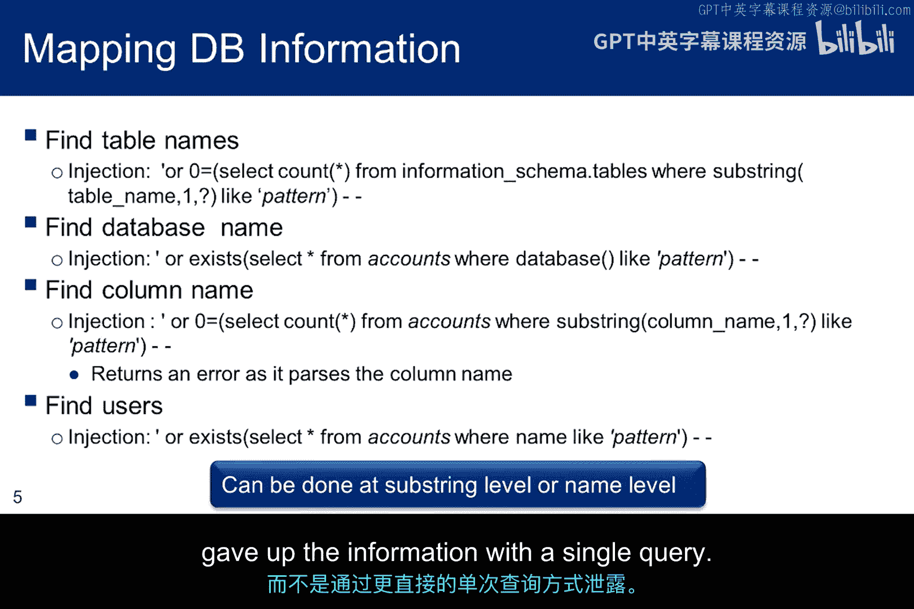

In this pseudocode， the true false expression asks the true false question。

 and the database provides a blindsequQL answer， but the true false check uses the if statement。

 which allows different constraints if the answer is true compared with when it is false。

 For example， we can slow down the query response when the answer is true。

 and do nothing if the answer is false。 This gives the blind injection engine another way to determine the answer to the question。

 It would be useful if the database responded to the pattern matching questions in a way that doesn't allow bit by bit inferences on a visual basis。

 The sleep function is a sQl function that sleeps for 5 seconds and delays the response。

 And here we see a little more detail showing how a timing attack might work。

 If the first character in the user password string is a capital A in this case。

 The query goes to sleep for5 seconds。 If it is not a， the response comes back。

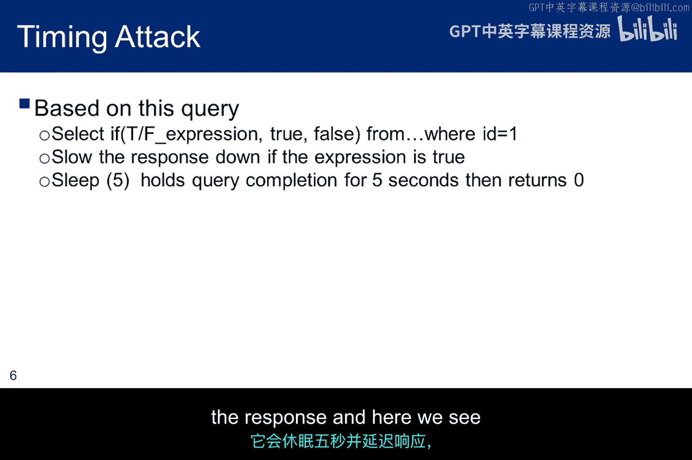

Immediately， so timing can be used in the same way。

 Er messages were used earlier to eke out a password hash。 Again， in the case of mutility。

 the passwords are stored in the clear。 but under normal circumstances。

 you would have to crack the password。

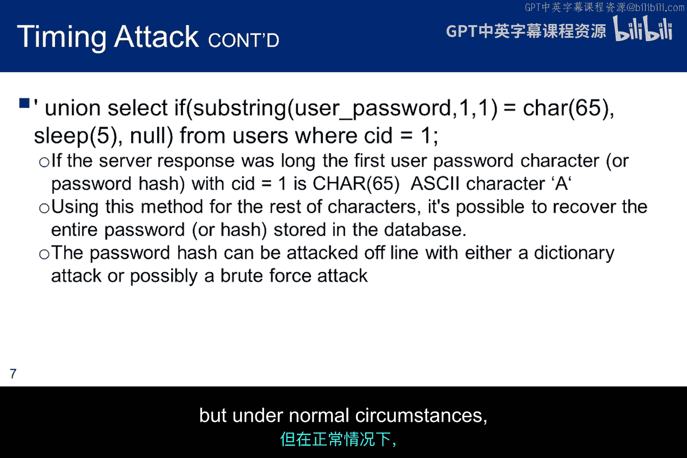

In summary， blind sequel injection provides a means to disclose information character by character when an injection isn't able to give it up all at once。

 I haven't discussed sequel map in this lecture， but it is a blind sequel injection tool that you will learn to use in the lab against mutilda。

The final discussion for this section will introduce you to some OasP mitigations guidance for the three Web vulnerabilities we have discussed。

 That will be followed by a very brief discussion of Web app scanners that look for vulnerabilities and applications running on the Web server。

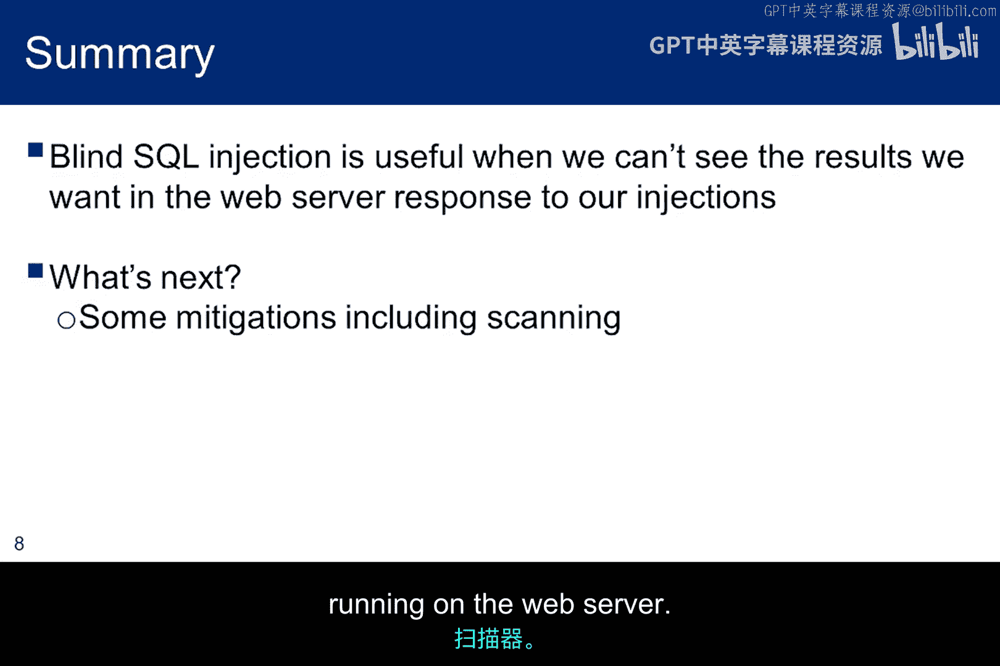

It is worth your time to review these three Owas cheat sheets as they provide guidance on how to defend against sequel injection。

 crossite scripting and cross sight request forgery。

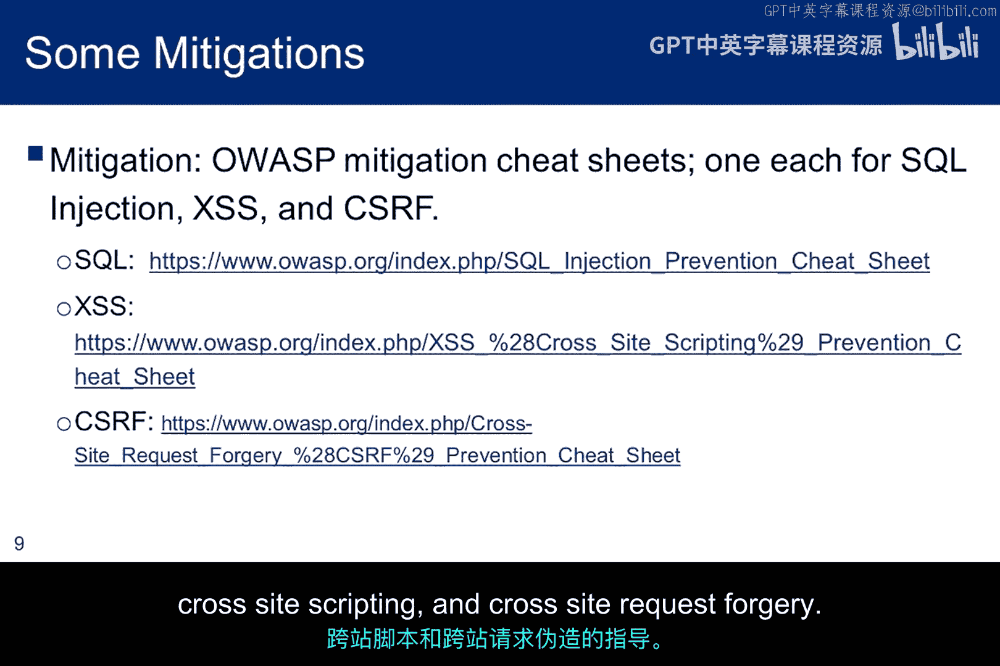

The lab for this module asks you to run a Web app scanner against the mut applications。

You do not submit those results as part of the homework。

 but you are required to include the scans in your pen test report。 Don't forget to do that。

 There are numerous web app scanners that tried to identify vulnerabilities。 you may have a favorite。

 and you are welcome to use it。 but I recommend Oas Zap。

 because it looks for the Oas top 10 and utility is designed to have the same set of vulnerabilities。

 That said， there are other tools available in Cali to include W 3 A F and Vega。

 I have tried both and neither was very effective。 In fact。

 when I tried  Vega on two occasions while in the middle of a scan。 it just stopped scanning。

That turned out to be a waste of time。 It would be worth while to try these just to see how they behave。

 But I suspect they are still unreliable and not worth much of your time。

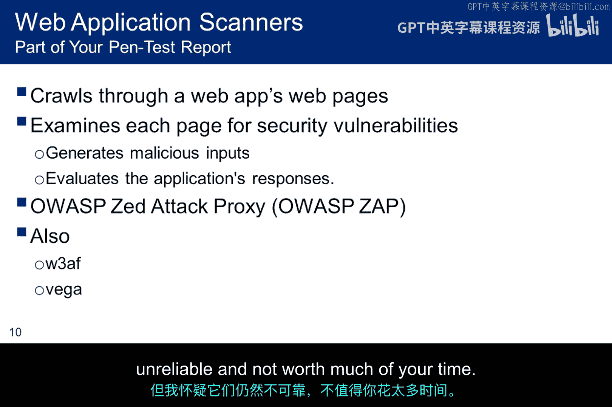

This is a start screen for Oasp Zap。 You basically just give it a URL。 In this case。

 the path to mut and start the scan。In the lower panel。

 you can see some of the getss that Oas Zap starts with to see what is returned。

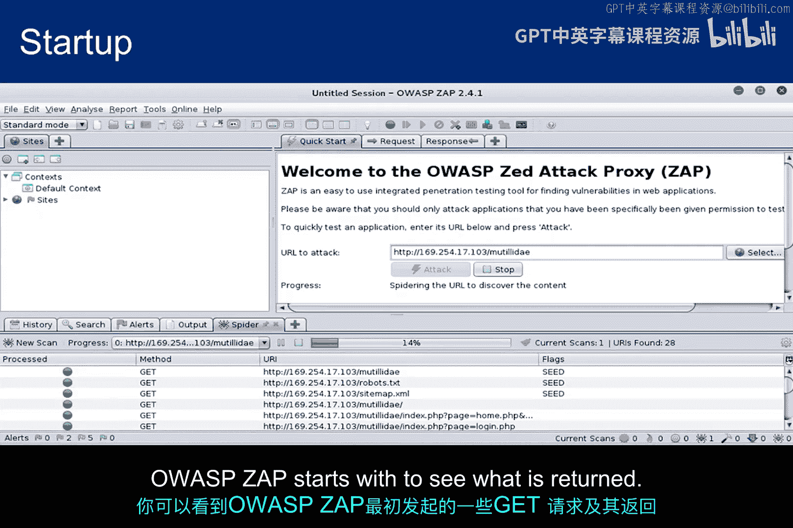

Notice that in my environment， the full report took 7 hours to run。 And this is a sample output。

 You can see there are over 2000 alerts， and 69 of them are considered high risk。

 Since I ran this report some time ago， Your results will most likely differ。

 This is one of the high vulnerabilities identified for cross sight scripting。

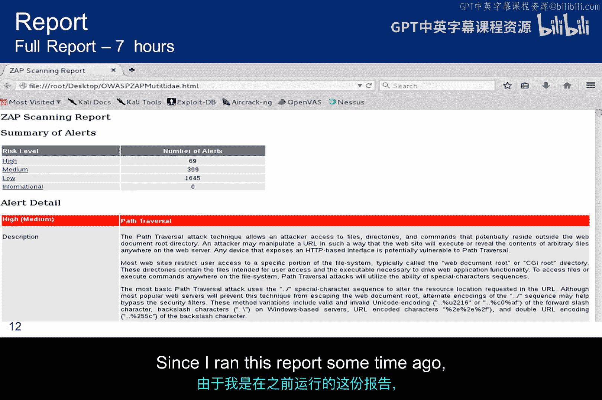

And this is a high vulnerability for sQL injection。

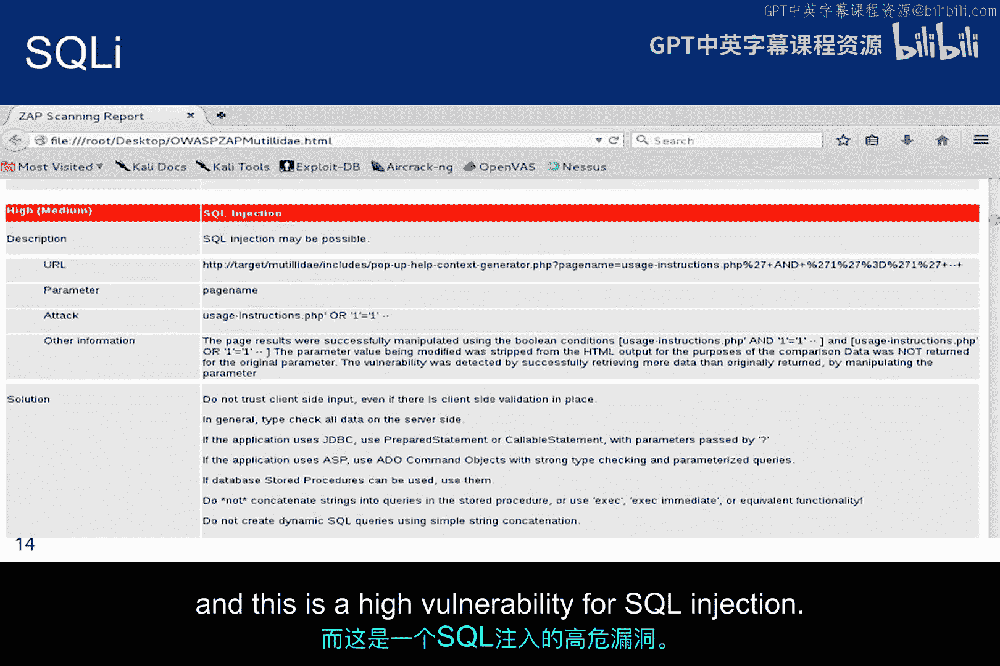

What is interesting is that when I ran it， no CS SR F vulnerabilities were found。 First。

 this tells us scanners are not perfect。 I think one might suspect that。

 but in writing our pen test report， we might forget it and put too much weight on the scan results。

The second point is that a pen tester needs multiple tools in order to ensure that pen test results are comprehensive。

This finishes the module on Web exploitation。 We covered sequel injection。

 crsite scripting and crite request forgery at a fairly high level and then drill down into sequel injection。

 While the lecture does not drill down into X， SS or CS SR F。 The lab will ask you to do that。

 We also spend some time on injection context。 We focused on sequel injection。

 But the idea of context and where your injection will land is a key idea that covers any kind of injection attack。

Finally， we discussed blindsQl injection， which is a brute force technique used when the system does not provide enough feedback to make using more standard techniques a viable option。

 We finished off with a very brief discussion of Web app scanners and scanning entire computers is the subject of the next module。

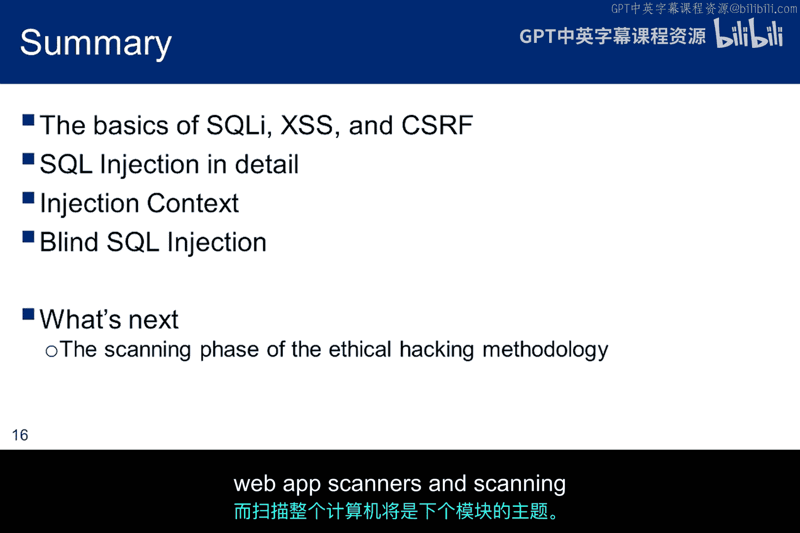