# 约翰霍普金斯大学《道德黑客入门｜Introduction to Ethical Hacking》中英字幕 p46 24_无线网络渗透.zh_en -BV1xgu1z1Eau_p46-

This lecture is on Wifi exploitation。 I will cover several aspects of Wifi security。

 The main focus will be on Wep and WPA 2 to provide an understanding of the attacks on the cryptographic protocols。

 While no one should be using Webb any longer， I know it is still found in home networks。

 And my guess is small organizations without knowledgeable security personnel may make the same mistake。

 At any rate， even if webb is obsolete， forming an understanding of protocol weaknesses and attack points will serve a pen tester well。

And， of course， Wifi attacks remain in the exploit phase。 But once again。

 the results obtained in the lab for this module are not to be included in your pen test report。

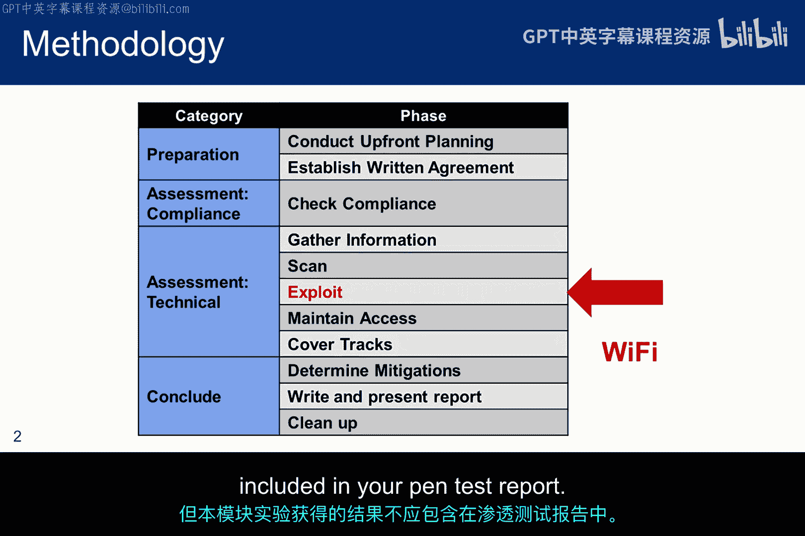

The next four slides will summarize various attacks。

 A malicious actor might use against a Wifi network。

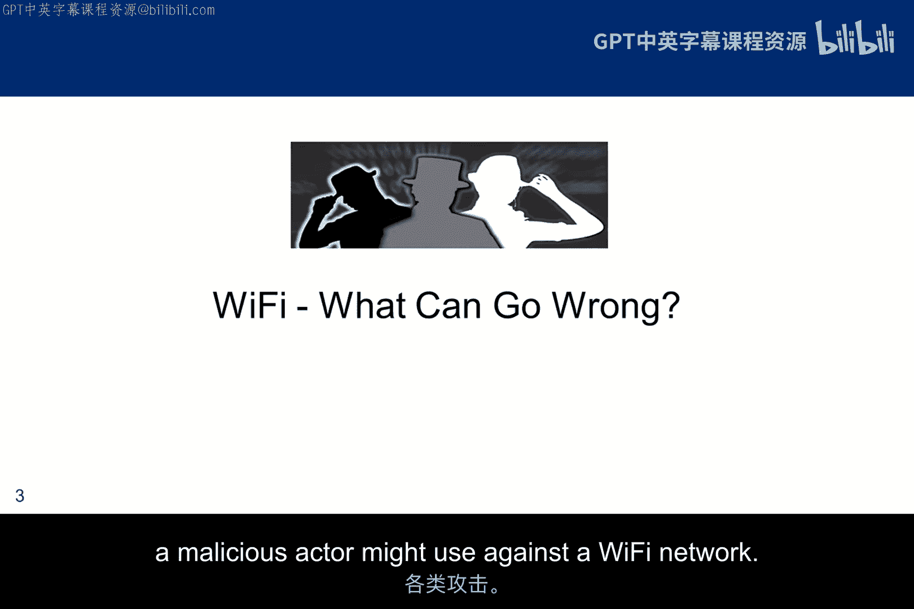

An unsecured access point inside the enclave can allow a rogue client to connect。

 This might be caused if the A P is misconfigured， but it might also be caused if web encryption is being used or if strong WPA encryption is being used with a weak pass phrase。

 These are the attack's defleural focus on。 And depending on how the internal network is configured。

 It is often the case that the Wi Fi access point would put an attacker behind the firewall。

 So it is critical that these devices be properly managed。

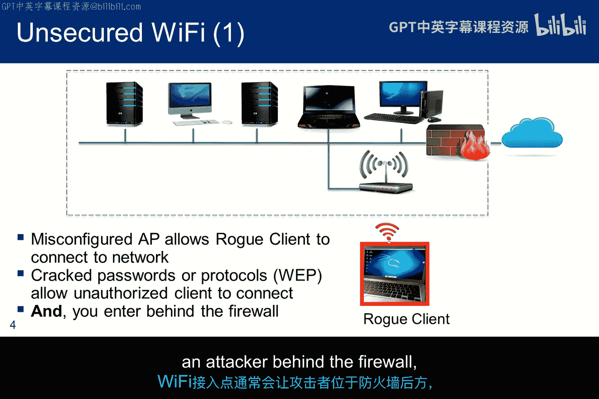

There are two main denial of service attack types， and they are difficult to defend against。

 in some sense， Wiids， s whipps systems that allow you to identify anomalous transmissions or Ddos attacks。

 but tracking down the attacker will most likely require the use of a spectrum analyzer and physical space control。

 However， this may be the best strategy， because you can't really prevent a gauze attack。

The first attack involves deauthenticating a legitimate client by ascending a de authenticthentation frame。

 which causes the client to have to reconnect deauthing continuously results in a denial of service。

 Wis researchers are working on detection algorithms for de attacks。

 but there are no effective mitigations。 The second approach is frame flooding。

 which overloads the access point with probe or association frames。

 This will keep additional clients from connecting or crash D A P。

 Mac address filtering may help with frame flooding。

 but it isn't a very scalable solution as the whitelist grows。

 and it really won't help in a large enterprise。 Fast A P processors and more A P memory to manage frame processing time can also help keep up with the flood。

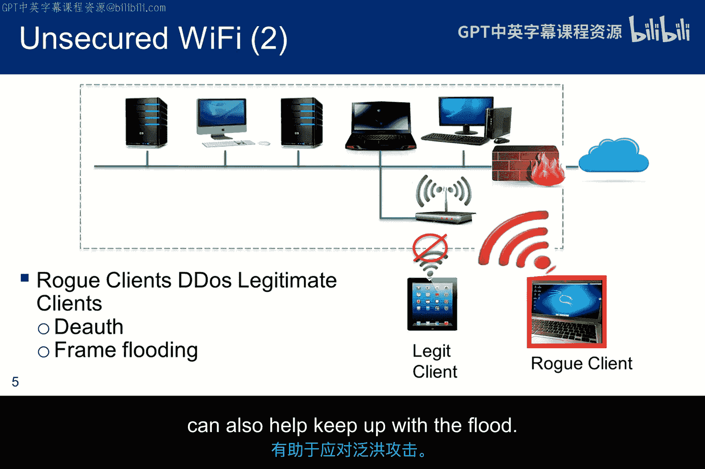

A good woods should easily detect a ro A P connected to the network。

 But if no ws is installed and a malicious actor has physical access to the network。

 it does not take long to plug in and hide a small form factor access point。 For example。

 a raspberry pie。

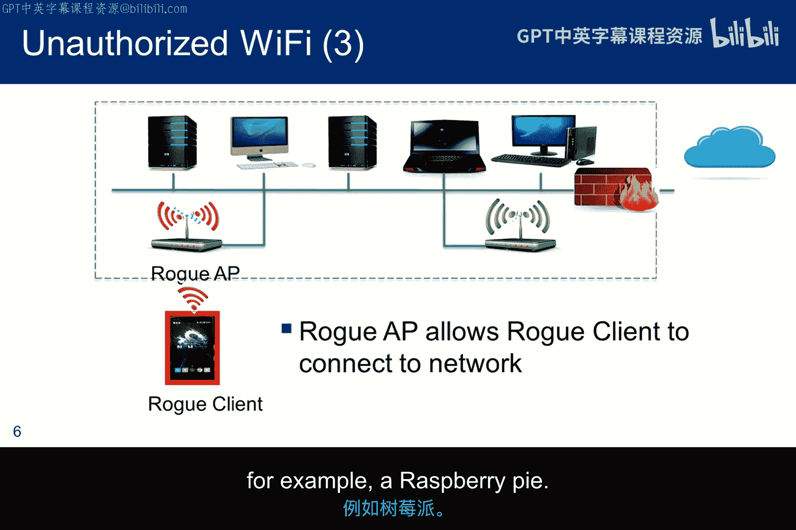

Many students have done evil twin projects for class projects。 They are not too complex。

 An access point software like Airbase and G is readily available to load on a raspberry pie。

 The attacker makes his own wireless network that appears to be legitimate。

 He simply gives a rogue access point the same SS I D and B SS S I D used by the Wi Fi network on the premises。

The rogue access point can be configured to pass the traffic through to the legitimate access point while monitoring for the victim's credentials。

 or it can simply say the system is temporarily unavailable after obtaining a username and password。

One question is， how long should the evil twin stay up， If not architected carefully。

 It shouldn't take the user too long to figure out something funny is going on。

 resulting in a new password。The other attack depicted is bridging Wi Fi to an LTE exfiltration device。

 like a mobile phone。But it is more of an insider attack than the others。

 since the wfi access from the Excelel device is most likely legitimate。

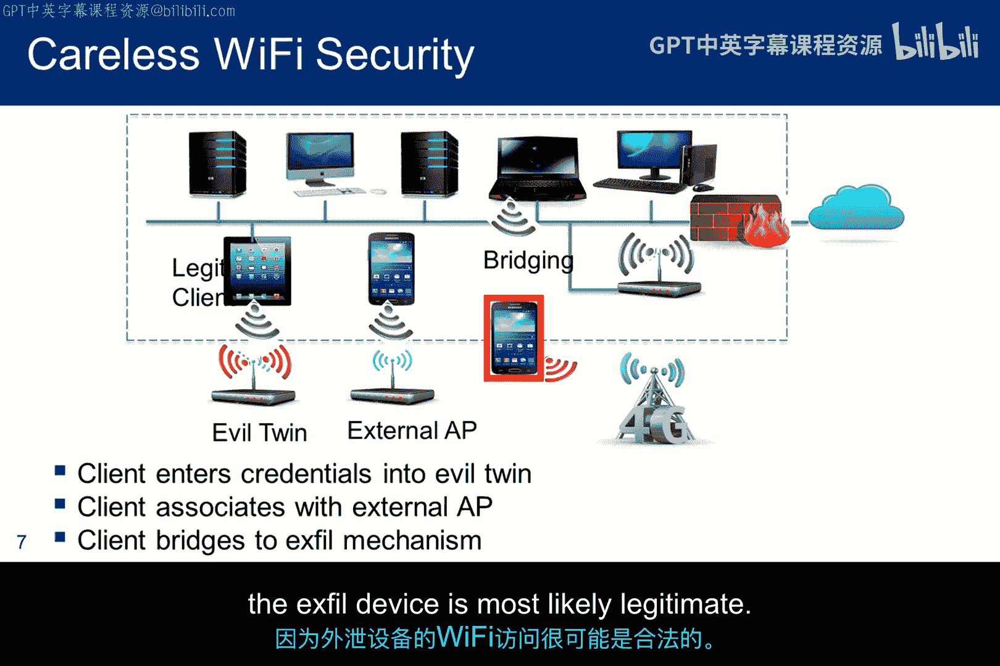

This is a list of resources about wfi standards and attacks。

 I have referred to most of these in constructing this lecture。 While it is a long list。

 I want to highlight the IE 802 do 11 standard。 If you want to understand the protocol or how you might attack the protocol。

 the standard is the best place to start。These documents are usually multi volumeume and lengthy。

 So reading them may not provide any inspiration， but this is where the methodical hackers often start。

 It is worth your time to become familiar with how they are constructed and how to abstract information。

 So one of the homework topics will ask you a question that will require you to look at the standard as the information requested is probably not available elsewhere。

 unless you get really lucky with your Google fool。

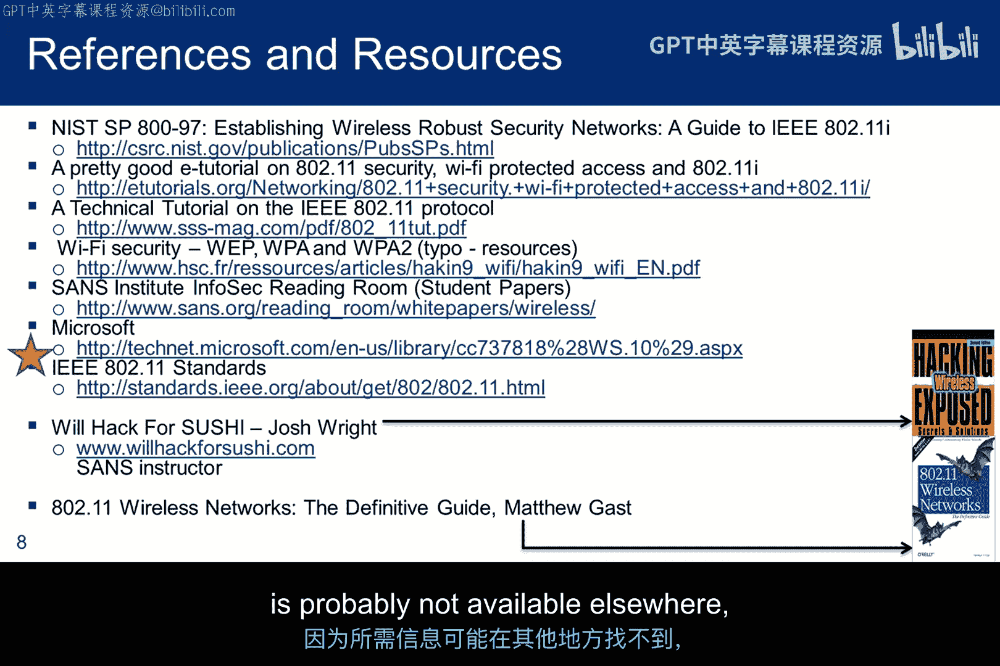

There are two basic Wifi topologies， infrastructure and ad hoc in infrastructure mode。

 access is coordinated through a wireless access point that has a DHCP server that provides IP addresses to all devices in the network requesting access。

 a basic service set or BSS with a single access point is an example of an infrastructure mode configuration。

 This is how a typical home network might be set up。An extended basic service set。

 or E BSS describes a configuration with multiple access points。

 having the same SSID that bridge traffic among the B， S Ss。

This will typically be found in an organization with a large campus The bridging from one A P to another is usually done across a wired connection。

 although there are examples of wireless bridging as well。The E BSS appears as a single B。

S S at the link control layer of the OSI protocol stack。In ad hoc mode。

 the architecture is described as an independent basic service set or IB S。

 This is a peer to peer configuration that is set up on the fly。

 It is rarely seen these days because it doesn't scale well， and Wifi has become ubiquitous。

 But at one time， this configuration provided a way to create a spontaneous W La formation for something like an offsite meeting in a hotel。

 This is basically a collection of wireless nodes communicating on a point to point basis with no DH P。

 One node is elected from the group to act as the proxy for the missing access point。

 and it is usually the station that starts the ad hoc net。

In the days of Windows X P free public w looked like a name for an access point。

 but it was usually an ad hoc network。 In other words， when a user selected it。

 he or she wasn't connecting to a router or hots spot。

 but rather directly to some one else's computer in the area near by。

 though it doesn't actually provide Internet access。 The network has spread across the country。

 even on airplanes thanks to a Windows X P bug。 It worked like this。

When a computer running an older version of X P was unable to find any of its favorites wireless networks。

 it automatically created an ad hoc network with the same name as the last one it connected to。

 in this case， free public Wi Fi。Other computers within range of that new ad hoc network see it luring those users to connect。

 There were other zombie networks as well。 If you are old enough， you may have seen some of them。

 links us H P set up， teammobile or default， unintentionally creating or connecting to an ad hoc network isn't inherently harmful。

 Despite its virus like spread。It does， however， provide an access point for hackers to come in and check out the user's files。

Starting with Windows 8 dot 1， Microsoft reduced support for ad hoc Wi Fi networks。 As a result。

 Windows 8 dot 1 does not detect or display ad hoc networks in the list of available wireless access points。

 Windows 10 behavior is slightly different， it does detect and display available ad hoc networks。

 but when attempting to connect， it fails with it cannot connect to network error。

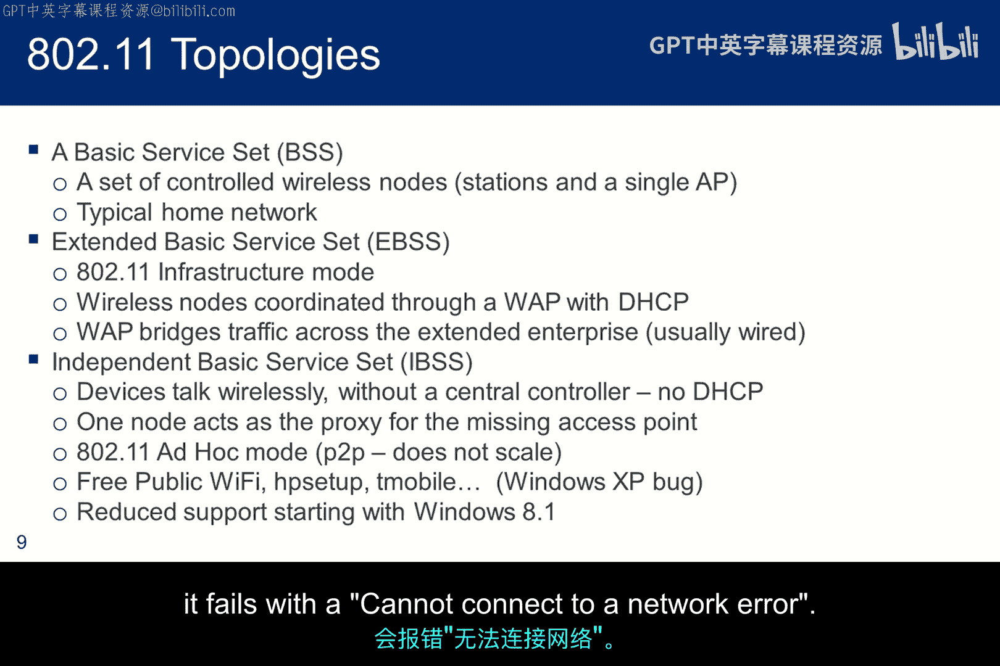

This is a typical wired distribution system connecting two access points in an E， B S S。

 If you were to try this at home on the second A P。

 you would normally turn off DHP and put it in bridged mode。

 I actually did this for a while when my Verizon Fios router had a connection table that was too small and could not support all the devices that needed to connect to it。

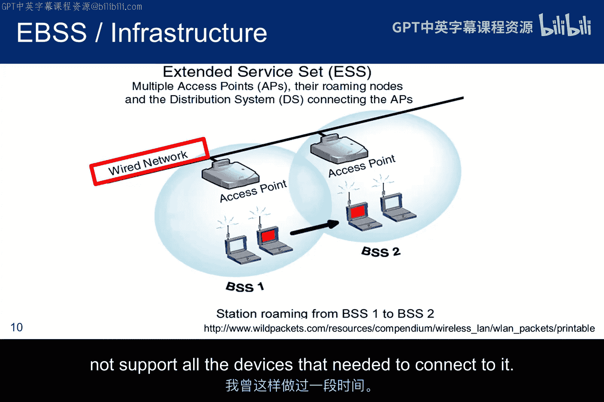

This is a typical IB S S。 A group of people in an environment without Wifi want to share information among their laptop computers。

 They agree on the SS I D they will use for their meeting and configure it into their laptops。

 specifying IBSS operation。When the first laptop is enabled。

 it starts looking for beacons containing the target SS I D。

It ignores beacons from other access points and looks only for beacons from other devices in the IBS S mode。

If it doesn't see any beacons， it realizes that it is the first arrival and starts sending beacons itself。

The next laptop to turn on seized the beacon from the first laptop with the correct SSI and synchronizes its timing so they can share messages and files。

When any device wants to send a frame to another device。

 it just transmits with the target device's Mac address as the destination。

 Since there is no process association， devices can come and go as they please without any hellelloos or goods。

 This makes ad hoc networks quite insecure because anyone can sniff the SS I D and join the network unless the participants agree on a password at the start of the meeting and encrypt their transmissions。

 But even with a password， it is complex because there is no coordinator。

 So every mobile device has to block an unwelcome newcomer independently and encryption is hard to configure。

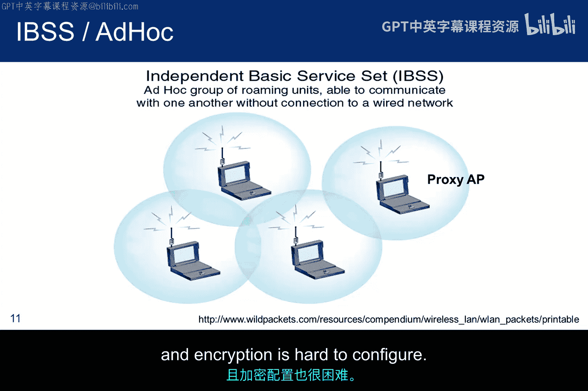

Packets bound for devices within the wireless La need to go to the correct destination。

 The SSId keeps the packets within the correct Wlan， even when overlapping W Las are present。

 However， there may be multiple access points within each wireless la。

 So there has to be a way to identify those access points and their associated clients。

 This identifier is called a basic service set identifier， B， S， S I D。

 which is just the A P's Mac address， and it is included in all wireless packets， E， S。

 S I D plays a role when you want to communicate between clients in a bridged B， S， S。

 that have to have the same SS S I D， but have different access points。

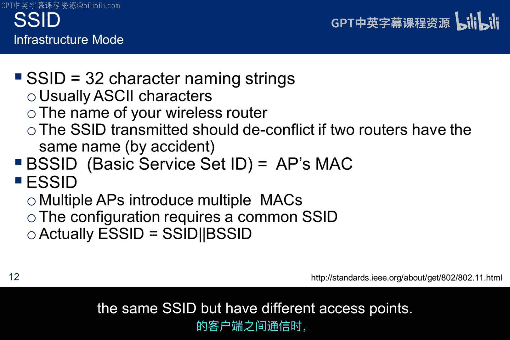

In this sub module， we discussed various Wi Fi threats and typical Wi Fi configurations。 Next。

 we will explore Wi Fi authentication。

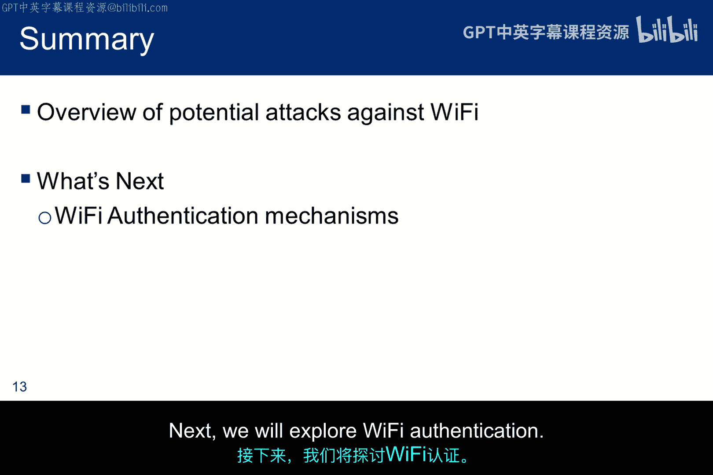