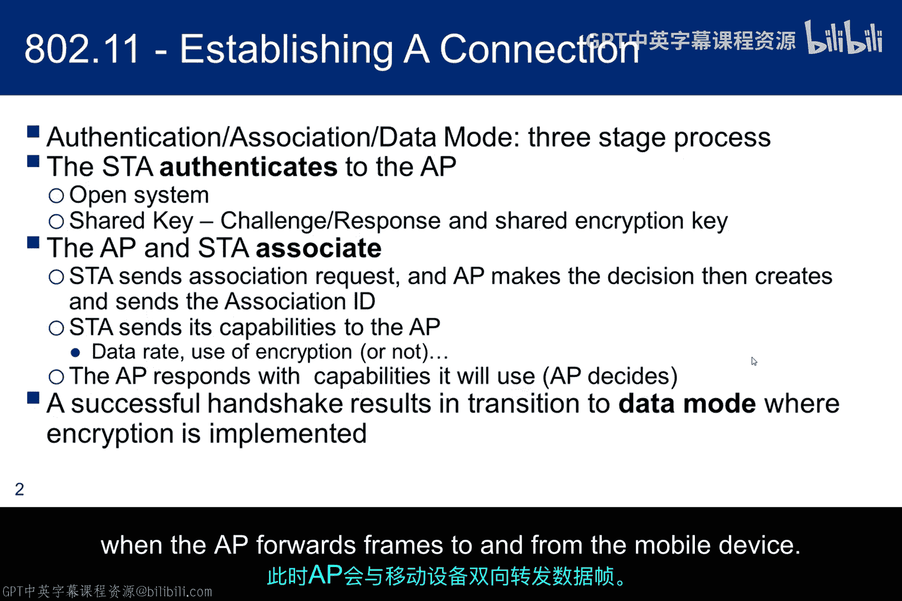
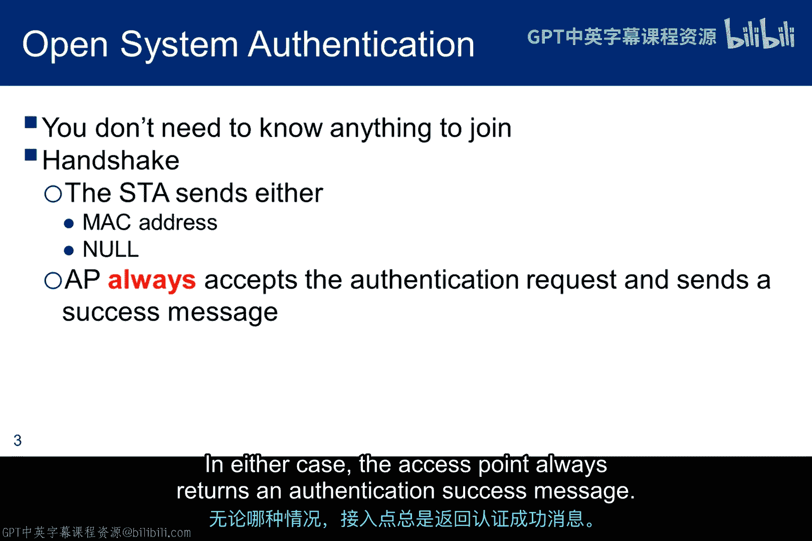
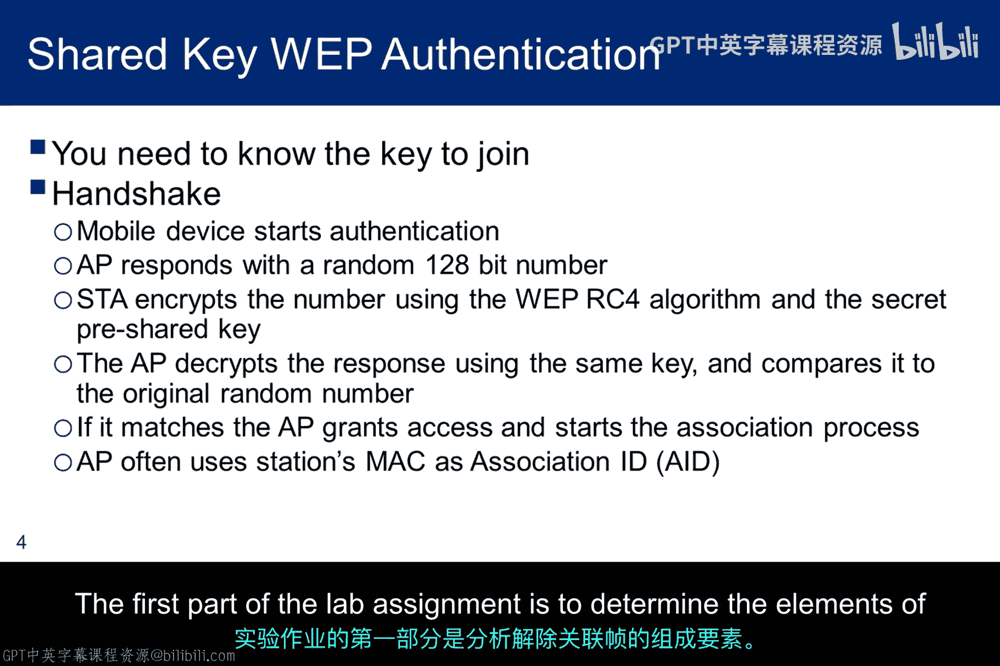
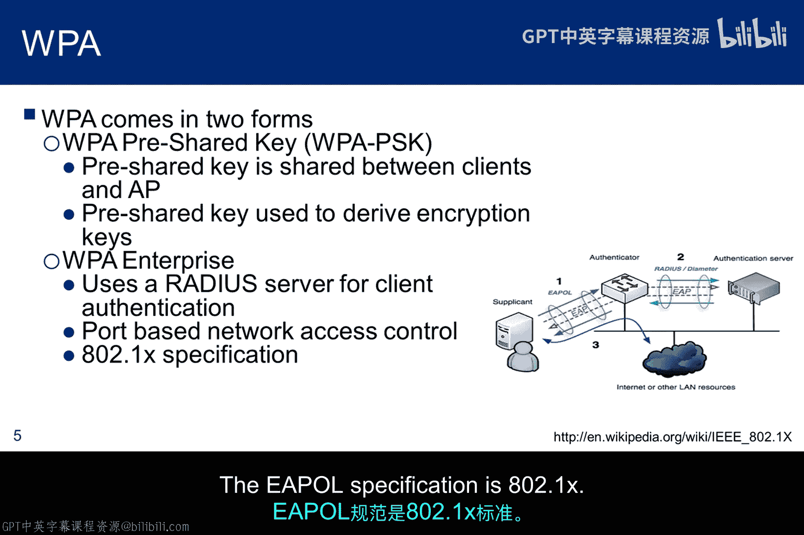
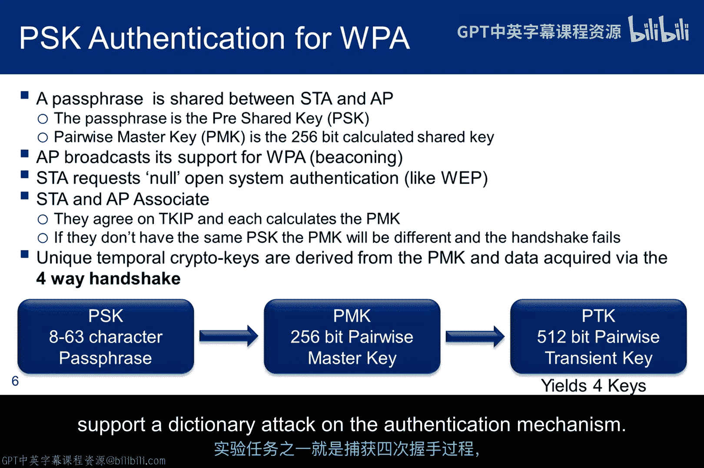
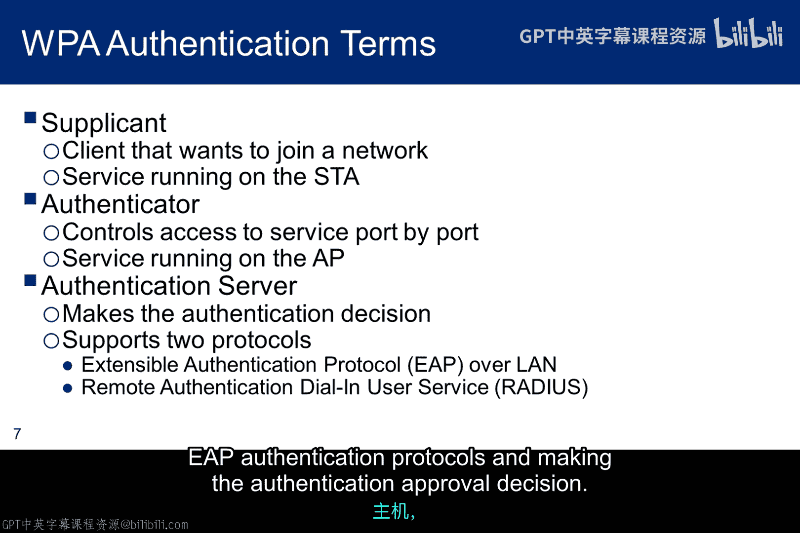
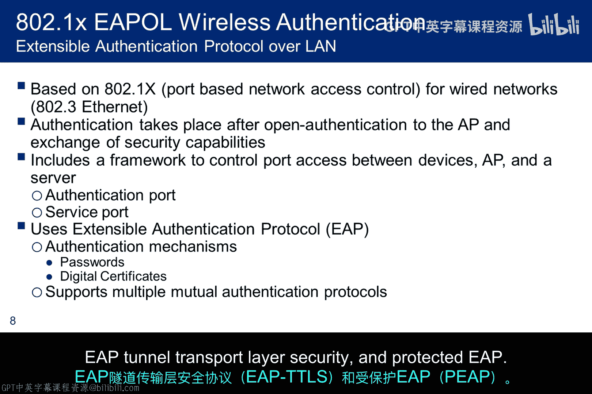
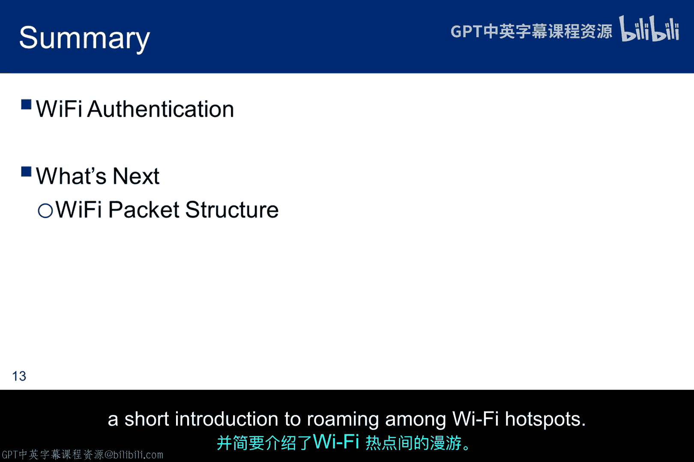

# 约翰霍普金斯大学《道德黑客入门｜Introduction to Ethical Hacking》中英字幕 p47 25_Wi-Fi连接建立与认证机制.zh_en -BV1xgu1z1Eau_p47-

Wi Fi access is a three step process， authentication， association and data exchange。

 And as the community discovered weaknesses in web authentication。

 the process evolved significantly to improve security， and the handshakes became more complicated。

 This sub module will discuss the details of the protocols。Standard 802。

11 connections follow a three step process。 First， the station authenticates to the access point。

There are two ways to do this。 One is called open system， and one is called shared key。

 which I will discuss shortly。 The second step is association after the mobile device authenticates to an A P。

 it sends an association request。 the A processes， the association request。

 Although the implementation may vary。 once the A P grants association。

 it responds with a success status code and the association I D used to identify the station for delivery of buffered frames when the power saving is enabled。

 a failed association request includes only a status code and the procedure ends。

 the third step is data transmission when the A P forwards frames to and from the mobile device。

Open system authentication means there is no security。 The station may send its Mac address。

 or it may just send a null， depending on the implementation。However。

 these aren't really very different approaches since the Mac can easily be spoofed。 In either case。

 the access point always returns an authentication success message。

With shared key authentication， a key is required， and both the access point and the station must have the same key when the station requests access。

 the A P sends  a028 B random number， which is encrypted by the station using the key and return to the access point。

 the A P decryptps the response and compares the result to the original 1 28 B number。

 If the two match， the station is authenticated and the association process begins。

Since the station's Mac address is included in the frames received。

 the A P uses the station's Mac as the AI D。 This is an important point because the Mac allows the station to remain associated with the A P As a result。

 if you want to start a sniffer to capture packets exchange during the handshake。

 You need to force a disassociation of the station from the A P。

 The first part of the lab assignment is to determine the elements of a disassociation frame。

 WPA authentication supports two authentication methods。 One method uses a pre shared key。

 It is far more complex than the web exchange using the hundred and 28 B random number。

 and it will be discussed shortly。 The second method uses some new terminology and is based on extensible authentication protocol or Eap P in a radius server that controls authentication。

Notice in the diagram that EAP exchanges in red take place between the station and the access point and between the access point and the authentication server。

 However， different encapsulating protocols are used。

 E P O L for the station and radius for the server。The EAPOL specification is 802。1 at。

Now， let's discuss the WPA authentication method that uses a pre shared key。

 We discussed We's use of a pre shared key， but the mechanism used in WPA is quite a bit more complex。

 For one thing， there is more than one key involved， and it is important not to mix them up。

 The first key is the pass phrase between 8 and 63 characters in length。

 often called pre shared key or P S K。 It is shared between the station and the access point。

 just as it is in Web。The second key is a 256 B Parawise master key or PMK。

 which is calculated using the PK in a key derivation function， along with the SSID。

The third key is the 512 B pairwise transient key calculated from the PM K and several other variables。

 including a seed。 All input to a pseudoran number generator。

 The authentication process starts off when the station requests open authentication from the access point。

 This is the same as web。 However， after authentication during the association phase。

 They agree to use the temporal key integrity protocol methodology to calculate the PM K and the PT T K。

 critical to the calculation of the P T K is data exchange during a farway handshake。

 one of the assignments in the lab is to capture a fourway handshake to support a dictionary attack on the authentication mechanism。

The names of the participants in the Enterpri WPA authentication Exchange are different than station and access point。

 The supplicant is a client device that wishes to attach to the wireless La。

 The term supplicant is also used interchangeably to refer to the software running on the client that provides credentials to the authenticator。

The authenticator is a network device such as an ethernet switch or a wireless access point。

And the authentication server is typically a host running software。

 supporting the radius and Eap authentication protocols and making the authentication approval decision。

8021 x is the standard for wireless E P O L authentication。 It is based on its ethernet counterpart。

 The 802。3 standard， which specifies the physical media and the working characteristics of ethernet。

 In this model， there is no pre shared key loaded at the access point， Rather。

 the authentication server manages the key for the access point。

 Although the supplicant and the authentication server。

 do need to exchange a pre shared secret to support key generation。

The authenticator divides each virtual port into two logical ports。

 One for service and the other for authentication。 And this is called the port access entity or Pe。

 The authentication Pe is always open to allow authentication frames through。

 While the service Pe is only open a bond successful authentication by the radius server。

 The supplicant and the authenticator communicate using layer 2 E A P， O L or E A P over land。

 Once the authentication process is complete， the supplicant and authenticator share a secret master key。

 which is shared with the authenticator by the radius server。

EAPOL supports multiple mutual authentication protocols， for example， EAP transport layer security。

 EAP tunnel transport La security and protected EAP。

The EAP RC does not specify how messages should be passed around。 It does not， for example。

 specify transport over the internet using I P。 In fact。

 Eap is not a land protocol at all because EAP was originally designed for use with dialup authentication via a modem。

 So to pass Eap messages around our network， we need an encapsulating methodology。

IE 8021 x defines a protocol called EAP overland to get Eap messages passed between the supplicant and the authenticator。

 and radius is used between the authenticator and the authentication server。 By the way。

 radius is a legacy for dialup authentication， not Wifi authentication。

 So you have to be sure your server supports Eap。There is no standard definition for how radius servers should be deployed。

 Some authentication servers are dedicated to specific authentication methods。

 Others may have special capabilities， such as redundant or distributed operation。

 A redundant server has standby units that take over seamlessly if the primary server fails and a distributed server has many servers operating in different locations。

 while it keeps the common authentication database updated and consistent between all sides。

But radius does define two things。 First， it defines the functionality that should be common across authentication servers。

 and second， it defines a protocol that allows other devices to access those capabilities。

There are three steps in the 8021 x handshake。 The first step is initialization on detection of a new supplicant。

 the port on the authenticator is enabled and set to the unauthorized state。 In this state。

 only 8021 x traffic is allowed。 Other traffic， such as Internet traffic is blocked。

The second step is initiation In this phase， the authenticator will periodically transmit Eap request identity frames to a special address on the local network segment。

The supplicant listens on this address and on receipt of the Eap request identity frame。

 it responds with an Eap response identity frame containing an identifier for the supplicant。

 such as a user I D。The authenticator， in turn， encapsulates this identity response in a radius access request packet and forwards it to the authentication server。

By the way， in a slightly different approach， it is also possible for the supplicant to initiate authentication by sending an EAPolL start frame to the authenticator。

 which will then reply with an EAP request identity frame。The third step is Eap negotiation。

 In this phase， the authentication server sends a reply encapsulated in a radius access challenge packet to the authenticator containing an Eap request。

 specifying the type of Eap authentication it wishes the supplicant to perform。

 The authenticator encapsulates the Eap request in an Eap frame and transmits it to the supplicant At this point。

 the supplicant can start the requested Eap method or send a NAack and respond with an Eap method。

 It is willing to perform。 The fourth step is authentication。

 Asuming the authentication server and supplicant agree on an Eap method。

 Eap requests and responses are sent between the supplicant and the authentication server translated by the authenticator until the authentication server responds with either an Eap success message encapsulated in a radius access。

Eep packet or an Eap failure message encapsulated in a radius access reject packet。

 If authentication is successful， the authenticator sets the Internet port to the authorized state and normal traffic is allowed。

If it is unsuccessful， the port remains in the unauthorized state。 When the supplicant logs off。

 it sends an E A PO L logoff message to the authenticator。

The authenticator then sets the port to the unauthorized state， once again。

 blocking all non Eap traffic。Here is a picture that tries to capture the enterprise process with an authentication server in the infrastructure。

 First， the Ap is beaconing。 If a station wants service。

 it requests open authentication from the A after authentication the station and A associate and agree to 8021x authentication and the station contacts。

 the authentication server through the access point。

 The station and authentication server complete the authentication handshake。

 and then they exchange a message or passph used to generate a common pairwise master key。

 But at this point， the access point does not have the PMK。

 So the authentication server passes the PMK to the A as an encrypted payload sometimes called key wrapping Now。

 the station and A generate a common pairwise transient key and enter encryptryed mode。

Passpointint provides an automated Wi-F network discovery and connection capability for mobile devices as they roam。

 a roaming device can connect automatically to any cable WiF hotspot for participating ISPs for it to work the A must support IAAE80211U based network information and the client device then gathers necessary information by using access network query protocol and QP messages。

The 80211 U enabled phone client discovers and selects a target AP based on information gathered during the pre association stage from an 80211 U enabled wireless Landng controller。

 which provides various information such as the hotspot owner details。

 Roaming Parts Realm list 3GPP cellularular information and domain name。

The realm list also provides listings of the realm name and its associated EAP authentication type mappings。

Knowing this information is essential for the phone client device so that the correct Eap credential exchange may take place。

 Once a hotspot is identified， the authentication is based on WPA2 enterprise model with a back end authentication server。

A phone client must either have pre provision network information such as a home organizational identifier。

 realm name and domain name in a preposition configuration file。

 where it may obtain home network information using the IMS SI data derived from a Sim card。

 One of the other benefits of passpoint is hardened security from rogue access points as part of the handshake includes information determining the legitimacy of the service provider access point。

This discussion has covered Wi Fi authentication for Web and WPA and a sharp introduction to roaming among Wi Fi hot spots。

 Next， I will cover Wi Fi packet structure。

