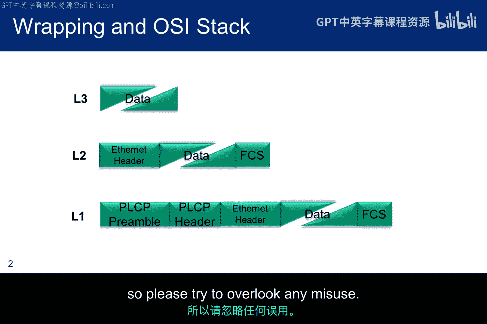
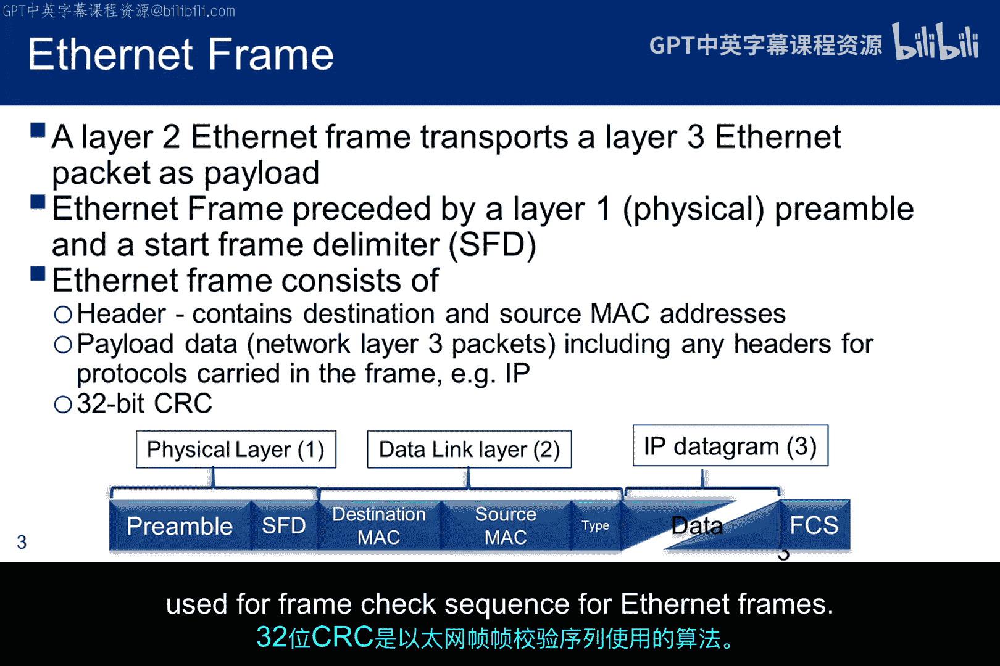
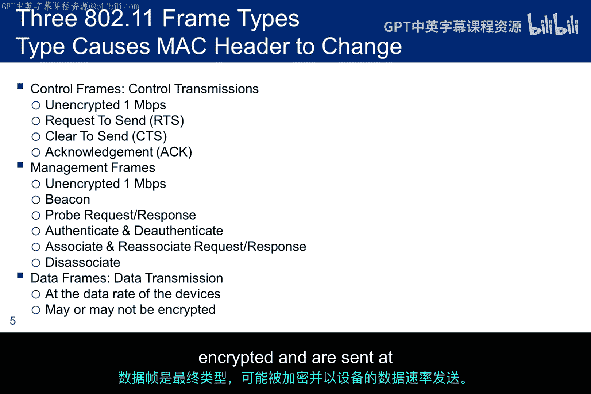
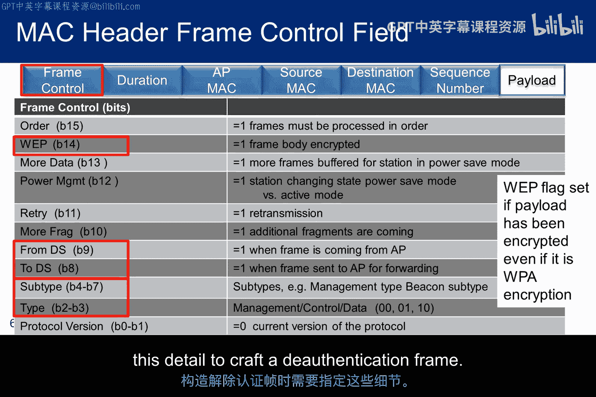
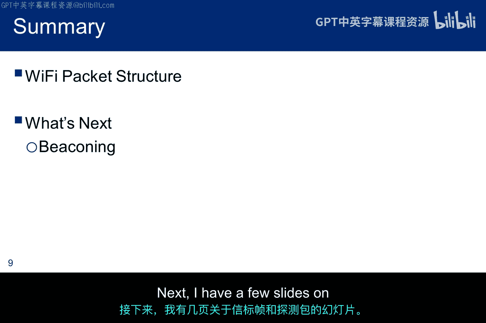

# 约翰霍普金斯大学《道德黑客入门｜Introduction to Ethical Hacking》中英字幕 p48 26_数据包结构与协议分析.zh_en -BV1xgu1z1Eau_p48-

The structure for Wifi packets is defined in the IE specification。

 The lab asks you to discuss the fields required for the construction of a de authentication packet because dething a connection is going to be necessary to capture WPA's fourway handshake。

 which you will be asked to do later in the lab。 while。

 there is a tool that will construct a deoffth packet for you。

 I want you to understand what goes into the frame in how to find details in the spec。

 so that if you had to craft any wfi packet type with a tool like Scappy， you would be able to do it。

Here is a simple depiction of the ethernet packet format。

 It shows how data at level 3 of the O I stack， it wrapped first with an ethernet header。

 and then with physical layer headers for transmission。 technically， frames are found at level 2。

 The data link layer。 and packets at level 3， the network layer。

 This is why the frame check sequence added at layer 2， as the word frame in its name。

I am not always careful about my use of that terminology， so please try to overlook any misuse。

This is a slightly more detailed look at an ethernet packet。

 It adds to detail that shows the ethernet frame hitter contains both destination and source Mac addresses。

 The wireless protocols introduced the idea of a third party， the wireless access point。

 This requires the expansion of some of the ethernet packet ideas。 for the ethernet hitter。

 since there are at least 45 protocols。 The one used by the payload needs to be identified。

 For example， an I P datagram。 A 32 B CRC is the algorithm used for frame check sequence for ethernet frames。

The wireless standard introduces the idea of a Mac header at layer 2 to replace the ethernet header。

 Notice that the Mac header is a little more complex and includes three Mac addresses。

 source destination and access point。 The format of the Mac header depends on whether the information is a control frame。

 a management frame or a data frame， which I will discuss in a minute。

 The Mac header contains the source and destination max to allow delivery of the frame to the correct device。

 The destination address can be uncast， which means it must be delivered to a single device。

 or it can be multicast， which means that it may be delivered to several devices。

 or possibly all devices in range。 The Mac header also adds some other fields。

 and I will discuss the frame， control field a little later。There are 3，80211 frame types。

 and we have to keep track of them because the order of the Mac addresses in the Mac headter will change。

 depending on the frame type。 The three frame types are control frames。

 management frames and data frames。 Control frames are unencrypted and are used for the request to send and clear to send messages Basically。

 an R T S indicates I want to transmit and it includes the source。

 the destination and the duration of the transmission。 If the medium is free。

 a clear to send is returned， repeating the duration of the transmission to make sure everyone one understands how long the media will be engaged。

Management frames are also unencrypted and are used for all the frame types shown here。

 The one the class will be interested in for the lab is the authentication。 It is a management frame。

 So that's how you want to narrow down the search。 If you look for it in the IE standard。

Data frames are the final type， and they may be encrypted and are sent at the data rate of the devices involved。

The frame control field is 16 Bs long， and we need to understand several of the settings。 First。

 if the payload is encrypted， bit 14 is set， this is usually parsed as the web bit。

 but it signals WPA encryption as well。 bits 8 and 9 for the from and 2 distribution systems Sign the order of the Mac addresses in the Mac header and bits 2 through 7 signal the frame type control management data and the subtype for example。

 a subtype of a management frame may indicate a beacon frame。 If you look at the iE spec。

 you will see six subtypes for control frames，7 subtypes for management frames and 10 subtypes for data frames。

 you will need to specify this detail to craft a D authentication frame。

This diagram shows how the two and from distribution system bits are associated with the frame type。

 First， notice the possible settings for the two bits on the left。To the right。

 you see how the order of the Mac addresses changes。 And for the last one。

 you see the addition of a fourth Mac address。Bit2ple 00 is used for all management frames and all control frames。

It is also used for any data frame sent from one station to another in an ad hoc network。

In an infrastructure network where the access point is operating。

 all the mobile devices send their frames to the A P。

 which then forwards them to the correct destination。 In this case。

 a mobile device creates and sends the message。 The access point receives them。

 but is not the final destination。 Therefore，3 addresses are needed。 Bi2ple 1，0。

 designates an infrastructure frame in which the station is sending to the A P and the A P will forward the frame to its destination。

But Tple 01 also designates infrastructure frames and is used for packets forwarded by the A。

Bit2ple11 designates a wireless distribution system which is sending frames between two access points。

 so it must incorporate the Mac of the second A。In the diagram。

 the receiver and transmitter Mac fields are for access points。

 and the source and destination Mac fields are for stations。 Basically。

 the source Mac is for the device that created the original message and the destination Mac is for the device that ultimately receives the message。

The sequence control field is used to manage different fragments， belonging to the same frame。

This shows a frame type subtype reference guide produced by sands。

 This information corresponds to the frame and sub frame type in the frame control field。

 frame type is pretty simple to set because it is 2 Bs。 And the only options are 0，1 and 2。

 The sub frame type uses 4 Bs。 The diagram at the bottom shows the frame control field and the bits designating a beacon frame。

 Subtype 1，0，0，0 and type 0，0。This finishes the discussion of wfi frame structure and should have provided enough information to construct a D offth packet for the lab。

 And you could use Spy to craft and send it if you wanted to。

 There are a few details unique to D offth frames that you will have to refer to the IE standard to get right。

 Next， I have a few slides on beening and probing packets。

