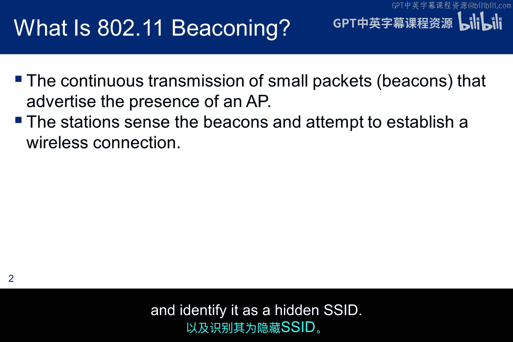
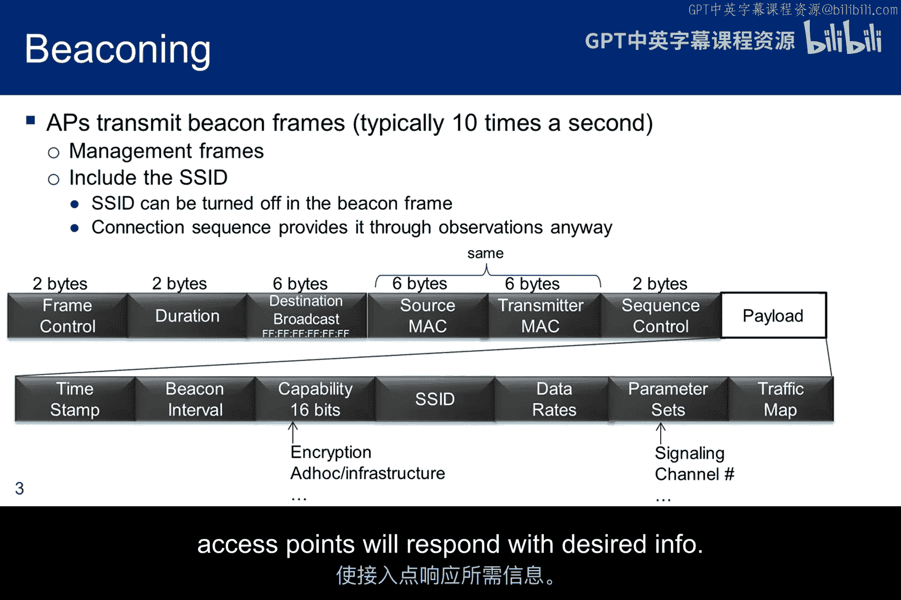
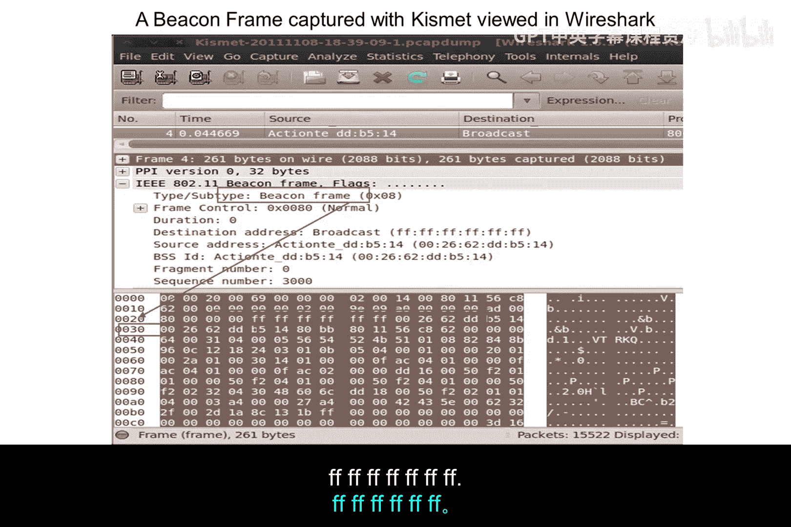
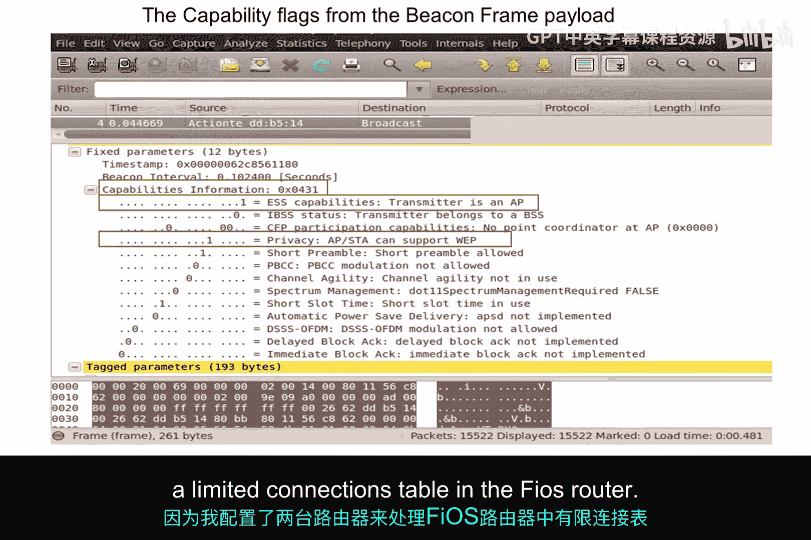
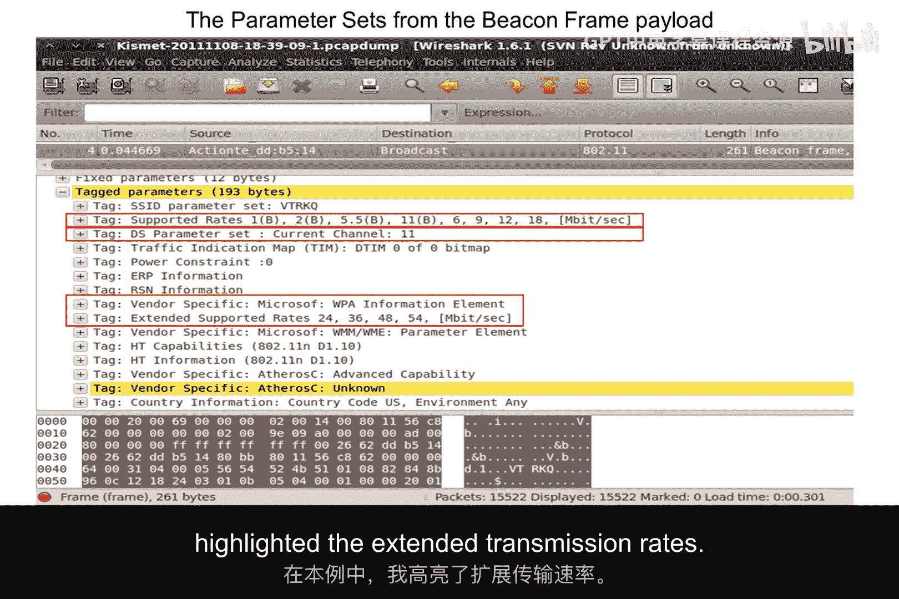
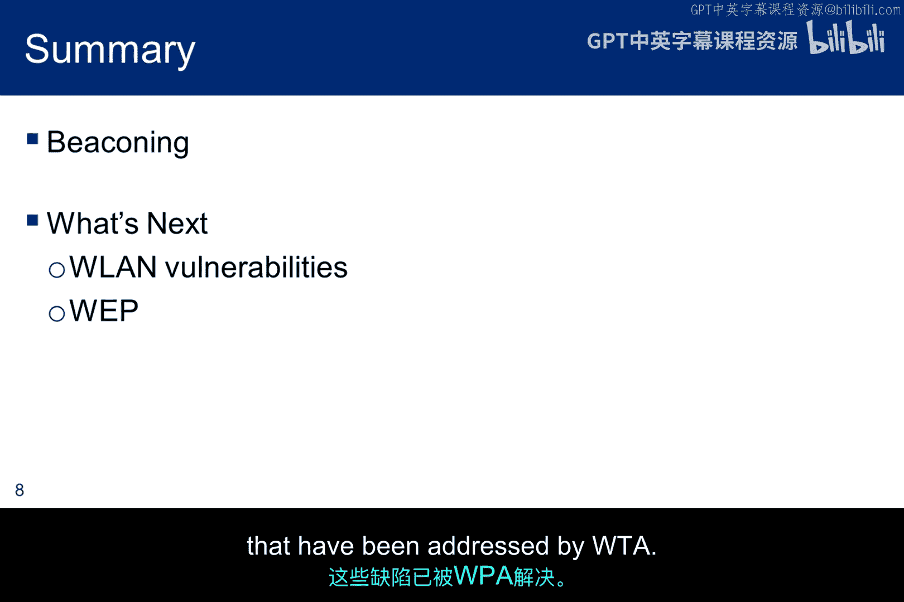

# 约翰霍普金斯大学《道德黑客入门｜Introduction to Ethical Hacking》中英字幕 p49 27_信标帧与探测帧.zh_en -BV1xgu1z1Eau_p49-

In this submod， I will discuss the idea of being by an access point and probing by a station。

 alternateter approaches to starting the Wi Fi access process。

The screen captures will show the structure of beaening packets collected using a wfi packet capture tool called Kiismid and displayed in wirereshark。

 Kiismmat is available in Cali， and you may want to explore its features。

 You should be able to do the same capture with wire shark directly。

 but promiscuous limit you to a single SSI D。 So you will have to read about setting up monitor mode to capture all the packets in the ether。

So what is being， Basically， these are advertisements from the access point stating that it is available to accept connections。

 Sometimes home users turn off beaing， thinking that it improves security。

 but it does not unless you simply don't use your Wi Fi network。

Monitoring tools can easily determine the existence of a non beconening access point by just examining data packets。

 and they will give you the Mac， the channel， the transmission rate。

 whether or not the traffic is encrypted and identify it as a hidden SSId。

Beacon frames are management frames， and if turned on。

 they are typically sent out 10 times a second in the picture。

 you see the field containing the destination Mac has a broadcast address in it。

 So it is transmitted to everyone。 Notice also that the source and A P max are the same since the A P is doing the transmitting。

 The payload in a beacon frame has several fields。 After receiving a beacon frame。

 A station uses the time stamp value to update its local clock。

 This process enables synchronization among all stations that are associated with the same access point。

 The beacon interval represents the amount of time between beacon transmissions。

Before a station enters powera mode。 the station needs the beacon interval to know when to wake up to receive the beacon and learn whether there are buffered frames in the access point。

 capability information signifies the requirements of stations that wish to belong to the wireless la that the beacon represents。

 for example， this information may indicate that all stations must use web in order to participate in the network。

 The service set identifier identifies a specific wireless land。

 before associating with a particular wireless land。

 A station must have the same SSId as the access point。 By default。

 access points include the SS Id in the beacon frame to enable stations to sniff and identify the SS Id in automatically configure the wireless network interface card with the proper SS I D Some access point vendors have an option to disable。

The SSID from being broadcast in Beacon frames， and in that case。

 the station has to know the SSID and probe the AP for access。

Each beacon carries information that describes the data rates that the particular wireless land supports。

 For example， a beacon may indicate that only 12 and 5。

5 Mbit per second data rates are available As a result， an 802。

11 B station would stay within limits and not use 11 Mbit with this information stations can use performance metrics to decide which access point to associate with parametermeter sets provide information about the specific signaling methods。

 which might include frequency hopping spread spectrum or direct sequence spread spectrum information。

 It would also include the channel number the access point is using。

An access point periodically sends the traffic indication map or ti within a beacon to identify which stations using power saving mode have data frames waiting for them in the access points buffer。

The ti identifies a station by the association I D that the access point assigned during the association process。

 an 80211 probe response frame from an A P to a probing station is very similar to a beacon frame。

 except that the probe responses don't carry the Tm info and are only sent in response to a probe request。

A N will broadcast a probe request when using active scanning to determine which access points are within range for possible association。

 and some sniffing software tools send probe requests so that access points will respond with desired info。

This is a beacon frame captured using kissment and displayed in wire shark。

Notice four fields in the capture。 First， the hex representation of the beacon frame is 80 or 0，0，0。

0，1，0，0，0。 Second， the destination address is the broadcast address， F， F， F， F， F， F， F， F， F， F， F。

 F， F， F。

And the last two fields show the broadcast Mac and the source Mac are the same。

 Both are the access point。This is the same packet information。

 but it drills down on the capabilities field。 You see the encryption is turned on and note that my A P is configured to use WPA A 2。

 but the 80211 specification and therefore， how wirehar pars the field does not distinguish web from WPA A。

 The top bit in the capabilities field acknowledges that the sender is an access point at the time。

 the sender was identified as an extended service set because I had two routers configured to deal with the constraints of a limited connections table in the Fios for router。

This is also the same packet information。 But this time。

 the screenshot drills down on the parameters。 The beacon includes information about the transmission rates supported and the channel number being used。

 and notice that there are some vendor specific parameters。 In this case。

 I have highlighted the extended transmission rates。 As mentioned earlier。

 it is possible to probe for nearby access points。 And when the SS I Ds are not included in the beacon frame。

 Or if beaconing is turned off， stations need to be configured to probe for a specific SSId in order to establish a connection。

 and beacon frames and probe responses are the same except for the Timm field。

This was a short discussion of beaening with screenshot of important frame fields that should provide some guidance in constructing a de authentication frame。

 Next， we will talk about a few wireless land vulnerabilities and dig deep into We to identify its serious deficiencies that have been addressed by W P A。

