# 约翰霍普金斯大学《道德黑客入门｜Introduction to Ethical Hacking》中英字幕 p50 28_WLAN安全漏洞.zh_en -BV1xgu1z1Eau_p50-

We discussed some wireless s vulnerabilities earlier， but in this sub module。

 we will talk about ways to exploit some of them and then dig down into web。

I'll cover a couple of these vulnerabilities at a high level now。

 and the rest will follow with a little more detail and attack approaches。

Bandth exhaustion is more or less the same as any TCP attack that uses up resources to get to the device。

 For example， S floods。 An example of process exhaustion on an access point is repeated authentication requests more than the A P can handle。

 Another A P process exhaustion Ex was discussed at the beginning of the module called frame flooding。

 it overloads the access point with probe or association frames。

 It is also possible to dos another station on an 80211 network The attacker transmits packets to a target using a spoofed access point Mac。

 The recipient of these spoofed frames has no way of telling if they are legitimate or illegitimate requests and processes them。

The ability to transmit spoofed management frames allows Mac layer。

 denialile service attacks like frame flooding， but it also allows de authenticthentation。

 disassociation flood attacks， which continuously disconnects the station from the access point。

 The two bullets at the bottom marked with red arrows are the main focus for the rest of this module。

 The first is a dictionary attack against WPA A， And the second is a cryptographicic attack against Webb。

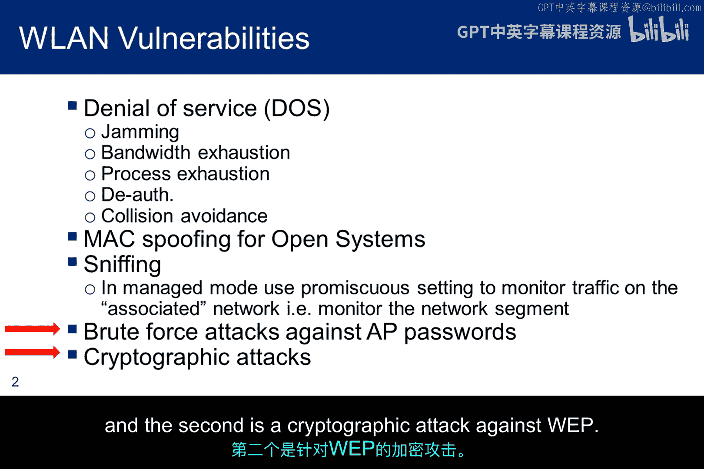

Jaming can be an effective technique for a 2。4 gigHz access point。

 Corless phones and microwave ovens cause interference and can actually be used as attack tools。

 Some older microwaves had porous shielding and actually leaked a 2。4 GHz signal。

 disconnecting Wifi devices。 In some ways， this is O B E with a transition to dual band routers that also support 5 GHz。

 but 2。4 GHz bands can still be attacked。And some dual band routers may not be properly configured to use the second band。

De authenticuthation requires Mac and channel information。

 but a tool like Kiismit collects that automatically。 Once we have sniffed that information。

 we can craft a deosth packet and launch the attack to force a disconnection。

 And if we do it repeatedly， it becomes a denial of service attack。And at various times。

 hotels have tried to maintain the telecommunications revenue stream by doing a deoff to force you off your mobile device's hot spot。

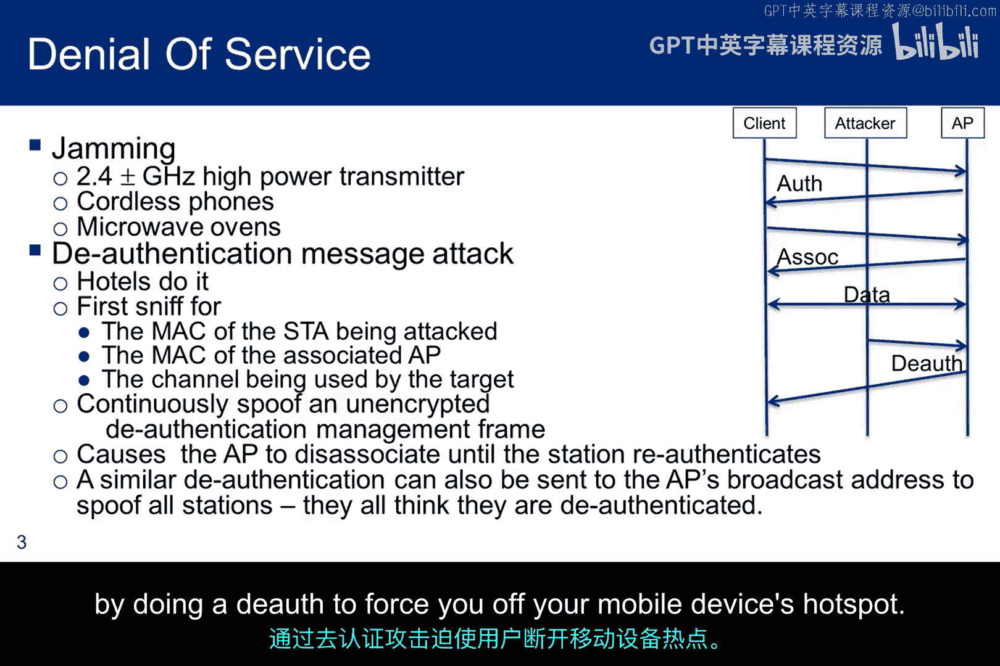

A collision avoidance denial N of service attack is also interesting。

 Here is how it works In normal operation。 When node A has data to send to node B。

 it first sends request to send packet to node B。 node A fills in the address of node B。

 and the time required to complete the data transmission。On receiving RTS packets from node A。

 node B replies with a clear to packet that also includes the duration information。

The R T S from A will also be received by node C。 If node C is also in the transmission range of a node C determines that it is not the intended receiver。

 So it blocks itself from accessing the channel by setting a timer known as the network allocation vector or NA A V。

 while in the blocking state， node C can neither start a data transmission nor reply to any Rts packet from any other node in its neighborhood。

Now， suppose node D is another node that is in the transmission range of node B。

 not necessarily node A， and node D receives a clear toend packet。 B sends back to A。

 D will also set a NA V timer to prevent any data transmission during the transmission of data from node A to node B。

 So nodes near a and nodes near B， will set their navs to eliminate collisions。

 The network allocation vector， is just another counter that decreases constantly from a value initialize using a duration field。

 which is a's transmit time included in the R T S packet or return in the C S packet。

The timer set by node C is called R T S and A V timer， and the timer set by node D is called C。

 T S and A V timer。 Now， nodeday starts actual transmission to node B。

 After receiving the complete data package accurately， node B replies with an acledgment。

 Act packet to indicate the success of transmission At that point。

 node C and D will unblock themselves。So an attack leveraging this mechanism constantly sends spoofed CTt S control frames containing high duration values。

 Every node that sees the C T S frames blocks itself。 And since they are continuous。

 those nodes never unblock， creating a denial of service situation。

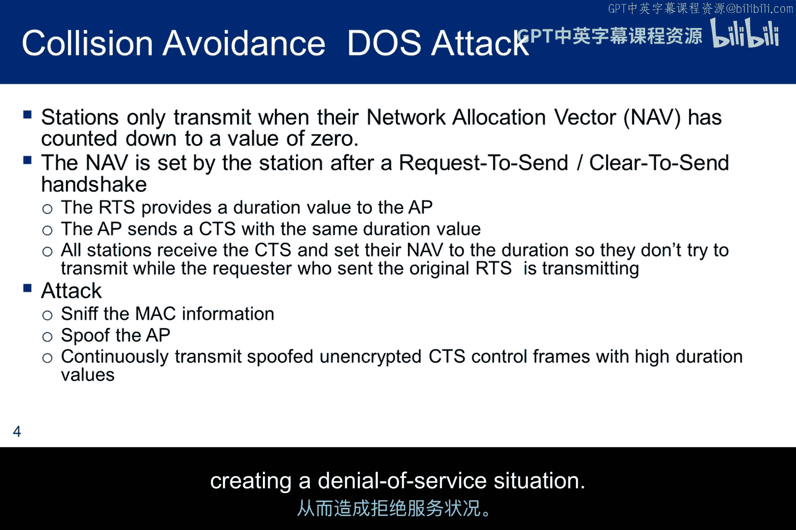

Now， for the fun part， just what is wrong with Webb。

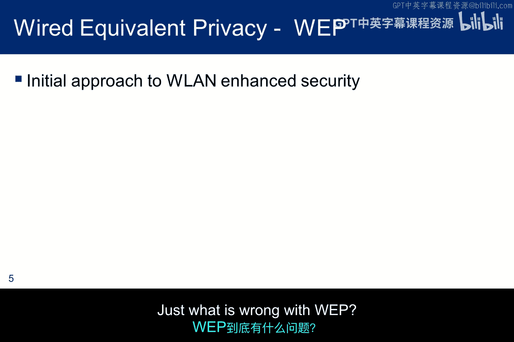

If you want to explore vulnerabilities， and if you plan to do the Wi Fi lab。

 you will need a wireless adapter。 You most likely have one on your host machine。

 but Vms don't directly interact with a host adapter。

 A VM can bridge to the host adapter for Internet access。

 but it cannot put the adapter into monitor mode， So there needs to be another solution。

 One approach is to use a USB Wifi adapter， which should be recognized by your Callli VM。

But some will not work with the Wifi tools like Kiismit or Airman N G。 In my case。

 I have three USB adapters。 One never worked。 One only worked until v box drivers are updated。

 and one still works。 There are lengthy discussions about this on the Internet。

 but almost all of those discussions deal with Cali running on the host， not as A V M。

 So be careful about what you read。 And as always， the Internet is full of discussions and opinions stated with certainty that will lead you astray。

The adaptaper that currently works for me is a T P link。 T P dash W N 7，22 N with the Atheros chip。

 The adapter is still available， but it may fail as well the next time I update v box。

 So I caution you about wasting money on more than one adapter， If you buy one， and it doesn't work。

 I recommend you change paths and go down the live USB route。

 which eliminates v box drivers from the picture。 The idea is you boot Callli from a live USB。

 It should recognize both your host adapter and a USB adapter。

 There is still no guarantee it will work。 but the adapter discussion on the Internet will be more pertinent。

 You do have to give the live USB a persistent partition。

 which is a little tricky but explained in the lab notes。

 The final option is to load the Wifi tools like airc and G right on your host eliminating both V box drivers and cali。

 but there are no。You are in case with this configuration， either。To attach the USB adapter in V box。

 you want to cancel the installation to the host when you plug the adapter in。

Then from the V box menu， select devices and USB devices and check your USB adapter to activate it。

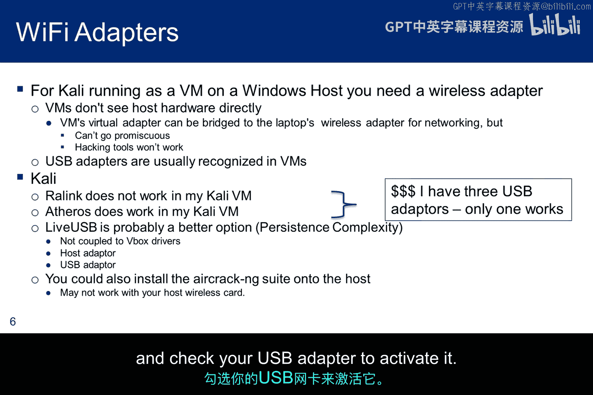

Before digging into the we algorithm， I want to remind you about how X or works。

 If a X or B equals C， then C， X or A equals B， and C， X or B equals A。

 This means that if you have plain text and you X or it with a key stream you get ciphert to get the plain text back。

 you X or the ciphertex with the same key stream。But because of the way Exor works。

 it is also possible to exor the plain text with the cipher text to get the key stream。

 We will use this fact in our analysis of we。

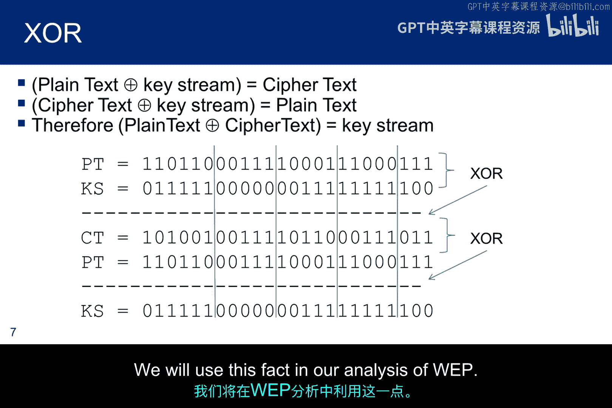

Wep uses the R C 4 algorithm， and it works like this。 Starting at the top left。

 we create a key stream by concatenating a 24 B initialization vector or Iv with a secret key。

 and running the result through R C 4。 The initial version of we only had a 40 B secret。

 but that was far too short。 So it was soon increased to 104 B secret。 And a reminder。

 a key stream is not the same as a fixed length key。

 This kind of algorithm uses a pseudoran number generator。

 and is designed to generate a key stream of any length。 In the case of we。

 The key stream will match the length of the plain text that needs to be encrypted。Simultaneously。

 a 32 B CRC is calculated on the plain text， and it is called the integrity check vector or ICV。

 Once this calculation is complete， the plain text is concatenated with its own ICV。

 So now we have a key stream that is just as long as it needs to be for the plain text plus ICV。

 and we exhor them together， creating the ciphert。 and that is all there is to it。

 What is transmitted is the initialization vector concatenated with a key I concatenated with the ciphert。

 the key I is just a number 0 or3， telling the other n。

 which of the four wet keys to use in creating the key stream。

 and the other N needs both the key I and the IV to recreate the key stream for decryption。

A little later， I will discuss a web crack that leverages design weaknesses and finds the key using crypt analysis。

 But think about how you would perform a brute force attack against a web。

 It is important to understand this algorithm for part of the lab assignment。

 So working through how you would validate a brute force attack will tell you if you really understand what is going on。

 So if you guess， K， what do you need to sniff， what calculations would you make and what comparisons are required to determine whether or not you have correctly guessed the secret。

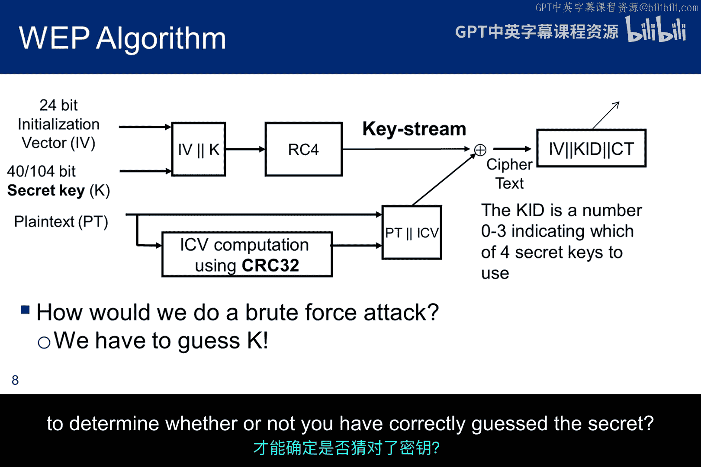

This slide summarizes the steps in the Web encryption process just discussed。

 So I won't run through them again， but I do have a few comments。 First。

 Reve cipher number 4 or R C 4 is a stream cipher and multiple vulnerabilities have been discovered。

 rendering it insecure。This weakness is actually key to the cryptanalytic attack。 Second。

 the highlighted box shows the exor steps for encryption and decryption。 Third。

 webb can use a 40 or  hundred04 B secret， but neither is secure。 And a reminder。

 a stream cipher takes a sequence of ordinary plain text and produces a sequence of cipher text while a block cipher handles a single block of plain text at a time。

 not the stream。😊。

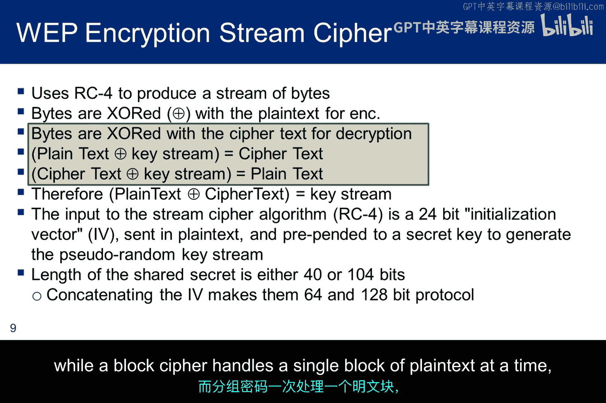

There are many security problems with Wep， but one is that CR C 32 is not cryptographically secure。

 The fact that it is linear means the CRRC of A X， R B equals the CR C of A Xor with CRC of B。

 This means that it is possible to compute the bit difference of two CR Cs based on the bit difference of the messages over which they are taken。

This facilitates the integrity attack because flipping bit N in the message results in a deterministic set of bits in the CRC that must be flipped to produce a correct checkum on the modified message。

 because flipping bits carries through the R C 4 decryption。

 This allows the attacker to flip arbitrary bits and an encrypted message and correctly adjust the checkum so that the resulting message appears valid。

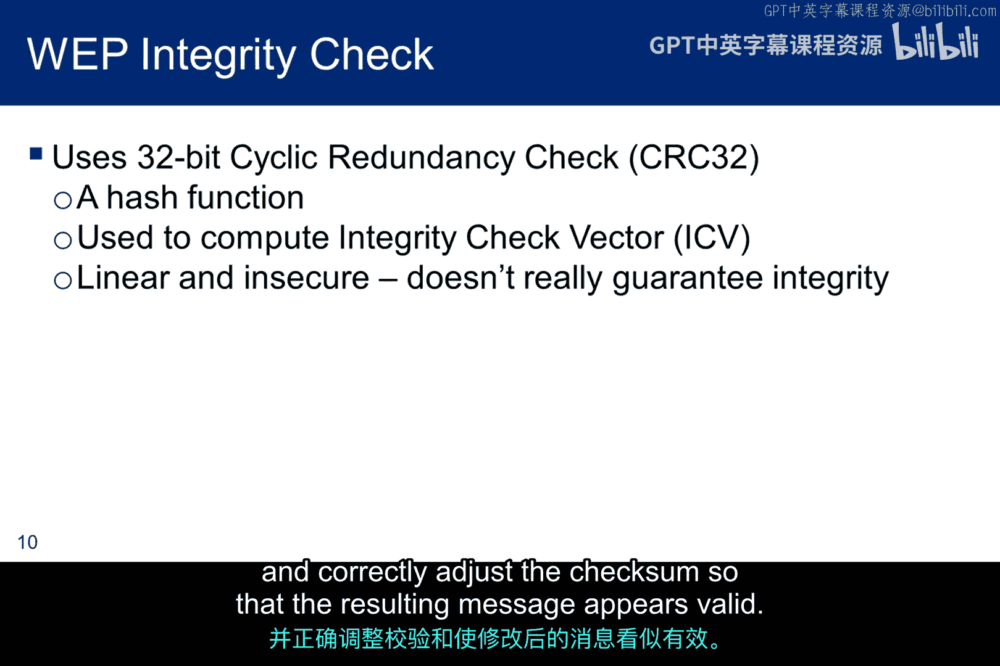

This slide summarizes the problems with Wep that make the protocol vulnerable。

 and all are addressed in the WPA A2 replacement。The first problem is the length of the I V。

 since it is only 24 B， even though it changes， it gets repeated frequently on a high traffic gl。

 When the I V is reused， the key stream is reused as well。

 And these collisions make the crypt analysis possible。 So the secret key can be recovered。

The second problem is the I V reuse， means messages can be replayed。

 which is essentially the same as reuse and facilitates crypt analysis。 In the next submodule。

 you will see that replaying packets is a significant component of the attack。 In fact。

 the standard does not require the Ivy to be incremented at all。

 While I don't know if any implementation that doesn't increment the Ivy。

 It is clear the security issues were not methodically thought through。Third。

 the Ivs are transmitted in the clear， so they can be easily sniffed。

 which reduces the key length to 104 Bs instead of 128 B。 But more importantly。

 knowing the first 24 Bs of the key helps crack R C 4， giving up the key。

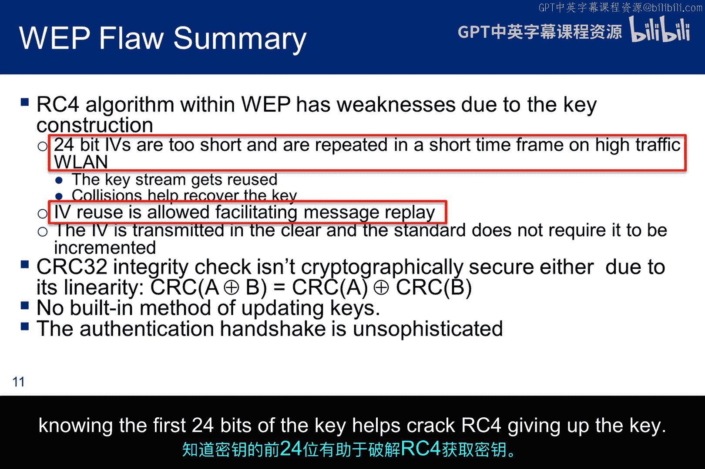

These are the key steps in the web hack。 It starts with the authentication process when  a hundred 28 random number is sent by the access point to the station for encryption。

 This can be sniffed and the associated ciphertext can be sniffed when the response is transmitted back。

 So Xor in the ciphertex and the plain text yields the key stream。 Since we can sniff the I V。

 which is passed in the clear， we have enough information to launch a crypt analysis tag on R C 4。

Basically， the algorithm is vulnerable when a few bits at the beginning of the key are known。

 And in this case， we know 24 Bs。

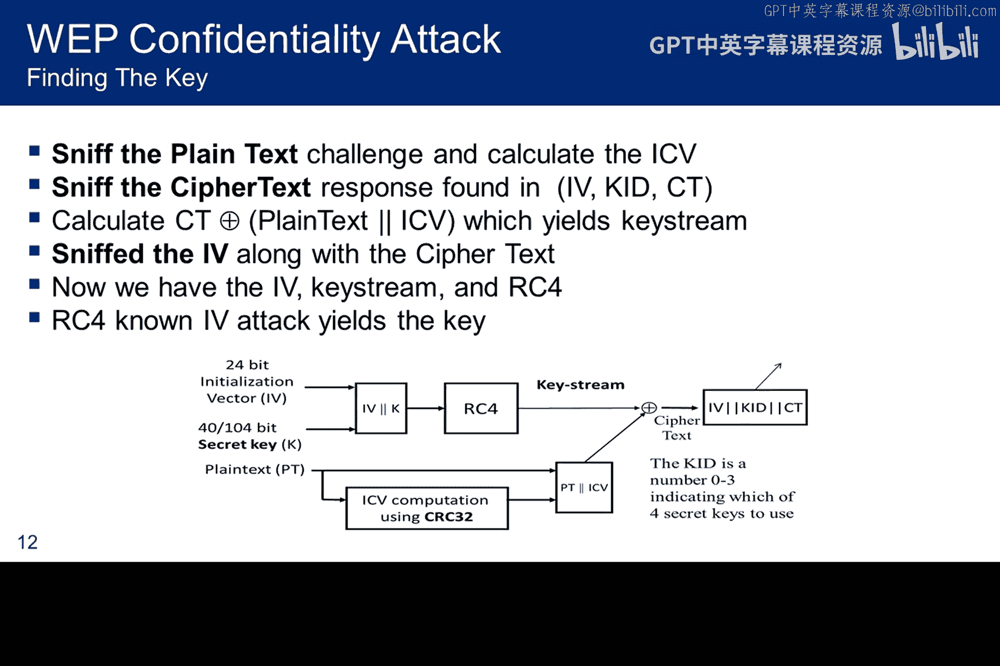

One basic weakness of R C 4 is that in certain cases， the I V。

 which gets concatenated with the secret， can determine the initial bys of the key stream。

 Since we know the Ivs， if we can collect examples where a small number of initial bits determines the key stream。

 the crypt analysis will give us the key。 So while the key stream may remain strong。

 certain keys using certain Ivs will be weak because the I V plays too big a role in determining the key stream。

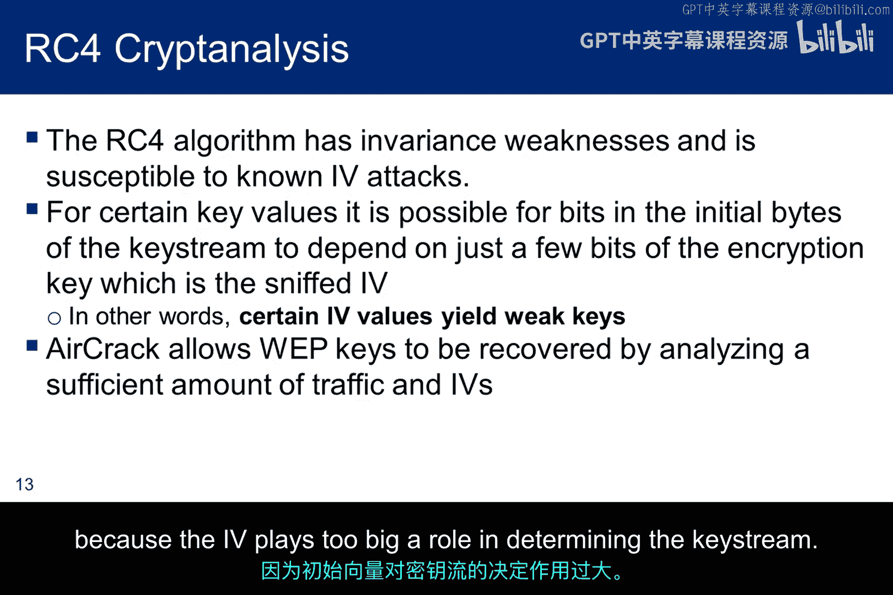

And this is another reminder about the role of address resolution protocol。

 as it is going to play an important role in our tech methodology。

 Ap links I P addresses to Mac addresses needed for physical transmission to minimize the number of broadcasts。

 Ap maintains a cache of I P address to Mac address mappings for future use。

 The Ap cache can contain both dynamic and static entries。

 Dyna entries are added and removed automatically over time。

 Sta entries remain in the cache until a computer is restarted。

Each dynamic arp cache entry has a potential lifetime of 10 minutes。

 New entries added to the cache or time stamp。 If an entry is not used within two minutes of being added。

 it expires and is removed from the ap cache。 If an entry is used again。

 it receives two more minutes of lifetime。 If an entry keeps getting used。

 it receives an additional two minutes of lifetime up to the maximum lifetime of 10 minutes。

 You can view the arp cache by using the arp command to view it type ARP Spacet A at a command prompt and to view arp command line options type arp slash question mark at the command prompt。

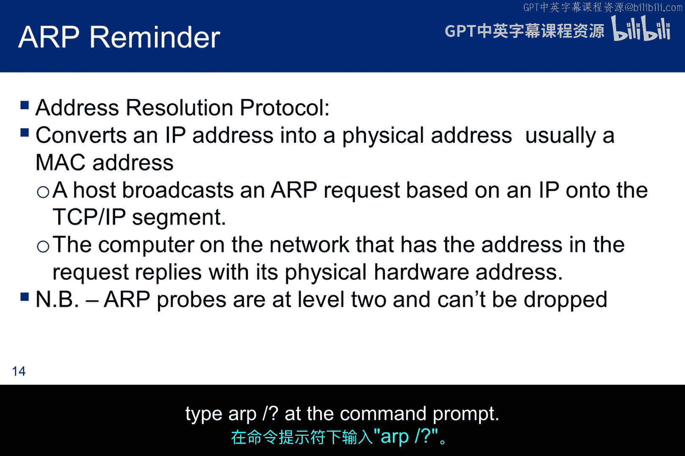

This lecture has discussed a few important W land vulnerabilities。

 but we have also drilled down into we to see where its weaknesses are。 Next。

 we will learn about leveraging those weaknesses to capture the secret encryption key。

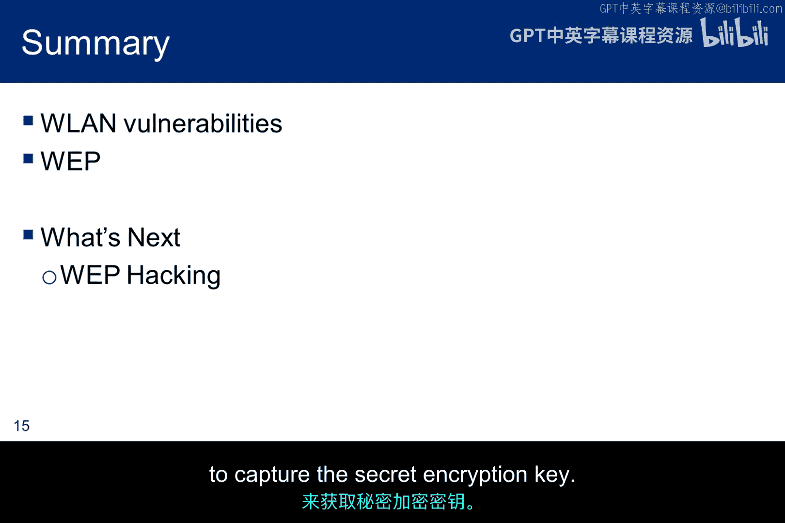