# 约翰霍普金斯大学《道德黑客入门｜Introduction to Ethical Hacking》中英字幕 p52 30_摒弃WEP，WPA安全性探讨.zh_en -BV1xgu1z1Eau_p52-

We know that Wep is a poor choice for our access point。

 and we know WPA has been designed to address weaknesses in We。

 But what does that mean and do the changes really achieve the goal。

You might think of WPA A as a subset of WPA 2。 It extends some of the we ideas to make them more secure。

 allowing reuse of we firmware。 And at the same time。

 it is forward compatible with the current WPA 2 standard。 In spite of this evolutionary approach。

 My de link router became trash because the company was not forward looking enough to make the firmware upgradable。

 WPA 2 is now part of the 80211 specification。As noted earlier。

 WPA supports both key sharing authentication and an enterprise solution using a radius authentication server。

 We will focus on the key sharing ideas for the rest of this module because a weak pass phrase can make WPA vulnerable in spite of the security enhancements。

 While it is not susceptible to crypt analysis。 Dictionary attacks are effective against a weak password。

The interim solution on the way to WPA 2 was WPA， so we will start there。

 The objective of WPA was to provide a solution to the web problems that retained many of the ideas of the web design while providing a path forward。

 So R C4 stays in the picture on an interim basis。 but everything around it gets strengthened with we the 24 B Ivy changes the key stream。

 But the prepenending of an Ivy that is repeated， turned out to be problematic。 In other words。

 the Ivy implementation determined how often the key stream changes。 In theory。

 this could never change if the Ivy is constant。But I have heard of no implementations that use this approach。

 but we don't really know how frequently the vendors change the Iv。 At any rate。

 the temporal key integrity protocol or Tkiip addresses the issues with the I V by dynamically changing the key for every frame that gets encrypted。

 The integrity algorithm is also strengthened from CRC 32 to a more secure algorithm called Michael。

 Finally， the authentication changed from simply encrypting and returning the ciphertext for 1 hundred28 B number to a fouraway handshake that requires the exchange of lots of information and results in a much improved authentication mechanism。

 We will work through the changes for a more secure use of a presured key。

 But remember that an 802 do1 x。 when there is a radius server。 That server manages the master key。

 and there is no P S K。These are the changes we need to understand。

 and the temporal key integrity protocol will be the first。

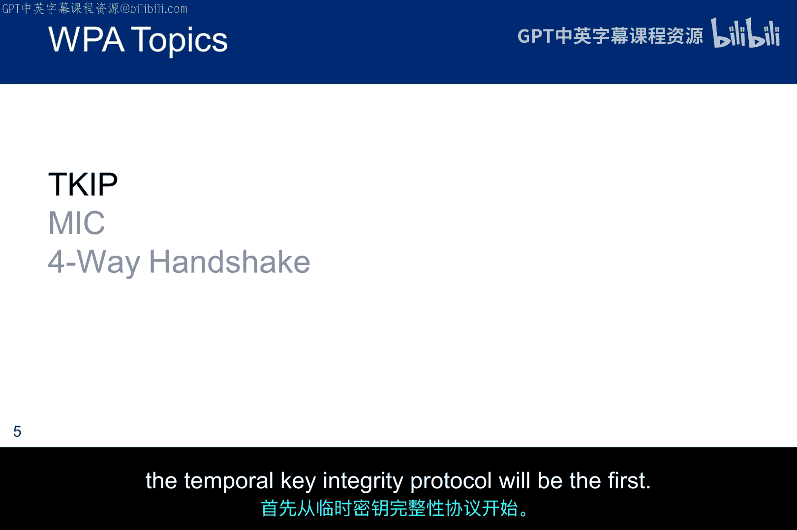

The TKP Parawise key hierarchy starts on the left with the shared passphse and the SSI of the Wi Fi network。

 The keyed hash message authentication code， Hmac Shah1 uses the passph as the key。

The password based key derivation function， PB K D F 2 actually generates the Parawise master key using parallel Hmac Sha1 calculations that are concatenated and truncated to yield a 256 B master key PMK。

 noticeice that the PMK is basically immutable during operation and will never change unless the passph or SSID changes。

Once we have the 256 B master key， it is fed into a pseudoran function。

 which uses a pseudoran number generator。P R N G to do key expansion to 512 B。

Additional inputs are the Mac and random number or nos associated with the A and the Mac and random number associated with a station。

An important idea is that given the same seed， the PR N G always produces the same random output stream。

 So two independent devices can generate the same set of keys by starting with the same seed value。

 In this case， the seed used by both the station and the access point is。

 pairwise key expansion angle。 So there will be a fourway handshake to allow the station to get the Mac and nos from the A P and vice versa。

So the output of the PRF is a 512 B string that is subsequently split into five different transient keys。

 The first 228 B keys are used just in time within the handshake to provide integrity protection and confidentiality。

 The third28 B key is actually used to encrypt data traffic。

 and the last 128 B string is split into 2 64 B integrity keys used during data transmission in both directions。

 Finally， although the master key doesn't change， the temporal string does change。

 Each time there is a new association handshake， both nonsenses change So the output of the PRF changes。

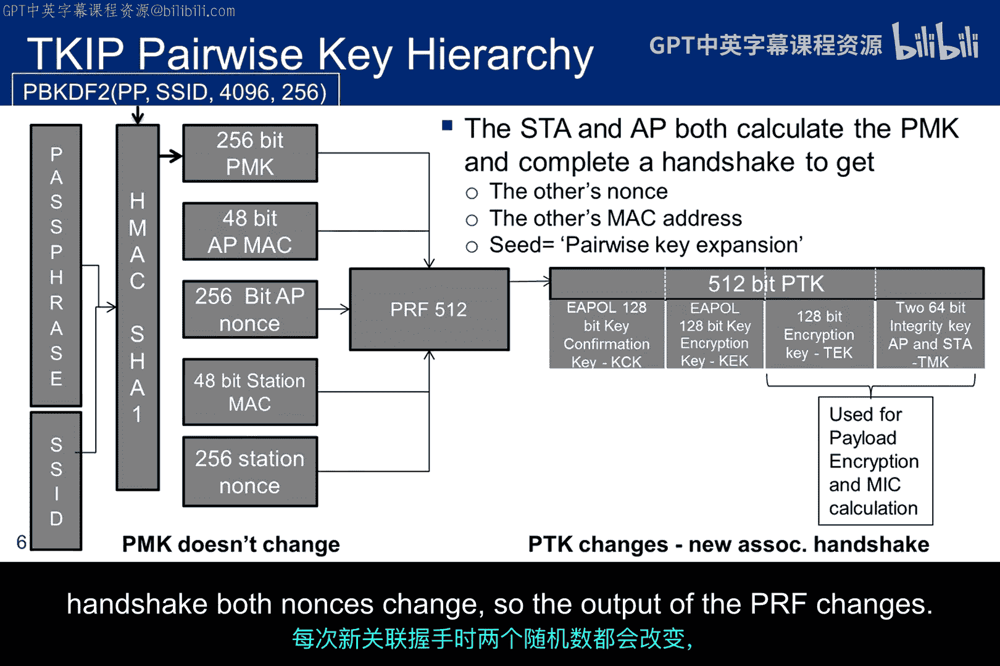

Once we have the transient keys， the T EK and the two T MK keys， the question becomes。

 what does TKip do with them to generate a protected payload？Before drilling down into this topic。

 notice the red boxes， which represent the reuse of the Web technologies。 Again。

 the idea is that WPA can provide more secure encryption because we have improved the inputs to those boxes。

While they remain unchanged， the inputs around them do not。 First。

 notice that the 48 B IV is also called the Tki sequence counter or T SC。

 where the word sequence means that increments with each new packet。 This forces the I V to change。

 which was not mandatory in web。 and the 48 B length means that an I V won't be reused for a very long time。

 In fact，2 to the 48 is so large that we can think of it as not repeating。

 If the T SC space is exhausted， the choice available in a compliant implementation。

 are to replace the temporal key with a new one or to end communications。

 Since reuse of any T SC value compromise is already sent traffic the best implementation would just end communication。

 The thing to notice about the T SC， is it is broken into two pieces。 A 32 B piece in a。16 bit peace。

Before we discuss how those segments are used， we need to look at what happens to the TEK。

The hundred and 28 B transient encryption key goes through two stages of mixing。

 The inputs to the first stage are the T E K， the Mac of the transmitter and the 32 B segment of the Ivy。

 The 16 B segment of the I V goes into the second mixing phase。

 This ensures that the first phase changes the key mixing with every 65000 packets。

 And the second phase changes it with every packet。

The result is that the 104 bit output key bears little resemblance to the original T EK。

 and any attempt to use the RC4 crypt analysis techniques isn't going to work。

The I V that is preended is still 24 B， but is composed of the 16 B T SC segment with a dummy by inserted in the middle of the 16 B string。

 This is done in a way that the weak key problem leveraged in crypt analysislysis of we is countered at this point。

 the1 28 B result is passed to R C 4， and the algorithm is treated exactly as it was in We。

 except for the fact that the whole 48 B I V gets transmitted rather than the 24 B I V that was just preended。

 at the bottom of the diagram。 you see the new key integrity algorithm。

 Michael is applied to the Mac service data unit。 and the M output is injected in between the plain text and the CR C is used by the Web algorithm。

 If fragmentation is required to send the payload， the M only goes with the last fragment。

 If there is no fragmentation， the M goes。

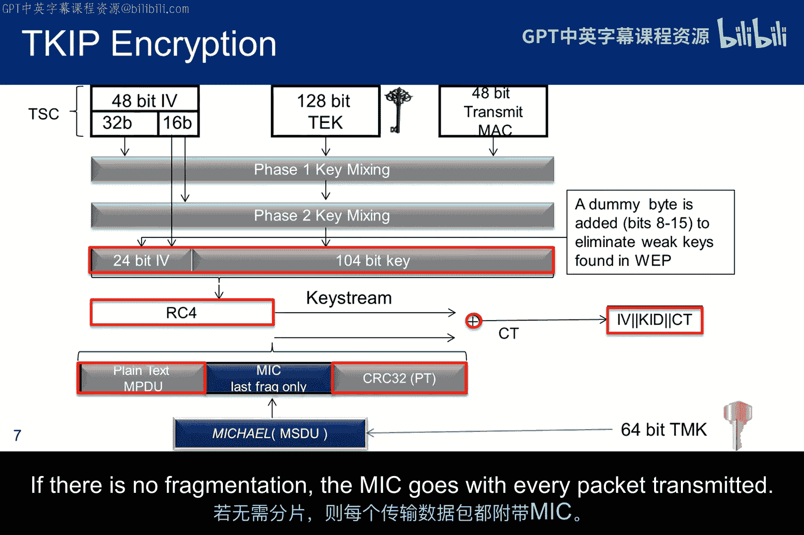

With every packet transmitted。This is just a short review of which WPA keys change and when they change。

 the pairwise master key can only change when the pass phrase or the SSID changes。It does change。

 but changes are infrequent。 The pairwise transient key changes each time there is a new faraway handshake。

 So that change is moderately frequent， but certainly not with each new packet。

 This is where the T SC comes in。 It increments with every packet resulting in a new 1 28 key input to R C 4 for each packet。

So this is what is different from We。 First， the output of the mixing algorithm changes the  hundred 28 B key used by R C 4 with each packet。

 because the T SC is incrementing。 If the T SC space is exhausted。

 The design choices available for compliance with the standard R1 to replace the temporal key with a new one or two to end communications。

 because reuse of any T SC value compromises already sent traffic， it may not be the best choice。

 The T SC is large enough， however， that T SC space exhaustion should not really be an issue。

 and just ending communications might be a better choice。Second。

 a dummy bite is added to the 16 B segment of the T SC in a way that it overcomes the weak key problem associated with certain Ivs that facilitated crypt analysis。

 Third， not only does the T SC increment， but a mechanism was added that blocks the replay of IVs。

 which was the weakness that allowed encrypted arc requests to be captured and replayed。

 This is accomplished as follows。 The Ivy value always starts with0 and is incremented by one for each packet sent。

 in any messages whose Tcap sequence counter is not greater than the last message is discarded。

 And fourth， each time a station reauthenticates and reassociates。

 There is a new handshake which results in all the keys changing。

 because the station and A P Nas are regenerated。

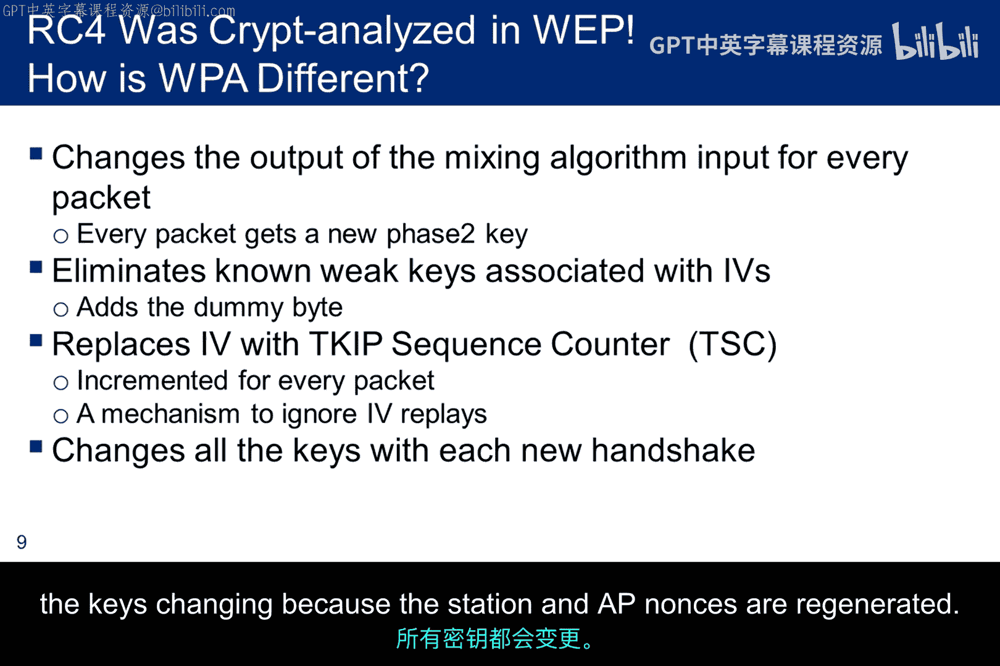

This picture of the pairwise transient key summarizes how the various key slices are used。

 I already talked about the two on the right。T， E， K and T M K in the Tkiip encryption discussion。

 The other two keys are used during the fourway handshake。

 and there is a just in time element that makes them ready just before they are needed。

The 128 B key encryption key or K E K is used during the handshake to provide confidentiality。

 Since at the time of the handshake， the record traffic encryption mechanism has not been activated。

 The access point uses this key to encrypt additional data sent to the client in the key data field。

 and the hundred28 B key confirmation key or K C K is also used during the handshake to protect through X or encryption and integrity check calculation。

The next WPA topic is the message integrity code， Michael， designed by Neils Ferguson。

 a Dutch cryptographer and consultant who currently works with Microsoft In 2001。

 he claimed to have broken the High bandwidthand Digital Content Protection Mechan。

 incorporated into the Highde DVD players， but he has not published the result due to the digital Millennium Copyright Act。

This slide is provided to make it clear。 The phrase message integrity code is overloaded。

 We saw a MI being calculated using the 64 B T Mks， one for the station and one for the access point。

 These 64 B keys run the keyed hash function called Michael used to improve the CRC 32 approach used by web。

 This is used on data traffic after the handshake is completed and the keys have been installed into the algorithm。

 but there is another M calculated during the handshake to maintain the integrity of data in the handshake。

 This is necessary because the keys have not been installed yet to protect the whole message。

 So as with encryption， an interim solution is required to provide integrity before the fourway handshake has been completed。

 This version of the M is associated with fields in the handshake， not the record traffic。

 and the M algorithm used in the handshake is Hmac M。5， not Michael， even though the key is the same。

 The 64 B slice of the T M K， this handshake M is protected by encrypting it with the K， C K。

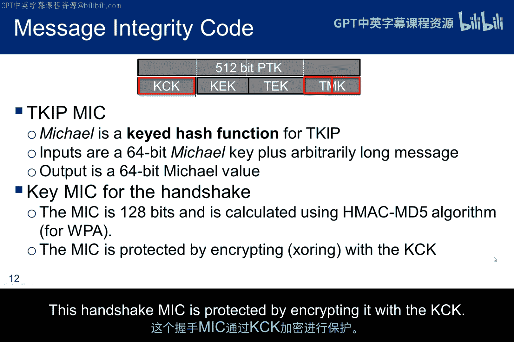

The micro algorithm starts by converting the 64 B integrity key to 2 32 B words。

 The message is partitioned into 32 B blocks and padded at the end with a single byte with the hexodadecimal value。

 X 5 a and then followed by between 4 and 70 bys。 The number of0 bys is chosen so that the overall length of the message plus the padding is a multiple of four。

 The computation of the MI uses substitutions， rotations and exclusive or operations。

The algorithm doesn't use multiplication for performance reasons。

 so it could support old wireless hardware upgraded from Web to WPA。

Notice the top picture depicts the Mac service data unit or MSD U。

 Basically the frame that will be wrapped by layer 1 headers for transmission。

 The M is calculated across the MSD U。 but a very important element is that the field that holds the mix is included in the calculation。

 So there is potentially a recursion like problem。 you calculate the M using whatever is in the mix field in the calculation。

 Then if you enter it into the MI field， you have to recalculate the M because of the new value。

 Obviously， this goes on forever。 the way WPA gets around it is to always set the mix field to null before the calculation is made。

 fragmentation is complex and a bit tedious。 So I no longer discuss it in detail in this course。

 but the concept is depicted in the bottom half of the picture。 Basically。

 when fragmentation is required。 The headers from the M D。

And the initial bytes from the data stream go into the first Mac protocol data unit or MPdu。

Additional bytes of data go into subsequent MPDus until you reach the end of the data。

 The last MPdu carries the last bytes of the data and the MI。One caution。

 this picture uses the phrase ethernet header。 But for simplicity。

 it does not show the 80211 Mac header needed to get the MP D U to the access point and then on to its destination。

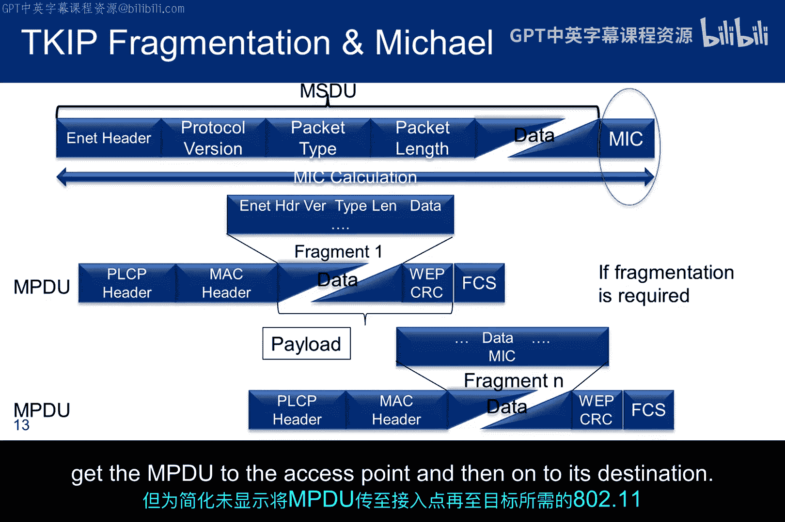

And the final WPA topic that represents an improvement on Web， it is the fourway handshake。

 I will provide a somewhat detailed discussion of each stage of the handshake since capturing a handshake and discussing the differences between WPA and WPA2 is part of the lab if you choose to do it。

This shows the key data pieces exchanged in the handshake。

 The Nos are critical to the calculation of the PT K。

 The handshake incorporates a just in time aspect， because as soon as the nos arrive。

 the K C Ks and or the K E K have to be calculated to protect the contents of the handshake before the handshake can continue。

 to say the key generating inputs are said， means the keys are loaded into the algorithm and will not change unless there is a new association and new Nos Of course。

 that just means the P K and the T SC is incrementing itself changing the actual encryption key for each packet。

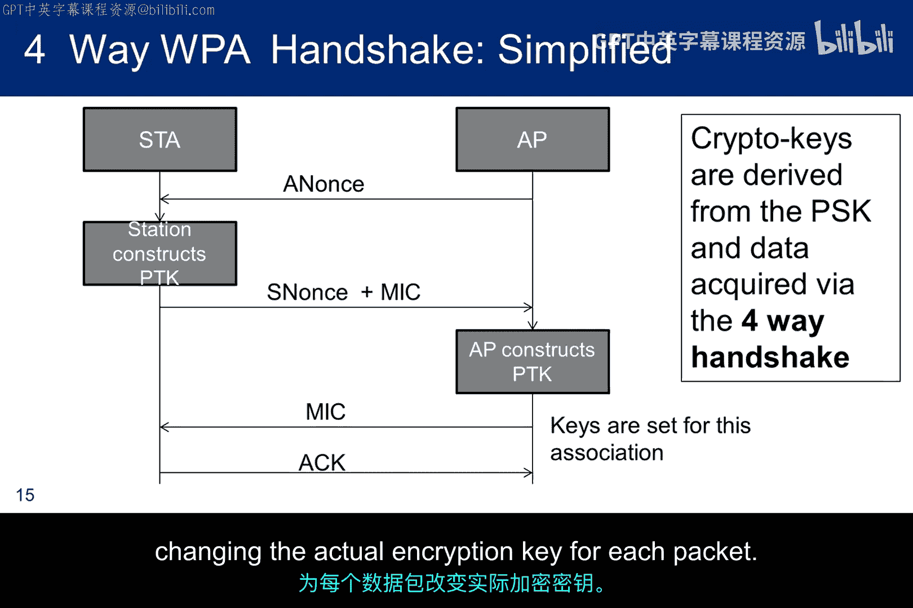

These are the steps in the farway handshake， and there are several important ideas that are summarized by each of the bullets。

 First， the Nas arrive just in time to support the PT K calculation， so the handshake can continue。

 Second， the M is calculated across the MSU， which includes the mix field。

 so that value must be set to 0 before doing the calculation。Third。

 the M algorithm used in the handshake is Hmac M5， not Michael。

 without the M being protected by the K C K。 An integrity error might result in the generation of different keys。

Fourth， there is an a at the end of the handshake that finalizes the switch to WPA encryption for data traffic。

 and finally， the handshake uses Eap POL keyframes。

 So capturing the handshake involves a collection of four packets identified by wireshark as the EAPPOL Pro。

 And a reminder， we are analyzing the WPA pre shared key authentication Handshake。

 not WPA Ense authentication with a radius server。

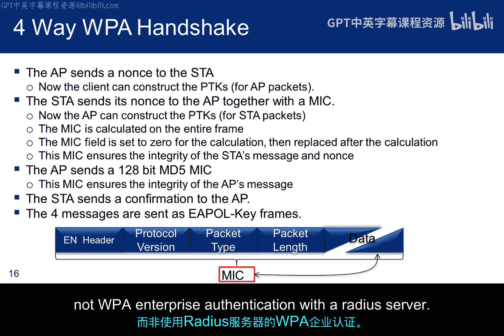

This shows the structure of the E A P O L messages， and obviously。

 the values are different for each of the four exchanges。

 The two red boxes just highlight important data elements to ensure the handshake can continue。

 The PT T Ks can't be calculated until the nonsenses arrive。

 and the mix field must be set to 0 before the mix is calculated。 And after the calculation。

 it is inserted into the field before transmission。Now。

 a short discussion of the fields in the E A PO L message。

 The descriptor type for WPA handshake has a value of 254， which is different than WPA 2。

The key information field contains several sub fieldss that provide information about the key type and how it should be used。

 It also contains various control bits to assist in the handshake procedure。

 The key length is provided in bytes。 Given the pairwise key approach。

 this represents the length of the right half of the P T K。

 even though the actual P T K is not sent in a keyframe。 It is the target key length。

 The replay counter is incremented with every message to detect any attempts at replay an old message。

 The exception is when this message is in response to an act， In which case。

 the replay value of the message being act is inserted。

 The key nos fields are the values that change with each association used to derive pairwise temporal keys。

 E A P， O L key I V is for group key transfer。 We won't discuss group key。

But if you are familiar with the concept， the GTK is encrypted using the EAPPOL key encryption key in conjunction with this IV value。

The encrypted GT K is placed in the key data area， the last field in the message。

Key sequence counter indicates the value of the sequence number to be expected in the first frame received after the keys are installed。

 This sequence number protects against replay attacks。

The key identifier is not used in WPA in the future it may be used to enable multiple keys to be set up in advance。

The key mix field is an integrity check value computed across the entire EAPPOL keyframe from the EAPPOL Procol version field to the end of the key material。

Key data length defines the number of bytes， and the subsequent key data。

Key data represents the material that needs to be sent in secret。 For example。

 in the case of the group key， this is the encrypted value of the GTK。In some pairwise key messages。

 depending on the implementation， this carries an information element。

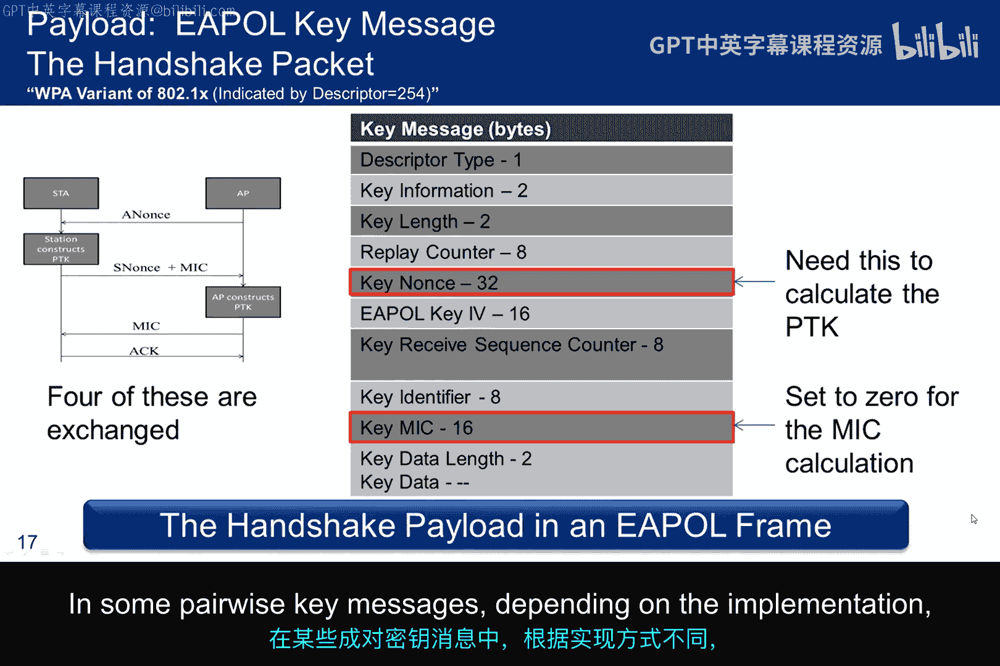

This is just a reminder that the M used in the handshake depends on the PT T K and just in time arrival of the nos。

 After the Hmac M D5 M is calculated， it is protected by Xorium with the K C。

 K before the E A PO L messages sent。

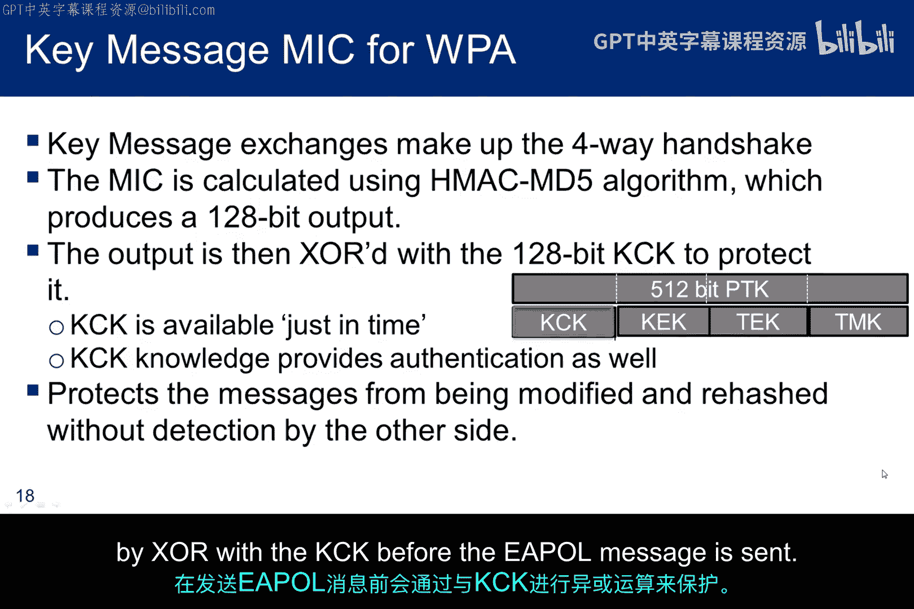

The next four slides will show the content when I captured a WPA handshake。

 It is assumed that your router is configured to use WPA2。

 and you are asked to compare the two and identify the differences。 for most of the fields。

 I have inserted comments about the content。 So I won't discuss them in detail。 One point， though。

 if you do do a WPA capture on your access point。 Your results may vary depending on the vendor implementation。

 If that is the case， you may find slight anomalies when you try to compare your WPA2 capture to this WPA capture。

In this segment of the handshake， the station has contacted the A P and requested access via open authentication。

 So the access point sends its nods to the station。 There is not much content here。

 The message just passes the nods indicatesates it is a pairwise key exchange and reminds the station that a response is required。

 It also sets the target length to 32 Bs and identifies the cryptographic algorithms to be R C 4 and Hmac M D 5。

 The last two values will differ for WPA 2。 Note that the target key length is 2，56， not 5，12。

 because it references the length of the T E K plus the T M K， not the whole PT T K。In this step。

 the station sends its nos to the access point。 Since the station has already received the A's Nos。

 it can calculate the PT T K and generate a mix for the content。When the A P checks the M。

 this will be proof to the A P that the station knows a secret passph。

 The presence of a M is indicated in the key information field。 The Act is set to 0。

 telling the A P that this is a response to the previous message and the A P is not expected to respond。

 Obviously， the A P moves on to the third step in the handshake。

 but it does not need to provide a mandatory response to the station's message。 Finally。

 if the message loses integrity because the MI calculation does not match the transmitted M。

 the cause is unknown， but the handshake will fail。This frame contains unencrypted key data。

 as shown at the bottom。 This is an information element that the station used to negotiate the security parameters during the association phase。

 I of the element at this step prevents a rogue mobile device from switching security parameters after the initial negotiation。

The data is not encrypted because the information element was sent in the open during the association and is not a secret。

 However， it is protected by the mix field and therefore cannot be altered。In the third step。

 the AP received the station's nos in step 2 and has now calculated the PTK。

If the mix received from the station is confirmed， the A P knows that both ends share the secret passph and the P Ks must be the same。

 So at this point， authentication of the station to the A P is complete。

 but the handshake is not finished。 Notice the install bit is set to one。

 indicating that the keys should be installed for use by both ends when the handshake ends in this step。

 the A P resends its nos with a mix based on the PT T K。

 which lets the station confirm that it has not established communications with a rogue access point。

The key data field sends a copy of the information element that the access point used in negotiating security during the association phase。

 but it is encrypted with a K E K。This is the final act sent from the station to the access point。

 agreeing to install the keys and go encrypted。This finishes the review of WPA changes to address the security problems in the Web。

 Next， I will discuss the differences between WPA and WPA2 and explain how a dictionary attack is run against WPA2。

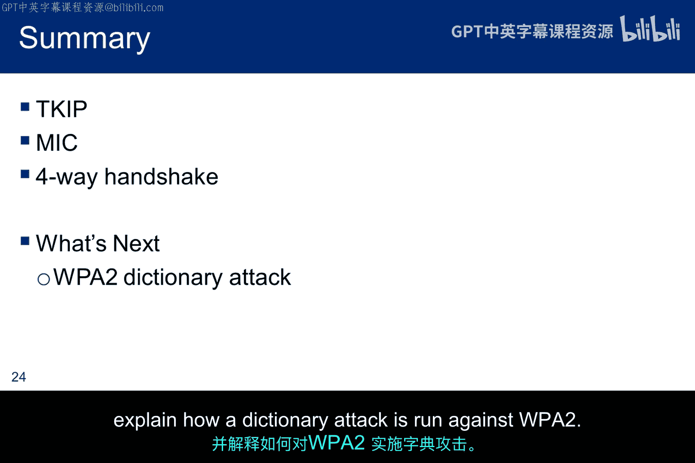