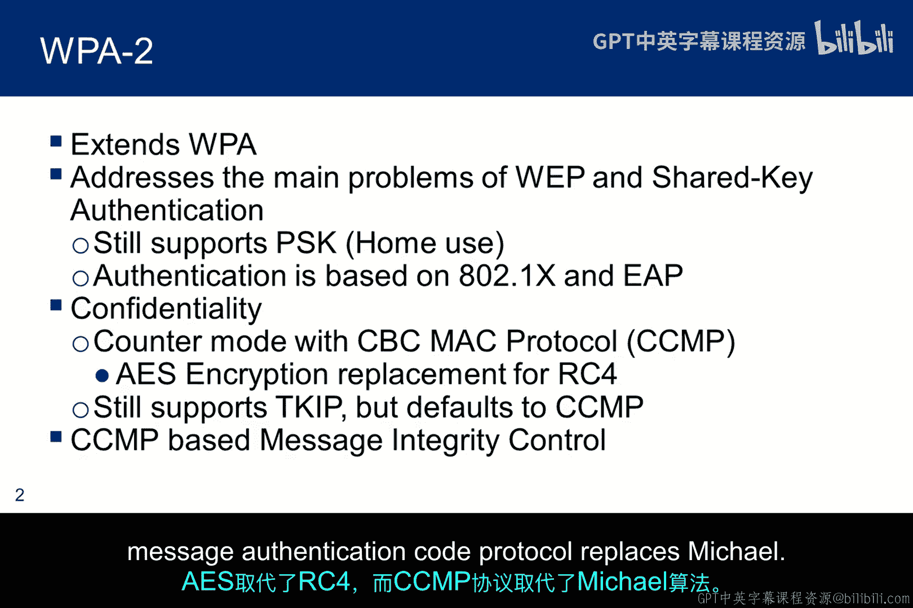
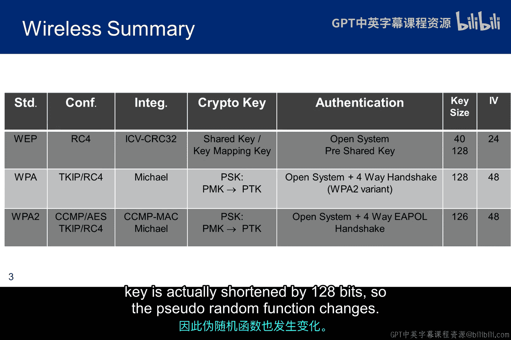
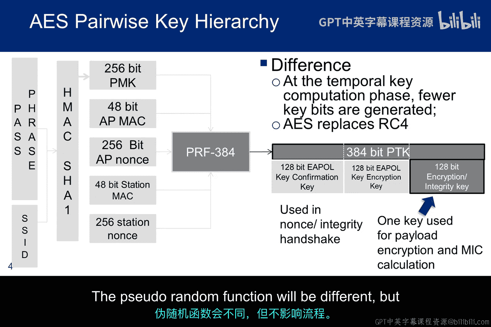
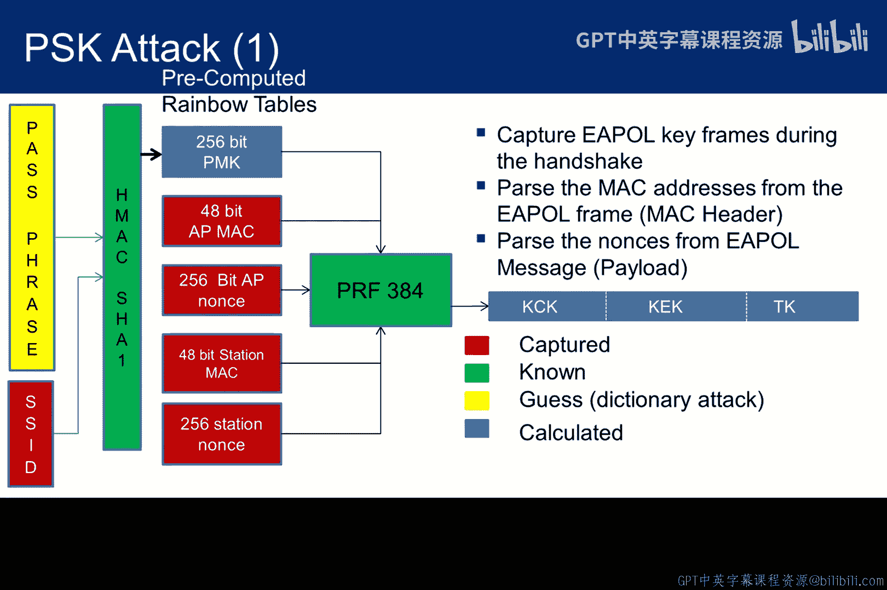
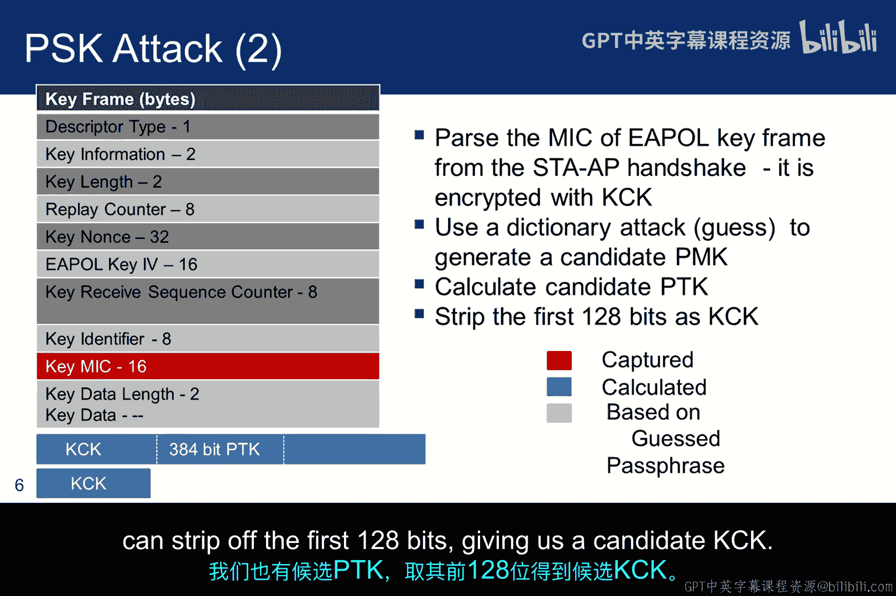
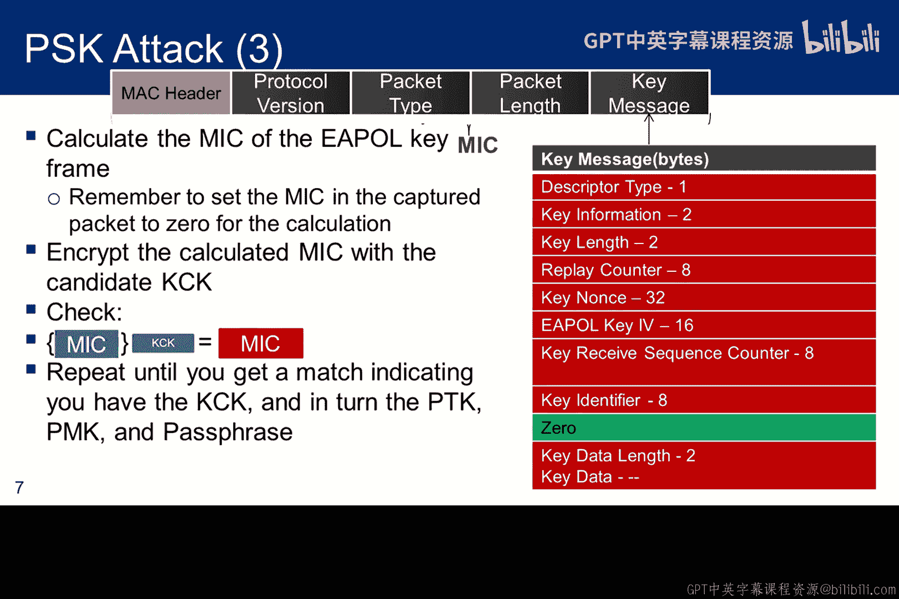
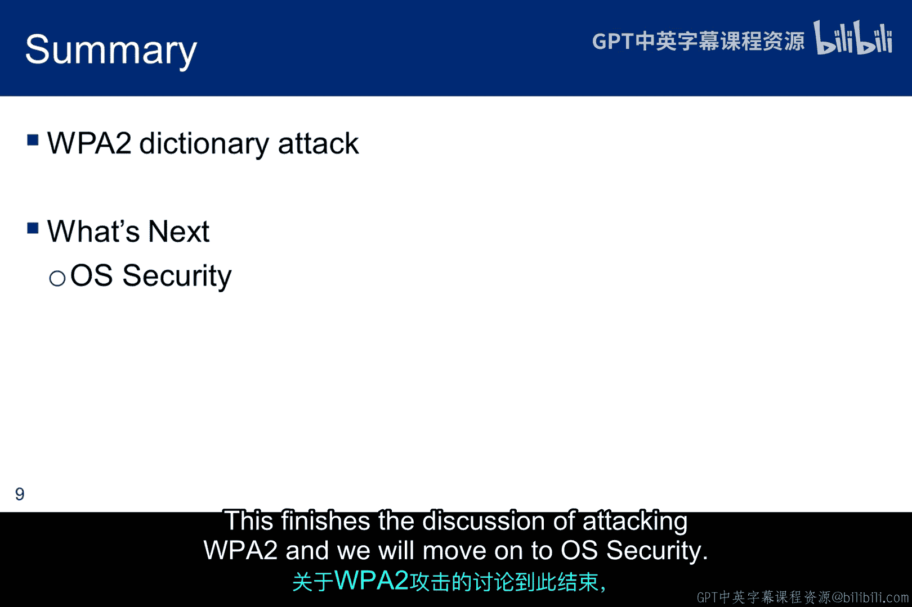

# 约翰霍普金斯大学《道德黑客入门｜Introduction to Ethical Hacking》中英字幕 p53 31_WPA-2字典攻击.zh_en -BV1xgu1z1Eau_p53-

In this submodle， I will briefly mention the differences between WPA and WPA2 and then discuss the way a dictionary attack works against either。

 although the diagrams will show WPA2。As noted already， WPA2 extends WPA。 In fact。

 WPA was designed to provide this kind of transition from Web。

 so WPA should work with most of the upgradable web hardware。

 but WPA also makes the transition to WPA2 seamless， even though new hardware may be required。

 WPA2 uses the same authentication mechanisms as WPA， but it does move to a new crypto suite。

 AES replaces R C 4 and a counter mode with cipherblock chain message authentication code protocol replaces Michael。

This table summarizes the various pieces of the 80211 transition from Webp to WPA to WPA2 to deal with the weaknesses in We。

 The fouraway handshake is slightly different， but the variation has no impact on our discussion。

 The major difference is thus cyber suite algorithms used。

 and the temporaloro key is actually shortened by 128 Bs。 So the pseudoran function changes。

The key generation process is basically the same S TC。

 except the PTK is 128 B shorter because a single key is used for both payload encryption and integrity calculations。

 The pseudoran function will be different， but that has no impact on the process。

Now， how does the dictionary attack proceed to begin。

 Not the color coating red is for information taken from sniffed packets。

 Green is for well known information like algorithms and random functions。

 Yellow represents the guest pass phrase that needs to be checked。And blue represents information。

 That is the output of some calculation。 So the first step in the attack is to capture a fourway handshake。

 which provides everything in red in this chart。 We guess at the passph or try an entry in the dictionary and then run everything through the two algorithms to get a candidate P T K。

 which for WPA is 384 Bs。 We don't know if the PT T K is correct or incorrect。

 So we need a way to check that。

When we captured the handshake， we captured three mix in the process， all protected with the K C K。

 I think the attack algorithm actually uses the third frame in the handshake and extracts the mix。

We also have a candidate PTK， and can strip off the first 128 bits， giving us a candidate， KCK。

So part of the attack goes like this， take the captured keyframe and set the mix field to0 and calculate the mix。

Now， encrypt the result with the candidate K CK and compare the mix we just calculated and encrypted with the one we captured in the handshake。

 If they don't match， it means our candidate K C K was wrong。 If they do match。

 it means the candidate K C K is the actual K CK。 And from that。

 we can infer that the initial passph was chosen correctly。

 We just cycle through the entire dictionary using this methodology for each entry。

 depending on the quality of the dictionary and the strength of the pass phrase。

 we may gain access to the encryption stream。

This is just a reminder of where the Rocky dictionary is found in Cali。

 The Rocky On classic video game Pass file was breached in 2009， providing 32 million passwords。

 which is a very good free dictionary that one can customize， enhance and save for future use。

 Actually， you should also cat the uncompressed Rocky file and pipe it to a grip on your password to see if you are at risk for a pretty simple dictionary attack。

嗯。This finishes the discussion of attacking WPA2， and we will move on to OS Security。

