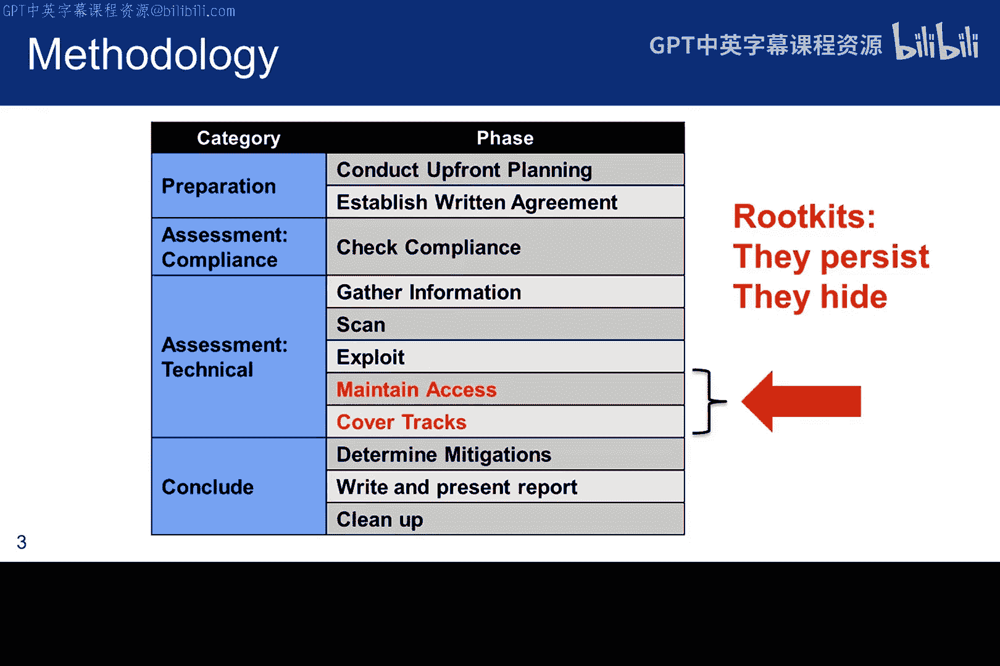
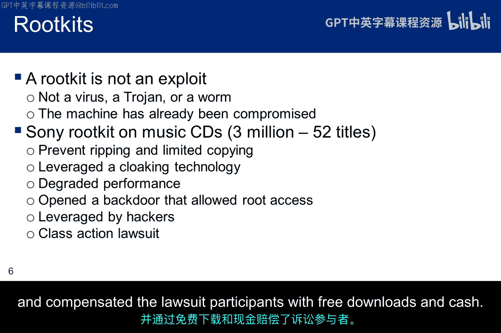
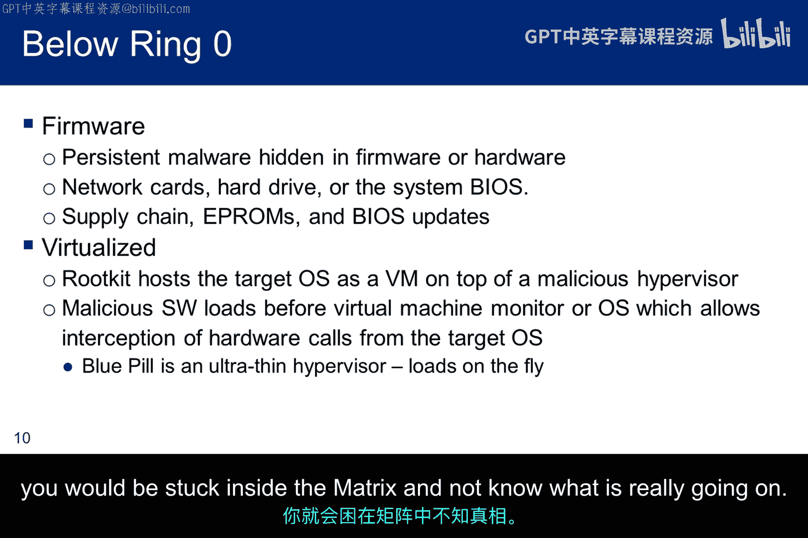
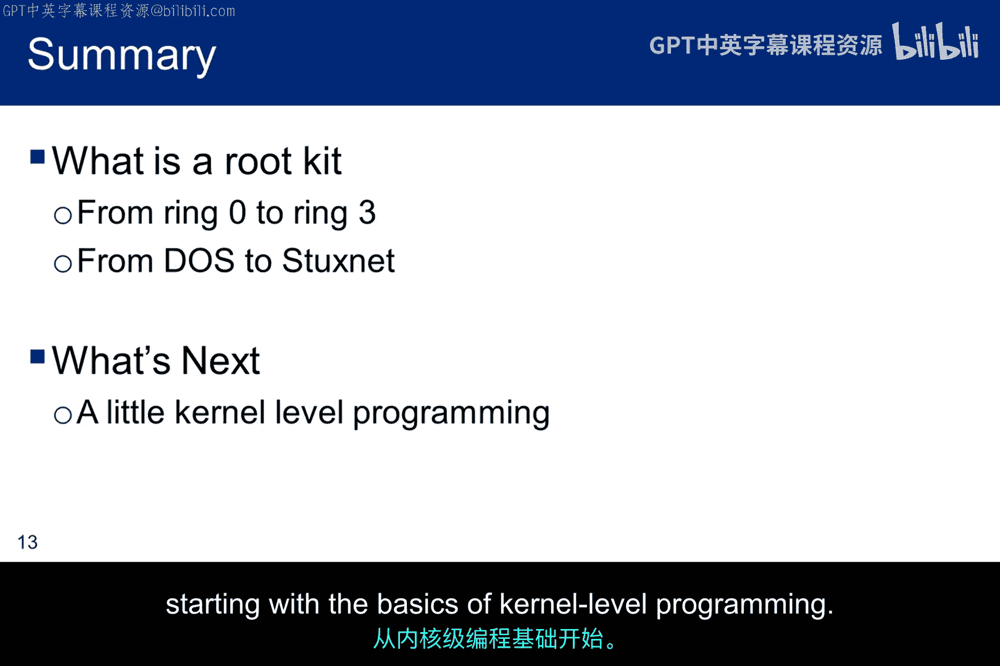

# 约翰霍普金斯大学《道德黑客入门｜Introduction to Ethical Hacking》中英字幕 p54 0_Rootkit技术解析.zh_en -BV1xgu1z1Eau_p54-

This lecture is a little unusual for an ethical hacking class。

 since customers don't even like back doors。 let alone root kidss。

 but root kits do fit with the objective of the course。

 which is to provide a path for protection of systems by showing how they can be attacked。

And most students who are neuralural in this course have never really figured out or been taught how root kits work。

 So I wanted to fill that gap。 There is some system level programming involved。

 and you may not have done much of that。 But I think there is enough guidance to help you over any rough spots。

A root kit does fit into our ethical hacking methodology in the context of maintain access and covering tracks。

 But it definitely extends these ideas beyond the boundary， normally associated with ethical hacking。

To day， root kits are usually used to hide the malicious actor's presence after an exploit。

 but they have actually been around for a long while。

 long before cyber attacks appeared on the horizon。😊。

The original route kits were modified versions of system programs like P S， Nettt。

 W and password that gave the authors rude access without the system administrator knowing about it。

Today day， this kind of precomed system software is less common in malicious code than hooks that intercept and modify the responses displayed to the user in order to hide a bad actor's activities。

Ken Thompson and Dennis Ritchie both received the Turing Award in 1983 for their work on Ex。

 I want to talk about Thompson for a minute because of his compiler based exploit against C to set the stage he designed and implemented the original Unix operating system。

 and the programming language that was the predecessor to C during this time period。

 he actually subverted the C compiler。 and he discussed this malware in the Turing award lecture he gave in 1983。

He modified the compiler to detect attempts to compile the Unix log on command and to generate altered code that would accept not only the user's correct password。

 but an additional password known to the attacker。 This is basically a pre compileiled root kit。

 The really interesting idea is the compiler would also detect attempts to compile a new version of the compiler and would insert the same exploits into the new compiler。

 Furthermore， neither of these attacks was present in the source code and could not be detected by a code review。

 The title of the lecture Refs on trust in trust is an interesting read and is readily available on the Internet。

Today day， root kits are a form of malware that hides other malicious malware on the system。

 Basically， they intercept calls to system functions that provide information to the user。

 and they modified the results displayed to the user。 For example。

 the output of a directory listing or a process listing would be hooked and modified to remove information associated with the malware。

 So the malware files would not be displayed in the directory listing。

 and the processes would not be displayed in the process listing。

But root kits are not exploits themselves。 A malicious actor cannot use a root kit to obtain unauthorized access to a system that he has not already compromised。

 They don't self replicate， infect other files or leverage vulnerabilities or unpatched software。

 Rather， they hide information on a computer that has already been compromised。

If you have never read about it， the Sony Ro kit is a pretty interesting story。 Basically。

 Sony put digital rights management software on C Ds。

 and that software was designed to prevent copying of those C Ds。 Of course。

 it did not inform the consumer in any way of the presence of this D RM software。Basically。

 when the C D played， the root kit got installed on the computer。

 It included cloaking technology to hide files， Reg keys and other system objects from users and it degraded system performance。

 It also prevented music from being ripped for iPods limited copying and it blocked copying from copies。

 And， of course， once hackers understood what was going on。

 They found ways to use Sony's root kit as a back door that provided root privileges。

 Once word got out to the public， it was determined that 3 million infected Cds had been sold。

 resulting in a class action lawsuit for computer tampering。 In the end。

 Sony recalled the affected Cds and compensated the lawsuit participants with free downloads and cash。

The first root kit on a PC in 1986 was called the Bryan virus。

 It slowed down the floppy disk drive and consumed some memory。

 making it unavailable to the operating system。 It was called a virus at the time。

 but it was also a root kit， because it intercepted and redirected Bo sector readed attempts。

 The malware resided in the boot sector。 and the original boot sector was moved and written to another sector where it was marked as bad。

 If a user tried to read the malicious boot sector。 They were redirected to the new location。

 and the original boot sector was displayed。This was early in the timeline for PCs。

 So flopppies were the target。 Bryan was relatively simple and lack code for dealing with hard disk partitions。

 So it avoided infecting hard disks through a bio check。 As an aside， many viruses at the time。

 did not build in this precaution and clobbered the hard disk。 So they were pretty destructive。

 Bryan often went undetected if the user did not notice the slow speed of the floppy disk access。

 partially due to this deliberate nondestructive approach with respect to hard disks。In about 2003。

 a root kit called Haer Defender became available for download。

 It was sort of a cookbook approach to creating a root kit。 It came with an installer。

 which had to run on the target machine。 a command and control server and a configuration file。

 The user just needed to enter into the configuration file， what needed to be hidden。

 Some of the options were tables， process of services and registry information。

 It was found in the wild for 10 years or so， but the threat has since been mitigated。

These are four basic types of root kits that I will introduce at a high level。

 The lab will require you to write a kernel level root kit。

 which is quite a bit more complex than a user level root kit。

 but provides more capability for the bad actor。Firmware root kits are persistent because they reside in firmware and can survive the installation of a new hard disk in an O S reload。

 The attack path is usually via the supply chain。 but Eproms and bioup or other options for infection。

 Virualized root kits attack the host Os running as a VM on a hypervisor Basically。

 hardware calls from the VM are intercepted and modified by the malicious hypervisor。

 Virtual root kits do not have to load before the operating system。 In fact。

 they can load into the operating system before promoting it to a virtual machine。

 The blue pill hypervisor， a wellknown example can allow the O S to talk directly to the hardware or it can shift the O S from having direct control of the physical computer to a VM living under the control of blue pill。

 Once the O S becomes a VM blue。Pill acts as an ultra thin hypervisor that lies dormant most of the time using virtually zero overhead and waits for interesting events。

 such as keyboard input。 The name blue pill comes from the movie。 The matrix。 in this movie。

 Mupheus explains to Neil that the matrix is an illusory world created to prevent humans from discovering that they are slaves to an external influence。

 Morpheus's words to Neo are。 This is your last chance。 after this， there is no turning back。

 you take the blue pill。 The story ends。 You wake up in your bed and believe whatever you want to believe You take the red pill。

 you stand Wonderland。 and I show you how deep the rabbit hole goes。

 So the blue pill leaves you in the matrix。 the red pill takes you out。

 And I guess Rowska's thinking was。 once the blue pill was installed。

 you would be stuck inside the matrix and not know what is really going on。

A kernel level root kit has unrestricted security access， but is more difficult to write。

 The complexity makes bugs common and any bugs encode code。

 operating at the kernel level may seriously impact system stability leading to discovery of the root kit。

 bootot kits， a subcategory of kernel level root kits。

 Compro bootloaders for machines with full disk encryption to intercept the encryption keys and passwords and persist into protected mode。

 an application level root kit is operating in user space。 So it is easiest to write。

 The main approach is to inject D L Ls into other processes to intercept and modify API behavior。

Clonnel level root kits can also be implemented as DL Ls， but as with Linux。

 you need root access to modify kernel behavior。 First。

 the attacker has to get a wrapper program to execute。 when it does。

 the wrapper extracts the DLL file and maps it into memory as a module and calls one of the functions to install the root kit。

 Since this requires root privileges。 Either you have to escalate or leverage a vulnerability to be able to inject the executable into another process。

 In the case of Stuxnet， the installer actually got injected into the antivirus software running on the target to help circumvent detection。

 By the way， Stuxnet also had a user level root kit used to hide activity in the programmable logic controller。

This was a brief introduction to the history of root kits。 Now。

 we want to start down a path of developing a simple kernel level root kit。

 starting with the basics of kernel level programming。

