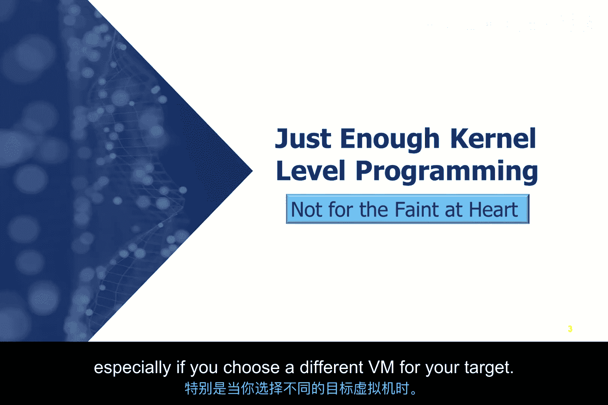
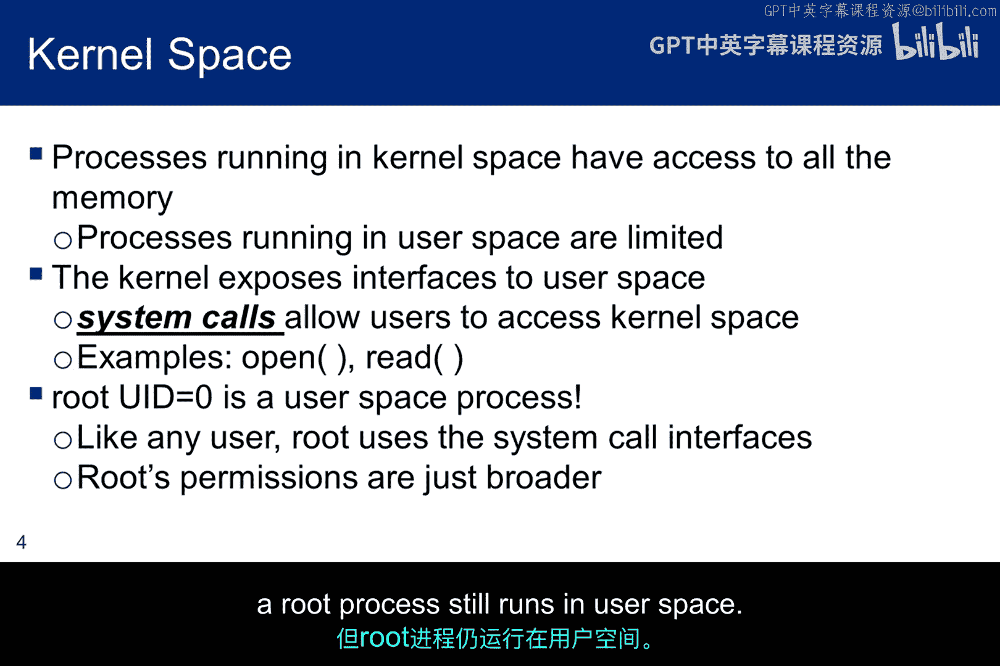
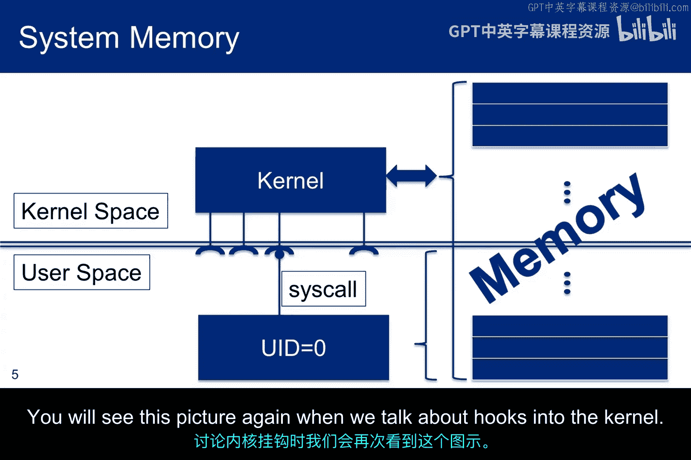
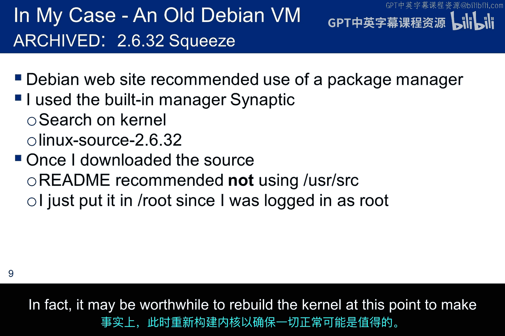
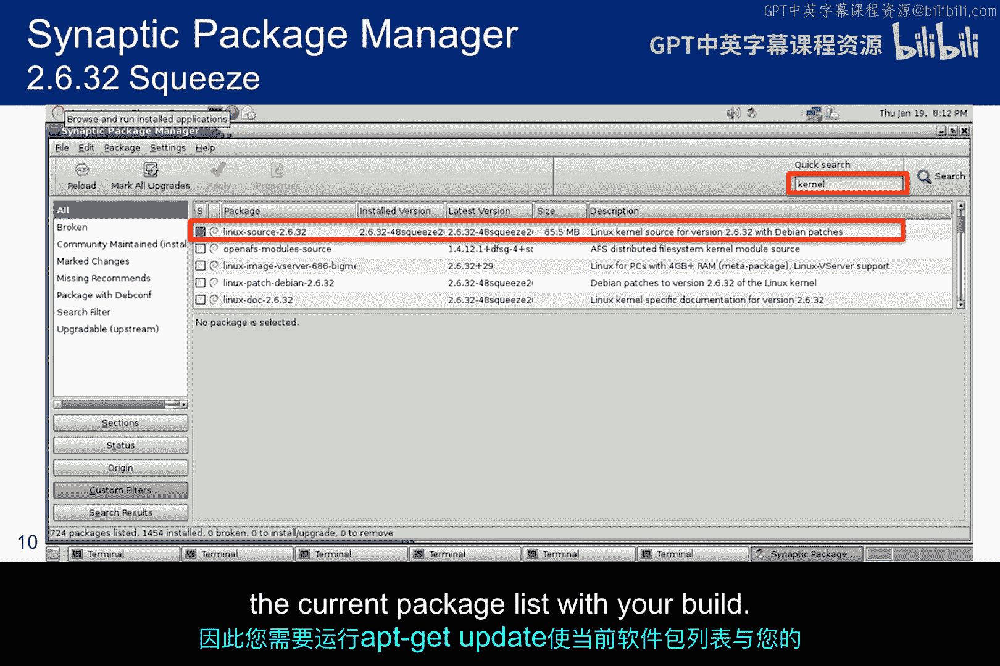
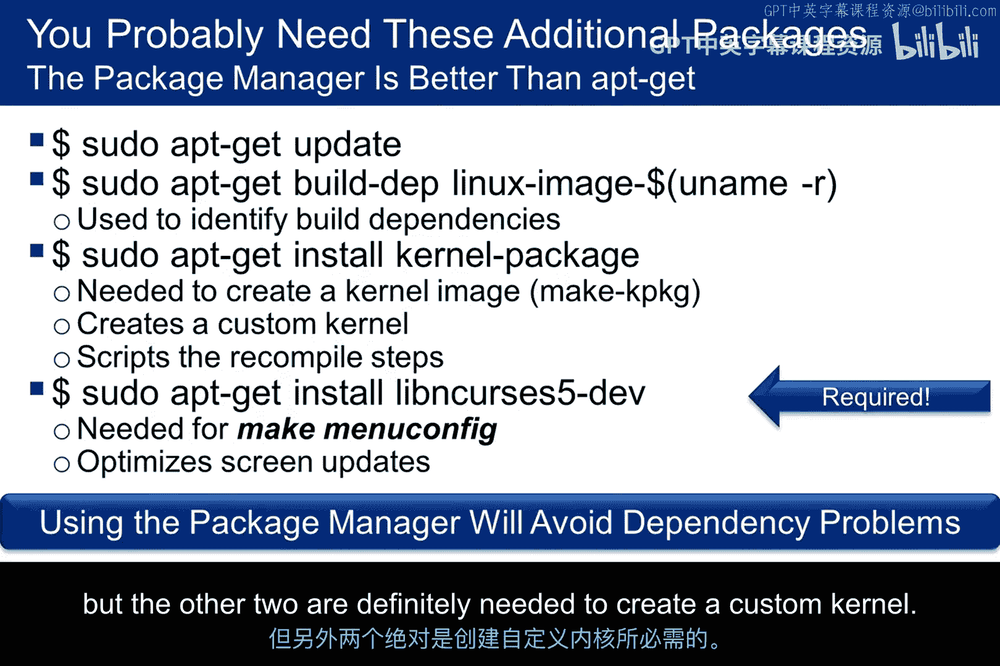
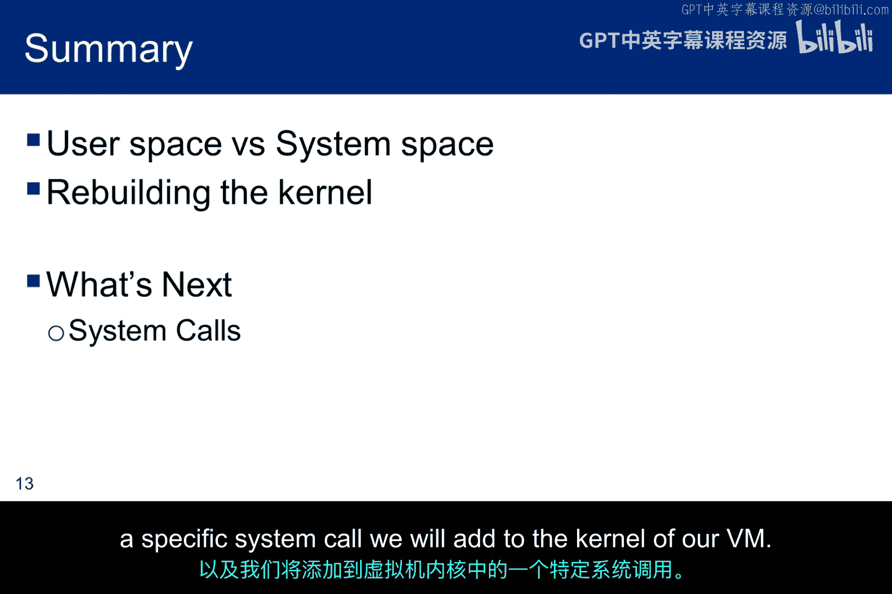

# 约翰霍普金斯大学《道德黑客入门｜Introduction to Ethical Hacking》中英字幕 p55 1_内核空间与用户空间.zh_en -BV1xgu1z1Eau_p55-

Colonnel level programming is necessary to develop a kernel level root kit。

 Even if you are a C programmer， you may not have had much experience with this。 Unfortunately。

 what is covered in this module will just scratch the surface。

 but it should be enough to get the root kit working and understand the fundamental ideas。

 I took most of my from basics of making a root kit from sis call to hook。But I am not positive。

 Donnus is the original author。 It seems to have been reposted many times by people claiming authorship At any rate。

 between the article and this lecture， you should be able to find your way through the lab。

 By the way， there are many ciscal tutorials on the Internet。

 But I did not find any of them very helpful。 as a result。

 I had to debug those elements of the root development piece by piece。

 and you may have to do the same especially if you choose a different V M for your target。

These are the topics we will cover in this module When we actually start to explore system calls。

 we will need to rebuild the kernel， so you will want to create another VM that you can reload if that process does not go smoothly。

 We will also explore loadable kernel modules， which are similar to D LLs on Windows and will actually hook the system calls as we proceed。

 you will see that root access is critical to the creation of a kernel level root kit because the L Km needs to run with kernel level privileges。

 The endga is to develop an L KM to hook a P call and hide one of the running processes。

The first step is to understand the difference between kernel space and user space as the hooking takes place in kernel space。

 When we have a pretty good intuition about what system level means。

 I want to start by diagramming exactly what takes place where。

The first important idea is that processes running in kernel space have unrestricted access to memory。

 While processes running in user space do not。 This， of course。

 is what you would expect to keep user level processes from trampling on each other。

 but a user process sometimes needs access to system calls and to facilitate this the kernel exposes interfaces to the user for functionality like opening a file in the file system。

 And a point you may not have understood is that rootown processes actually run in user space and use the same system call API。

Root privileges are far different from system privileges。

 Root has more permissions than a standard user， but a route process still runs in user space。

This is a diagram that shows the kernel has access to all the memory， while a user， even U I 0。

 does not。 The kernel exposes to Cis call interface to user space。

 and the system calls ask the kernel to provide the service through the interface。

 You will see this picture again when we talk about hooks into the kernel。

To start off， we are going to create our own simple system call so that we understand the details of how it works At the end of the module。

 we will hook an actual system call built into the kernel by developers。

 This approach of creating our own system call first means we are going to have to rebuild the kernel。

 I recommend you start with a Vm you don't care about in case it gets corrupted。

It is possible to take a snapshot of one of your existing Vms。

 but my conservative approach was to use a separate VM for a couple of reasons。 First of all。

 you probably did not download the source for the Vms you have already installed。

 And if you do that now， it is totally unclear how the source will align with the patches you have put in。

 You definitely want to run appgit upgrade before proceeding to make sure you have the latest package list。

 If you install a new Vm， you may not want to patch the kernel for this lab because kernel source that has been patch in various nonstandard ways may cause problems。

 For our purposes， we don't care about the patches anyway。 Second。

 an older version of Linux may be easier to understand and work with than the most recent version of Uuntu。

 In my case， I used an old Deian Vm。 You don't have to use Debian。

 but you will need to sort out the management of system calls。

Which may be handled differently Even a different version of the same OS can have the system call tables organized differently。

The assumption is that at this point， you have installed the V M and updated the package list。

 The next task is to download the source so you can recompile the kernel。

 You can download the source for the whole build or just the kernel source。

 Here is syntax for either approach。 If you just want to download the kernel source。

 Be careful that what you request from the kernel archive is precisely the version of Linux you are running。

 Although downloading your version will most likely be different than in the syntax shown here。

 it might be a good learning tool to visit the kernel archive and see if you can find the kernel source as shown in the W get statement。

As noted， the source usually needs to be in slash user slash source。

 but you should confirm that this is the case for the version of Linux you have decided to use。

 Here is the syntax for untring the kernel source downloaded previously to that location。

 after the tar command runs， the subtracty is identified by the kernel version。

I used an old Deieian V M since it was already installed in my virtual hacking environment。

 and I had been thinking about deleting it for some time as squeeze is now deprecated and archived。

 That means this build had been patch many times。 And I had no problems with source mismatch。

 So my earlier cautions may not be critical， at least for the colonel source。

When I visited the Deian website， I saw the recommendation to use a synaptic package manager rather than W Gt to download the source。

 So I started the package manager searched on kernel and found the Linux source I needed。

 Once I added the package the Readme recommended not using slash user slash source。

 So I put it into slash route。 You may encounter the same kind of differences for the VM you choose。

 work methodically。 So， you know， your kernel recompile will not go astray。 In fact。

 it may be worth while to rebuild the kernel at this point to make sure everything is working properly。

This screen shot shows my search for the kernel source using the package manager。

 The description actually says it contains all the deian patches。

 So you definitely want to run app get update to align the current package list with your build。

This screen shot shows the tarball and the source after untring in Root's home directory。

These are some additional packages that are required to rebuild the kernel。

 And using the package manager instead of app get is probably the best approach for all of these as the package manager does a really good job of resolving dependencies。

 So the packages you want are build Depp kernel package and Lin curses 5。

 you may not need build Depp。 If you are using the package manager。

 but the other two are definitely needed to create a custom kernel。

I have explained the difference between user space and system space。

 noting that route is just another user with additional privileges。

 I have also discussed the steps for downloading the source and additional packages you need to recompile the kernel。

 Next， I will talk about system calls and a specific system call。

 We will add to the kernel of our V M。

