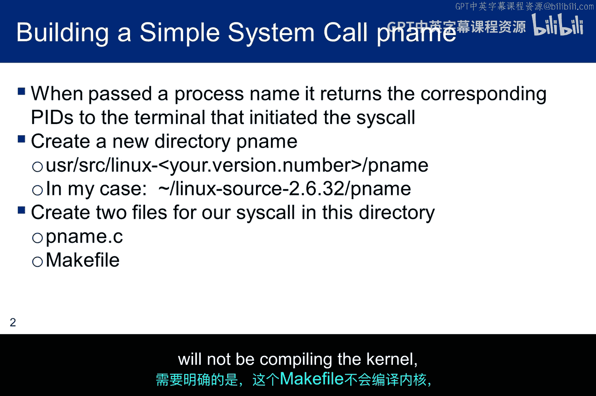
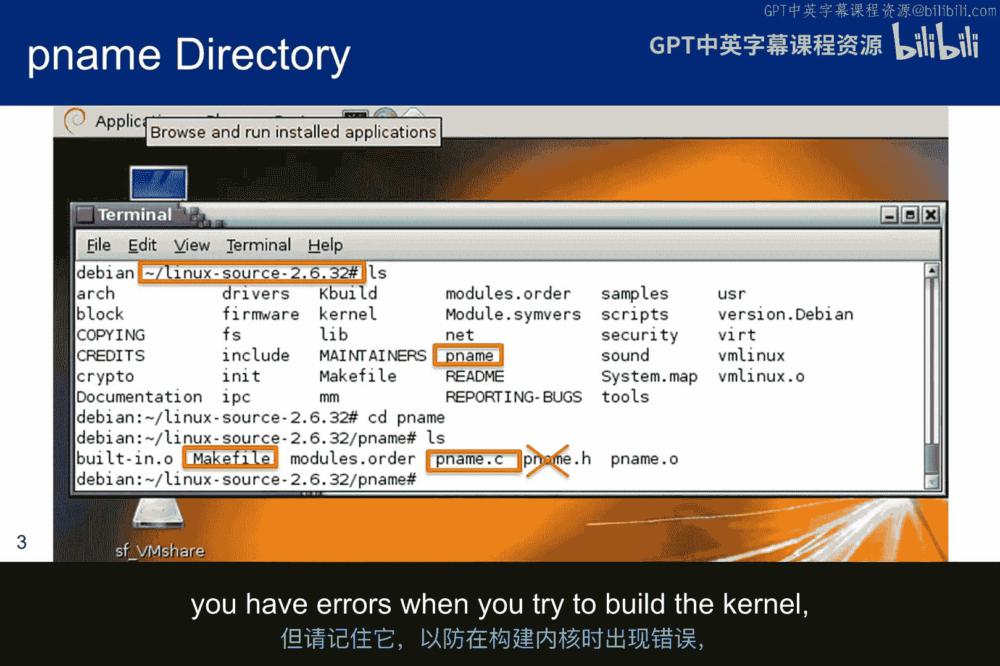
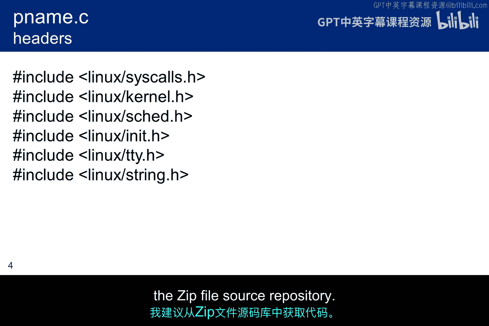
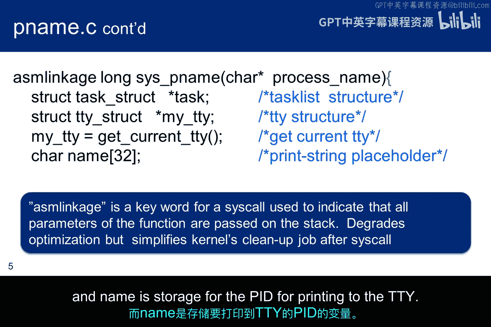
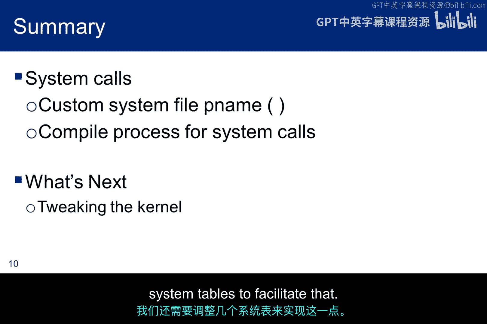

# 约翰霍普金斯大学《道德黑客入门｜Introduction to Ethical Hacking》中英字幕 p56 2_系统调用机制.zh_en -BV1xgu1z1Eau_p56-

Now， we are going to add our own system call to the kernelel and then recompile the kernel。

The simple cis call will be called P name， and it is a very simple program used to pass in a process name on the command line and have the process I D written to the terminal。

 When there is more than one instance of the process， you will get a P I D for each to start off。

 we need to create a new directory for our program。Since the program is called P name。

 we need to create a P name subdirecty in the source tree。 There will be two files in this directory。

 The program itself， P named C and the make file to compile the program。 To be clear。

 this make file will not be compiling the kernel。 Just the C program。

This shows my source directory for P name。 And you can see P name C and the make file。

 ignore P name dot H for now。 I believe this is a bit of a red herring in doughuts paper。

 I did not find it necessary for compiling P name。 but keep it in the back of your mind in case you have errors when you try to build the kernel。

 which will run the make file to compile P name。

These are the headers to include in P namedd on C。 Be careful about cutting and pasting because of the stylized characters that Powerpointint and Adobe reader may use。

 I recommend you take the code from the zip file source repository。

This is the first part of our program。 ASM linkage is a keyword for a system call that defines how parameters get passed。

 Notice that the name for the call starts off with cis underscore。

 which is important for keeping track of system calls。 Also。

 the open bracket is not closed on this slide， but will be closed on the next slide at the end of the program。

 If you don't have much experience with C。 These are simply the structures for managing the data。

 task contains the names of their processes running。

 T T Y just keeps track of the terminal for printing out the PD。

 and name is storage for the PD for printing to the T T Y。

This is where the conversion from process name to P I D takes place and where the results are sent to the screen。

 The system call accepts a process name from the calling program and compares it to a list of running processes。

So the system looks at the process scheduler and compares the running process names with the name passed in。

 If it finds a match， it prints out the P to the user's terminal。

 So the loop depicted here in green brackets cycles through all the running processes and the red brackets are commands to print the PD when a name match is found。

In the S print S statement， the L D format is just for long decimal。

 which is how the P I D is held in the kernel task structure。

 and the S print F behaves like print F in terms of format statements。 But in this case。

 puts the P I D equal into a string buffer pointed to by the name and appends a null automatically when the string ends。

 Finally， it uses the right command to write the string to the screen。

 But since the kernel is doing the writing， it needs to determine the user's T T Y to make sure it goes to the right place。

This is just a screenshot showing the source on my VM。And the make file is a simple one line file。

 It is in a sub directory under source， and it is going to be called by the Colel build Program's parent make file。

This is how the K build recompiles the kernel。 It runs through all the source subtractories and finds all the O B J Y files First。

 then it compiles each into an object file， once they are all compiled。

 a loader program merges the individual object files into a single object file called built in。

 which is not a loadable file， Finally， built in is linked into VM Linux by the kernel's make file。

I' have explained the workings of the custom system calls。

 and I have described the recompile process at a high level。 But at this point。

 P name will not be built when we recompile the kernel。

 We still need to tweak a couple of system tables to facilitate that。

