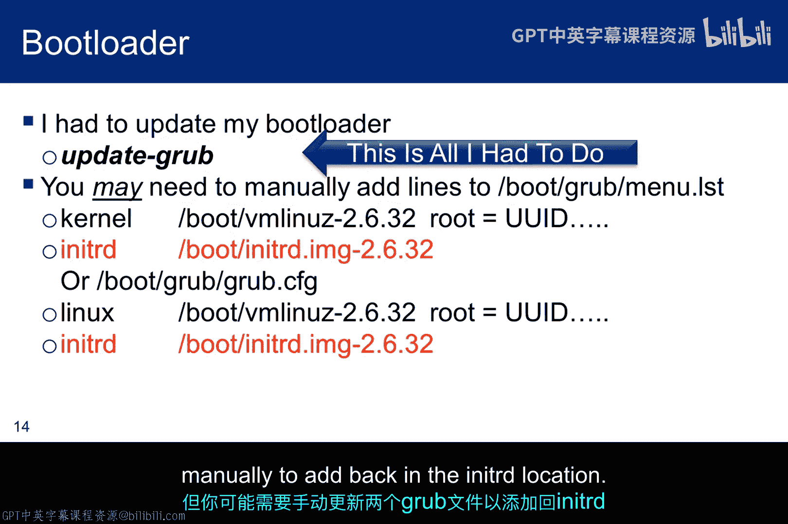
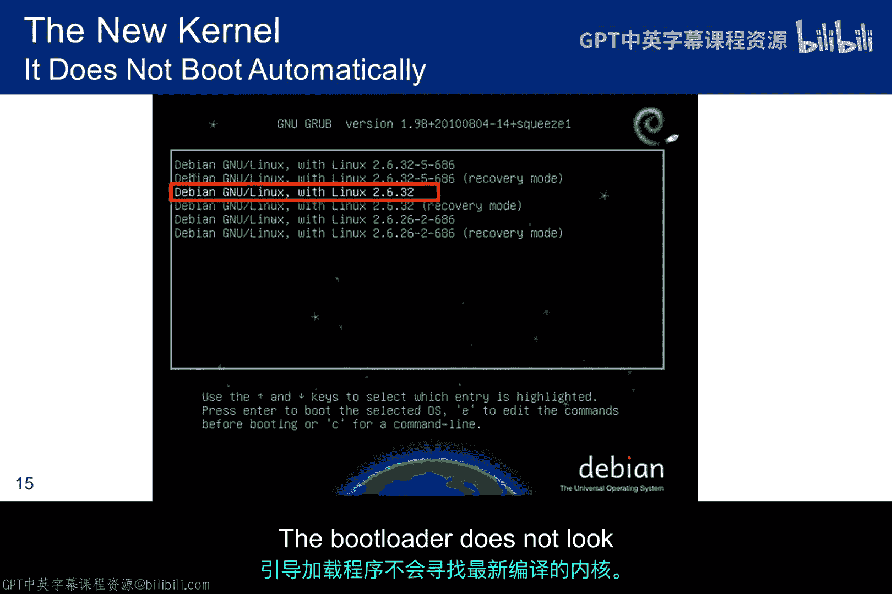
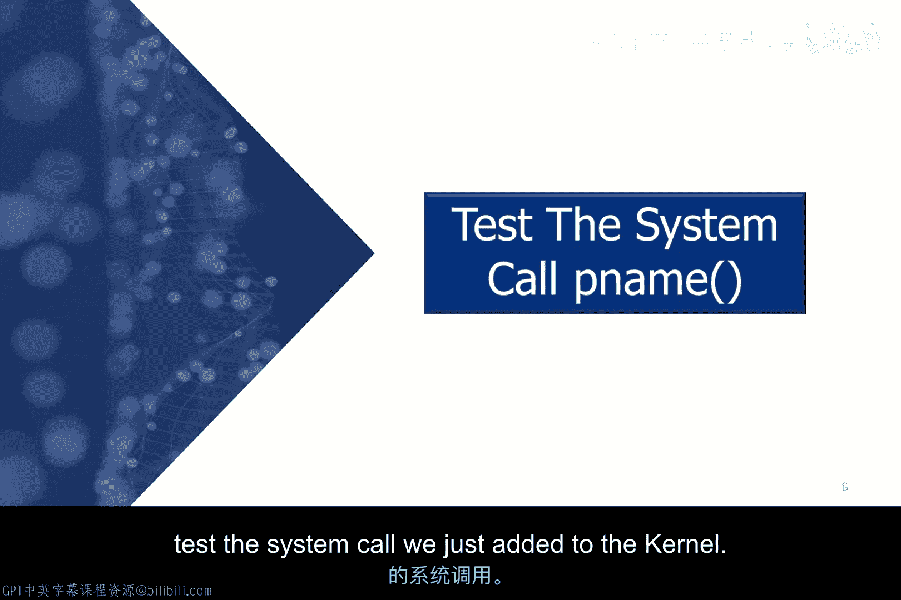
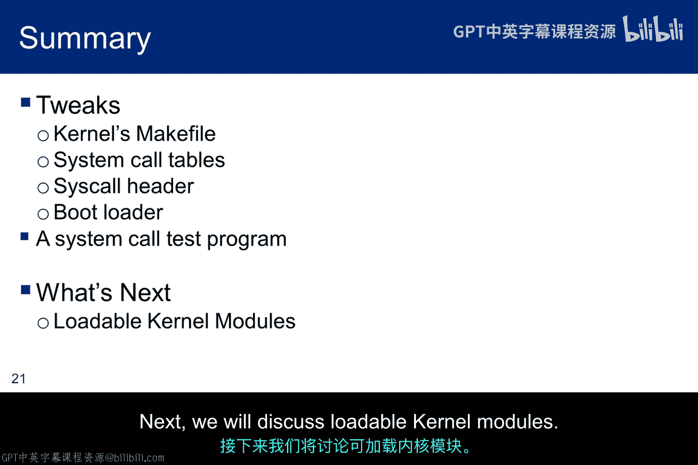

# 约翰霍普金斯大学《道德黑客入门｜Introduction to Ethical Hacking》中英字幕 p57 3_内核参数调优.zh_en -BV1xgu1z1Eau_p57-

We have created the custom system call， but there is still much work to be done to get it to build with the kernel。

 The system tables need to have the system call added。

 and the kernel make file has to have the new program added to it， as well。

These are the adjustments we have to make to build a customized kernel with a new system call P name。

 Step 1，3 and 4 are pretty straightforward， but step 2 will be complicated because your build will probably handle system calls differently than mine and probably differently than the version discussed in doughuts paper。

That means you are going to have to do some critical thinking。 Inject a little goo fo。

 and just plain analyze the kernelel tables to get the call to work。

The first bullet tells you where the kernelel's make file should be located at the top level of the source tree。

 A reminder， the Deian website said not to use slash user slash source。

 So I put it in roots home directory。 Once you have located it， editit this file and make one change。

 add P name slash。 You should be able to do a search on core pack Y and find the line quickly。

 Then just add P name slash to the end of the line。

 This tells the compiler to look in the P name directory for the child make file。

This is a screen shot of my make file with P name added。 again， the caution。

 it should be P name slash， not slash P name。Next， we have to add P name to the cis call table。

 So it has a call number。 This is where everything gets tricky。

 This slide will describe the process for Linux 3，1636。

 And the next slide will describe it for Linux 2，6，32。

 Your call table structure may be completely different。 And if that is the case。

 you will need to figure out what to do。 The discussion forum may help。

 but do some digging on your own and don't depend on that。For 3，1636。

 the system call table can be found at arch X 86 cis calls from the top of the source tree and is called Cis call underscore 64。

 you need to identify the last call number in the table and incremented by  one for the P name system call。

 In this example， the last system call was numbered 3，1，9。

 So the new entry would have three elements。 The system call number。

 the C program name and the system name given in the ASM linkage call prototype。 So for 31636 build。

 the entry would be 320 space common space P name， space cis underscore P name。Unfortunately。

 this may not work for your build。For my older Deian build。

 the system call table was in a slightly different location， and the file name was quite different。

 including the file name extension， which had changed from dot TBL to dot S。

I wasted some time trying to find it by searching for cis calls plural rather than cis call。

 And I can think of many ways this might be modified。

 So be creative if you have trouble finding your cis call table。

 One useful approach might be to search the internet for system call tables combined with your Linux version number。

 Hopefully， a search like that will return the file name。

The complication for me was the cis call entry was broken into two pieces， not a single entry。

 As with version 3，1636。 The prototype name went into the cis call table。

 but the call number was defined in a header named you and I S TD underscore 32 dot H。

 which required two changes。 I had to add the new system call entry。

 and also increment the number 4 in our underscore Cis calls。

 finding this link between Cis call underscore table underscore 32 dot S and Unied 32 H was challenge。

 especially since they were in totally different parts of the directory tree。

 This is a screenshot of my cis call table with a new entry。

 I just followed the pattern for the rest of the table。

And this is a screen shot of the updated header file。 Again。

 I just followed the pattern for the changes。The third task is to add the name for our cis call prototype to the Cisca dot H file。

 Fortunately， my cisca dot H was in the same location as 3，1636。 So the change was easy。

 Just add the prototype from the P name source to the header file。

 This basically tells the compiler how this system call passes parameters。

And here's a screenshot of myscalls。 edge file with the prototype name for the new system call。

And that's it。 However， before we can compile the kernel。

 we have to run make menuconfig a tool used to configure Linux source。

 a necessary step in compiling the source code that will allow the user to choose the features and options of Linux that will be compiled。

 In our case， you should be able to just accept the default configurations when prompted by make menu config。

 Now you can start the kernel recompile by typing make from the directory where you found the kernel's make file。

 probably the top level source directory。 The build is going to take a while。

 So watch for immediate errors and then go get an espresso。 Once the kernel is built。

 you need to install the new version with the command， make install， make modules underscore install。

 I actually run the installation with separate commands But combining them into one should be fine。

 After the new kernel is installed， cross your fingers and reboot the system by typing reboot。

Once again， my old Deian build did not make things easy。

 I got a kernelel panic telling me the colonel could not mount the file system。

 It turned out that a file was missing in the boot directory。

 I'm not entirely sure why this happened， but the good news was it was not a rare occurrence。

 So I was able to find some guidance on the problem。 The fix was pretty simple。

 There is a program available to recreate the int R D file。

 Why this is not part of the build script is kind of a mystery。

 but this is the reason it may pay to create a new V M for this lab。

 Just in case you can't recover from a panic error。

 This is a strangeshot of the boot directory after the int R D file was recreated。

Depending on how your system loads， you may need to update the boot loader。 In my case。

 update ta Grub did the trick， but it is possible you will have to update two Gr files manually to add back in the N R D location。

Finally， you will most likely have to select the new kernel from the boot loader menu。

 as the system will automatically boot with the last kernel used。

 The boot loader does not look for the most recent compiled kernel。

Now， we need to create a simple C program to test the system call we just added to the kernelel。

These are the headers for Ke P named dot C。 Notice the uned Got H header。 recall。

 that is where the new call number is found on my old Deian system。

This is a simple program that prompts the user to enter a process name， reads the user input。

 parsees a string and creates a token。Then the system call is made by the number we added to the Cis call table。

 and the process name is passed to it。 The system call prints out the P I Ds and then passes status back to test P name。

Compile a simple program with the JCC compiler， Then open two terminals in the first one。

 run test P name and enter the name of the shell you are running when prompted in the second one。

 list the running processes and Gr on the shell name。

 you should see test P name displaying the same P I Ds as P。 S。 If not。

 you have a problem and need to review everything above。Here is a screen shot of test P Na output。

 I was using bash on Debion， and you can see I had three shells running。

 The system call printed the P I Ds to the Q， T Y and returned no errors to the calling program。

 Test P name C。I have talked about the places that P name or cis underscore P name have to be added to get the system to see and build in the new system call。

 And I described the problems I had to solve to get the build to complete。 Hopefully， this will help。

 and your recompile experience will go more smoothly than mine。

 Once the colonel had a new system call。 we were able to create a simple program to call it Test P name gott C。

😊，Next， we will discuss loadable kernel modules。

